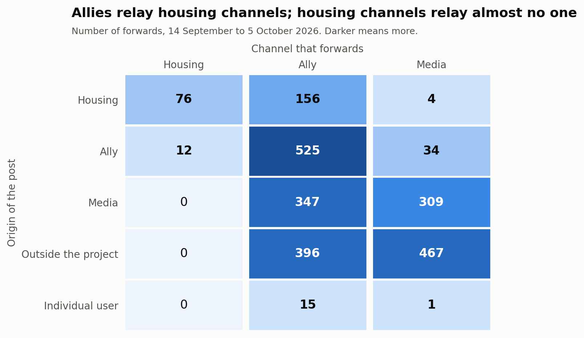
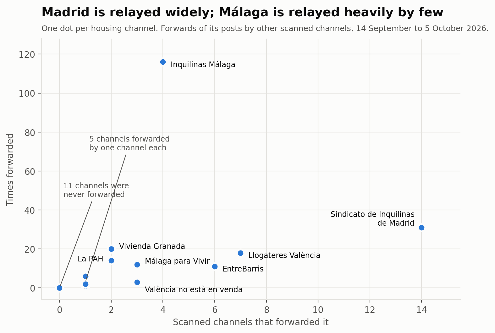
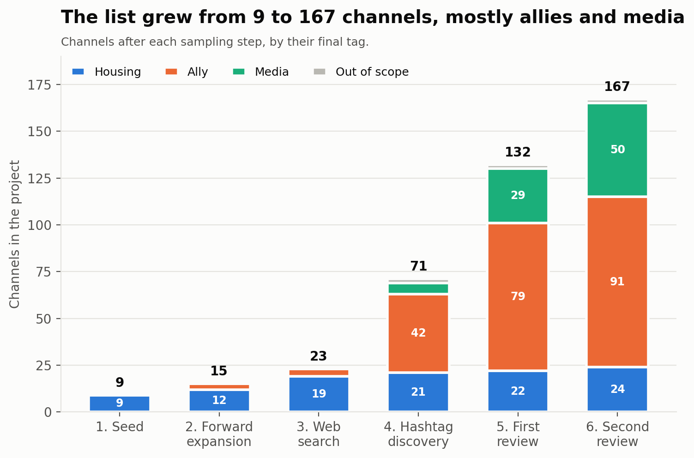

# Project `acampadas_vivienda` — Technical Report

Telegram channels of the Spanish housing movement and their allies during the
September–October 2026 housing camps: how the channel list was built, how channels were
classified, and what the forwarding and mention networks show.

- **Report date:** 2026-10-05
- **Observation window:** 2026-09-14 to 2026-10-05 (21 days, starting eight days before
  the Maricarmen eviction)
- **Tool:** tgmon (this repository), with two options added during the project
- **Data:** public Telegram channels and groups only, read without joining

Companion documents: [external_review.md](external_review.md) (tagging rule and
decisions), [external_review_log.csv](external_review_log.csv) (evidence per channel),
[community_analysis.md](community_analysis.md) (community detection in detail).

---

## 1. Summary

1. **The project holds 167 channels:** 24 housing channels (`in-scope`), 91 allies,
   50 media and 2 out-of-scope. It grew from a 9-channel seed through forwards, a web
   search, hashtag discovery and two reviewed rounds of snowballing.
2. **22,111 messages were scanned** in 165 channels, giving 2,403 forward events and
   5,753 link events (@-mentions and t.me links), of which 2,049 point to another
   account.
3. **The graph has 778 nodes and 1,115 edges** (541 forward, 574 link). Only 165 nodes
   are scanned project channels; the rest are accounts they forward or mention.
4. **Housing channels are sources, not relays.** Allies forwarded housing content 156
   times; housing channels forwarded ally content 12 times. Housing channels almost
   never link to other Telegram accounts.
5. **The Sindicato de Inquilinas de Madrid is the one hub.** It is forwarded by 14
   channels and mentioned by 6, across Madrid, València and Andalusia. No other
   housing channel is relayed by more than 7.
6. **Forwarding of housing content starts with the eviction.** Forwards of housing
   channels' posts go from 0–2 a day before 23 September to 20 that day, and peak at
   35 a day on 29 September and 1 October.
7. **There is no single housing community.** The network is strongly clustered
   (modularity 0.67 on forwards) by territory and political current: Madrid, València,
   Málaga, the PAH, Podemos, antifascist info channels. Housing channels sit in 8 of
   the 19 whole-graph communities.
8. **Territorial housing clusters do not forward each other.** The PAH cluster is
   closed; València and Málaga are self-contained; the only cross-territory tie between
   housing channels is one València channel forwarding the Madrid union once. Only
   Madrid union posts travel across territories, and they do so through allies.
9. **The two camp channels are not forwarded by anyone.** Acampada26s (Madrid) and
   Acampada per l'habitatge (Barcelona) appear only through mentions.
10. **Volume is concentrated in a few relays.** Five channels make 60% of all forwards
    (Red TEJAR alone 24%), and one channel makes 62% of all outgoing mentions
    (Malditaultraderecha). Weighted measures mostly describe these channels.

---

## 2. Context

Background gathered from press and Wikipedia on 2026-10-05; sources disagree on some
details, noted below.

- **The eviction.** Maricarmen Abascal, 87, was evicted from the flat in Madrid's
  Retiro district where she had lived since 1956. Press sources give 22 or 23
  September; the Madrid union's own channel announced it for 23 September, with a
  support act on the 22nd. The owner is the company Urbagestión. An agreement on about
  28 September let her return.
- **The camps.** A march on 26 September ("26-S") ended with a camp at Puerta del Sol.
  Camps followed in Barcelona, Sevilla, Málaga and other cities from 28 September, and
  in València, Alacant, Granada and Oviedo around 3–5 October.
- **The decrees.** The government approved two housing decree-laws on 29 September.
  Congress voted them down on 2 October. "Decreto Maricarmen" is used both for the
  union's five demands and for the government's package.
- **Tension in Sol.** On 2 October a message circulated saying the Madrid union would
  leave Sol; some outlets reported it and one reported a denial. One outlet reported
  that Coordinadora Juvenil Socialista was taking a growing role in the camp.

---

## 3. Results

### 3.1 The channel list

| Tag | Channels | What it covers |
|---|---|---|
| `in-scope` | 24 | Tenant unions, PAH groups, housing assemblies, the two camp channels |
| `ally` | 91 | Parties, unions, social centres, movement agendas, solidarity and anti-repression groups, individuals' channels |
| `media` | 50 | News outlets, magazines, publishers, commentary and info channels |
| `out-of-scope` | 2 | A forum-thread bot and a meme channel |

All but one are broadcast channels; Acampada26s is a group.

The 24 housing channels by territory: Madrid 6 (Sindicato de Inquilinas, Movimiento de
Vivienda de Madrid, Carabanchel, Tetuán, PAH-VKS, Acampada26s); Catalonia 7 (Sindicat
de Llogateres, PAH Barcelona, PAH Catalanes, PAHC Baix Montseny, Les Corts, Sindicat
d'Habitatge Socialista, Acampada per l'habitatge); València 5; Málaga 2; Granada 1;
Mallorca 1; and two state-wide channels, La PAH and Cuadernos de Trabajo (on
organising methods).

Three housing channels posted nothing in the window: Grup d'Habitatge de Les Corts,
Sindicat d'Habitatge Socialista de Catalunya and Cuadernos de Trabajo.

### 3.2 Volume and timing

| Measure | Value |
|---|---|
| Messages scanned (last scan of each channel) | 22,111 in 165 channels |
| Forward events | 2,403 (61 self-forwards) |
| Forward origins | 2,340 channels, 41 hidden names, 16 users, 6 groups |
| Link events | 5,753 (3,704 self-links) |
| Link events to another account | 2,049: 1,779 @-mentions and 270 t.me links |
| Median delay between original post and forward | 0.9 hours |
| Forwards within 1 hour / 24 hours | 51% / 91% |

Forwards per day, all channels and those whose origin is a housing channel:

| Period | All forwards per day | Forwards of housing channels per day |
|---|---|---|
| 14–22 Sep (before the eviction) | 48–115 | 0–2 |
| 23 Sep (eviction) | 142 | 20 |
| 24–26 Sep | 77–103 | 2–7 |
| 27–28 Sep (after the march) | 120–140 | 12–25 |
| 29 Sep – 2 Oct (decrees, Congress vote) | 150–176 | 26–35 |
| 3–4 Oct | 103–115 | 13–17 |

5 October is a partial day and is left out.


*Figure 1. Forwards per day: all forwards made by scanned channels (top) and forwards of posts by housing channels (bottom), with the main events marked.*

### 3.3 Who forwards whom

Forward events between roles (origin → forwarder), self-forwards excluded:

| Origin \ Forwarder | core | ally | media |
|---|---|---|---|
| core | 76 | 156 | 4 |
| ally | 12 | 525 | 34 |
| media | 0 | 347 | 309 |
| external (not in project) | 0 | 396 | 467 |
| user | 0 | 15 | 1 |



*Figure 2. Number of forwards by origin and forwarder role. Hidden-name origins are counted as outside the project.*

- Housing channels forward almost only each other (76) and a little from allies (12).
  They forward nothing from media or from outside the project.
- Allies are the relays: they forward allies, media, outside sources and housing
  channels.
- Media forward media and outside sources, and housing channels only 4 times.

Link events between roles (referenced account → channel that references it):

| Referenced \ Referrer | core | ally | media |
|---|---|---|---|
| core | 3 | 70 | 1 |
| ally | 0 | 192 | 26 |
| media | 3 | 187 | 8 |
| external | 0 | 895 | 38 |
| unidentified handle or user | 25 | 338 | 263 |

Housing channels reference other accounts 31 times in total, 25 of them handles that
could not be matched to a Telegram account.

### 3.4 Housing channels one by one

| Channel | Forwarded by (channels) | Times forwarded | Forwards made | Mentioned or linked by (channels) |
|---|---|---|---|---|
| Sindicato de Inquilinas de Madrid | 14 | 31 | 0 | 6 |
| Sindicat de Llogateres València | 7 | 18 | 1 | 0 |
| EntreBarris | 6 | 11 | 10 | 0 |
| Sindicato de Inquilinas de Málaga | 4 | 116 | 2 | 0 |
| Málaga para Vivir | 3 | 12 | 44 | 2 |
| València no està en venda | 3 | 3 | 6 | 0 |
| La PAH | 2 | 14 | 0 | 0 |
| Sindicato de Vivienda de Granada | 2 | 20 | 0 | 0 |
| PAH-VKS | 1 | 6 | 0 | 2 |
| Sindicat de Llogateres | 1 | 1 | 0 | 1 |
| PAH Catalanes | 1 | 1 | 0 | 0 |
| La Saïdia Comuna | 1 | 1 | 4 | 0 |
| Sindicat Llogateres Mallorca | 1 | 2 | 0 | 0 |
| Acampada per l'habitatge (Barcelona camp) | 0 | 0 | 0 | 2 |
| Acampada26s (Madrid camp) | 0 | 0 | 0 | 2 |
| Movimiento de Vivienda de Madrid | 0 | 0 | 3 | 1 |
| Sindicato de Vivienda de Carabanchel | 0 | 0 | 0 | 1 |
| Sindicato Vivienda Tetuán | 0 | 0 | 0 | 1 |
| PAH Barcelona | 0 | 0 | 14 | 0 |
| Benimaclet per l'Habitatge | 0 | 0 | 3 | 0 |
| PAHC Baix Montseny | 0 | 0 | 1 | 0 |
| Les Corts, Sindicat d'Habitatge Socialista, Cuadernos de Trabajo | 0 | 0 | 0 | 0 |

Counts are over scanned channels only. The GEXF also shows edges to and from
unidentified handles, which is why some of these channels have more neighbours there.



*Figure 3. Each housing channel by the number of scanned channels that forwarded it and the number of times it was forwarded.*

- **Breadth versus volume.** The Madrid union is relayed by the most channels; the
  Málaga union is forwarded most often, but by only four channels (Málaga para Vivir
  44 times, La Invisible 44, Red TEJAR 24, Antifascistas 4).
- **Two kinds of housing channel.** Most only publish (zero forwards made). A few act
  as local relays: Málaga para Vivir, PAH Barcelona and EntreBarris.

### 3.5 Relays that dominate the volume

| Channel | Role | Forwards made | Share of all forwards |
|---|---|---|---|
| Red TEJAR (@andaluciajustayresiliente) | ally | 586 | 24% |
| Multicanal Radio | media | 262 | 11% |
| Prima Linea | media | 241 | 10% |
| ANTIIMPERIALISTAS.COM | media | 184 | 8% |
| Sare Antifaxista Euskal Herria | ally | 162 | 7% |

Outgoing references to other accounts are even more concentrated: Malditaultraderecha
makes 1,278 of 2,049 (62%), Convocatorias Madrid 287 and Fullblack161 254. All three
sign or credit sources in nearly every post.

### 3.6 Cascades

A cascade is one original post forwarded by several scanned channels.

- 129 posts by housing channels were forwarded at least once: 60 by one channel, 38 by
  two, 27 by three, and 4 by four or more.
- **The widest:** a Madrid union post of 23 September, the day of the eviction,
  forwarded by six channels: CSO La Rosa, ESLA EKO, XR Madrid, Ecologistas Madrid,
  CS La Cheli and Tom Kucharz's channel.
- **Next:** two posts by Sindicat de Llogateres València (23 and 27 September),
  forwarded by five and four València channels, and a Madrid union post of
  24 September forwarded by four.
- Cascades are mostly local. The exceptions are posts by the Madrid union: three were
  also forwarded by Red TEJAR (Andalusia), one of them together with the Valldigna
  collective (València), and one by València no està en venda. Posts by the València
  and Málaga housing channels were forwarded only within their own territory.

### 3.7 Communities

Method and full tables are in [community_analysis.md](community_analysis.md).

| Graph | Nodes | Communities | Modularity | Modularity of the tag partition |
|---|---|---|---|---|
| Forwards, scanned channels | 139 | 18 | 0.666 | 0.070 |
| Links, scanned channels | 83 | 7 | 0.410 | −0.064 |
| Combined, scanned channels | 152 | 14 | 0.600 | 0.026 |
| Whole graph, all nodes | 766 | 19 | 0.703 | — |


*Figure 4. The 152 scanned channels with at least one tie, coloured by community of the combined forward and mention graph. Housing channels are outlined and labelled. Communities are placed on a ring, so only ties, not distances between communities, carry meaning.*

- **Tags do not explain the structure.** Grouping channels as core, ally and media
  gives modularity near zero. Territory and political current do.
- **Whole-graph communities containing housing channels:**

| Community | Nodes | Housing channels |
|---|---|---|
| Madrid camp ecosystem | 104 | Madrid union, PAH-VKS, Movimiento de Vivienda de Madrid, Carabanchel, Tetuán, Acampada26s |
| València | 56 | Five València housing channels and PAHC Baix Montseny |
| Andalusian relay and state-wide left media | 87 | Sindicato de Vivienda de Granada |
| Malditaultraderecha sphere | 129 | Sindicat de Llogateres |
| Málaga | 12 | Málaga union, Málaga para Vivir |
| Barcelona camp | 12 | Acampada per l'habitatge |
| PAH | 8 | La PAH, PAH Barcelona, PAH Catalanes |
| Podem País Valencià and Balears | 7 | Sindicat Llogateres Mallorca |

- **Forwards and mentions tell different stories for Madrid.** In the forward graph the
  Madrid union clusters with the climate movement (XR, Ecologistas en Acción), and the
  camp channel and neighbourhood unions are unconnected. In the link graph they all
  join one community, because Convocatorias Madrid mentions the conveners of each call.
- **Bridges between communities are allies.** Red TEJAR, Malditaultraderecha, the
  Valldigna collective and Sevilla Anticarcelaria carry most between-community ties.
  The Madrid union is the only housing channel among the main bridges.
- **Placement is stable for housing channels.** 20 of the 21 connected housing
  channels stay with their community in at least 96% of runs. Sindicat de Llogateres
  (75%) is the exception.

### 3.8 Hashtags

Counted on an early download of 459 messages from the first 20 housing channels
(14 September to 5 October); not repeated on the final list.

- 86 messages carry hashtags; 43 distinct tags.
- Use is regional: #AcampadaPorLaVivienda (31 messages) and #NosQuedamos (28) come
  almost only from the two Málaga channels; #NiUnaMaricarmenMés from the four València
  channels; #DecretoMaricarmen from the PAH.
- Only #HaciaLaHuelgaGeneral crosses territories (Madrid and Málaga).
- The Madrid union used #AcampadaMaricarmen and #AcampadaXMaricarmen on 15–17
  September, before the eviction.

---

## 4. Methodology

### 4.1 Tools and environment

- **tgmon** (`tgmon.py`, Python, Telethon), run from the repository root with one
  authorised Telegram user session. Channels are read through the public API without
  joining.
- **Two options were added to tgmon for this project** (commit `15a61ea`, branch
  `forwards-by-links`, documented in the README):
  - `discover --days N`: only add channels whose posts matching the hashtag fall inside
    the window. Before, `discover` had no time filter.
  - `forwards-by --links`: also record @-mentions and t.me links, and build a second
    graph (section 4.5).
- **tgkit-new downloader**, wrapped by `scripts/download_window.py` to stop at a date,
  for the message download used in the hashtag count.
- **networkx 3.4** for graphs and community detection.
- **Web search** for context and for locating channels of organisations named in the
  press.

### 4.2 Time window

All collection used "the last 21 days" at run time on 2026-10-05, that is from about
09:45 UTC on 14 September. The window opens eight days before the eviction so that the
period before the mobilisation is visible. Runs later in the day reach slightly later
messages; stored events run from 14 September 12:02 to 5 October 10:54 UTC.

### 4.3 Sampling: how the channel list was built

The list is a snowball sample grown from a seed, with a review step before each
enlargement in the later rounds.

| Step | Method | Channels added | Total |
|---|---|---|---|
| 1. Seed | CSV supplied by the researcher: 10 channels of the housing movement; 9 had a public username | 9 | 9 |
| 2. Forward expansion | `expand`: every channel that a project channel forwarded from in the window | 6 | 15 |
| 3. Web search | Channels of camp conveners named in the press, and the participant list on acampada26s.net; each checked on Telegram's public preview | 8 | 23 |
| 4. Hashtag discovery | `discover --days 21` on seven hashtags found in step-1 channels' posts | 48 | 71 |
| 5. First external review | Channels appearing in the graph but not in the project (133), reviewed against the tagging rule | 61 | 132 |
| 6. Second external review | The 85 channels brought in by scanning the step-5 additions | 35 | 167 |



*Figure 5. Size of the channel list after each sampling step, by the final tag of each channel.*

Details:

- **Step 2** was repeated on the 20 in-scope channels after step 3 and found nothing
  new: within the housing channels, forwarding is closed.
- **Step 4 hashtags:** #AcampadaPorLaVivienda (4 channels), #DecretoMaricarmen (7),
  #NiUnaMaricarmenMés (11), #NiUnaMaricarmenMás (0), #HaciaLaHuelgaGeneral (11),
  #AcampadaSol (15), #26s (0). `discover` returns broadcast channels only, not groups.
  Six doubtful results were classified by reading their last 40 messages.
- **Steps 5 and 6** are the only steps where a channel had to pass a test before
  being added (section 4.4). Steps 2 and 4 add whatever the method returns; their
  results were tagged afterwards.
- **Stopping.** Sampling was stopped after step 6 by decision, not because it ran dry.
  Scanning the step-6 additions brought 132 more external channels and 342
  unidentified handles into the graph, increasingly distant from housing (international
  antifascist and anti-imperialist info channels). These were not reviewed.
- **Not reachable.** Channels without a public username cannot be added. Two matter:
  Difusión Asamblea de Vivienda Sevilla and the València camp's group, Acampada Plaça
  Ajuntament. Grup d'Habitatge de Sants, in the seed CSV, had no usable link.
- **Not found on Telegram:** the Alacant housing unions, the Asturias tenant unions,
  Derecho al Techo (Las Palmas), and the Sevilla and Zaragoza tenant unions.

Consequences for interpretation: the sample is not a census of the housing movement on
Telegram, and its ally and media parts reflect the route taken (through València's
anarchist channels, Red TEJAR and Malditaultraderecha) as much as the field itself.

### 4.4 Classification

**Tags.** One tag per channel, stored in `channels.json`:

| Tag | Graph role | Definition |
|---|---|---|
| `in-scope` | core | Housing organisations: tenant unions, PAH, housing assemblies, camp channels |
| `ally` | ally | Organisations and collectives that are not housing organisations; personal channels of individuals |
| `media` | media | News outlets, magazines, publishers, programmes, commentary and info channels |
| `out-of-scope` | not scanned | Noise |

The scheme evolved during the project: first `in-scope` / `out-of-scope`; then `ally`
replaced `out-of-scope` for non-housing organisations; then `media` was split from
`ally`. Earlier tags were revised each time so one rule holds across the list.

**Rule for adding a channel from the graph (steps 5 and 6).**

1. *Engagement test.* The channel must have at least one own post about the camps or
   the Maricarmen eviction in the window. Being forwarded by a project channel is not
   enough.
2. *Tag by kind of channel:* housing organisation → `in-scope`; other organisation or
   individual's channel → `ally`; outlet → `media`.
3. *Aggregators and chats* are decided by reading their messages: `ally` if the
   channel speaks as a movement actor (issues or relays calls, publishes collectives'
   statements); not added if it only reposts headlines or is open chatter.
4. *Not added:* no camp post, noise, or not readable.

**Evidence.** For each candidate, its own posts in the window were read (forwards
excluded, up to 1,000 messages) and two keyword counts taken: housing terms (vivienda,
habitatge, desahuci-, desnona-, inquilin-, llogat-, alquiler, lloguer, rentis-, plus
the camp terms) and camp terms (acampad-, Maricarmen). The first matching post is kept
in the log. Single hits and all aggregators were read; three keyword false positives
were discarded.

**Outcome of the two reviews (215 channels):**

| Decision | Round 1 | Round 2 |
|---|---|---|
| Added as `in-scope` | 1 | 2 |
| Added as `ally` | 37 | 12 |
| Added as `media` | 23 | 21 |
| Not added | 69 | 50 |

**Judgement calls** (all recorded in the log):

- Commentary and info channels run by one person or an anonymous collective are
  `media`, not `ally`, when their camp posts comment rather than mobilise
  (Geoestrategia y Política, España en Guerra, Prima Linea and similar).
- Movement agenda channels (Convocatorias Madrid, Convócala Málaga and similar) are
  `ally`, because they publish calls rather than news.
- Diario Socialista is `media` by kind, although it is the main Telegram voice of
  Movimiento Socialista; that current's youth organisation, Coordinadora Juvenil
  Socialista, is an `ally` with an empty channel.
- The rule tests engagement, not stance: Grupo Ruptura is `ally` although its post
  criticises the camp.
- The seed channels were kept `in-scope` as supplied, including Cuadernos de Trabajo
  and the neighbourhood collective La Saïdia Comuna.
- Channels found in steps 2 to 4 were tagged by kind without the engagement test.

### 4.5 Data collection

**Forwards** (`forwards-by`). For every scanned channel, each message in the window
that is a forward produces one event: forwarder, message id and date, origin (channel,
group, user or hidden name), original message id and date, and views. Events are
appended to `forward_events.ndjson` and deduplicated on forwarder and message, so
repeated runs accumulate one dataset.

**Links** (`forwards-by --links`). For every message that is *not* a forward:

- @-mentions (Telegram's mention entities) and URLs to `t.me` or `telegram.me` naming
  a username, a post, or a numeric channel id. Invite links and service paths (share,
  sticker packs and so on) are ignored.
- Links inside forwarded messages are skipped; they belong to the origin.
- One event per message, target and kind, in `link_events.ndjson`. A channel
  referencing itself is stored and flagged as a self-link.
- **Identifying the target without extra API calls.** A handle is matched, in order,
  against project channels, origins already seen in forward events, and the session's
  local entity cache. Anything else is stored as `username:<name>` with type
  `unknown`. Username look-ups were avoided because Telegram rate-limits them
  strictly. Many unknown handles are Instagram or X handles pasted into posts.

**Scanned set.** All channels tagged `in-scope`, `ally` or `media` (165). Each was
scanned once with its final tag; earlier partial scans are subsumed by deduplication.

**Message download.** Posts of the first 20 housing channels were downloaded in
tgkit-new's format (`posts/`) for the hashtag count. Reactor lists were requested only
for the one group, since the API refuses them for broadcast channels.

### 4.6 Graph construction

`scripts/export_gephi.py` builds the GEXF from tgmon's two graphs.

- **Direction** follows the information: origin → forwarder, and referenced account →
  channel that references it.
- **Aggregation.** One edge per ordered pair and kind. A forward edge's weight is the
  number of forwards; a link edge's weight is mentions plus links, with both counts
  kept. Each edge keeps the first and last date.
- **Two edge kinds** in one file, told apart by the GEXF `kind` attribute (Gephi's
  edge type) and by the `edge_kind` column, so a pair can have one edge of each.
- **Self-loops** are dropped (7 forward, and all self-links).
- **Node roles:** `core`, `ally`, `media` from the tags; `external` for identified
  channels and groups outside the project; `unidentified` for unmatched handles;
  `user` for individual accounts.
- **Isolated nodes.** Scanned channels with no edge of either kind are added so that
  silence is visible (12 nodes).
- **Pseudonymisation.** Nodes typed `user` are relabelled `user:1` … `user:20`.
  Unidentified handles and hidden-name origins keep their text.
- **Review attributes.** `category` and `review` are copied from the review log, so
  channels reviewed and not added are still labelled.
- **Community attributes.** `community_forward`, `community_link`,
  `community_combined`, `community_full`, `community_full_name`, and a
  `stability_<graph>` score for each.

Final graph: 778 nodes (24 core, 91 ally, 50 media, 251 external, 342 unidentified,
20 users) and 1,115 edges.

### 4.7 Community analysis

`scripts/analyze_communities.py`, following the barris project's method.

- **Graphs.** Undirected; weight 1 + ln(count) so that pairs with hundreds of events
  do not swamp the rest. Four graphs: forwards, links and combined among scanned
  channels, and the whole graph with all nodes and both edge kinds.
- **Detection.** Louvain (`networkx`, resolution 1.0).
- **Stability.** 50 runs with seeds 0 to 49: number of distinct partitions, modularity
  range, and pairwise co-assignment.
- **Labels.** Forward and link graphs use the seed-42 partition, which is also the
  most frequent (48% and 84% of runs). The combined and whole graphs gave 31 and 46
  distinct partitions, so they are labelled by a consensus partition (Lancichinetti and
  Fortunato 2012): pairs are linked by the share of runs that put them together, pairs
  below 0.5 are dropped, and Louvain is rerun on that graph until all runs agree. Both
  converged at the first pass.
- **Node stability.** For each node, the mean share of the 50 runs in which it sits
  with the other members of its labelled community.
- **Comparison.** Modularity of the partition by tag, to test whether the tags explain
  the structure.
- **Names.** Whole-graph communities were named by reading their members. Each name is
  tied to an anchor channel in `flows/community_names.csv`, so names survive
  renumbering.
- **Whole-graph caveat.** Unscanned nodes only have ties to the channels that
  reference them, so they join that channel's community. Three whole-graph communities
  are a single scanned channel plus the accounts it cites.

### 4.8 Other analyses

- **Role mixing, daily volume, delay and cascades** (section 3) were computed directly
  from the two event files. Delay is forward time minus original post time. A cascade
  groups forward events by origin channel and original message id.
- **Hashtags** were counted with a regular expression on message text, case-folded,
  once per message.

---

## 5. Limitations

**Sampling**

- The list is a snowball from a nine-channel seed. It is not a census, and regions
  where no channel was found (Alacant, Asturias, Canarias, Sevilla, Zaragoza) are
  absent rather than quiet.
- Later rounds drift from housing towards antifascist and anti-imperialist info
  channels. Sampling stopped by decision with 132 external channels unreviewed.
- Private channels and groups, and those without a username, are invisible. This
  excludes most camp coordination, which the press describes as running on WhatsApp
  and Telegram groups.
- Only one group is in the project; `discover` returns channels only.

**Classification**

- The engagement test is a keyword match. Image-only posts and other wordings are
  missed, and one matching post is enough to pass.
- The `media` / `ally` boundary for commentary channels and aggregators rests on
  reading a few messages.
- Channels added in steps 2 to 4 did not pass the engagement test.

**Network**

- A 21-day window. Absence of a tie means no forward or mention in three weeks, not
  no relationship.
- Forwards with hidden origin (41) cannot be attributed; copy-pasted content leaves no
  trace.
- Mention counts are inflated by signatures and source credits. Use edge presence, or
  the log-weighted measures, rather than raw link weights.
- 342 nodes are unidentified handles; an unknown share are not Telegram accounts.
- Whole-graph communities mix interaction with citation (section 4.7).
- The hashtag count covers 20 channels, not the final list.

**Context**

- Background facts come from press and Wikipedia retrieved on one day, with
  conflicting reports on the eviction date and on the Madrid union leaving Sol.

**Data protection**

- `projects/` is excluded from version control. Raw event files contain numeric user
  ids and display names of people who posted or were forwarded in groups; the
  Acampada26s download contains sender names and reactor lists. The GEXF pseudonymises
  user nodes but keeps unidentified handles and hidden display names as text; these
  should be removed or pseudonymised before the file is shared.

**tgmon**

- `discover` overwrites `discovered_via` with `tag` for channels already in the
  project, so the provenance label of several seed and web-search channels was lost;
  the step counts in section 4.3 come from the run record, not from that field.
- `discover` does not store which hashtag found a channel.
- `--with-tag` requires all listed tags, so selecting several tags needs
  `--exclude-tag` instead.

---

## 6. Reproducibility

Run from the repository root, with `TELEGRAM_API_ID` and `TELEGRAM_API_HASH` set and
an authorised session.

```bash
# Collection: forwards and links for all scanned channels, then both graphs
python tgmon.py --session <session> forwards-by --project acampadas_vivienda \
    --days 21 --per-channel -1 --exclude-tag out-of-scope --links --graph

# Rebuild the graphs without scanning (picks up tag changes)
python tgmon.py --session <session> forwards-by --project acampadas_vivienda --graph-only

# Communities, then the GEXF (in this order: the export reads the community tables)
python projects/acampadas_vivienda/report/scripts/analyze_communities.py
python projects/acampadas_vivienda/report/scripts/export_gephi.py

# Figures (after the community analysis: the network map reads its tables)
python projects/acampadas_vivienda/report/scripts/make_figures.py
```

Re-running the collection later moves the 21-day window; the stored events are kept
and new ones appended. The review scripts in `scripts/review/` are one-off records of
what was run: they contain the decision lists and expect to be run from the repository
root with `PYTHONPATH=.`.

---

## 7. Files

All under `projects/acampadas_vivienda/`.

| File | Content |
|---|---|
| `channels.json` | The 167 channels with tags |
| `channels.before-discover.json`, `channels.before-external-review.json`, `channels.before-external-review-2.json` | Lists before steps 4, 5 and 6 |
| `discovery.log.ndjson` | tgmon's log of every add, tag change and run |
| `posts/*.json` | Messages of the first 20 housing channels, tgkit-new format |
| `results/_forwards_by/forward_events.ndjson`, `edges.csv`, `nodes.csv` | Forward events and graph |
| `results/_links/link_events.ndjson`, `edges.csv`, `nodes.csv` | Link events and graph |
| `results/_forwards_by/gephi/acampadas_vivienda_forwards.gexf` | Merged graph for Gephi |
| `results/_forwards_by/gephi/nodes_gephi.csv`, `edges_gephi.csv` | The same as tables |
| `report/acampadas_vivienda_technical_report.md` | This report |
| `report/external_review.md`, `external_review_log.csv` | Tagging rule; evidence and decision per reviewed channel |
| `report/community_analysis.md` | Community detection in detail |
| `report/flows/communities_*.csv`, `communities_summary.json`, `community_names.csv` | Community tables, statistics and names |
| `report/figures/fig1_timeline.png` … `fig5_role_mixing.png` | The five figures, generated by `scripts/make_figures.py` |
| `report/scripts/export_gephi.py`, `analyze_communities.py`, `make_figures.py`, `download_window.py` | Derived-output scripts |
| `report/scripts/review/` | One-off review scripts and the scan results they used |
