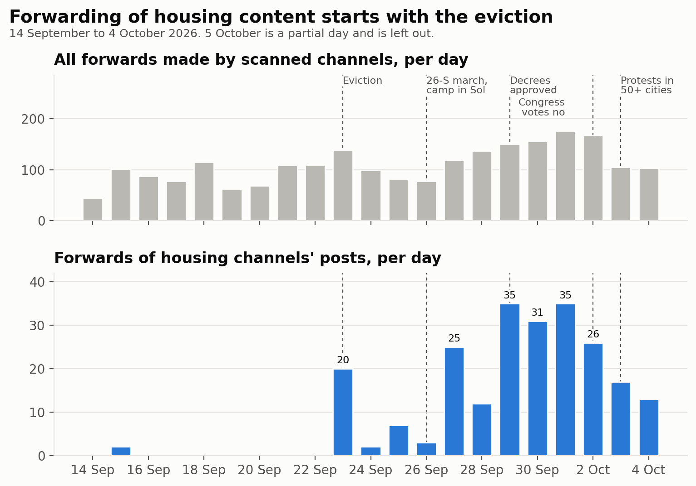
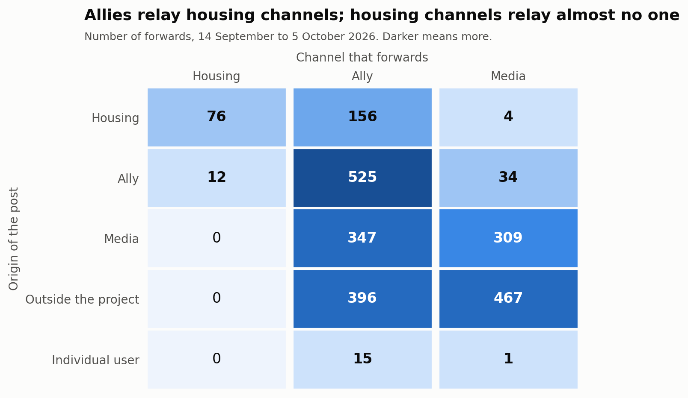
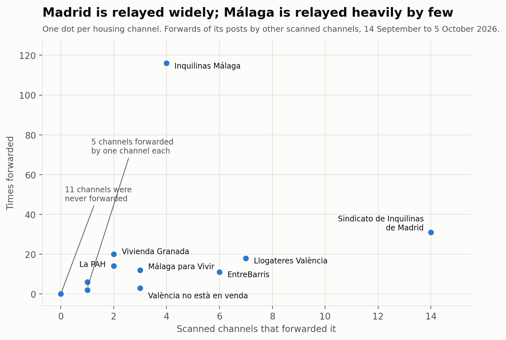
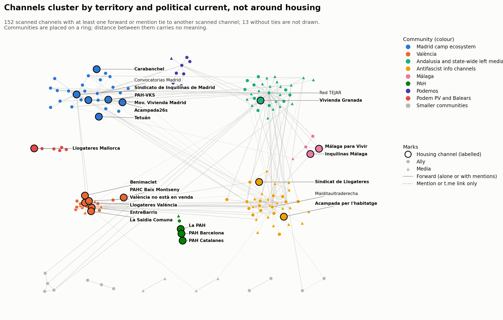
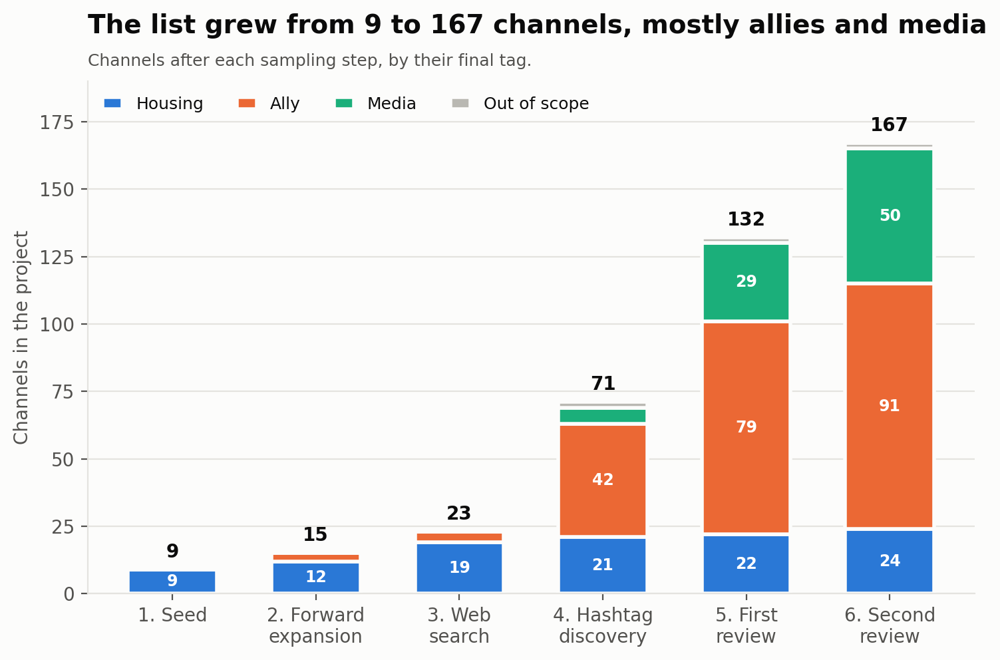

# Informe tècnic: primer estudi, 14 de setembre – 5 d'octubre del 2026

<a href="../acampadas_vivienda_technical_report.html">English</a> · <a href="../es/acampadas_vivienda_technical_report.html">Español</a> · <strong>Català</strong>

> Aquesta pàgina tracta del primer estudi, del 14 de setembre al 5 d'octubre del 2026. La mobilització va continuar: vegeu el [seguiment](followup.md), del 6 d'octubre a la vaga de l'11 de novembre.

Canals de Telegram del moviment per l'habitatge a Espanya i dels seus aliats durant les
acampades per l'habitatge de setembre i octubre del 2026: com es va construir la llista de
canals, com es van classificar els canals i què mostren les xarxes de reenviaments i
mencions.

- **Data de l'informe:** 2026-10-05
- **Finestra d'observació:** del 2026-09-14 al 2026-10-05 (21 dies, començant vuit dies
  abans del desnonament de Maricarmen)
- **Dades:** només canals i grups públics de Telegram, llegits sense unir-s'hi

*Traducció de l'original en anglès. Les figures i el fitxer d'evidències són en anglès.*

Documents complementaris: la [revisió externa](external_review.md) (regla d'etiquetatge i
decisions), les [evidències per canal](../external_review_log.csv) (CSV) i l'[anàlisi de
comunitats](community_analysis.md) (detecció de comunitats en detall).

---

## 1. Resum

1. **La mostra té 167 canals:** 24 canals d'habitatge, 91 aliats, 50 mitjans i 2 fora
   d'àmbit. Va créixer des d'una llavor de 9 canals mitjançant reenviaments, una cerca
   web, la cerca per etiquetes i dues rondes revisades de bola de neu.
2. **Es van analitzar 22.111 missatges** en 165 canals, que van donar 2.403
   esdeveniments de reenviament i 5.753 esdeveniments d'enllaç (mencions amb @ i enllaços
   t.me), dels quals 2.049 apunten a un altre compte.
3. **El graf té 778 nodes i 1.115 arestes** (541 de reenviament, 574 d'enllaç). Només 165
   nodes són canals analitzats de la mostra; la resta són comptes que reenvien o
   mencionen.
4. **Els canals d'habitatge són fonts, no difusors.** Els aliats van reenviar contingut
   d'habitatge 156 vegades; els canals d'habitatge van reenviar contingut d'aliats 12
   vegades. Els canals d'habitatge gairebé mai no enllacen a altres comptes de Telegram.
5. **El Sindicato de Inquilinas de Madrid és l'únic node central.** El reenvien 14 canals
   i el mencionen 6, a Madrid, València i Andalusia. Cap altre canal d'habitatge no el
   difonen més de 7.
6. **El reenviament de contingut d'habitatge comença amb el desnonament.** Els
   reenviaments de publicacions de canals d'habitatge passen de 0–2 al dia abans del 23 de
   setembre a 20 aquell dia, i arriben a un màxim de 35 al dia el 29 de setembre i l'1
   d'octubre.
7. **No hi ha una única comunitat d'habitatge.** La xarxa està molt agrupada
   (modularitat 0,67 en reenviaments) per territori i corrent polític: Madrid, València,
   Màlaga, la PAH, Podemos, canals d'informació antifeixista. Els canals d'habitatge són
   en 8 de les 19 comunitats del graf complet.
8. **Els grups territorials d'habitatge no es reenvien entre ells.** El grup de la PAH és
   tancat; València i Màlaga són autosuficients; l'únic vincle entre territoris entre
   canals d'habitatge és un canal de València que reenvia una vegada el sindicat de
   Madrid. Només les publicacions del sindicat de Madrid viatgen entre territoris, i ho
   fan a través d'aliats.
9. **Ningú no reenvia els dos canals de les acampades.** Acampada26s (Madrid) i Acampada
   per l'habitatge (Barcelona) només apareixen a través de mencions.
10. **El volum es concentra en uns pocs difusors.** Cinc canals fan el 60 % de tots els
    reenviaments (només Red TEJAR, el 24 %), i un canal fa el 62 % de totes les mencions
    sortints (Malditaultraderecha). Les mesures ponderades descriuen sobretot aquests
    canals.

---

## 2. Context

Antecedents recollits de la premsa i de la Viquipèdia el 2026-10-05; les fonts no
coincideixen en alguns detalls, que s'assenyalen més avall.

- **El desnonament.** Maricarmen Abascal, de 87 anys, va ser desnonada del pis del
  districte madrileny de Retiro on vivia des del 1956. Les fonts de premsa donen el 22 o
  el 23 de setembre; el canal del mateix sindicat de Madrid el va anunciar per al 23 de
  setembre, amb un acte de suport el 22. La propietària és l'empresa Urbagestión. Un
  acord cap al 28 de setembre li va permetre tornar.
- **Les acampades.** Una marxa el 26 de setembre («26-S») va acabar amb una acampada a la
  Puerta del Sol. Van seguir acampades a Barcelona, Sevilla, Màlaga i altres ciutats des
  del 28 de setembre, i a València, Alacant, Granada i Oviedo cap al 3–5 d'octubre.
- **Els decrets.** El Govern va aprovar dos decrets llei d'habitatge el 29 de setembre.
  El Congrés els va tombar el 2 d'octubre. «Decreto Maricarmen» s'utilitza tant per a les
  cinc reivindicacions del sindicat com per al paquet del Govern.
- **Tensió a Sol.** El 2 d'octubre va circular un missatge que deia que el sindicat de
  Madrid deixaria Sol; alguns mitjans el van publicar i un en va publicar un desmentiment.
  Un mitjà va informar que la Coordinadora Juvenil Socialista tenia un paper creixent a
  l'acampada.

---

## 3. Resultats

### 3.1 La llista de canals

| Etiqueta | Canals | Què abasta |
|---|---|---|
| habitatge | 24 | Sindicats de llogateres, grups de la PAH, assemblees d'habitatge, els dos canals d'acampada |
| aliat | 91 | Partits, sindicats, centres socials, agendes de moviments, grups de solidaritat i antirepressius, canals d'individus |
| mitjà | 50 | Mitjans d'informació, revistes, editorials, canals de comentari i informació |
| fora d'àmbit | 2 | Un bot de fils d'un fòrum i un canal de mems |

Tots menys un són canals de difusió; Acampada26s és un grup.

Els 24 canals d'habitatge per territori: Madrid 6 (Sindicato de Inquilinas, Movimiento
de Vivienda de Madrid, Carabanchel, Tetuán, PAH-VKS, Acampada26s); Catalunya 7 (Sindicat
de Llogateres, PAH Barcelona, PAH Catalanes, PAHC Baix Montseny, Les Corts, Sindicat
d'Habitatge Socialista, Acampada per l'habitatge); València 5; Màlaga 2; Granada 1;
Mallorca 1; i dos canals estatals, La PAH i Cuadernos de Trabajo (sobre mètodes
d'organització).

Tres canals d'habitatge no van publicar res a la finestra: Grup d'Habitatge de Les Corts,
Sindicat d'Habitatge Socialista de Catalunya i Cuadernos de Trabajo.

### 3.2 Volum i ritme

| Mesura | Valor |
|---|---|
| Missatges analitzats (última anàlisi de cada canal) | 22.111 en 165 canals |
| Esdeveniments de reenviament | 2.403 (61 reenviaments de si mateixos) |
| Orígens de reenviaments | 2.340 canals, 41 noms ocults, 16 usuaris, 6 grups |
| Esdeveniments d'enllaç | 5.753 (3.704 enllaços a si mateixos) |
| Esdeveniments d'enllaç a un altre compte | 2.049: 1.779 mencions amb @ i 270 enllaços t.me |
| Mediana del retard entre la publicació original i el reenviament | 0,9 hores |
| Reenviaments en menys d'1 hora / 24 hores | 51 % / 91 % |

Reenviaments al dia, de tots els canals i d'aquells l'origen dels quals és un canal
d'habitatge:

| Període | Tots els reenviaments al dia | Reenviaments de canals d'habitatge al dia |
|---|---|---|
| 14–22 set (abans del desnonament) | 48–115 | 0–2 |
| 23 set (desnonament) | 142 | 20 |
| 24–26 set | 77–103 | 2–7 |
| 27–28 set (després de la marxa) | 120–140 | 12–25 |
| 29 set – 2 oct (decrets, votació al Congrés) | 150–176 | 26–35 |
| 3–4 oct | 103–115 | 13–17 |

El 5 d'octubre és un dia parcial i es deixa fora.

*Figura 1. Reenviaments al dia: tots els reenviaments fets per canals analitzats (a dalt) i reenviaments de publicacions de canals d'habitatge (a baix), amb els fets principals marcats.*

### 3.3 Qui reenvia qui

Esdeveniments de reenviament entre papers (origen → reenviador), sense reenviaments de si
mateixos:

| Origen \ Reenviador | habitatge | aliat | mitjà |
|---|---|---|---|
| habitatge | 76 | 156 | 4 |
| aliat | 12 | 525 | 34 |
| mitjà | 0 | 347 | 309 |
| extern (fora de la mostra) | 0 | 396 | 467 |
| usuari | 0 | 15 | 1 |

*Figura 2. Nombre de reenviaments segons el paper de l'origen i del reenviador. Els orígens amb nom ocult es compten com a fora de la mostra.*

- Els canals d'habitatge reenvien gairebé només entre ells (76) i una mica d'aliats (12).
  No reenvien res de mitjans ni de fora de la mostra.
- Els aliats són els difusors: reenvien aliats, mitjans, fonts externes i canals
  d'habitatge.
- Els mitjans reenvien mitjans i fonts externes, i canals d'habitatge només 4 vegades.

Esdeveniments d'enllaç entre papers (compte referit → canal que el refereix):

| Referit \ Referent | habitatge | aliat | mitjà |
|---|---|---|---|
| habitatge | 3 | 70 | 1 |
| aliat | 0 | 192 | 26 |
| mitjà | 3 | 187 | 8 |
| extern | 0 | 895 | 38 |
| usuari no identificat o usuari | 25 | 338 | 263 |

Els canals d'habitatge fan referència a altres comptes 31 vegades en total, 25 d'elles a
usuaris que no es van poder associar a cap compte de Telegram.

### 3.4 Els canals d'habitatge un per un

| Canal | Reenviat per (canals) | Vegades reenviat | Reenviaments fets | Mencionat o enllaçat per (canals) |
|---|---|---|---|---|
| Sindicato de Inquilinas de Madrid | 14 | 31 | 0 | 6 |
| Sindicat de Llogateres València | 7 | 18 | 1 | 0 |
| EntreBarris | 6 | 11 | 10 | 0 |
| Sindicato de Inquilinas de Málaga | 4 | 116 | 2 | 0 |
| Málaga para Vivir | 3 | 12 | 44 | 2 |
| València no està en venda | 3 | 3 | 6 | 0 |
| La PAH | 2 | 14 | 0 | 0 |
| Sindicato de Vivienda de Granada | 2 | 20 | 0 | 0 |
| PAH-VKS | 1 | 6 | 0 | 2 |
| Sindicat de Llogateres | 1 | 1 | 0 | 1 |
| PAH Catalanes | 1 | 1 | 0 | 0 |
| La Saïdia Comuna | 1 | 1 | 4 | 0 |
| Sindicat Llogateres Mallorca | 1 | 2 | 0 | 0 |
| Acampada per l'habitatge (acampada de Barcelona) | 0 | 0 | 0 | 2 |
| Acampada26s (acampada de Madrid) | 0 | 0 | 0 | 2 |
| Movimiento de Vivienda de Madrid | 0 | 0 | 3 | 1 |
| Sindicato de Vivienda de Carabanchel | 0 | 0 | 0 | 1 |
| Sindicato Vivienda Tetuán | 0 | 0 | 0 | 1 |
| PAH Barcelona | 0 | 0 | 14 | 0 |
| Benimaclet per l'Habitatge | 0 | 0 | 3 | 0 |
| PAHC Baix Montseny | 0 | 0 | 1 | 0 |
| Les Corts, Sindicat d'Habitatge Socialista, Cuadernos de Trabajo | 0 | 0 | 0 | 0 |

Els recomptes són només sobre canals analitzats. La xarxa completa també té arestes cap a
i des d'usuaris no identificats, per això alguns d'aquests canals hi tenen més veïns.

*Figura 3. Cada canal d'habitatge segons el nombre de canals analitzats que el van reenviar i el nombre de vegades que va ser reenviat.*

- **Amplitud davant de volum.** El sindicat de Madrid és el que difonen més canals; el
  sindicat de Màlaga és el reenviat més sovint, però només per quatre canals (Málaga para
  Vivir 44 vegades, La Invisible 44, Red TEJAR 24, Antifascistas 4).
- **Dos tipus de canal d'habitatge.** La majoria només publica (zero reenviaments fets).
  Uns quants actuen com a difusors locals: Málaga para Vivir, PAH Barcelona i
  EntreBarris.

### 3.5 Els difusors que dominen el volum

| Canal | Paper | Reenviaments fets | Part de tots els reenviaments |
|---|---|---|---|
| Red TEJAR (@andaluciajustayresiliente) | aliat | 586 | 24 % |
| Multicanal Radio | mitjà | 262 | 11 % |
| Prima Linea | mitjà | 241 | 10 % |
| ANTIIMPERIALISTAS.COM | mitjà | 184 | 8 % |
| Sare Antifaxista Euskal Herria | aliat | 162 | 7 % |

Les referències sortints a altres comptes encara estan més concentrades:
Malditaultraderecha en fa 1.278 de 2.049 (62 %), Convocatorias Madrid 287 i Fullblack161
254. Tots tres signen o citen fonts a gairebé totes les publicacions.

### 3.6 Cascades

Una cascada és una publicació original reenviada per diversos canals analitzats.

- 129 publicacions de canals d'habitatge es van reenviar almenys una vegada: 60 per un
  canal, 38 per dos, 27 per tres i 4 per quatre o més.
- **La més àmplia:** una publicació del sindicat de Madrid del 23 de setembre, el dia del
  desnonament, reenviada per sis canals: CSO La Rosa, ESLA EKO, XR Madrid, Ecologistas
  Madrid, CS La Cheli i el canal de Tom Kucharz.
- **Les següents:** dues publicacions del Sindicat de Llogateres València (23 i 27 de
  setembre), reenviades per cinc i quatre canals de València, i una publicació del
  sindicat de Madrid del 24 de setembre reenviada per quatre.
- Les cascades són sobretot locals. Les excepcions són publicacions del sindicat de
  Madrid: tres les va reenviar també Red TEJAR (Andalusia), una d'elles juntament amb el
  col·lectiu de la Valldigna (València), i una València no està en venda. Les
  publicacions dels canals d'habitatge de València i Màlaga només es van reenviar dins
  del seu propi territori.

### 3.7 Comunitats

El mètode i les taules completes són a l'[anàlisi de comunitats](community_analysis.md).

| Graf | Nodes | Comunitats | Modularitat | Modularitat de la partició per etiquetes |
|---|---|---|---|---|
| Reenviaments, canals analitzats | 139 | 18 | 0,666 | 0,070 |
| Enllaços, canals analitzats | 83 | 7 | 0,410 | −0,064 |
| Combinat, canals analitzats | 152 | 14 | 0,600 | 0,026 |
| Graf complet, tots els nodes | 766 | 19 | 0,703 | — |

*Figura 4. Els 152 canals analitzats amb almenys un vincle, acolorits per comunitat del graf combinat de reenviaments i mencions. Els canals d'habitatge apareixen contornejats i etiquetats. Les comunitats se situen en un anell, de manera que només els vincles, no les distàncies entre comunitats, tenen significat.*

- **Les etiquetes no expliquen l'estructura.** Agrupar els canals en habitatge, aliat i
  mitjà dona una modularitat propera a zero. El territori i el corrent polític sí que
  l'expliquen.
- **Comunitats del graf complet que contenen canals d'habitatge:**

| Comunitat | Nodes | Canals d'habitatge |
|---|---|---|
| Ecosistema de l'acampada de Madrid | 104 | sindicat de Madrid, PAH-VKS, Movimiento de Vivienda de Madrid, Carabanchel, Tetuán, Acampada26s |
| València | 56 | Cinc canals d'habitatge de València i PAHC Baix Montseny |
| Difusor andalús i mitjans d'esquerra estatals | 87 | Sindicato de Vivienda de Granada |
| Esfera de Malditaultraderecha | 129 | Sindicat de Llogateres |
| Màlaga | 12 | sindicat de Màlaga, Málaga para Vivir |
| Acampada de Barcelona | 12 | Acampada per l'habitatge |
| PAH | 8 | La PAH, PAH Barcelona, PAH Catalanes |
| Podem País Valencià i Balears | 7 | Sindicat Llogateres Mallorca |

- **Reenviaments i mencions expliquen històries diferents sobre Madrid.** Al graf de
  reenviaments, el sindicat de Madrid s'agrupa amb el moviment climàtic (XR, Ecologistas
  en Acción), i el canal de l'acampada i els sindicats de barri queden sense connexió. Al
  graf d'enllaços tots s'uneixen en una comunitat, perquè Convocatorias Madrid menciona
  els convocants de cada convocatòria.
- **Els ponts entre comunitats són aliats.** Red TEJAR, Malditaultraderecha, el
  col·lectiu de la Valldigna i Sevilla Anticarcelaria porten la majoria dels vincles entre
  comunitats. El sindicat de Madrid és l'únic canal d'habitatge entre els ponts
  principals.
- **La ubicació és estable per als canals d'habitatge.** 20 dels 21 canals d'habitatge
  connectats continuen amb la seva comunitat en almenys el 96 % de les execucions.
  Sindicat de Llogateres (75 %) n'és l'excepció.

### 3.8 Etiquetes (hashtags)

Comptades en una descàrrega primerenca de 459 missatges dels 20 primers canals
d'habitatge (del 14 de setembre al 5 d'octubre); no es va repetir amb la llista final.

- 86 missatges porten etiquetes; 43 etiquetes diferents.
- L'ús és regional: #AcampadaPorLaVivienda (31 missatges) i #NosQuedamos (28) vénen
  gairebé només dels dos canals de Màlaga; #NiUnaMaricarmenMés, dels quatre canals de
  València; #DecretoMaricarmen, de la PAH.
- Només #HaciaLaHuelgaGeneral travessa territoris (Madrid i Màlaga).
- El sindicat de Madrid va fer servir #AcampadaMaricarmen i #AcampadaXMaricarmen del 15
  al 17 de setembre, abans del desnonament.

---

## 4. Metodologia

### 4.1 Eines

- **Recollida** mitjançant l'API pública de Telegram, amb tgmon, una eina de seguiment de
  Telegram construïda sobre la biblioteca Telethon. Els canals i grups es llegeixen sense
  unir-s'hi.
- **Treball assistit per un agent.** La recollida, la classificació i l'anàlisi les va
  fer un agent d'IA seguint un protocol escrit; l'equip va fixar el protocol, va prendre
  les decisions que canviaven la mostra o la classificació i en va revisar els resultats.
- **Anàlisi de xarxes** amb la biblioteca networkx.
- **Cerca web** per al context i per localitzar els canals d'organitzacions esmentades a
  la premsa.

### 4.2 Finestra temporal

Tota la recollida va fer servir «els últims 21 dies» en el moment d'execució, el
2026-10-05, és a dir, des de les 09:45 UTC aproximadament del 14 de setembre. La finestra
s'obre vuit dies abans del desnonament perquè es vegi el període anterior a la
mobilització. Les execucions més tardanes del dia arriben a missatges una mica
posteriors; els esdeveniments desats van del 14 de setembre a les 12:02 al 5 d'octubre a
les 10:54 UTC.

### 4.3 Mostreig: com es va construir la llista de canals

La llista és una mostra de bola de neu que creix des d'una llavor, amb un pas de revisió
abans de cada ampliació a les rondes posteriors.

| Pas | Mètode | Canals afegits | Total |
|---|---|---|---|
| 1. Llavor | Una llista llavor de deu canals del moviment per l'habitatge compilada per a l'estudi; 9 tenien nom d'usuari públic | 9 | 9 |
| 2. Expansió per reenviaments | Tots els canals dels quals un canal de la mostra va reenviar a la finestra | 6 | 15 |
| 3. Cerca web | Canals de convocants de les acampades esmentats a la premsa, i la llista de participants d'acampada26s.net; cadascun comprovat a la previsualització pública de Telegram | 8 | 23 |
| 4. Cerca per etiquetes | Canals les publicacions dels quals a la finestra feien servir una de set etiquetes trobades a les publicacions dels canals llavor | 48 | 71 |
| 5. Primera revisió externa | Canals que apareixen al graf però no a la mostra (133), revisats amb la regla d'etiquetatge | 61 | 132 |
| 6. Segona revisió externa | Els 85 canals que va portar l'anàlisi dels afegits del pas 5 | 35 | 167 |

*Figura 5. Mida de la llista de canals després de cada pas de mostreig, segons l'etiqueta final de cada canal.*

Detalls:

- **El pas 2** es va repetir amb els 20 canals d'habitatge després del pas 3 i no va
  trobar res de nou: entre els canals d'habitatge, el reenviament és tancat.
- **Etiquetes del pas 4:** #AcampadaPorLaVivienda (4 canals), #DecretoMaricarmen (7),
  #NiUnaMaricarmenMés (11), #NiUnaMaricarmenMás (0), #HaciaLaHuelgaGeneral (11),
  #AcampadaSol (15), #26s (0). La cerca per etiquetes retorna només canals de difusió, no
  grups. Sis resultats dubtosos es van classificar llegint-ne els últims 40 missatges.
- **Els passos 5 i 6** són els únics en què un canal va haver de superar una prova abans
  d'afegir-se (apartat 4.4). Els passos 2 i 4 afegeixen el que retorna el mètode; els
  seus resultats es van etiquetar després.
- **Aturada.** El mostreig es va aturar després del pas 6 per decisió, no perquè
  s'esgotés. Analitzar els afegits del pas 6 va portar al graf 132 canals externs més i
  342 usuaris no identificats, cada vegada més allunyats de l'habitatge (canals
  d'informació antifeixista i antiimperialista internacionals). Aquests no es van
  revisar.
- **No assolibles.** Els canals sense nom d'usuari públic no es poden afegir. Dos
  importen: Difusión Asamblea de Vivienda Sevilla i el grup de l'acampada de València,
  Acampada Plaça Ajuntament. Grup d'Habitatge de Sants, de la llista llavor, no tenia cap
  enllaç utilitzable.
- **No trobats a Telegram:** els sindicats d'habitatge d'Alacant, els sindicats de
  llogateres d'Astúries, Derecho al Techo (Las Palmas) i els sindicats de llogateres de
  Sevilla i Saragossa.

Conseqüències per a la interpretació: la mostra no és un cens del moviment per
l'habitatge a Telegram, i les seves parts d'aliats i mitjans reflecteixen el camí recorregut
(a través dels canals anarquistes de València, Red TEJAR i Malditaultraderecha) tant com
el camp mateix.

### 4.4 Classificació

**Etiquetes.** Cada canal porta una etiqueta:

| Etiqueta | Paper al graf | Definició |
|---|---|---|
| habitatge (*in-scope*) | habitatge (*core*) | Organitzacions d'habitatge: sindicats de llogateres, PAH, assemblees d'habitatge, canals d'acampada |
| aliat | aliat | Organitzacions i col·lectius que no són organitzacions d'habitatge; canals personals d'individus |
| mitjà | mitjà | Mitjans d'informació, revistes, editorials, programes, canals de comentari i informació |
| fora d'àmbit | no analitzat | Soroll |

L'esquema va evolucionar durant l'estudi: primer habitatge / fora d'àmbit; després aliat
va substituir fora d'àmbit per a les organitzacions que no són d'habitatge; després mitjà
es va separar d'aliat. Les etiquetes anteriors es van revisar cada vegada perquè una sola
regla valgui per a tota la llista.

**Regla per afegir un canal des del graf (passos 5 i 6).**

1. *Prova d'implicació.* El canal ha de tenir almenys una publicació pròpia sobre les
   acampades o el desnonament de Maricarmen a la finestra. Que el reenviï un canal de la
   mostra no n'hi ha prou.
2. *Etiqueta segons el tipus de canal:* organització d'habitatge → habitatge; una altra
   organització o canal d'individu → aliat; mitjà d'informació → mitjà.
3. *Els agregadors i els xats* es decideixen llegint-ne els missatges: aliat si el canal
   parla com a actor del moviment (llança o difon convocatòries, publica comunicats de
   col·lectius); no s'afegeix si només republica titulars o és conversa oberta.
4. *No s'afegeixen:* sense publicacions sobre les acampades, soroll o no llegible.

**Evidències.** De cada candidat es van llegir les seves pròpies publicacions a la
finestra (sense reenviaments, fins a 1.000 missatges) i es van fer dos recomptes per
paraules clau: termes d'habitatge (vivienda, habitatge, desahuci-, desnona-, inquilin-,
llogat-, alquiler, lloguer, rentis-, més els termes d'acampada) i termes d'acampada
(acampad-, Maricarmen). La primera publicació que coincideix es desa al registre. Es van
llegir les coincidències úniques i tots els agregadors; es van descartar tres falsos
positius de paraules clau.

**Resultat de les dues revisions (215 canals):**

| Decisió | Ronda 1 | Ronda 2 |
|---|---|---|
| Afegit com a habitatge | 1 | 2 |
| Afegit com a aliat | 37 | 12 |
| Afegit com a mitjà | 23 | 21 |
| No afegit | 69 | 50 |

**Decisions que van requerir judici** (totes registrades):

- Els canals de comentari i informació d'una sola persona o d'un col·lectiu anònim són
  mitjans, no aliats, quan les seves publicacions sobre les acampades comenten en lloc de
  mobilitzar (Geoestrategia y Política, España en Guerra, Prima Linea i similars).
- Els canals d'agenda de moviments (Convocatorias Madrid, Convócala Málaga i similars)
  són aliats, perquè publiquen convocatòries més que notícies.
- Diario Socialista és mitjà pel seu tipus, tot i que és la principal veu a Telegram del
  Movimiento Socialista; l'organització juvenil d'aquell corrent, la Coordinadora Juvenil
  Socialista, és un aliat amb el canal buit.
- La regla mesura la implicació, no la postura: Grupo Ruptura és aliat tot i que la seva
  publicació critica l'acampada.
- Els canals llavor es van mantenir com a habitatge tal com es van facilitar, inclosos
  Cuadernos de Trabajo i el col·lectiu de barri La Saïdia Comuna.
- Els canals trobats als passos 2 a 4 es van etiquetar per tipus sense la prova
  d'implicació.

### 4.5 Recollida de dades

**Reenviaments.** Per a cada canal analitzat, cada missatge de la finestra que és un
reenviament produeix un esdeveniment: reenviador, id i data del missatge, origen (canal,
grup, usuari o nom ocult), id i data del missatge original, i visualitzacions. Els
esdeveniments es dedupliquen per reenviador i missatge.

**Mencions i enllaços.** Per a cada missatge que *no* és un reenviament:

- Es registren les mencions amb @ i les URL a `t.me` o `telegram.me` que anomenen un nom
  d'usuari, una publicació o un id numèric de canal. S'ignoren els enllaços d'invitació i
  les rutes de servei (compartir, paquets d'adhesius, etc.).
- S'ometen els enllaços dins de missatges reenviats; pertanyen a l'origen.
- Un esdeveniment per missatge, destinació i tipus. Un canal que es refereix a si mateix
  es registra com a enllaç a si mateix.
- **Identificar la destinació.** Un usuari es compara amb la mostra, amb els orígens ja
  vistos en reenviaments i amb els comptes ja vistos a la recollida. Tota la resta es
  desa com a *usuari no identificat*. Els usuaris no es van consultar un per un, perquè
  Telegram limita estrictament aquestes consultes. Molts usuaris no identificats són
  usuaris d'Instagram o X enganxats a les publicacions.

**Conjunt analitzat.** Tots els canals etiquetats com a habitatge, aliat o mitjà (165).

**Descàrrega de missatges.** Es van descarregar les publicacions dels 20 primers canals
d'habitatge per al recompte d'etiquetes.

### 4.6 Construcció del graf

- **La direcció** segueix la informació: origen → reenviador, i compte referit → canal
  que el refereix.
- **Agregació.** Una aresta per parell ordenat i tipus. El pes d'una aresta de
  reenviament és el nombre de reenviaments; el d'una aresta d'enllaç, mencions més
  enllaços. Cada aresta desa la primera i l'última data.
- **Dos tipus d'aresta** en un sol graf, de manera que un parell de canals pot tenir una
  aresta de cada tipus.
- **Els bucles** s'eliminen (7 de reenviament, i tots els enllaços a si mateixos).
- **Papers dels nodes:** habitatge, aliat i mitjà segons les etiquetes; *extern* per a
  canals i grups identificats fora de la mostra; *no identificat* per a usuaris sense
  correspondència; *usuari* per a comptes individuals.
- **Nodes aïllats.** Es mantenen els canals analitzats sense arestes de cap tipus, perquè
  el silenci sigui visible (12 nodes).
- **Pseudonimització.** Els comptes d'usuaris individuals estan pseudonimitzats.

Graf final: 778 nodes (24 d'habitatge, 91 aliats, 50 mitjans, 251 externs, 342 no
identificats, 20 usuaris) i 1.115 arestes.

### 4.7 Anàlisi de comunitats

- **Grafs.** No dirigits; pes 1 + ln(recompte) perquè els parells amb centenars
  d'esdeveniments no anul·lin la resta. Quatre grafs: reenviaments, enllaços i combinat
  entre canals analitzats, i el graf complet amb tots els nodes i els dos tipus d'aresta.
- **Detecció.** Louvain (resolució 1,0).
- **Estabilitat.** 50 execucions amb llavors de 0 a 49: nombre de particions diferents,
  rang de modularitat i coassignació per parells.
- **Etiquetes.** Els grafs de reenviaments i d'enllaços fan servir la partició de la
  llavor 42, que és també la més freqüent (48 % i 84 % de les execucions). El combinat i
  el complet van donar 31 i 46 particions diferents, de manera que s'etiqueten amb una
  partició de consens (Lancichinetti i Fortunato 2012): els parells s'uneixen amb la
  proporció d'execucions que els posen junts, els parells per sota de 0,5 es descarten i
  Louvain es torna a executar sobre aquest graf fins que totes les execucions coincideixen.
  Tots dos van convergir a la primera passada.
- **Estabilitat dels nodes.** Per a cada node, la proporció mitjana de les 50 execucions
  en què és amb els altres membres de la seva comunitat etiquetada.
- **Comparació.** Modularitat de la partició per etiqueta, per comprovar si les etiquetes
  expliquen l'estructura.
- **Noms.** Les comunitats del graf complet es van anomenar llegint-ne els membres. Cada
  nom va lligat a un canal àncora, de manera que els noms sobreviuen a la renumeració.
- **Reserva del graf complet.** Els nodes no analitzats només tenen vincles amb els
  canals que els refereixen, de manera que s'uneixen a la comunitat d'aquell canal. Tres
  comunitats del graf complet són un únic canal analitzat més els comptes que cita.

### 4.8 Altres anàlisis

- **La barreja de papers, el volum diari, el retard i les cascades** (apartat 3) es van
  calcular directament a partir dels esdeveniments de reenviament i d'enllaç. El retard
  és l'hora del reenviament menys l'hora de la publicació original. Una cascada agrupa els
  esdeveniments de reenviament per canal d'origen i id del missatge original.
- **Les etiquetes** es van comptar amb una expressió regular sobre el text del missatge,
  sense distingir majúscules, una vegada per missatge.

---

## 5. Limitacions

**Mostreig**

- La llista és una bola de neu a partir d'una llavor de nou canals. No és un cens, i les
  regions on no es va trobar cap canal (Alacant, Astúries, Canàries, Sevilla, Saragossa)
  hi són absents, no en silenci.
- Les rondes posteriors es desvien de l'habitatge cap a canals d'informació antifeixista
  i antiimperialista. El mostreig es va aturar per decisió amb 132 canals externs sense
  revisar.
- Els canals i grups privats, i els que no tenen nom d'usuari, són invisibles. Això
  exclou la major part de la coordinació de les acampades, que segons la premsa funciona
  en grups de WhatsApp i Telegram.
- Només hi ha un grup a la mostra; la cerca per etiquetes retorna només canals.
- El pas d'etiquetes no registra quina etiqueta va trobar cada canal.

**Classificació**

- La prova d'implicació és una coincidència de paraules clau. Es perden les publicacions
  que són només imatge i altres formulacions, i una publicació que coincideixi n'hi ha
  prou per passar.
- La frontera entre mitjà i aliat per als canals de comentari i els agregadors es basa en
  la lectura d'uns pocs missatges.
- Els canals afegits als passos 2 a 4 no van passar la prova d'implicació.

**Xarxa**

- Una finestra de 21 dies. L'absència d'un vincle vol dir que no hi va haver reenviament
  ni menció en tres setmanes, no que no hi hagi relació.
- Els reenviaments amb origen ocult (41) no es poden atribuir; el contingut copiat i
  enganxat no deixa rastre.
- Els recomptes de mencions estan inflats per signatures i citacions de fonts. Convé fer
  servir la presència d'arestes, o les mesures amb ponderació logarítmica, en lloc dels
  pesos bruts d'enllaç.
- 342 nodes són usuaris no identificats; una part desconeguda no són comptes de Telegram.
- Les comunitats del graf complet barregen interacció amb citació (apartat 4.7).
- El recompte d'etiquetes cobreix 20 canals, no la llista final.

**Context**

- Els fets de context vénen de la premsa i de la Viquipèdia consultades un sol dia, amb
  informacions contradictòries sobre la data del desnonament i sobre la sortida del
  sindicat de Madrid de Sol.

**Protecció de dades**

- Les dades en brut, que contenen identificadors i noms visibles d'usuaris individuals
  que van publicar o van ser reenviats en grups, no es publiquen. Als fitxers publicats,
  els comptes d'usuaris individuals i els orígens de reenviaments amb nom ocult estan
  pseudonimitzats.

---

## 6. Reproductibilitat

La finestra està fixada en el temps i el procediment es descriu a l'apartat 4. El codi i
les dades en brut no es publiquen; les evidències de cada canal revisat, sí.

**Com citar aquesta pàgina.**

DataPolitik (Heurística). <em>Informe tècnic: primer estudi, 14 de setembre – 5 d'octubre del 2026</em>. Dins de <em>Acampades per l'habitatge i xarxes de comunicació a Telegram a Espanya, tardor del 2026</em>. Període d'observació: 14 de setembre – 5 d'octubre del 2026. Publicat el 7 de novembre del 2026. <a href="https://datapolitik.github.io/acampadas-vivienda-report/ca/acampadas_vivienda_technical_report.html">https://datapolitik.github.io/acampadas-vivienda-report/ca/acampadas_vivienda_technical_report.html</a>

Text i figures originals: [CC BY 4.0](https://creativecommons.org/licenses/by/4.0/) · [Ús i citació](index.md#use-and-citation)

---

Un estudi de [DataPolitik](https://www.heuristica.barcelona/datapolitik/), d'[Heurística](https://www.heuristica.barcelona/). · [Inici](index.md) · [Presentació del seguiment](followup.md)
