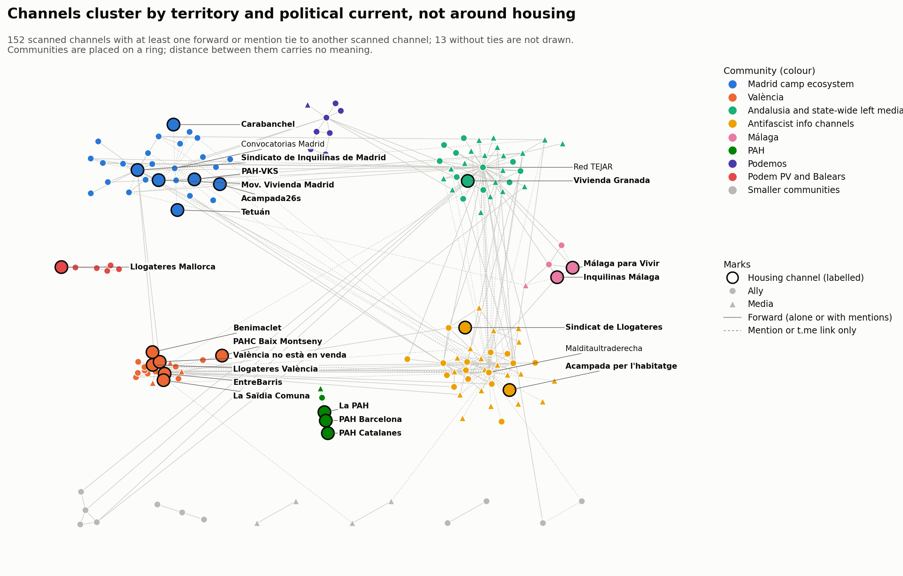

# Anàlisi de comunitats: primer estudi, 14 de setembre – 5 d'octubre del 2026

<a href="../community_analysis.html">English</a> · <a href="../es/community_analysis.html">Español</a> · <strong>Català</strong>

> Aquesta pàgina tracta del primer estudi, del 14 de setembre al 5 d'octubre del 2026. La mobilització va continuar: vegeu el [seguiment](followup.md), del 6 d'octubre a la vaga de l'11 de novembre.

Fet el 2026-10-05. Finestra: del 2026-09-14 al 2026-10-05.

*Traducció de l'original en anglès. Les figures són en anglès.*

## Mètode

- **Nodes:** els 165 canals analitzats de la mostra (24 d'habitatge, 91 aliats, 50
  mitjans). Es deixen fora els nodes externs i no identificats perquè no se'n van llegir
  les publicacions pròpies.
- **Grafs:** reenviaments, enllaços (mencions amb @ i enllaços t.me) i tots dos
  combinats. Les arestes es fan no dirigides i amb pes 1 + ln(recompte), perquè una
  parella que intercanvia centenars de reenviaments no anul·li la resta.
- **Comunitats:** Louvain (llavor 42, resolució 1,0).
- **Estabilitat:** 50 llavors aleatòries; proporció d'execucions que donen la mateixa
  partició, rang de modularitat i freqüència amb què els membres de cada comunitat
  continuen junts («cohesió»).
- **Comparació:** modularitat de la partició que donen les etiquetes (habitatge / aliat /
  mitjà).

## Xifres principals

| | Reenviaments | Enllaços | Combinat |
|---|---|---|---|
| Canals amb almenys un vincle | 139 | 83 | 152 |
| Arestes no dirigides | 229 | 115 | 330 |
| Component connexa més gran | 115 | 83 | 134 |
| Comunitats | 18 | 7 | 13 |
| Modularitat | 0,666 | 0,410 | 0,599 |
| Modularitat de la partició per etiquetes | 0,070 | −0,064 | 0,026 |
| Mateixa partició a les 50 llavors | 48 % | 84 % | 8 % |
| Rang de modularitat entre llavors | 0,664–0,666 | 0,409–0,412 | 0,586–0,600 |

La xarxa està molt agrupada, i els grups no tenen res a veure amb les etiquetes
d'habitatge / aliat / mitjà: agrupar per etiqueta dona una modularitat propera a zero.
Els canals s'agrupen per territori i per corrent polític.

## Comunitats de reenviament

Els membres de cada comunitat continuen junts en almenys el 95 % de les execucions.

| # | Comunitat | Mida | Canals d'habitatge a dins | Vincles que queden a dins |
|---|---|---|---|---|
| 1 | Difusor andalús i mitjans d'esquerra estatals, al voltant de Red TEJAR | 32 | Sindicato de Vivienda de Granada | 64 % |
| 2 | València | 18 | Sindicat de Llogateres València, EntreBarris, València no està en venda, La Saïdia Comuna, Benimaclet per l'Habitatge | 84 % |
| 3 | Sindicat de Madrid i moviment climàtic | 16 | Sindicato de Inquilinas de Madrid, Movimiento de Vivienda de Madrid | 61 % |
| 4 | Canals d'informació antifeixista (Euskal Herria, internacional) | 15 | cap | 64 % |
| 5 | Podemos (Madrid i estatal) | 10 | cap | 90 % |
| 6 | Mitjans internacionalistes i antiimperialistes de Barcelona | 7 | Sindicat de Llogateres | 61 % |
| 7 | Sevilla Anticarcelaria i Malditaultraderecha | 6 | cap | 33 % |
| 8 | Podem País Valencià i Balears | 6 | Sindicat Llogateres Mallorca | 100 % |
| 9 | Màlaga | 5 | Sindicato de Inquilinas de Málaga, Málaga para Vivir | 55 % |
| 10 | PAH | 5 | La PAH, PAH Barcelona, PAH Catalanes | 100 % |
| 11 | Anticapitalistas | 4 | cap | 68 % |
| 12 | CCOO | 3 | cap | 100 % |
| 13–18 | Sis parelles | 2 cadascuna | PAH-VKS (amb La Villana de Vallekas), PAHC Baix Montseny (amb InfoClau) | — |

Resultats:

- **No hi ha una comunitat d'habitatge.** Els 17 canals d'habitatge que tenen vincles de
  reenviament es reparteixen en 9 comunitats. Cadascun és dins del seu propi grup
  territorial o organitzatiu: València, Madrid, Màlaga, la PAH, Mallorca.
- **València és l'únic lloc on els canals d'habitatge formen el centre d'un grup,** amb
  cinc canals d'habitatge i el 84 % dels vincles a dins.
- **El sindicat de Madrid s'agrupa amb el moviment climàtic,** no amb altres canals
  d'habitatge: XR Madrid, XR España, Ecologistas en Acción i la seva secció de Madrid són
  els canals que més el reenvien.
- **La PAH és un grup tancat.** Tots els seus vincles queden a dins; ni reenvia els
  sindicats de llogateres ni aquests la reenvien.
- **Set canals d'habitatge no tenen cap vincle de reenviament amb cap canal analitzat:**
  Acampada26s, Acampada per l'habitatge, Sindicato de Vivienda de Carabanchel, Sindicato
  Vivienda Tetuán, Grup d'Habitatge de Les Corts, Sindicat d'Habitatge Socialista de
  Catalunya, Cuadernos de Trabajo.
- **Els ponts entre comunitats són aliats, no canals d'habitatge.** Red TEJAR porta 17
  dels vincles entre comunitats, Sevilla Anticarcelaria 7, Malditaultraderecha 5, el
  col·lectiu de la Valldigna 5. El sindicat de Madrid, amb 5, és l'únic canal d'habitatge
  entre els ponts principals.

## Comunitats d'enllaç

El graf d'enllaços és més petit (83 canals), però forma una única component connexa.

| # | Comunitat | Mida | Canals d'habitatge a dins |
|---|---|---|---|
| 1 | Canals que Malditaultraderecha cita o menciona | 45 | Sindicat de Llogateres |
| 2 | Ecosistema de l'acampada de Madrid, al voltant de Convocatorias Madrid | 22 | Sindicato de Inquilinas de Madrid, PAH-VKS, Movimiento de Vivienda de Madrid, Acampada26s, Tetuán, Carabanchel |
| 3 | Canals anarquistes i de centres socials de València | 5 | cap |
| 4 | Màlaga | 5 | Sindicato de Inquilinas de Málaga, Málaga para Vivir |
| 5–7 | Tres parelles | 2 cadascuna | Acampada per l'habitatge (amb IzquierdaDiario) |

- **Les mencions uneixen Madrid on els reenviaments no ho fan.** Acampada26s, Tetuán i
  Carabanchel, aïllats al graf de reenviaments, s'uneixen aquí al sindicat de Madrid i a
  PAH-VKS en una comunitat, perquè Convocatorias Madrid menciona els convocants de cada
  convocatòria.
- **La comunitat 1 és en bona part obra d'un sol canal.** Reflecteix qui cita
  Malditaultraderecha com a font, de manera que descriu la llista de lectures d'aquell
  canal més que un grup que interactua.
- **Catorze canals d'habitatge no tenen cap vincle d'enllaç,** entre ells tots els de
  València i de la PAH, que no fan referència a cap altre canal analitzat amb @ ni amb
  enllaç t.me.

## Combinat

Sumar els dos tipus d'aresta dona 13 comunitats (modularitat 0,599): esfera antifeixista i
de Malditaultraderecha (36), Andalusia i mitjans estatals (36), Madrid (27, sis canals
d'habitatge), València (19, sis d'habitatge), Podemos, Podem PV i Balears, PAH,
Anticapitalistas, CCOO i quatre parelles.

*Els 152 canals analitzats amb almenys un vincle, acolorits per comunitat del graf combinat (etiquetes de consens). Les comunitats se situen en un anell; només els vincles tenen significat.*

Aquesta partició és la menys estable: 31 particions diferents en 50 llavors. Les
comunitats grans es mantenen (cohesió de 0,82 a 0,97), però els canals de la vora entre
els blocs antifeixista i andalús passen de l'un a l'altre, de manera que les seves mides
exactes no s'han de llegir amb detall. Només tres canals d'habitatge continuen sense
connexió: Les Corts, Sindicat d'Habitatge Socialista de Catalunya i Cuadernos de Trabajo,
que no van publicar res a la finestra.

## Com s'assignen les etiquetes, i estabilitat dels nodes

Louvain és aleatori, de manera que 50 execucions amb llavors diferents no sempre
coincideixen.

| Graf | Particions diferents en 50 execucions | Etiqueta usada | Comunitats | Estabilitat mitjana per node | Nodes per sota de 0,8 |
|---|---|---|---|---|---|
| Reenviaments | 8 | Llavor 42 (la partició més freqüent, 48 % de les execucions) | 18 | 0,98 | 3 |
| Enllaços | 3 | Llavor 42 (la partició més freqüent, 84 % de les execucions) | 7 | 1,00 | 0 |
| Combinat | 31 | Consens de les 50 execucions | 14 | 0,96 | 5 |
| Complet | 46 | Consens de les 50 execucions | 19 | 0,96 | 45 |

- **Partició de consens** (Lancichinetti i Fortunato 2012): cada parell de nodes s'uneix
  amb la proporció de les 50 execucions que els posen a la mateixa comunitat; els parells
  per sota de 0,5 es descarten; Louvain s'executa 50 vegades sobre aquest graf. Tots dos
  grafs van convergir a la primera iteració, amb les 50 execucions retornant la mateixa
  partició.
- **L'estabilitat d'un node** és la proporció mitjana de les 50 execucions originals en
  què un node és amb els altres membres de la seva comunitat etiquetada. 1,0 vol dir que
  sempre és amb el mateix grup; un valor baix indica un node de vora. Es dona per als
  quatre grafs.
- Els apartats del graf combinat i del complet de més amunt descriuen la partició de la
  llavor 42. Les etiquetes de consens només difereixen als marges: el combinat té 14
  comunitats en lloc de 13 (els canals de Màlaga formen la seva pròpia comunitat de 5), i
  el complet en té 19 en lloc de 20.

Nodes de vora que convé conèixer:

- **Sindicat de Llogateres (0,75 al graf complet)** és l'únic canal d'habitatge que no
  està fermament situat. És amb el bloc de Malditaultraderecha i l'internacionalista de
  Barcelona, perquè els canals que el reenvien hi pertanyen, però en una quarta part de
  les execucions cau en un altre lloc. Tots els altres canals d'habitatge puntuen 0,96 o
  més.
- **Els canals climàtics (XR Madrid, XR Málaga, XR España, 0,66)** passen del bloc de
  Madrid, on reenvien el sindicat de Madrid, al bloc andalús i de mitjans estatals.
- **Sevilla Anticarcelaria, Sevilla en Acción i Grupo Ruptura (0,61 a 0,64)** passen del
  bloc de Malditaultraderecha a l'andalús.
- **Al graf combinat,** el col·lectiu de la Valldigna, Diari La Veu i La Directa (0,63 a
  0,64) són a la vora de la comunitat de València, i Cañada Se Queda i ESLA EKO (0,65) a
  la vora de la de Madrid.

## Límits

- Només s'inclouen canals analitzats; els 251 nodes externs i els 342 no identificats
  del graf complet, no.
- La llista de canals va créixer des de la llavor d'habitatge cap enfora a través dels
  aliats, de manera que els blocs antifeixista i de mitjans reflecteixen tant com es va
  construir la llista com el camp mateix.
- Els vincles d'enllaç són sensibles als hàbits de signatura (Malditaultraderecha,
  Convocatorias Madrid). La ponderació logarítmica ho redueix, però no ho elimina.

## Comunitats del graf complet

Les comunitats de més amunt cobreixen només els canals analitzats, cosa que deixa sense
etiqueta la majoria dels nodes del graf complet. Una passada més aplica el mateix mètode
al graf complet: els 766 nodes connectats (analitzats, externs, no identificats,
usuaris), amb els dos tipus d'aresta junts.

- 20 comunitats, modularitat 0,703. Tots els nodes de la component gegant (739 nodes)
  tenen un valor; només els 12 nodes aïllats no en tenen.
- **Els nodes no analitzats s'uneixen a qui hi fa referència.** Un node extern o no
  identificat només té vincles amb els canals analitzats que el van reenviar o mencionar,
  de manera que cau a la comunitat d'aquell canal. Les comunitats 2 (127 nodes) i 5 (65
  nodes) contenen cadascuna un únic canal analitzat, Fullblack161 i Prima Linea, més les
  fonts que difon.
- **Els canals analitzats s'agrupen de manera molt semblant a abans:** ecosistema de
  l'acampada de Madrid (comunitat 3, sis canals d'habitatge), València (7, sis
  d'habitatge), Màlaga (10), PAH (12), Podemos (9), Podem PV i Balears amb el sindicat de
  Mallorca (13), i el canal de l'acampada de Barcelona amb els comptes que menciona (11).
- **Menys estable en el detall:** 46 particions diferents en 50 llavors, amb modularitat
  entre 0,701 i 0,704. Els blocs són robustos; l'assignació dels nodes de vora, no.

## Descripció de les comunitats del graf complet

Els números identifiquen les comunitats del graf complet. «Mostra» compta els canals
analitzats (habitatge, aliat, mitjà); «Altres» compta canals externs, usuaris no
identificats i usuaris, que s'uneixen a la comunitat de qui hi fa referència. Els noms
són etiquetes descriptives donades després de llegir-ne els membres.

| # | Comunitat | Nodes | Mostra | Altres | Canals d'habitatge | Principals aliats i mitjans | Estabilitat |
|---|---|---|---|---|---|---|---|
| 1 | Esfera de Malditaultraderecha: contrainformació antifeixista, Sevilla i Barcelona | 129 | 18 | 111 | Sindicat de Llogateres | Malditaultraderecha, Sevilla Anticarcelaria, Palestina SOS Barcelona, Presos Revolucionarios; elPlural, Crític, Tot Barcelona | 0,87 |
| 2 | Fullblack161 i les seves fonts | 127 | 1 | 126 | — | Fullblack161 (informació antifeixista internacional); gairebé tots els altres nodes són usuaris que cita | 1,00 |
| 3 | Ecosistema de l'acampada de Madrid | 104 | 23 | 81 | Sindicato de Inquilinas de Madrid, PAH-VKS, Movimiento de Vivienda de Madrid, Carabanchel, Tetuán, Acampada26s | Convocatorias Madrid, Ecologistas en Acción, La Villana de Vallekas, ESLA EKO, CSO La Rosa, Asamblea Popular de Carabanchel | 1,00 |
| 4 | Difusor andalús i mitjans d'esquerra estatals | 87 | 38 | 49 | Sindicato de Vivienda de Granada | Red TEJAR, XR, Anticapitalistas, Liza; El Salto, Spanish Revolution, Canal Red, Diario Socialista, IzquierdaDiario, CTXT | 0,93 |
| 5 | Prima Linea i les seves fonts | 65 | 1 | 64 | — | Prima Linea (informació antifeixista francesa i italiana) i els canals que reenvia | 1,00 |
| 6 | Mitjans antiimperialistes i internacionals | 62 | 4 | 58 | — | ANTIIMPERIALISTAS.COM, Satélite Rojo, teleSUR, Al Mayadeen | 1,00 |
| 7 | Informació antifeixista basca, gallega i càntabra | 59 | 10 | 49 | — | Sare Antifaxista, Brigada Laila Jaled, Mitxis na Galiza, Las calles contra el fascismo; España en Guerra, Alerta Gorria Irratia | 0,91 |
| 8 | València | 56 | 20 | 36 | Sindicat de Llogateres València, EntreBarris, València no està en venda, La Saïdia Comuna, Benimaclet per l'Habitatge, PAHC Baix Montseny | col·lectiu de la Valldigna, CSOA CSN, Ateneu del Cabanyal, Assemblea Feminista, Alerta Solidària; La Veu, L'Accent, La Directa | 1,00 |
| 9 | Podemos (Madrid i estatal) | 16 | 8 | 8 | — | Difusión para Podemos, Podemos, Podemos Madrid, Podemos Parla, Área Joven | 1,00 |
| 10 | Acampada de Barcelona | 12 | 1 | 11 | Acampada per l'habitatge | Els altres 11 nodes són usuaris que menciona el canal de l'acampada | 0,94 |
| 11 | Màlaga | 12 | 6 | 6 | Sindicato de Inquilinas de Málaga, Málaga para Vivir | La Invisible, Convócala Málaga, Antifascistas; eldiario.es | 0,95 |
| 12 | PAH | 8 | 5 | 3 | La PAH, PAH Barcelona, PAH Catalanes | Privados de la Pública; La Cafetera | 1,00 |
| 13 | Podem País Valencià i Balears | 7 | 6 | 1 | Sindicat Llogateres Mallorca | Podem, Podem València i tres dels seus portaveus | 1,00 |
| 14 | Multicanal Radio i Nuestra España | 5 | 2 | 3 | — | Els dos mitjans i el que difon la ràdio | 1,00 |
| 15 | Marx21 | 5 | 2 | 3 | — | Marx21, Marx21 Andalucía | 1,00 |
| 16 | Notícies anarquistes | 5 | 2 | 3 | — | InfoAgitación, Anarquismos | 1,00 |
| 17 | CCOO Madrid | 3 | 3 | 0 | — | Canal CCOO, CCOO Madrid, CCOO Eiffage | 1,00 |
| 18 | CCOO transport | 2 | 2 | 0 | — | CCOO Ciudadanía, CCOO EMT Madrid | 1,00 |
| 19 | Alba Pulido | 2 | 1 | 1 | — | Un canal personal i un usuari que menciona | 1,00 |

Notes de lectura:

- Les comunitats 2, 5 i 10 són un canal analitzat amb els comptes que cita, no un grup
  que interactua.
- PAHC Baix Montseny és a la comunitat de València (8) pel seu vincle amb InfoClau, que
  menciona Alerta Solidària; és un canal català, no valencià.
- Sindicat de Llogateres (comunitat 1) és el canal d'habitatge situat amb menys fermesa,
  amb estabilitat 0,75.

---

Un estudi de [DataPolitik](https://www.heuristica.barcelona/datapolitik/), d'[Heurística](https://www.heuristica.barcelona/). · [Inici](index.md) · [Presentació del seguiment](followup.md)
