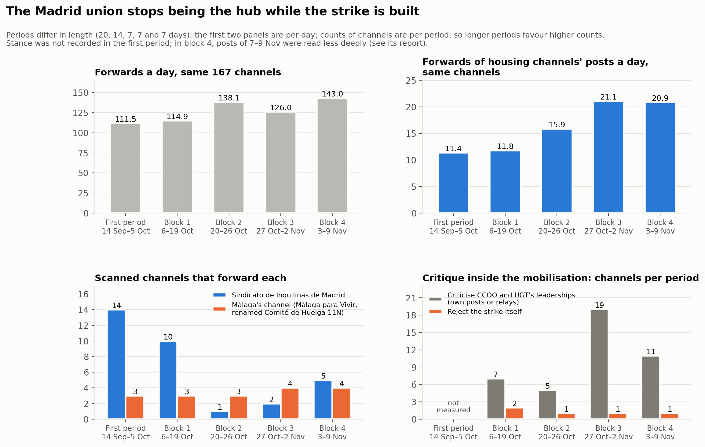
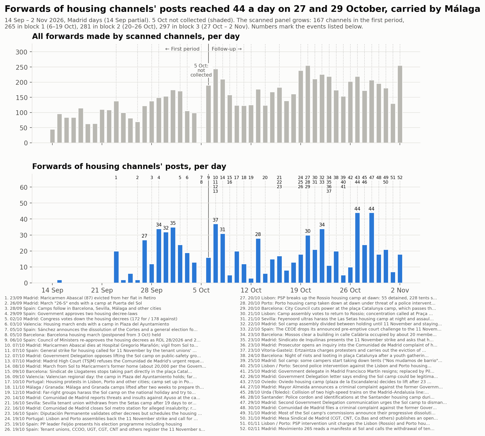

# Seguiment: del 6 d'octubre al 2 de novembre del 2026

<a href="../followup.html">English</a> · <a href="../es/followup.html">Español</a> · <strong>Català</strong>

El [primer estudi](acampadas_vivienda_technical_report.md) va cobrir del 14 de setembre
al 5 d'octubre del 2026. La mobilització va continuar: Maricarmen Abascal va morir el 7
d'octubre, els sindicats de llogateres van convocar una vaga general per l'habitatge per
a l'11 de novembre i les acampades van començar a aixecar-se. Aquest seguiment amplia
l'estudi en el temps, en blocs setmanals, fins a la vaga.

**Estat:** aquí es publiquen els blocs 1 a 3 (6 d'octubre – 2 de novembre). El bloc 4
(3–9 de novembre, que inclou el desallotjament de l'acampada de Sol el 3 de novembre) i
el bloc 5 (10–16 de novembre, la vaga) s'hi afegiran quan estiguin complets.

| Bloc | Dies (hora de Madrid) | Informe |
|---|---|---|
| 1 | 6–19 d'octubre | [Bloc 1](followup_block1.md) |
| 2 | 20–26 d'octubre | [Bloc 2](followup_block2.md) |
| 3 | 27 d'octubre – 2 de novembre | [Bloc 3](followup_block3.md) |

Totes les decisions de revisió, tant si s'hi va afegir el canal com si no, són al
[registre de revisió del seguiment (CSV, en anglès)](../followup_review_log.csv).

## Com funciona el seguiment

- **Un panell.** Els 167 canals del primer estudi s'analitzen a cada bloc, i els canals
  admesos en un bloc s'incorporen al panell a partir del següent. No s'elimina cap canal:
  si un canal deixa de publicar, això és un resultat. Així els blocs es poden comparar
  amb els mateixos canals.
- **Una ronda de revisió per bloc.** Es llegeixen els canals i grups que apareixen al
  graf de reenviaments o mencions d'un bloc, i els noms d'usuari que les pàgines públiques
  de Telegram mostren com a canals públics. Un candidat s'admet si té almenys una
  publicació pròpia sobre la mobilització al bloc (tres si publica més de 300 vegades al
  bloc). El bloc 1 va tenir una ronda addicional d'expansió per reenviaments i de cerca
  per etiquetes (hashtags).
- **Postura, bloc a bloc.** Cada canal rep una postura per a cada bloc, a partir del text
  complet de les seves publicacions: de suport; crítica des de dins (dona suport a la
  mobilització però en qüestiona els convocants o l'estratègia); hostil; informativa; o
  cap.
- **Opositors.** Un canal les publicacions del qual sobre la mobilització són hostils
  s'etiqueta com a *opositor*, sigui quin sigui el seu tipus. Els opositors s'analitzen,
  de manera que se'n veuen els vincles amb la resta, però els canals que reenvien no es
  revisen llevat que un altre canal també els reenviï. El primer estudi no tenia aquesta
  categoria.
- **Dies fixos.** Els blocs van de mitjanit a mitjanit, hora de Madrid. **El 5 d'octubre
  és un buit:** la recollida del primer estudi va acabar el 5 d'octubre a les 10:54 UTC i
  el seguiment comença el 6 d'octubre.
- **Treball assistit per un agent.** La recollida, la classificació i l'anàlisi les va
  fer un agent d'IA seguint un protocol escrit; l'equip va fixar el protocol, va prendre
  les decisions que canviaven la mostra o la classificació i en va revisar els resultats.
- **Termes de cerca per bloc.** Les paraules que indiquen que una publicació tracta de la
  mobilització es revisen i es proven a cada bloc, perquè el vocabulari canvia: de les
  acampades a la mort de Maricarmen, els decrets i la vaga.

## La trajectòria

*Les figures són en anglès.*

| | Primer període | Bloc 1 | Bloc 2 | Bloc 3 |
|---|---|---|---|---|
| Dies | 14 set – 5 oct (20) | 6–19 oct (14) | 20–26 oct (7) | 27 oct – 2 nov (7) |
| Canals al panell al final | 167 | 265 | 281 | 297 |
| Reenviaments al dia, els 167 canals del primer estudi | 111,5 | 114,9 | 138,1 | 126,0 |
| Reenviaments al dia de publicacions de canals d'habitatge, mateixos canals | 11,4 | 11,8 | 15,9 | 21,1 |
| Publicacions sobre la mobilització al dia, tots els canals | — | 101 | 73 | 76 |
| Canals que reenvien el Sindicato de Inquilinas de Madrid | 14 | 10 | 1 | 2 |
| Canals que reenvien el canal del comitè de vaga de Màlaga | 3 | 3 | 3 | 4 |
| Canals amb crítica des de dins | — | 4 | 5 | 13 |
| Canals opositors | — | 2 | 2 | 2 |
| Part dels reenviaments dels cinc reenviadors més grans | 60 % | 51,1 % | 48,5 % | 46,5 % |
| Comunitats (modularitat) | 14 (0,60) | 13 (0,698) | 18 (0,735) | 19 (0,736) |
| Coincidència amb les comunitats del període anterior (índex de Rand ajustat) | — | 0,512 | 0,586 | 0,587 |

«—»: no mesurat en aquell període. Al primer estudi no es van descarregar les publicacions
de tota la mostra ni es va registrar la postura.

## Principals resultats fins ara

1. **El sindicat de Madrid deixa de ser el node central.** Al primer estudi, el
   Sindicato de Inquilinas de Madrid era reenviat per 14 canals, més que cap altre canal
   d'habitatge. Al bloc 1, després de la mort de Maricarmen, per 10; als blocs 2 i 3, per
   1 i 2. Publica molt menys al seu canal i, segons la seva pròpia versió, ja no manté un
   punt permanent a Sol.
2. **El canal de Màlaga concentra els reenviaments de contingut d'habitatge.** Málaga
   para Vivir, rebatejat «Comité de Huelga 11N · Málaga», suma 98 dels 130 reenviaments
   de publicacions de canals d'habitatge al bloc 2 i 128 de 176 al bloc 3. Les seves
   publicacions les reenvien moltes vegades els mateixos tres o quatre canals: volum sense
   amplitud.
3. **La mobilització passa de les acampades a la vaga, i creix la dissidència interna.**
   Les publicacions dels blocs 2 i 3 tracten gairebé totes de construir la vaga de l'11 de
   novembre. Els canals que donen suport a la vaga alhora que qüestionen el paper de CCOO
   i UGT, o l'abast de la vaga, passen de 5 al bloc 2 a 13 al bloc 3; entre ells, el
   sindicat d'habitatge de Granada i una carta oberta dels sindicats alternatius de
   Madrid.
4. **Els grups territorials continuen sense reenviar-se entre ells.** Tots els
   reenviaments entre canals d'habitatge queden dins de Madrid, Barcelona, València o
   Màlaga. El primer vincle entre territoris apareix al bloc 3, i és una menció: un
   comunicat conjunt de les acampades de diverses ciutats després de l'accident
   ferroviari d'Urda.
5. **Els canals de les mateixes acampades continuen gairebé sense difondre's.** El canal
   de l'acampada de Sol va publicar 50, 32 i 11 vegades als tres blocs i va ser reenviat 3,
   7 i 2 vegades; el de l'acampada de Barcelona va publicar 103, 24 i 19 vegades i va ser
   reenviat una vegada, una vegada i cap.
6. **Els sindicats d'habitatge de Barcelona formen un grup propi**, i al bloc 3 les
   acampades de Sol i de Barcelona queden en una mateixa comunitat amb els sindicats de la
   CGT que en difonen les publicacions. Els altres grups territorials (Madrid, València,
   Màlaga amb el difusor andalús) es mantenen des del primer estudi.
7. **Els opositors són una parella tancada.** Dos mitjans són hostils a tots els blocs:
   **Nuestra España Noticias** i **Multicanal Radio**. Multicanal Radio reenvia Nuestra
   España (149, 74 i 76 vegades) i notícies del cor; cap altre canal no reenvia ni cita
   cap dels dos. La seva hostilitat és a les seves pròpies publicacions, per exemple el
   titular de Nuestra España «La ridícula huelga general que llega ocho años tarde» i el
   de Multicanal Radio «Sindicato de Inquilinas, la mano de la Revolución de la
   Ultra-izquierda». Al bloc 3 la seva postura es basa en indicis més febles (titulars
   adversos sense un atac explícit); llegits com a informatius, tots dos tornarien a ser
   mitjans. Al primer estudi, Multicanal Radio era el segon reenviador més gran, etiquetat
   com a mitjà, perquè no existia la categoria d'opositor.

## La línia temporal contínua

## Límits

- **La mostra creix per disseny.** Les comparacions entre períodes es fan amb els
  mateixos canals on importa (les files «mateixos canals» de la taula); els totals sobre
  tots els canals no són comparables.
- **Els blocs tenen durades diferents.** Els recomptes de canals per període afavoreixen
  els períodes més llargs.
- **Només text.** Les imatges, els vídeos i els articles enllaçats en general no es van
  llegir.
- **Els canals i grups privats són invisibles,** entre ells diversos canals d'acampades i
  d'assemblees d'habitatge (vegeu l'informe de cada bloc).
- **La postura i la categoria d'opositor són judicis**, recollits a l'informe de cada
  bloc amb les alternatives.
- **El context** prové de la premsa; les discrepàncies entre fonts s'assenyalen a cada
  bloc.

---

Un estudi de [DataPolitik](https://www.heuristica.barcelona/datapolitik/), d'[Heurística](https://www.heuristica.barcelona/). · [Inici](index.md) · [Presentació del seguiment](followup.md)
