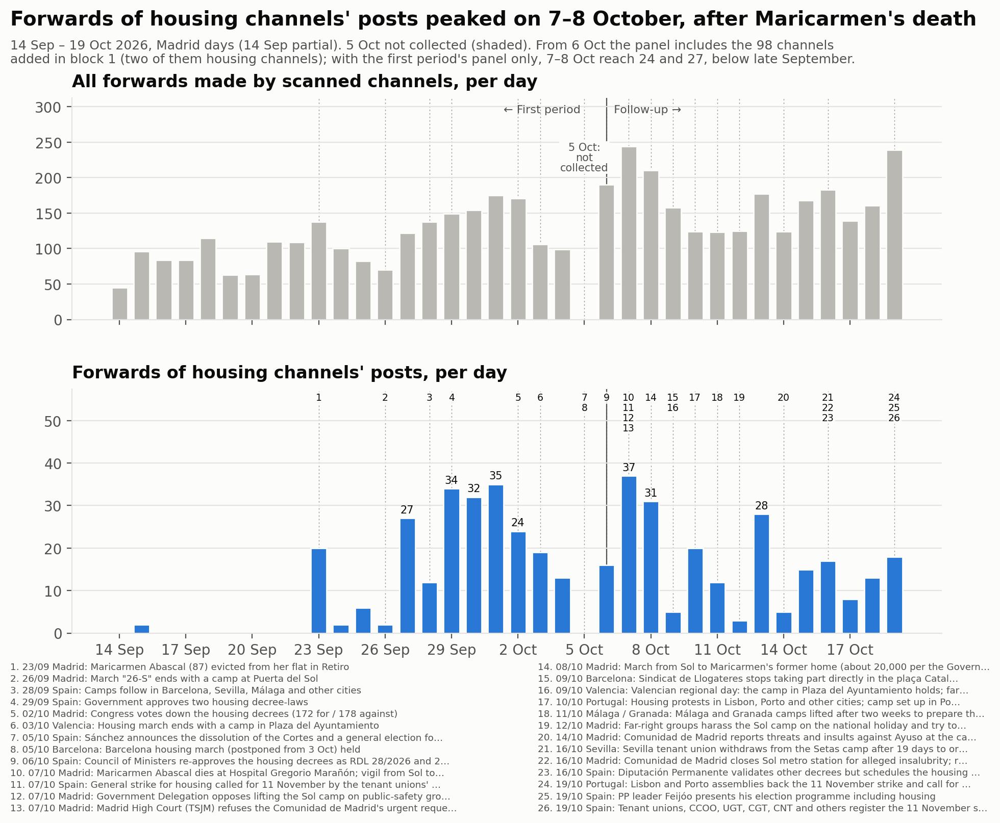
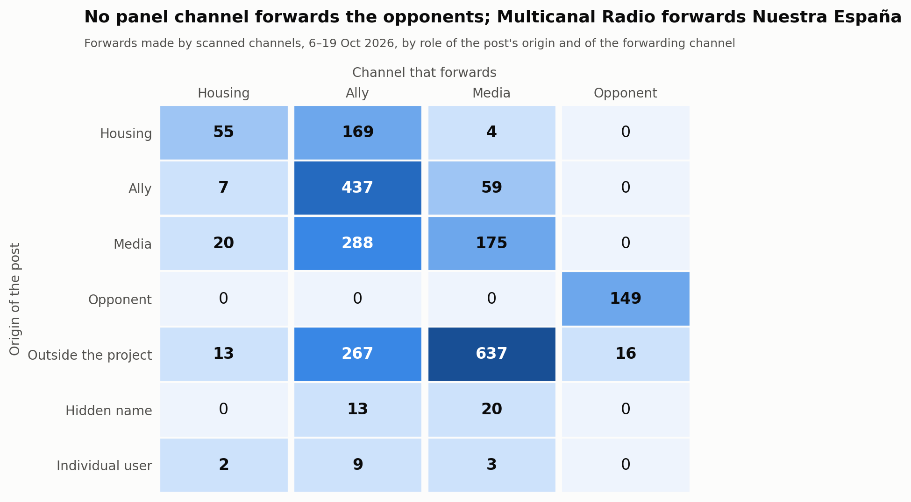
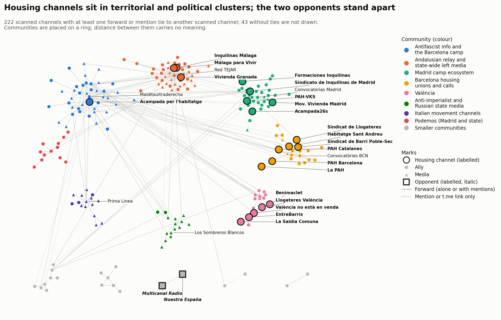

# Bloc 1: del 6 al 19 d'octubre del 2026

<a href="../followup_block1.html">English</a> · <a href="../es/followup_block1.html">Español</a> · <strong>Català</strong>

Forma part del [seguiment](followup.md) de la mobilització per l'habitatge a Telegram.
El bloc 1 cobreix del 6 d'octubre a les 00:00 al 19 d'octubre a les 24:00, hora de Madrid
(2026-10-05T22:00Z a 2026-10-19T22:00Z). La referència és el [primer període](acampadas_vivienda_technical_report.md)
(del 14 de setembre al 5 d'octubre). **El 5 d'octubre és un buit:** la recollida del
primer període va acabar el 5 d'octubre a les 10:54 UTC i el seguiment comença el 6
d'octubre; el buit no es va omplir i apareix ombrejat a la línia temporal.

*Traducció de l'original en anglès. Les figures i el registre de revisió són en anglès.*

## 1. Què va passar al bloc

Fets datats, cadascun amb almenys una font de premsa. En resum:

- **6 oct.** El Consell de Ministres va tornar a aprovar els dos decrets d'habitatge que el
  Congrés havia tombat el 2 d'octubre. El 5 d'octubre s'havien convocat eleccions
  generals.
- **7 oct.** Maricarmen Abascal (87 anys), el desnonament de la qual el 23 de setembre va
  originar les protestes, va morir a l'hospital, i una concentració va anar de Sol al
  Congrés. Els sindicats de llogateres van convocar una **vaga general per l'habitatge
  per a l'11 de novembre**. El Tribunal Superior de Justícia de Madrid (TSJM) es va tornar
  a negar a ordenar el desallotjament de l'acampada de Sol. Les fonts daten aquesta
  negativa el 5 o el 7 d'octubre; es registra el 7 d'octubre amb una nota.
- **8 oct.** Unes 20.000 persones van marxar de Sol a l'antiga casa de Maricarmen (xifra
  de la Delegació del Govern).
- **9–11 oct.** El Sindicat de Llogateres va deixar de participar directament a
  l'acampada de plaça Catalunya. L'acampada de València va resistir el dia de la
  Comunitat. Es va muntar una acampada a Porto. Les acampades de Màlaga i Granada es van
  aixecar per preparar la vaga, segons la premsa. Les publicacions de CAT-AIT Granada,
  admès a la segona ronda, ho contradiuen: difonen les assemblees de l'acampada de Granada
  del 13 i el 14 d'octubre i organitzen una xerrada «en la Acampada de Granada» el 16 i
  el 17 d'octubre. Sense resoldre.
- **12 oct.** Grups d'extrema dreta van assetjar l'acampada de Sol el dia de la festa
  nacional. Les informacions parlen de dues o de cinc detencions.
- **14–16 oct.** La Comunidad de Madrid va denunciar davant la fiscalia amenaces contra
  Ayuso i va tancar l'estació de metro de Sol. El sindicat de llogateres de Sevilla va
  deixar l'acampada de les Setas. La Diputació Permanent va fixar la votació dels decrets
  per al 12 de novembre.
- **19 oct.** Assemblees a Lisboa i Porto van donar suport a la vaga de l'11 de novembre.
  Feijóo (PP) va presentar el seu programa, que inclou l'habitatge.

## 2. La mostra

### Panell i revisió

El seguiment va començar amb els 167 canals del primer període: 24 d'habitatge
(*in-scope*), 91 aliats, 50 mitjans i 2 fora d'àmbit. No es va eliminar cap canal. Els
dos canals fora d'àmbit es van mantenir al panell i van rebre un paper després de
llegir-los (vegeu més avall). Dues rondes hi van afegir **98 canals**. Totes les
decisions, tant si s'hi va afegir el canal com si no, són al [registre de
revisió](../followup_review_log.csv) (bloc 1, columna `round`).

- **Ronda de revisió:** 78 canals (49 aliats, 28 mitjans, 1 d'habitatge) de 296 candidats
  llegits.
- **Segona ronda (expansió per reenviaments i cerca per etiquetes)**, una ronda
  addicional feta després de la revisió: 20 canals (15 aliats, 3 mitjans, 2 d'habitatge)
  de 72 candidats llegits.
  - **Cerca per etiquetes:** la cerca d'etiquetes (hashtags) de Telegram amb 13 etiquetes
    de campanya del bloc va retornar 26 canals. 15 ja eren al panell, **entre ells els
    dos opositors**; un ja s'havia rebutjat; 10 eren nous.
  - **Expansió per reenviaments:** els orígens de reenviaments que encara no eren al
    panell ni s'havien revisat, presos dels reenviaments recollits. Tots 63 els
    reenviaven només canals admesos a la ronda de revisió.
  - Cap candidat de cap dels dos tipus no era hostil.
  - El disseny preveu una ronda de revisió per bloc. Aquesta ronda és un afegit i es manté
    a part al registre i a la prova de sensibilitat de més avall.

**Panell després del bloc 1 (265 canals), per paper i postura al bloc 1.** Entre
parèntesis, els canals afegits al bloc 1 (ronda de revisió + segona ronda).

| Paper | de suport | crítica des de dins | informativa | hostil | cap | no llegible | total |
|---|---|---|---|---|---|---|---|
| habitatge | 25 (1+2) | 0 | 0 | 0 | 2 | 0 | 27 (1+2) |
| aliat | 134 (46+14) | 3 (1+1) | 2 (2+0) | 0 | 16 | 0 | 155 (49+15) |
| mitjà | 47 (16+0) | 1 | 26 (12+3) | 0 | 6 | 1 | 81 (28+3) |
| opositor | 0 | 0 | 0 | 2 | 0 | 0 | 2 |
| fora d'àmbit | 0 | 0 | 0 | 0 | 0 | 0 | 0 |

Els dos canals d'habitatge de la segona ronda:
- **Sindicat de Barri del Poble-Sec**, un sindicat de barri que atura desnonaments. Va
  muntar el comitè de vaga del Poble-Sec «per l'habitatge #11N» (#2179).
- **Sindicat d'Habitatge de Sant Andreu**, un sindicat d'habitatge: «11N VAGA GENERAL…
  Salaris pels terres i lloguers pels núvols» (#1511).

### Canvis de paper

- **Nuestra España Noticias** (@nuestraespana): mitjà → **opositor** (tipus: mitjà).
  Entre els seus propis titulars: «La ridícula huelga general que llega ocho años tarde»
  (#1947), «jóvenes patriotas se enfrentaron a los izquierdistas de la Puerta del Sol»
  (#2039) i «varias agresiones en plena calle por acampados de Sol» (#2040).
- **Multicanal Radio** (@multicanalr): mitjà → **opositor** (tipus: mitjà). Entre les
  seves pròpies publicacions: «LOS COME GAMBAS CONVOCAN HUELGA GENERAL» (#4198) i
  «Sindicato de Inquilinas, la mano de la Revolución de la Ultra-izquierda» (#4302).
  També reenvia Nuestra España. Al primer període era el segon reenviador més gran (11 %
  dels reenviaments), etiquetat com a mitjà, perquè aquell període no tenia categoria
  d'opositor.
- **Roto2bot** (@roto2botfc): fora d'àmbit → **mitjà** (un agregador), postura
  informativa. És un bot que republica els títols dels fils més responguts del fòrum
  Forocoches. Uns 25 títols tractaven de la mobilització: alguns hostils, altres de suport
  i altres neutres.
- **MEME_CCC** (@meme_ccc): fora d'àmbit → **mitjà**, postura crítica des de dins. La seva
  única publicació amb imatge sobre la vaga es burla del líder d'UGT (#VendeObreros).

### Baixes

- **En silenci:** sis canals no van publicar res al bloc.
  - Aliats: @CJSocialista, @CanadaSeQueda, @convocatoriascadiz, @mitxisantifascistas.
  - D'habitatge: @cuadernosdetrabajo, @ghlescorts.
- **Privat:** @elsaltomadrid (El Salto Madrid, mitjà) és privat i no té postura.
- **Reanomenats:** cap nom d'usuari no va canviar. Van canviar dos títols.
  - @malagaparavivir: «Málaga para Vivir» va passar a ser «**Comité de Huelga 11N •
    Málaga**».
  - @acampada26s: «Acampada26s» va passar a ser «Acampada 26S».

## 3. Anàlisi

### Volum

**Reenviaments.** Els canals analitzats van fer 2.343 reenviaments al bloc, sense comptar
els reenviaments de si mateixos: 167,4 al dia de mitjana.

- Aquesta xifra inclou els 98 canals afegits en aquest bloc. El panell del primer període
  tot sol va fer 114,9 al dia, davant de 111,5 al dia al primer període (15 de setembre –
  4 d'octubre).
- Amb el mateix panell, el volum de reenviaments gairebé no va canviar.

**Reenviaments de publicacions de canals d'habitatge.** 228 al bloc, 16,3 al dia, davant
d'11,4 al dia al primer període. La xifra del bloc compta les publicacions dels dos nous
canals d'habitatge i els reenviaments dels canals nous.

- Només amb el panell i la llista de canals d'habitatge del primer període: 11,8 al dia,
  amb 24 el 7 d'octubre i 27 el 8 d'octubre.
- Amb tot el panell, els pics del bloc segueixen la mort de Maricarmen: 37 el 7 d'octubre
  i 31 el 8 d'octubre, i 28 el 13 d'octubre.
- Per tant, els pics per sobre dels màxims del primer període (34–35 del 29 de setembre
  a l'1 d'octubre) es deuen a la mostra més gran, no a més reenviaments dels mateixos
  canals.

**Publicacions sobre la mobilització** (publicacions que coincideixen amb els termes
d'implicació, tots els canals descarregats): 1.409.

- Per paper: 204 d'habitatge, 670 d'aliats, 484 de mitjans, 51 d'opositors.
- Per postura: 1.259 de suport, 93 informatives, 51 hostils, 6 crítiques des de dins.
- Van tenir el pic el 8 d'octubre (299) i el 7 d'octubre (215) i van baixar a 30–105 al
  dia la segona setmana.
- No hi ha referència per a aquesta mesura: al primer període no es van descarregar les
  publicacions de tot el panell.

**Amb i sense els canals afegits.** Quatre canals afegits aporten cadascun més de deu
nodes del graf als quals res més no fa referència:
- ronda de revisió: @MTnews_Espanol (20) i @ophiucu (13);
- segona ronda: ANRed (24) i Conflict News (14).

Se'n van rellegir les evidències i les quatre decisions es mantenen. Cap canal afegit no
fa més del 15 % dels reenviaments del bloc; el més gran és @ophiucu amb el 9,9 %.

| | reenviaments | al dia | publicacions sobre la mobilització |
|---|---|---|---|
| tots els canals analitzats | 2.343 | 167,4 | 1.409 |
| sense MT News (repetidor de RT) | 2.343 | 167,4 | 1.404 |
| sense Los Sombreros Blancos [Z] | 2.111 | 150,8 | 1.403 |
| sense ANRed | 2.343 | 167,4 | 1.407 |
| sense Conflict News | 2.325 | 166,1 | 1.407 |
| sense els 20 canals de la segona ronda | 2.167 | 154,8 | 1.315 |
| sense els 78 canals de la ronda de revisió | 1.785 | 127,5 | 1.134 |
| sense els 98 canals afegits | 1.609 | 114,9 | 1.040 |

MT News i ANRed no fan reenviaments; publiquen enllaços. Sense Los Sombreros Blancos, la
columna de mitjans baixa de 898 a 666 reenviaments. Cap de les conclusions de més avall
no depèn d'un sol d'aquests canals.

**Concentració.** Els cinc reenviadors més grans fan el 51,1 % de tots els reenviaments:

| Canal | Paper | Reenviaments | Part |
|---|---|---|---|
| Red TEJAR | aliat | 382 | 16,3 % |
| Prima Linea | mitjà | 297 | 12,7 % |
| Los Sombreros Blancos | mitjà | 232 | 9,9 % |
| Multicanal Radio | opositor | 165 | 7,0 % |
| @nullaesrbu | mitjà | 122 | 5,2 % |

### Qui reenvia qui

Reenviaments, segons el paper del canal d'origen de la publicació i del canal que la
reenvia. Entre parèntesis, les xifres del primer període.

**Publicacions de canals d'habitatge**
- 169 reenviades per aliats (156).
- 55 reenviades per altres canals d'habitatge (76).
- 4 reenviades per mitjans (4).

**Canals d'habitatge que reenvien altres canals**
- 7 reenviaments d'aliats (12).
- 20 reenviaments de mitjans.
- 13 reenviaments de canals externs.

El patró del primer període es manté: **els aliats difonen els canals d'habitatge; els
canals d'habitatge difonen poc.** L'augment de canals d'habitatge que reenvien mitjans i
canals externs es deu als dos nous sindicats de Barcelona; només Sant Andreu fa 40
reenviaments. Els mitjans reenvien sobretot canals externs: 637 dels 898 de la columna de
mitjans.

**Opositors.** La fila i la columna d'opositors només contenen dos fluxos:
- Multicanal Radio reenviant Nuestra España, 149 vegades.
- Multicanal Radio reenviant un canal extern de premsa del cor, 16 vegades.

Cap canal del panell no reenvia ni menciona amb @ cap opositor, i els opositors no
reenvien ni mencionen canals del panell.

### Node central, difusors, territoris i acampades

**El sindicat de Madrid.** El Sindicato de Inquilinas de Madrid continua sent el node
central per amplitud.
- Bloc: reenviat per 10 canals analitzats, 39 reenviaments.
- Primer període (20 dies): reenviat per 14 canals, 31 reenviaments.
- El segueix en amplitud un canal nou: el Sindicat de Barri del Poble-Sec, reenviat per 4
  canals (18 reenviaments).

**Amplitud davant de volum.** Els canals de Màlaga es reenvien més vegades, però des de
menys canals.

| Canal | Reenviaments | Canals que el reenvien |
|---|---|---|
| Inquilinas Málaga | 66 | 4 |
| Málaga para Vivir | 53 | 3 |

36 d'aquests reenviaments són els dos canals de Màlaga reenviant-se entre ells.

**Difusors menors**

| Canal | Canals que el reenvien | Reenviaments |
|---|---|---|
| Vivienda Granada | 2 | 18 |
| València no està en venda | 3 | 10 |
| EntreBarris | 3 | 3 |
| Llogateres València | 3 | 3 |

**Canals no difosos.** 11 dels 27 canals d'habitatge no els va reenviar cap canal
analitzat.

**Els grups territorials continuen sense reenviar-se entre ells.** Hi ha dotze vincles de
reenviament entre canals d'habitatge.
- **Entre territoris:** un, dins d'una mateixa organització: La PAH → PAH Barcelona (1).
- **Dins de cada territori:**
  - Màlaga: 36 reenviaments entre els seus dos canals.
  - Barcelona: 4 vincles. Poble-Sec → Sant Andreu (8), Sindicat de Llogateres →
    Poble-Sec i → Sant Andreu, PAH Catalanes → Sant Andreu.
  - València: 4 vincles.
  - Madrid: Formaciones → Sindicato de Inquilinas de Madrid.
- **Nou des del primer període:** la segona ronda hi afegeix un grup barceloní de canals
  d'habitatge que es reenvien entre ells.

**Els canals de les acampades gairebé no es difonen.**
- Acampada26s (Madrid): 50 publicacions al bloc, reenviada 3 vegades per un canal
  (Difusión urgente, afegit a la segona ronda), mencionada amb @ per dos.
- Acampada per l'habitatge (Barcelona): 103 publicacions, reenviada una vegada (per
  @antifascistas), mencionada per dos.

Al primer període no es va reenviar cap dels dos canals d'acampada.

### Vincles que van aparèixer i desaparèixer

La comparació abasta els 165 canals del panell analitzats en tots dos períodes, de manera
que els canals afegits no l'alteren.

| Vincles entre ells | Bloc 1 | Primer període |
|---|---|---|
| Total | 221 | 365 |
| Mantinguts | 154 | 154 |
| Nous al bloc 1 | 67 (50 de reenviament, 17 d'enllaç) | – |
| Desapareguts des del primer període | – | 211 (148 de reenviament, 63 d'enllaç) |

El primer període dura 20 dies i el bloc 14, de manera que part de la pèrdua es deu a la
finestra més curta.

Vincles nous:
- Els canals de Podemos es reenvien entre ells: @ahorapodemos → PodemVLC, PodemPV, Pablo
  Echenique i altres.
- Sare Antifaxista (informació antifeixista basca) reenvia ara el Sindicato de Inquilinas
  de Madrid (2 reenviaments).
- La Directa la reenvien ara PAH Barcelona i PAH Catalanes.
- València no està en venda la reenvia EntreBarris.

### Contacte entre els opositors i la resta

Es van llegir tots els esdeveniments que uneixen un opositor amb un canal que no ho és:
17.

- **16 reenviaments de premsa del cor.** Multicanal Radio reenvia publicacions
  d'@elmarujeo sobre actors, cantants i influenciadors. Cap no tracta de la mobilització.
  @elmarujeo no va ser candidat a revisió, perquè només un opositor hi fa referència.
- **1 menció amb @.** És l'usuari de la signatura de l'autor d'un article de Nuestra
  España sobre el PSOE («Historia del 'gang' del PSOE - TERCERA PARTE», #2010). No tracta
  de la mobilització, i el compte està pseudonimitzat.

**No hi ha cap vincle de cita hostil**: cap canal del panell no reenvia ni enllaça una
publicació d'un opositor per citar-la. L'hostilitat dels opositors es veu a les seves
pròpies publicacions: 51 publicacions sobre la mobilització, totes d'aquests dos canals.
Els opositors formen una parella tancada; el mapa de la xarxa els dibuixa a part.

### Comunitats

Graf combinat de reenviaments i mencions dels canals analitzats: 222 nodes, 385 arestes,
43 canals analitzats sense vincles.

**Louvain amb 50 llavors.**
- Etiquetes de consens: 13 comunitats, modularitat 0,698. La partició per paper dona
  0,121.
- Estabilitat:
  - 16 particions diferents; la més freqüent apareix en el 16 % de les execucions.
  - Estabilitat mitjana per node 0,95.
  - Onze nodes queden per sota de 0,8; deu d'ells, a les vores de les comunitats 1–3, a
    0,55:
    - @XRMadrid, @xrebellion_esp, @Rebelioncientifica i @madconvocala;
    - @SevillaAnticarcelaria, @gruporuptura i @ZaragozaCNT;
    - @anticapimadrid, @liberarmadrid i @anticapitalistasmov.
  - L'onzè és @PabloEchenique (0,75).
- El primer període tenia 14 comunitats, modularitat 0,60, 31 particions diferents amb
  una part màxima del 8 % i una estabilitat mitjana per node de 0,96.

Les comunitats, amb el nom dels seus canals principals:

| # | Nom | Canals | Membres d'habitatge |
|---|---|---|---|
| 1 | Difusor andalús i mitjans d'esquerra estatals | 45 | Inquilinas Málaga, Málaga para Vivir, Vivienda Granada |
| 2 | Informació antifeixista i l'acampada de Barcelona | 42 | Acampada per l'habitatge (també Sare Antifaxista i els canals bascos) |
| 3 | Ecosistema de l'acampada de Madrid | 36 | Sindicato de Inquilinas de Madrid, Acampada26s, PAH-VKS, Formaciones, Mov. Vivienda Madrid |
| 4 | Sindicats d'habitatge i convocatòries de Barcelona | 22 | Habitatge Sant Andreu, Poble-Sec, PAH Barcelona, Sindicat de Llogateres, PAH Catalanes, La PAH |
| 5 | Mitjans antiimperialistes i estatals russos | 15 | — (TASS, Los Sombreros Blancos, MT News, ANRed, Cubadebate, Al Mayadeen) |
| 6 | Canals de moviments italians | 15 | — (Prima Linea, Radio Onda d'Urto, C.S.O.A. Ex Snia, Infoaut, Conflict News) |
| 7 | València | 15 | València no està en venda, EntreBarris, Llogateres València, Benimaclet |
| 8 | Podemos (Madrid i estatal) | 12 | — |
| 9–13 | CNT-AIT i solidaritat amb Palestina (8); CCOO (6); **opositors** (2); Marx21 (2); convocatòries de Sevilla (2) | | — |

**Coincidència amb el primer període.** En els 131 canals presents a totes dues
particions combinades, l'índex de Rand ajustat és **0,512**: 21 canals apareixen només al
graf del primer període i 91 només al d'aquest bloc. L'estructura territorial persisteix:
Madrid, València, i Màlaga amb el difusor andalús.

El canvi principal d'aquest bloc és Barcelona. Amb els canals de la segona ronda, les
organitzacions d'habitatge de Barcelona formen una comunitat pròpia. Al primer període i
a la versió d'aquest bloc amb només la ronda de revisió, eren amb els canals d'informació
antifeixista. L'altre canvi és que canals nous formen les seves pròpies comunitats:
canals de moviments italians, i mitjans estatals russos i antiimperialistes.

## 4. Llistes de termes

Les llistes del bloc 1 es van elaborar des de zero i es van provar. El vocabulari va
passar dels termes de les acampades del primer període a uns altres de nous:
- la vaga de l'11 de novembre, escrita 11N, amb una regla sensible a majúscules i una
  regla de proximitat entre data i vaga;
- Maricarmen;
- els decrets;
- els noms dels sindicats de llogateres;
- les etiquetes de campanya;
- formes en basc, gallec i portuguès.

Dos falsos positius van portar a les regles de proximitat: la visita del Papa «del 8 a
l'11 de novembre» i la data en basc «urriaren 11n». Mancances conegudes, per corregir al
bloc 2:
- «a la huelga» sense «general»;
- publicacions que són només imatge.

La vaga educativa de Madrid (des del 14 d'octubre) és un conflicte diferent i no és a les
llistes.

## 5. Decisions que podrien haver estat unes altres

**Postura i papers**
- Roto2bot com a mitjà/informativa; podria ser opositor (tipus: agregador).
- MEME_CCC com a crítica des de dins; podria ser hostil.
- @gruporuptura com a crítica des de dins; podria ser de suport.
- @bultzaka (Bultza EHM-L) com a aliat/crítica des de dins. El seu article diu que la
  vaga d'un dia és «oportunista y electoralista»; podria quedar fora de l'àmbit de la
  mobilització per l'habitatge.
- Mitjans: de suport quan el canal pren posició amb les seves pròpies paraules,
  informativa quan només publica titulars. Casos límit: Al Mayadeen, eldiario.es, Diari
  La Veu, Crític.
- Les mencions de passada i els enllaços solts a X es van llegir com a postura *cap*. Els
  enllaços no es van seguir.
- Diverses postures de suport es basen en una sola publicació breu:
  MovimientoAntirrepreMad, oscarreinasat, podemosparla, reinonis_vlc, sentitcritic,
  azadijinvalencia, convocatoriasevilla.
- Les publicacions sobre els decrets d'habitatge compten com a publicacions sobre la
  mobilització.

**Revisió**
- La regla que un canal amb més de 300 missatges necessita tres publicacions pròpies sobre
  la mobilització en va rebutjar nou amb una o dues publicacions d'aquest tipus. Entre
  ells, HispanTV, Data Urgente, Entre Guerras i DD Geopolitics.
- Formaciones Sindicato de Inquilinas admès com a canal d'habitatge; podria ser aliat.
- Contropiano admès per un enllaç a un article propi l'adreça del qual nomena la vaga de
  l'11 de novembre. L'article no es va obrir.
- ALUCHE.RED admès perquè la pàgina d'esdeveniment que enllaça vincula el seu comitè de
  vaga juvenil amb la vaga de l'11 de novembre.
- Ecologistas Indignadas rebutjat: el seu enllaç «la ciudad efímera de Sol» (10
  d'octubre) no es va poder verificar.
- Radical Graffiti admès com a aliat/informativa; C.S.O.A. Ex Snia admès per una
  publicació en italià que no coincidia amb cap terme.
- Xats de grup rebutjats per ser conversa oberta.
- Activisme per l'habitatge no vinculat a la mobilització rebutjat (Avlaunionhtz,
  colabbikestein).
- Les publicacions sobre la vaga educativa no es van comptar com a mobilització.

**Segona ronda (expansió per reenviaments i cerca per etiquetes)**
- Fer-la o no: el disseny té una ronda de revisió per bloc. El seu efecte es mostra a part
  a la taula de sensibilitat.
- Sindicat de Barri del Poble-Sec com a canal d'habitatge (un sindicat de barri que
  atura desnonaments); podria ser aliat.
- Kursant com a aliat/crítica des de dins: el seu document diu que la convocatòria de
  vaga «quedará en una estrategia electoralista de CCOO, UGT y PSOE».
- Descontrol Editorial i Difusión urgente admesos per una publicació cadascun: una llista
  de lectures emmarcada en la vaga, i etiquetes de campanya en una publicació electoral.
- CA-AIT Marina Alta admès per un comunicat de suport «al moviment per la vivenda» el text
  enllaçat del qual no es va obrir.
- elintrusoAVE rebutjat: el seu «respeto y admiración por #laacampadadeSol» és una frase
  de passada en una publicació electoral.
- Es va mantenir el rebuig d'AV La Unión de Hortaleza. La seva publicació #NosQuedamos
  tracta del barri de la UVA de Hortaleza.
- Etiquetes cercades: només les usades per almenys dos canals d'habitatge; es van deixar
  fora les etiquetes genèriques.

**Anàlisi**
- Els usuaris no identificats que no són canals o grups públics verificats estan
  pseudonimitzats als fitxers del graf i de l'anàlisi. Alguns poden ser organitzacions.
- Els noms de les comunitats són interpretacions dels canals principals de cada comunitat.

## 6. Què no es va verificar

**Contingut no llegit**
- **Imatges, vídeos i àudio:** no es van llegir, llevat de dues publicacions amb imatge
  llegides a la previsualització web pública (MEME_CCC #1008, Sistema 161 #3509).
- **Enllaços:** no es van seguir els articles enllaçats ni els enllaços a X, llevat
  d'alguns esmentats més amunt.
- **Candidats grans:** per als candidats amb 30 o més publicacions pròpies i cap
  coincidència de termes, només es va fer una comprovació àmplia per paraules clau. Als
  més petits es va llegir l'inici de cada publicació, i el text complet només on podia
  tractar de la mobilització.

**Canals i comptes no assolits**
- **Canals privats:** set candidats no es van poder llegir, entre ells tres canals
  d'acampada o d'habitatge (Acampada Plaça Ajuntament, València; ACAMPADA CONSTITUCIÓN,
  Màlaga; Difusión Asamblea de Vivienda Sevilla). Tampoc no es va poder llegir El Salto
  Madrid, del panell.
- **Usuaris no identificats:** 160 usuaris sense compte públic no es van comprovar més.
  27 usuaris de persones o bots no van ser candidats.
- **Cobertura de la cerca per etiquetes:** la cerca d'etiquetes de Telegram retorna només
  canals públics de difusió, no grups. La cerca no registra quina etiqueta va trobar cada
  canal.
- **Enllaços de la segona ronda:** l'expansió per reenviaments de la segona ronda cobreix
  només els orígens de reenviaments. No es van revisar les destinacions dels enllaços dels
  canals nous.

**Buits a les dades**
- **5 d'octubre:** no recollit, per disseny.
- **Dates:** la data de la negativa del TSJM i el nombre de detencions del 12 d'octubre
  difereixen segons les fonts.

**No comprovat**
- **Colors:** el mapa de la xarxa es recolza en la posició a l'anell i en la llegenda on
  hi ha parells de colors que no superen la comprovació de tots els parells.

**Com citar aquesta pàgina.**

DataPolitik (Heurística). <em>Bloc 1: del 6 al 19 d'octubre del 2026</em>. Dins de <em>Acampades per l'habitatge i xarxes de comunicació a Telegram a Espanya, tardor del 2026</em>. Període d'observació: 6–19 d'octubre del 2026. Publicat el 7 de novembre del 2026. <a href="https://datapolitik.github.io/acampadas-vivienda-report/ca/followup_block1.html">https://datapolitik.github.io/acampadas-vivienda-report/ca/followup_block1.html</a>

Text i figures originals: [CC BY 4.0](https://creativecommons.org/licenses/by/4.0/) · [Ús i citació](index.md#use-and-citation)

---

Un estudi de [DataPolitik](https://www.heuristica.barcelona/datapolitik/), d'[Heurística](https://www.heuristica.barcelona/). · [Inici](index.md) · [Presentació del seguiment](followup.md)
