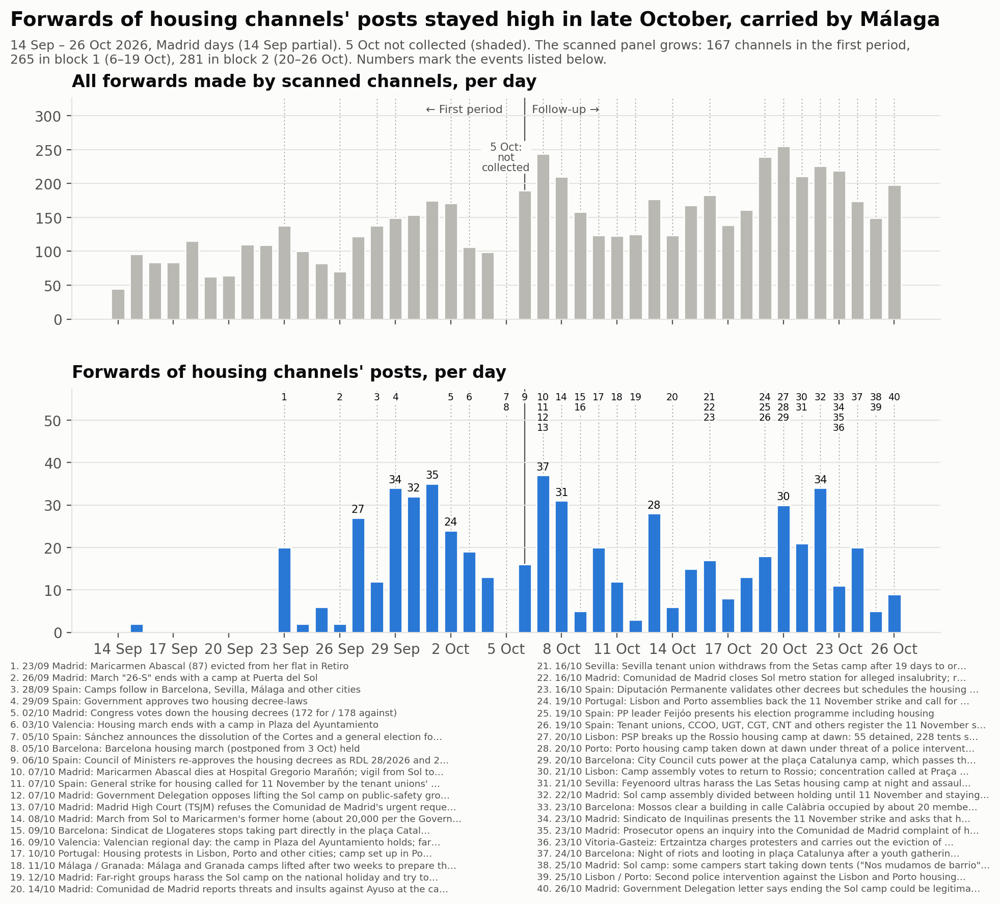
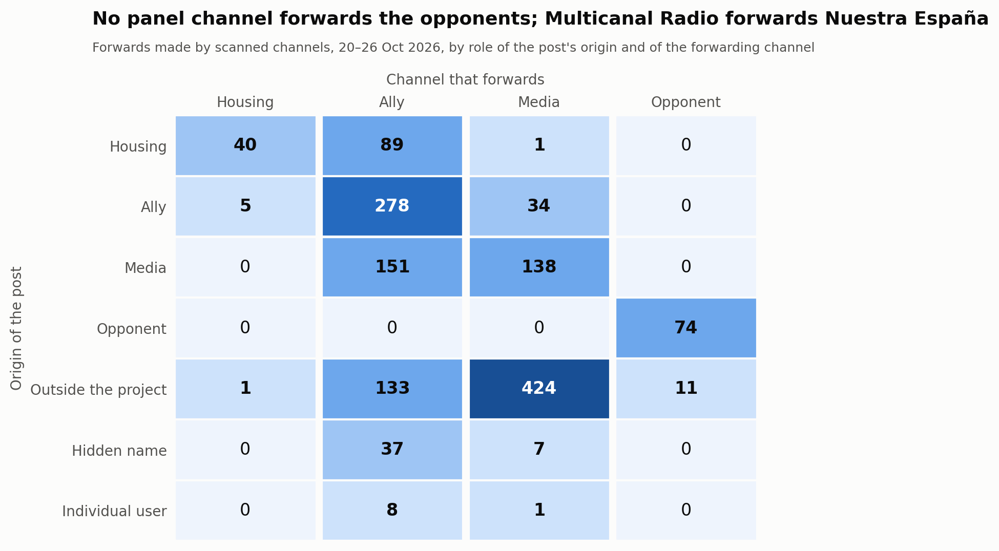
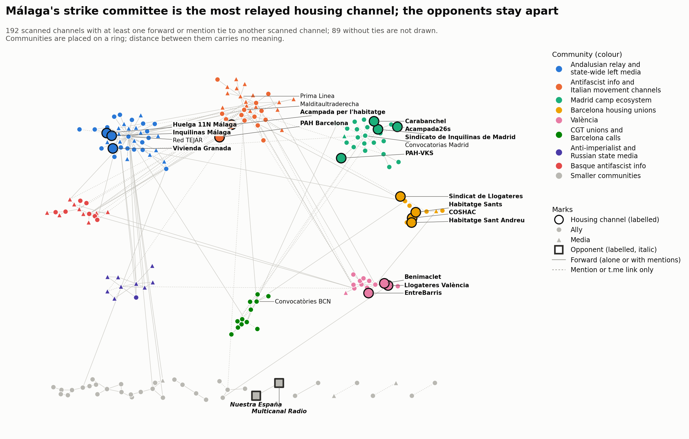

# Bloc 2: del 20 al 26 d'octubre del 2026

<a href="../followup_block2.html">English</a> · <a href="../es/followup_block2.html">Español</a> · <strong>Català</strong>

Forma part del [seguiment](followup.md) de la mobilització per l'habitatge a Telegram.
El bloc 2 cobreix del 20 d'octubre a les 00:00 al 26 d'octubre a les 24:00, hora de
Madrid (2026-10-19T22:00Z a 2026-10-26T23:00Z). L'horari d'hivern va començar el 25
d'octubre, de manera que els dos últims dies del bloc tenen 25 i 24 hores.

- **Comparacions:** amb el bloc 1 (6–19 d'octubre) i, quan són comparables, amb el primer
  període (14 de setembre – 5 d'octubre, el [primer període](acampadas_vivienda_technical_report.md)).
- **El buit del 5 d'octubre** continua sense omplir-se i apareix ombrejat a la línia
  temporal.
- **El bloc dura 7 dies i el bloc 1, 14:** els totals es comparen per dia.

*Traducció de l'original en anglès. Les figures i el registre de revisió són en anglès.*

## 1. Què va passar al bloc

Fets datats, cadascun amb almenys una font de premsa. En resum:

- **20 oct, Portugal.** La policia (PSP) va dissoldre a trenc d'alba l'acampada del
  Rossio a Lisboa: 55 detinguts i 228 tendes requisades, segons la PSP. L'acampada de
  Porto es va desmuntar aquell mateix matí sota l'amenaça d'una intervenció. Els mitjans
  no coincideixen sobre si la va desmuntar la PSP o els manifestants.
  - El 21 d'octubre l'assemblea de Lisboa va votar tornar al Rossio.
  - teleSUR, citant RTP, informa d'una segona intervenció contra totes dues acampades el
    25 d'octubre: 31 detinguts i 33 ferits. La data i les xifres són incertes.
- **20 oct, Barcelona.** L'Ajuntament va tallar la llum a l'acampada de plaça Catalunya,
  aleshores a la quarta setmana i amb unes 600 tendes.
- **21 oct, Sevilla.** Ultres del Feyenoord van assetjar de nit l'acampada de les Setas i
  van agredir persones sense llar als voltants abans d'un partit de la Champions League.
- **22 oct, Madrid.** L'assemblea de l'acampada de Sol estava dividida entre aguantar fins
  a l'11 de novembre i quedar-s'hi indefinidament. Molts acampats estaven recollint.
- **23 oct.**
  - **Barcelona:** unes 20 persones de l'acampada i dels sindicats d'habitatge van ocupar
    un edifici buit al carrer Calàbria 177 («La Revolta»). Els Mossos el van desallotjar
    aquell mateix dia.
  - **Madrid:** el Sindicato de Inquilinas va presentar la vaga i va demanar que
    l'habitatge fos l'eix de la campanya del 29 de novembre. Va dir que ja no manté un
    punt permanent a Sol.
  - **Vitoria-Gasteiz:** l'Ertzaintza va carregar contra els manifestants i va executar
    el desnonament d'una família amb sis fills a Sansomendi. Estudiants d'onze centres van
    aturar les classes per sumar-se a la protesta.
- **24 oct, Barcelona.** Una nit d'aldarulls i saquejos a plaça Catalunya va seguir una
  concentració juvenil convocada a les xarxes socials: 128 detinguts, segons els Mossos.
  Les autoritats la van desvincular de l'acampada de la mateixa plaça.
- **25–26 oct, Madrid.** Alguns acampats van començar a desmuntar tendes («Nos mudamos de
  barrio»). El 26 d'octubre una carta de la Delegació del Govern deia que posar fi a
  l'acampada podia ser legítim passat un temps raonable. El Español va estimar
  l'assistència en unes 1.000 persones, davant d'un màxim de 2.000.

Després del bloc: l'acampada de Sol va ser desallotjada el 3 de novembre (bloc 4).

## 2. La mostra

### Panell i revisió

El bloc 2 va analitzar els 265 canals del panell. Després, una ronda de revisió va
admetre **16 de 262 candidats llegits**:
- 202 canals i grups del graf del bloc;
- 57 usuaris no identificats que les pàgines públiques de Telegram van mostrar com a
  canals o grups públics;
- 3 canals trobats provant noms d'usuari de marca + ciutat per a comitès de vaga i
  acampades locals (`huelga11n`, `huelgageneral11n`, `sindicathabsc`), tots sense
  contingut.

No es va trobar cap comitè de vaga local amb canal de Telegram: els comitès que apareixen
a les publicacions enllacen al web de la vaga, a WhatsApp i a Instagram.

Totes les decisions, tant si s'hi va afegir el canal com si no, són al [registre de
revisió](../followup_review_log.csv) (bloc 2).

**Admesos**
- **d'habitatge:** COSHAC (confederació catalana de sindicats d'habitatge); Grup
  d'Habitatge de Sants.
- **aliats:** Anticapitalistas Aragón; CGT Barcelona; CGT Baix Llobregat; CGT
  Socioeconómico; CA-AIT Sierra de Madrid; Comunismo Revolucionário Galego;
  Laintersección; Agenda del Henares; Fridays For Future Madrid.
- **mitjans:** ARAINFO, AhotsaInfo i Maldito Bulo (informativa); Wesh La Smala (de
  suport); Supernova (crítica des de dins).
- Quatre d'ells s'havien rebutjat al bloc 1 i ara passen per les seves publicacions del
  bloc 2: CGT Baix Llobregat, CGT Socioeconómico, AhotsaInfo i Wesh La Smala.

**No admesos**
- Set candidats eren privats.
- Cap candidat no era hostil.

> **Regla revisada (10 de novembre del 2026).** Aquí *crítica des de dins* inclou els
> canals que donen suport a la vaga alhora que qüestionen CCOO i UGT o la seva
> estratègia. La regla es va revisar després: aquests canals compten com a de suport,
> amb la crítica registrada a part, i només els que rebutgen la mateixa vaga són
> *crítics amb la vaga*. Vegeu la [visió general del seguiment](followup.md).
> Aquest informe es manté tal com es va publicar.

**Panell després del bloc 2 (281 canals), per paper i postura al bloc 2**

| Paper | de suport | crítica des de dins | informativa | hostil | cap | no llegible | total |
|---|---|---|---|---|---|---|---|
| habitatge | 20 | 1 | 0 | 0 | 8 | 0 | 29 |
| aliat | 91 | 2 | 2 | 0 | 69 | 0 | 164 |
| mitjà | 18 | 2 | 17 | 0 | 48 | 1 | 86 |
| opositor | 0 | 0 | 0 | 2 | 0 | 0 | 2 |
| fora d'àmbit | 0 | 0 | 0 | 0 | 0 | 0 | 0 |

### Canvis de postura des del bloc 1

**Cap paper no va canviar.** Tots dos opositors van tornar a ser hostils.
- **Nuestra España**, al seu propi titular: «Maricarmen: administradora única de una
  empresa de alquileres de 5,7M, el timo que se tragó la izquierda» (#2122).
- **Multicanal Radio:** «¿ESPAÑA ARDERÁ COMO FRANCIA? Huelga 11N de UGT y CCOO al
  descubierto» (#4403). També va reenviar el #2122.

**La crítica des de dins del moviment apareix per primera vegada entre els canals
d'habitatge.** Cadascun d'aquests dona suport a la vaga alhora que en discuteix els
coorganitzadors.
- **El Sindicato de Vivienda de Granada (d'habitatge)** va publicar un comunicat conjunt
  (llegit a la imatge de la previsualització web).
  - La seva tesi: «las burocracias sindicales de CCOO y UGT» convoquen «una huelga
    simbólica... en favor del Gobierno», una vaga al servei de «los intereses electorales
    del PSOE».
  - El seu rebuig: «No marcharemos con los cómplices de nuestra miseria. ¡Hacia la huelga
    general 11N!» (#588).
- **Liza Anarquista** difon el mateix comunicat.
- **Diario Socialista** recull la posició de la Coordinadora Juvenil Socialista (CJS):
  les direccions de CCOO i UGT «convierten la huelga en un acto electoral para el PSOE».
- **Bultza EHM-L i Supernova** objecten el «réformisme» de la vaga.

**Molts canals no tenen postura en aquest bloc.** 125 dels 265 canals del panell tenen
postura *cap* al bloc 2. Entre ells, els mitjans que van passar la revisió del bloc 1 per
la mort de Maricarmen: MT News, Los Sombreros Blancos i franceinfo.

### Baixes

Respecte al bloc 1.

- **En silenci:** 20 canals no van publicar res al bloc.
  - D'habitatge: La PAH, PAH Catalanes, Sindicato de Vivienda de Carabanchel, Cuadernos
    de trabajo, ghlescorts.
- **Privat:** El Salto Madrid, encara privat.
- **Reanomenats:** un nom d'usuari, @airbnbcrepa → @lecitta. Tres títols: el canal
  antifeixista basc hi va afegir «/ FAK!»; els canvis de Málaga para Vivir i Acampada26s
  vénen del bloc 1.

## 3. Anàlisi

### Volum

**Reenviaments.** Els canals analitzats van fer 1.432 reenviaments al bloc, sense comptar
els reenviaments de si mateixos: **204,6 al dia**, davant de 167,4 al bloc 1.

| Panell | Primer període | Bloc 1 | Bloc 2 |
|---|---|---|---|
| els 167 canals del primer període | 111,5 | 114,9 | **138,1** |
| el panell al final del bloc 1 (265) | – | 167,4 | 193,3 |
| tots els canals analitzats | – | 167,4 | 204,6 |

Amb el mateix panell, els reenviaments van pujar prop d'un 20 % del bloc 1 al bloc 2.

**Reenviaments de publicacions de canals d'habitatge:** 130 al bloc, 18,6 al dia (bloc 1:
16,3).
- Només amb el panell i la llista de canals d'habitatge del primer període: 15,9 al dia
  (bloc 1: 11,8; primer període: 11,4).
- Pic: 34 el 22 d'octubre.
- **La majoria d'aquests reenviaments vénen d'un sol canal**: el Comité de Huelga 11N de
  Màlaga, amb 98 dels 130. Les seves publicacions les reenvien unes 33 vegades cadascun
  els mateixos tres canals: Inquilinas Málaga, Red TEJAR i La Invisible.

**Publicacions sobre la mobilització** (publicacions que coincideixen amb els termes
d'implicació; tots els canals descarregats): 511, **73 al dia** davant de 101 al bloc 1.
- Amb el panell al final del bloc 1: 482, 69 al dia.
- Per paper: 83 d'habitatge, 300 d'aliats, 119 de mitjans, 9 d'opositors.
- Per postura: 449 de suport, 37 informatives, 12 crítiques des de dins, 9 hostils, 4
  cap (aquestes últimes són falsos positius en canals llegits com a *cap*).
- Pics el 21 d'octubre (113) i el 26 d'octubre (110).

La conversa sobre la mobilització es redueix mentre els reenviaments creixen. Els
reenviaments tracten de molts temes, entre ells Ceuta, Palestina, les protestes de França
i Itàlia i les eleccions.

**Amb i sense els canals admesos.** Cap canal admès no fa més del 15 % dels reenviaments
del bloc (el més gran és Wesh La Smala, 59, 4,0 %). Cap no aporta més de dos candidats
als quals res més no fa referència. Sense els 16 canals admesos: 1.353 reenviaments
(193,3 al dia) i 482 publicacions sobre la mobilització.

**Concentració.** Els cinc reenviadors més grans fan el 48,5 % de tots els reenviaments:

| Canal | Paper | Reenviaments | Part |
|---|---|---|---|
| Red TEJAR | aliat | 230 | 16,1 % |
| Prima Linea | mitjà | 209 | 14,6 % |
| Los Sombreros Blancos | mitjà | 108 | 7,5 % |
| Multicanal Radio | opositor | 85 | 5,9 % |
| @nullaesrbu | mitjà | 63 | 4,4 % |

### Qui reenvia qui

Reenviaments, segons el paper del canal d'origen de la publicació i del canal que la
reenvia; entre parèntesis, el bloc 1.

**Publicacions de canals d'habitatge**
- 89 reenviades per aliats (169).
- 40 reenviades per altres canals d'habitatge (55).
- 1 reenviada per mitjans (4).

**Canals d'habitatge que reenvien altres canals**
- 5 reenviaments d'aliats (7).
- 0 reenviaments de mitjans (20).
- 1 reenviament d'un canal extern (13).

Els **mitjans** reenvien sobretot canals externs: 424 de 605.

**Opositors.**
- Multicanal Radio reenvia Nuestra España 74 vegades, i un canal extern de premsa del cor
  11 vegades.
- Cap canal del panell no reenvia ni menciona amb @ cap opositor.

### Node central, difusors, territoris i acampades

**El sindicat de Madrid ja no és el node central.**

| Sindicato de Inquilinas de Madrid | Canals que el reenvien | Reenviaments | Publicacions pròpies |
|---|---|---|---|
| Bloc 1 (14 dies) | 10 | 39 | 33 |
| Bloc 2 (7 dies) | 1 (Difusión urgente) | 3 | 5 |

Va publicar molt menys al seu canal. Les seves publicacions del bloc 2 tracten de la
vaga, el «decreto Maricarmen» i un acte a Vistalegre.

**Els més difosos per amplitud**

| Canal | Canals que el reenvien | Reenviaments |
|---|---|---|
| Comité de Huelga 11N · Málaga | 3 | 98 |
| COSHAC | 3 | 5 |
| Sindicat de Llogateres · València | 3 | 4 |

16 dels 29 canals d'habitatge no els va reenviar cap canal analitzat.

**Els grups territorials continuen sense reenviar-se entre ells.** Els cinc vincles de
reenviament entre canals d'habitatge queden dins d'un territori:
- Màlaga: 33 reenviaments.
- Barcelona: COSHAC → Sant Andreu i → Sants, Acampada per l'habitatge → PAH Barcelona.
- València: Llogateres → Benimaclet.

**Canals de les acampades.**
- **Acampada26s (Madrid):** 32 publicacions, reenviada 7 vegades, totes per Difusión
  urgente.
- **Acampada per l'habitatge (Barcelona):** 24 publicacions, reenviada una vegada, per PAH
  Barcelona.

Totes dues acampades continuen publicant. Les publicacions de Sol són sobretot
assemblees, tallers i desmentiments de notícies falses («BULO», «FALSO»).

### Vincles que van aparèixer i desaparèixer

La comparació abasta els 263 canals del panell analitzats en tots dos blocs.

| Vincles entre ells | Bloc 2 | Bloc 1 |
|---|---|---|
| Total | 254 | 428 |
| Mantinguts | 170 | 170 |
| Nous al bloc 2 | 84 (64 de reenviament, 20 d'enllaç) | – |
| Desapareguts des del bloc 1 | – | 258 (189 de reenviament, 69 d'enllaç) |

El bloc 1 dura el doble, de manera que part de la pèrdua es deu a la finestra més curta.

Vincles nous:
- Difusión urgente reenvia el sindicat de Madrid.
- El sindicat de Barcelona reenvia Palestina SOS.
- CSOA l'Horta reenvia els canals d'habitatge de València.
- Anticapitalistas reenvia Red TEJAR.

### Contacte entre els opositors i la resta

Es van llegir tots els esdeveniments que uneixen un opositor amb un canal que no ho és:
12.

- **11 reenviaments de premsa del cor.** Multicanal Radio reenvia @elmarujeo sobre actors,
  presentadors i cantants.
- **1 menció amb @.** És la signatura d'un autor en un article de Nuestra España, «¿Quién
  está detrás de las manifestaciones en Europa?». El compte està pseudonimitzat.

Com al bloc 1, **no hi ha cap vincle de cita hostil**, i els opositors són una parella
tancada. La seva hostilitat és a les seves pròpies 9 publicacions sobre la mobilització.
Multicanal Radio les amplifica reenviant-les.

### Comunitats

Graf combinat de reenviaments i mencions: 192 canals analitzats amb vincles, 278 arestes;
89 canals analitzats sense vincles.

**Louvain amb 50 llavors**
- Etiquetes de consens: 18 comunitats, modularitat 0,735 (partició per paper: 0,155).
- Estabilitat: 6 particions diferents; la més freqüent apareix en el 50 % de les
  execucions.
- Estabilitat mitjana per node 0,98. Cinc nodes són a 0,79, tots a la vora de la
  comunitat 1: Canal Red, Irene Zugasti, Diario Red, Pablo Echenique, La Base.
- Aquesta partició és més estable que la del bloc 1 (16 particions, 16 % de part
  màxima).

| # | Nom | Canals | Membres d'habitatge |
|---|---|---|---|
| 1 | Difusor andalús i mitjans d'esquerra estatals | 37 | Comité de Huelga 11N Málaga, Inquilinas Málaga, Vivienda Granada |
| 2 | Informació antifeixista i canals de moviments italians | 31 | Acampada per l'habitatge, PAH Barcelona |
| 3 | Ecosistema de l'acampada de Madrid | 24 | Sindicato de Inquilinas de Madrid, Acampada26s, PAH-VKS, Carabanchel |
| 4 | Informació antifeixista basca (amb ARAINFO i Supernova) | 16 | — |
| 5 | València | 14 | Llogateres València, EntreBarris, Benimaclet |
| 6 | Sindicats de la CGT i convocatòries de Barcelona | 12 | — |
| 7 | Mitjans antiimperialistes i estatals russos | 10 | — |
| 8 | Sindicats d'habitatge de Barcelona | 10 | COSHAC, Grup d'Habitatge de Sants, Habitatge Sant Andreu, Sindicat de Llogateres |
| 9–18 | Podemos; Anticapitalistas; CCOO; CNT-AIT; Podem València; **opositors** (2); Marx21; tres parelles | 2–8 cadascuna | — |

**Coincidència amb el bloc 1.** En 169 canals compartits, l'índex de Rand ajustat és
**0,586**. Els grups territorials persisteixen: Madrid, València, Màlaga amb el difusor
andalús, i els sindicats d'habitatge de Barcelona. Què va canviar:
- **CGT i convocatòries de Barcelona:** els sindicats de la CGT i el canal de
  convocatòries de Barcelona formen la seva pròpia comunitat.
- **Canals italians:** s'uneixen als canals d'informació antifeixista.
- **L'acampada de Barcelona:** el seu canal i PAH Barcelona són amb els canals
  d'informació antifeixista, no amb els sindicats d'habitatge de Barcelona.

## 4. Llistes de termes

Es van mantenir les llistes del bloc 1, s'hi van afegir nou termes d'implicació i es van
tornar a provar les llistes.

**Termes afegits**
- **Etiquetes:** etiquetes del tipus #AcampadaSol i #HuelgaGeneral11N; els termes antics
  no les captaven per falta de límit de paraula.
- **Campanya:** el web de la vaga, la campanya catalana #EnsCostalaVida, l'errata «hulega
  general».
- **Frases sobre la vaga:** «huelga de inquilinas / alquileres» i «organizando la huelga
  general».
- **Decret:** «decret llei 29/2026».
- **La mancança coneguda del bloc 1:** «a la huelga» a menys de 200 caràcters d'una
  paraula relacionada amb l'habitatge.
- **Acampades en altres llengües:** «campement» en francès i «campamento» a la mateixa
  frase que Sol, Madrid, Barcelone, logement o vivienda.
- **Portuguès:** «greve geral» amb «habitação».

**Proves**
- 14 de 14 positius coneguts coincideixen.
- 0 coincidències als dos canals sense relació.
- Es van llegir 60 publicacions que només coincidien per context.

**Falsos positius trobats**
- «Comité de huelga» també capta el comitè de vaga del professorat de Madrid.
- El terme d'acampada va captar una publicació sobre un camp de refugiats veneçolà entre
  els candidats a revisió.

Cap no afecta una decisió, ja que les decisions es basen en la lectura.

**Omissions acceptades:** convocatòries a la marxa del 23 d'octubre de l'acampada de
Barcelona que no nomenen ni l'acampada ni la vaga.

## 5. Decisions que podrien haver estat unes altres

**Postura**
- El sindicat d'habitatge de Granada com a crítica des de dins, a partir del text d'una
  imatge; podria ser de suport, ja que continua convocant la vaga.
- Diario Socialista com a crítica des de dins; podria ser de suport.
- Roto2bot continua com a informativa tot i que els seus títols del fòrum tendeixen a
  hostils («Maricarmen tuvo una empresa que explotaba viviendas en alquiler»); podria ser
  opositor.
- España en Guerra de suport malgrat que ataca l'ús de Ticketmaster per part del sindicat
  de Madrid.
- Grupo Ruptura com a informativa (una notícia); al bloc 1 era crítica des de dins.
- Óscar Reina de suport per publicacions «¡Huelga General!» que no nomenen la vaga.

**Revisió**
- CA-AIT Sierra de Madrid i Fridays For Future Madrid admesos per una publicació breu
  cadascun.
- Comunismo Revolucionário Galego admès per la convocatòria de la vaga de l'11N a Galícia
  amb la CIG.
- Supernova admès com a crítica des de dins pel seu propi article sobre la vaga
  d'habitatge basca.
- HispanTV rebutjat de nou per la regla de més de 300 missatges.
- CS El Ocho rebutjat: no es va poder confirmar que el seu «Comité de Huelga en
  Villaverde» fos el comitè de l'11N.

**Anàlisi**
- La referència per als vincles i el node central és el bloc 1.
- Les comparacions amb el mateix panell fan servir els 167 canals del primer període, o
  el panell al final del bloc 1.

## 6. Què no es va verificar

**Context**
- **Lisboa i Porto, 25 d'octubre:** la data i les xifres de la segona intervenció
  policial.
- **Núcleo Nacional a Sol, 25 d'octubre:** la notícia d'un canal sobre un nou atac a
  l'acampada de Sol (@fullblackAntifa #7636) no es va trobar a la premsa.
- **Diligències de la fiscalia per la denúncia d'Ayuso:** l'única font és la Viquipèdia.

**Contingut no llegit**
- **Imatges i vídeos:** no es van llegir, llevat d'@svgranada #588.
- **Enllaços:** no es van seguir els articles enllaçats.
- **Candidats a revisió sense paraules clau:** només es va llegir l'inici de les seves
  primeres publicacions.

**Canals i comptes no assolits**
- **Canals privats:** set candidats són privats, entre ells un canal de pensionistes de
  Barcelona; El Salto Madrid, del panell, també és privat.
- **Cerca per etiquetes:** cap en aquest bloc. La revisió del bloc va fer servir només el
  graf i la prova de noms d'usuari.

**No comprovat**
- **Mapes de la xarxa:** la seva disposició varia lleugerament d'una generació a l'altra.

**Com citar aquesta pàgina.**

DataPolitik (Heurística). <em>Bloc 2: del 20 al 26 d'octubre del 2026</em>. Dins de <em>Acampades per l'habitatge i xarxes de comunicació a Telegram a Espanya, tardor del 2026</em>. Període d'observació: 20–26 d'octubre del 2026. Publicat el 7 de novembre del 2026. <a href="https://datapolitik.github.io/acampadas-vivienda-report/ca/followup_block2.html">https://datapolitik.github.io/acampadas-vivienda-report/ca/followup_block2.html</a>

Text i figures originals: [CC BY 4.0](https://creativecommons.org/licenses/by/4.0/) · [Ús i citació](index.md#use-and-citation)

---

Un estudi de [DataPolitik](https://www.heuristica.barcelona/datapolitik/), d'[Heurística](https://www.heuristica.barcelona/). · [Inici](index.md) · [Presentació del seguiment](followup.md)
