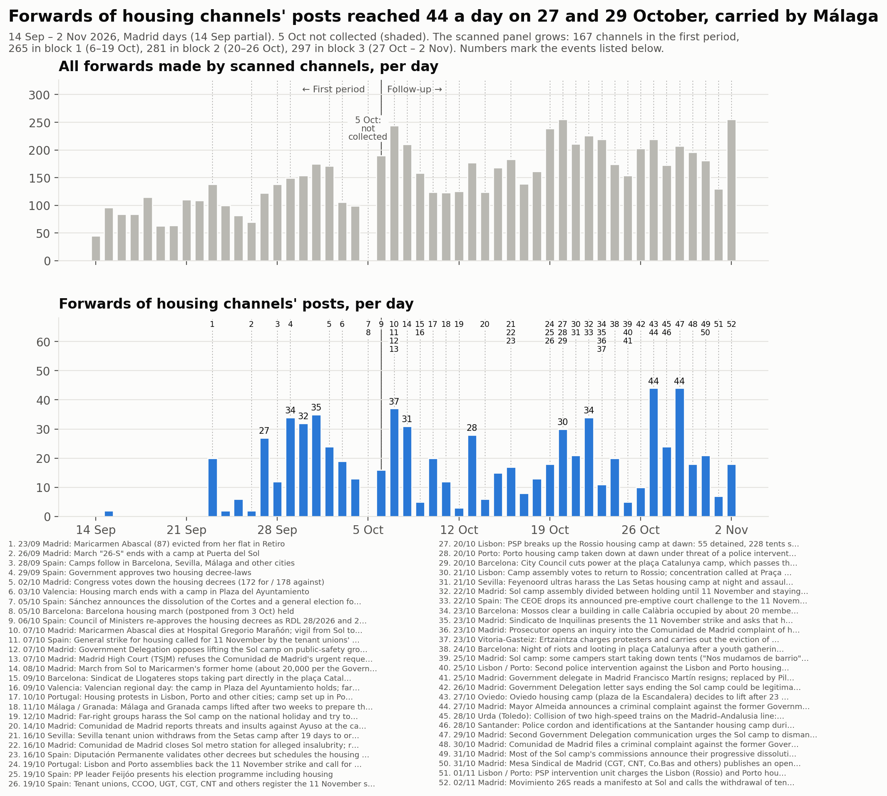
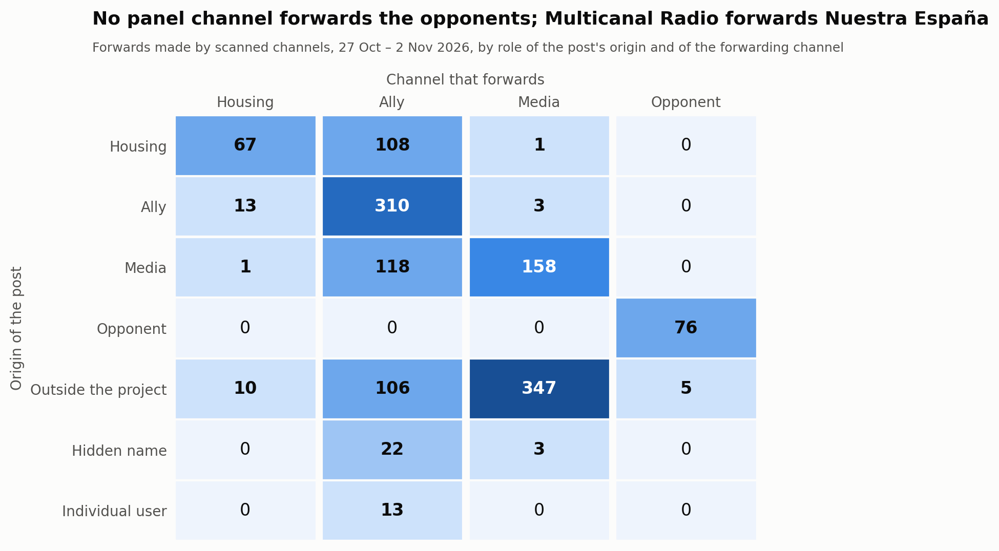
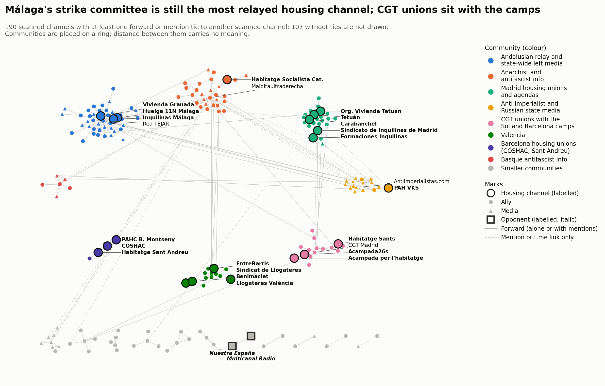

# Bloc 3: del 27 d'octubre al 2 de novembre del 2026

<a href="../followup_block3.html">English</a> · <a href="../es/followup_block3.html">Español</a> · <strong>Català</strong>

Forma part del [seguiment](followup.md) de la mobilització per l'habitatge a Telegram.
El bloc 3 cobreix del 27 d'octubre a les 00:00 al 2 de novembre a les 24:00, hora de
Madrid (2026-10-26T23:00Z a 2026-11-02T23:00Z, tot en horari d'hivern).

- **Comparacions:** amb el bloc 2 (20–26 d'octubre), que té la mateixa durada, i, quan
  són comparables, amb el bloc 1 (6–19 d'octubre) i el primer període (14 de setembre –
  5 d'octubre, el [primer període](acampadas_vivienda_technical_report.md)).
- **El buit del 5 d'octubre** continua sense omplir-se i apareix ombrejat a la línia
  temporal.

*Traducció de l'original en anglès. Les figures i el registre de revisió són en anglès.*

## 1. Què va passar al bloc

Fets datats, cadascun amb una font de premsa llevat que la nota digui una altra cosa. En
resum:

- **27 oct, Oviedo.** L'acampada de la plaza de la Escandalera va decidir aixecar-se
  després de 23 dies per concentrar-se en la vaga.
- **27 oct, Madrid.** L'alcalde Almeida va anunciar una querella contra l'exdelegat del
  Govern per l'acampada de Sol. El delegat havia dimitit el 25 d'octubre; els mitjans no
  coincideixen sobre si el motiu va ser l'acampada o la seva exclusió de les llistes del
  PSOE.
- **28 oct, Urda (Toledo).** Dos trens d'alta velocitat van xocar: 68–69 morts, tres dies
  de dol nacional (29–31 d'octubre). La confederació de llogateres va aturar les seves
  xarxes socials aquell dia, i COSHAC va ajornar al 4 de novembre les seves accions a
  seus del PSC.
- **28 oct, Santander.** La policia va encerclar l'acampada per l'habitatge i va
  identificar acampats durant un míting de Vox (titular d'eldiario.es; article no obert).
- **29 oct, Madrid.** Una segona carta de la Delegació del Govern va instar l'acampada de
  Sol a desmuntar-se (titular d'elPlural; Viquipèdia).
- **30 oct, Madrid.** La Comunidad de Madrid va presentar una querella contra l'exdelegat
  (titulars).
- **31 oct, Madrid.**
  - La majoria de les comissions de l'acampada de Sol van anunciar la seva dissolució
    progressiva i el seu trasllat als barris. El Español diu «la mayoría»; la Viquipèdia
    diu «siete de las diez».
  - La Mesa Sindical de Madrid (CGT, CNT, Co.bas i altres) va publicar una carta oberta
    en què advertia CCOO i UGT que no convertissin la vaga en una precampanya electoral.
- **1 nov, Lisboa i Porto.** La policia va carregar contra les acampades a les 04:30. El
  portaveu de l'acampada va parlar d'almenys 10 detinguts i sis ferits; la fiscalia es va
  negar a validar sis detencions. Els manifestants van tornar a les places aquell mateix
  vespre (només publicacions de canals).
- **2 nov, Madrid.** Movimiento 26S va llegir el seu manifest a Sol i va dir que la
  retirada de les tendes era una «reestructuració interna».

Després del bloc: la policia va desallotjar l'acampada de Sol de matinada el 3 de
novembre (bloc 4).

## 2. La mostra

### Panell i revisió

El bloc 3 va analitzar els 281 canals del panell. Després, una ronda de revisió va
admetre **16 de 231 candidats llegits**:
- 175 canals i grups del graf del bloc;
- 53 usuaris no identificats que les pàgines públiques de Telegram van mostrar com a
  canals públics, i un grup públic;
- 2 grups trobats provant noms d'usuari d'acampades i comitès esmentats a les
  publicacions.

Totes les decisions, tant si s'hi va afegir el canal com si no, són al [registre de
revisió](../followup_review_log.csv) (bloc 3).

**Admesos**
- **d'habitatge:**
  - Organización Vivienda Tetuán.
  - «DIFUSIÓ ACAMPAR PER HABITAR», el grup públic de l'acampada de Mallorca, trobat amb la
    prova de noms d'usuari.
- **aliats:**
  - UGT Comunicación, coconvocant de la vaga.
  - Barcelona: SAPB-CGT, SEGAP-CGT, Moviments Socials, Ateneu Llibertari de Gràcia.
  - Madrid: Agenda Tetuán, C.S.O. La Enredadera, Centro Social El Ocho, Agua de Mayo.
  - Altres: OMAL; REAS (coconvocant de la vaga de consum); els comitès de vaga juvenils
    de la Safor; la Coordinadora Anarquista Horizontal.
- **mitjans:** HispanTV, com a *informativa*. Ara té tres publicacions pròpies sobre les
  protestes de Portugal i els desallotjaments d'acampades. En tenia dues als blocs 1 i 2,
  i la regla en demana tres.

**No admesos:** nou candidats no es van poder llegir (vuit privats, entre ells un canal
de l'Asamblea de Vivienda de Sevilla i el grup de l'acampada de València). Cap candidat no
era hostil.

> **Regla revisada (10 de novembre del 2026).** Aquí *crítica des de dins* inclou els
> canals que donen suport a la vaga alhora que qüestionen CCOO i UGT o la seva
> estratègia. La regla es va revisar després: aquests canals compten com a de suport,
> amb la crítica registrada a part, i només els que rebutgen la mateixa vaga són
> *crítics amb la vaga*. Vegeu la [visió general del seguiment](followup.md).
> Aquest informe es manté tal com es va publicar.

**Panell després del bloc 3 (297 canals), per paper i postura al bloc 3**

| Paper | de suport | crítica des de dins | informativa | hostil | cap | no llegible | total |
|---|---|---|---|---|---|---|---|
| habitatge | 21 | 1 | 0 | 0 | 9 | 0 | 31 |
| aliat | 91 | 7 | 0 | 0 | 79 | 0 | 177 |
| mitjà | 8 | 5 | 20 | 0 | 53 | 1 | 87 |
| opositor | 0 | 0 | 0 | 2 | 0 | 0 | 2 |
| fora d'àmbit | 0 | 0 | 0 | 0 | 0 | 0 | 0 |

### Canvis de postura des del bloc 2

**Cap paper no va canviar.** Tots dos opositors van tornar a ser *hostils*, amb indicis
més febles que als blocs 1 i 2.
- **Nuestra España.** Els seus propis titulars presenten l'acampada com a costosa i
  protegida, i la vaga com una maniobra:
  - «Lo que hay tras la dimisión del delegado de Gobierno en Madrid: 25M de perjuicio y
    amenaza de demanda de CEIM» (#2187);
  - «Todo sobre el plantón de CCOO y UGT a la CEOE ¿Cancelaron la reunión para convocar
    la huelga del 11-N?» (#2189);
  - «Vídeo: cuando no son en Sol, el Gobierno sí gasea manifestantes» (#2209).
- **Multicanal Radio** reenvia dos d'aquests titulars.
- **Judici:** llegits com a *informatius*, tots dos canals tornarien a ser *mitjans*.

**La crítica des de dins del moviment s'estén.** 13 dels 281 canals del panell tenen
postura *crítica des de dins*, davant de 4 de 265 al bloc 2 (5 comptant els canals admesos
al bloc 2). Tots donen suport a la vaga i discuteixen el paper de CCOO i UGT o l'abast de
la vaga:
- **La carta oberta de la Mesa Sindical**, publicada per CGT Madrid i difosa per dos
  canals de la CGT: «UNA HUELGA NO ES UN ACTO DE CAMPAÑA... ¿Es boicot o es desidia?»
- **IzquierdaDiario:** «CCOO y UGT están boicoteando la huelga del 11N: ¿Una huelga
  general activa o un desfile electoral?»
- **Grupo Ruptura:** «los sindicatos verticales vendidos a la patronal (CCOO, UGT y
  demás)... HUELGA SALVAJE E INDEFINIDA».
- **PRT Barcelona:** «superar els límits que imposen les cúpules sindicals».
- **mpr21:** «CCOO y UGT operan para que la huelga del 11 de noviembre sea un fracaso».
- **El sindicat d'habitatge de Granada** convoca la seva pròpia marxa, «Ni capitalistas,
  ni rentistas, ni cómplices» (#600). Organitzacions de Granada, Saragossa i Valladolid
  van trencar amb CCOO i UGT per a la vaga (El Salto Andalucía i Diario Socialista,
  difosos per canals del panell).
- **També amb postura *crítica des de dins*:** Liza, Diario Socialista, Presos
  Revolucionarios, Revolución Comunista i La Idea.

**Les crítiques adreçades al govern continuen sent *de suport*.** La campanya de COSHAC
«aquesta vaga també és contra el PSC» i les seves accions a seus del PSC en són un
exemple.

**Rotació.** 91 canals van canviar de postura: 36 van passar d'una postura activa a *cap*
i 27 a l'inrevés. Les publicacions del bloc tracten gairebé totes de construir la vaga:
comitès, cartells, tallers, una vaga de consum cada dimecres fins a l'11N.

### Baixes

Respecte al bloc 2.

- **En silenci:** 29 canals no van publicar res al bloc.
  - D'habitatge: La PAH, PAH Catalanes, Carabanchel, Cuadernos de trabajo, Les Corts,
    La Saïdia Comuna, València no està en venda.
- **Privat:** El Salto Madrid.
- **Reanomenats:** cap canvi nou de nom d'usuari (continua @airbnbcrepa → @lecitta). El
  canal de l'acampada de Sol es titula ara «Acampada 26S».

## 3. Anàlisi

### Volum

**Reenviaments.** Els canals analitzats van fer 1.361 reenviaments al bloc, sense comptar
els reenviaments de si mateixos: **194,4 al dia**, davant de 204,6 al bloc 2.

| Panell | Primer període | Bloc 1 | Bloc 2 | Bloc 3 |
|---|---|---|---|---|
| els 167 canals del primer període | 111,5 | 114,9 | 138,1 | **126,0** |
| el panell al final del bloc 1 (265) | – | 167,4 | 193,3 | **183,9** |
| el panell al final del bloc 2 (281) | – | – | – | 190,1 |
| tots els canals analitzats | – | 167,4 | 204,6 | 194,4 |

Amb el mateix panell, els reenviaments van baixar entre un 5 i un 9 % respecte al bloc 2.
El bloc inclou els tres dies de dol després de l'accident ferroviari. El dia més baix és
l'1 de novembre (130).

**Reenviaments de publicacions de canals d'habitatge: 176, 25,1 al dia** (bloc 2: 18,6).
- Només amb el panell i la llista de canals d'habitatge del primer període: 21,1 al dia
  (bloc 2: 15,9; bloc 1: 11,8; primer període: 11,4). És el valor més alt del seguiment.
- Pics de 44 el 27 i el 29 d'octubre.
- **Màlaga n'aporta la major part:** el Comité de Huelga 11N · Málaga en suma 128 dels
  176, reenviats per Inquilinas Málaga (47), La Invisible (44), Red TEJAR (36) i Suburbia
  (1).

**Publicacions sobre la mobilització** (publicacions que coincideixen amb els termes
d'implicació; tots els canals descarregats): 532, **76 al dia** (bloc 2: 73).
- Amb el panell al final del bloc 2: 474, 68 al dia (bloc 2, amb el seu propi panell:
  69).
- Per paper: 104 d'habitatge, 339 d'aliats, 83 de mitjans, 6 d'opositors.
- Per postura: 439 de suport, 42 informatives, 34 crítiques des de dins, 6 hostils, 11
  cap (aquestes últimes són falsos positius en canals llegits com a *cap*).
- Pics el 27 d'octubre (103) i el 2 de novembre (101).

**Amb i sense els canals admesos.** Cap canal admès no fa més del 15 % dels reenviaments
del bloc (el més gran és HispanTV, 8, 0,6 %), i cap no aporta més d'un node al qual res
més no fa referència. Sense els 16 canals admesos: 1.331 reenviaments (190,1 al dia) i
474 publicacions sobre la mobilització.

**Concentració.** Els cinc reenviadors més grans fan el 46,5 % de tots els reenviaments:

| Canal | Paper | Reenviaments | Part |
|---|---|---|---|
| Red TEJAR | aliat | 199 | 14,6 % |
| Los Sombreros Blancos | mitjà | 142 | 10,4 % |
| Antiimperialistas.com (@nullaesrbu) | mitjà | 122 | 9,0 % |
| Prima Linea | mitjà | 89 | 6,5 % |
| Multicanal Radio | opositor | 81 | 6,0 % |

(Les parts són sobre els 1.361 reenviaments sense reenviaments de si mateixos, com al
bloc 2.)

### Qui reenvia qui

Reenviaments, segons el paper del canal d'origen de la publicació i del canal que la
reenvia; entre parèntesis, el bloc 2.

**Publicacions de canals d'habitatge**
- 108 reenviades per aliats (89).
- 67 reenviades per altres canals d'habitatge (40).
- 1 reenviada per mitjans (1).

**Canals d'habitatge que reenvien altres canals**
- 13 reenviaments d'aliats (5).
- 1 de mitjans (0).
- 10 de canals externs (1).

Els **mitjans** reenvien sobretot canals externs: 347 de 512.

**Opositors.**
- Multicanal Radio reenvia Nuestra España 76 vegades, i un canal extern del cor 5
  vegades.
- Cap canal del panell no reenvia ni menciona amb @ cap opositor.

### Node central, difusors, territoris i acampades

**El sindicat de Madrid continua sense ser el node central.** El reenvien 2 canals
(Difusión urgente dues vegades, FETAP una), davant d'1 al bloc 2 i 10 al bloc 1. És segon
per amplitud, empatat amb altres.

**Els més difosos per amplitud**

| Canal | Canals que el reenvien | Reenviaments |
|---|---|---|
| Comité de Huelga 11N · Málaga | 4 | 128 |
| COSHAC | 2 | 12 |
| Sindicato de Inquilinas de Madrid | 2 | 3 |
| Acampada 26S (Sol) | 2 | 2 |

19 dels 31 canals d'habitatge no els va reenviar cap canal analitzat.

**El primer vincle entre territoris entre canals d'habitatge.** El canal de l'acampada de
Barcelona va publicar un comunicat conjunt de condol de «las acampadas territoriales de
todo el Estado» després de l'accident ferroviari, etiquetant les acampades de Sol,
València, Granada, Alacant i Barcelona (#271). Aquesta publicació és l'únic vincle entre
canals d'habitatge de territoris diferents als blocs 2 i 3, i és una menció, no un
reenviament. Els cinc vincles de reenviament queden dins d'un territori:
- Màlaga: 47 reenviaments.
- Catalunya: COSHAC → Sant Andreu (7) i → PAHC Baix Montseny (5).
- València: Llogateres → Benimaclet (7).
- Madrid: Formaciones → Sindicato de Inquilinas (1).

**Canals de les acampades.**
- **Acampada 26S (Sol):** 11 publicacions (bloc 2: 32), sobre les assemblees, els nodes
  territorials i el manifest del 2 de novembre. Reenviada dues vegades (CGT Zona Sur i
  FETAP van difondre el manifest).
- **Acampada per l'habitatge (Barcelona):** 19 publicacions, no reenviada. Va anunciar
  «cambios importantes en nuestra estrategia», va demanar una taula de negociació i va dir
  «no vamos a dar un paso atrás NI A DESACAMPAR».
- **Acampar per Habitar (Mallorca):** admesa en aquest bloc; 73 missatges, sense vincles.

### Vincles que van aparèixer i desaparèixer

La comparació abasta els 279 canals del panell analitzats en tots dos blocs.

| Vincles entre ells | Bloc 3 | Bloc 2 |
|---|---|---|
| Total | 242 | 294 |
| Mantinguts | 125 | 125 |
| Nous al bloc 3 | 117 (81 de reenviament, 36 d'enllaç) | – |
| Desapareguts des del bloc 2 | – | 169 (121 de reenviament, 48 d'enllaç) |

Vincles nous al voltant dels canals d'habitatge:
- FETAP reenvia el sindicat de Madrid i el manifest de l'acampada de Sol.
- CGT Zona Sur reenvia l'acampada de Sol.
- Suburbia reenvia Màlaga.
- L'acampada de Barcelona menciona l'acampada de Sol.

Vincles desapareguts:
- Acampada de Barcelona → PAH Barcelona.
- COSHAC → Sants.
- Acampada de Sol → Difusión urgente.

### Contacte entre els opositors i la resta

Es van llegir tots els esdeveniments que uneixen un opositor amb un canal que no ho és:
8.
- **5 reenviaments de premsa del cor:** Multicanal Radio reenvia @elmarujeo.
- **3 mencions en publicacions pròpies de Nuestra España:** l'usuari d'un eurodiputat de
  Vox, i dos comptes pseudonimitzats (la signatura d'un autor i un compte citat).

Com als blocs 1 i 2, **no hi ha cap vincle de cita hostil**, i els opositors són una
parella tancada. La seva hostilitat és a les seves pròpies 6 publicacions sobre la
mobilització.

### Comunitats

Graf combinat de reenviaments i mencions: 190 canals analitzats amb vincles, 260 arestes;
107 canals analitzats sense vincles.

**Louvain amb 50 llavors**
- Etiquetes de consens: 19 comunitats, modularitat 0,736 (partició per paper: 0,199).
- Estabilitat: 14 particions diferents; la més freqüent apareix en el 28 % de les
  execucions.
- Estabilitat mitjana per node 0,95; 16 nodes per sota de 0,8, 3 per sota de 0,6.
- És menys estable que el bloc 2 (6 particions, 50 %).

| # | Nom | Canals | Membres d'habitatge |
|---|---|---|---|
| 1 | Difusor andalús i mitjans d'esquerra estatals | 43 | Huelga 11N Málaga, Inquilinas Málaga, Vivienda Granada |
| 2 | Informació anarquista i antifeixista | 29 | Habitatge Socialista de Catalunya |
| 3 | Sindicats d'habitatge i agendes de Madrid | 24 | Sindicato de Inquilinas de Madrid, Tetuán, Org. Vivienda Tetuán, Carabanchel, Formaciones |
| 4 | Mitjans antiimperialistes i estatals russos | 16 | PAH-VKS (per un vincle, amb Sistema 161) |
| 5 | Sindicats de la CGT amb les acampades de Sol i Barcelona | 15 | Acampada 26S, Acampada per l'habitatge, Habitatge Sants |
| 6 | València | 13 | Llogateres València, EntreBarris, Benimaclet, Sindicat de Llogateres |
| 7 | Canals de moviments francesos i italians | 8 | — |
| 8 | Informació antifeixista basca | 6 | — |
| 9–19 | Convocatòries de Barcelona; Podemos; CCOO; sindicats d'habitatge de Barcelona (COSHAC, Sant Andreu, PAHC Baix Montseny); Anticapitalistas; Podem València; **opositors** (2); quatre parelles | 2–5 cadascuna | — |

**Coincidència amb el bloc 2.** En 152 canals compartits, l'índex de Rand ajustat és
**0,587** (bloc 1 → 2: 0,586). Els grups territorials persisteixen: Màlaga amb el difusor
andalús, Madrid, València i els sindicats d'habitatge de Barcelona.

Què va canviar:
- **Les acampades s'uneixen als sindicats de la CGT.** Les acampades de Sol i Barcelona
  queden en una mateixa comunitat amb CGT Madrid, CGT Catalunya i CGT Zona Sur, els
  canals que difonen les publicacions de les acampades i la carta de la Mesa Sindical.
- **El sindicat de Madrid** és ara amb els sindicats de Tetuán i Carabanchel i les
  agendes de barri, no amb l'acampada de Sol.

**Disseny del mapa.** L'anell mostra les vuit comunitats més grans, llevat que els
sindicats d'habitatge de Barcelona (4 canals) substitueixen els canals francesos i
italians (8) perquè els canals d'habitatge de Barcelona quedin ben etiquetats.

## 4. Llistes de termes

Es van mantenir les llistes del bloc 2, amb onze termes d'implicació afegits o ampliats i
un de restringit, i es van tornar a provar les llistes.

**Termes afegits o ampliats**
- **Guions en adreces:** «11-de-noviembre» i «huelga-general» en URL.
- **Frases sobre construir la vaga:** «construir / construyendo la huelga general»;
  «huelga general del 11» seguit d'un signe de puntuació.
- **La campanya contra el PSC:** «aquesta vaga / esta huelga» a prop d'una paraula
  relacionada amb l'habitatge.
- **Etiqueta:** #VagaPerLaVivenda.
- **Protestes:** «protestar / protestan… por la vivienda» (Portugal).
- **El decret:** «RDL d'habitatge» i «el nou decret» a prop d'una paraula relacionada amb
  l'habitatge.
- **Acampades:** el plural italià «acampade», trobat en llegir canals en llengües
  estrangeres.

**Restringit**
- «comité de huelga» ja no capta els comitès de vaga del professorat i dels metges. Era
  el fals positiu conegut del bloc 2.

**Proves**
- 20 de 22 positius coneguts coincideixen.
- Canals sense relació: 0 coincidències a TASS, 1 a MT News, que és un veritable positiu
  sobre Portugal. El canal negatiu del bloc 2, Satélite Rojo, publica ara sobre les
  acampades portugueses i es va substituir.
- Es van llegir 90 publicacions que només coincidien per context.
- Es van llegir totes les publicacions que els canvis van guanyar (20) o perdre (3).

**Omissions acceptades:** publicacions que només diuen «huelga general» o «vaga general»
sense cap paraula relacionada amb l'habitatge. «Huelga general» sola continua sent un
terme de context perquè la vaga general d'Itàlia del 30 d'octubre i la de França del 5
de novembre apareixen als mateixos canals.

## 5. Decisions que podrien haver estat unes altres

**Postura**
- **Els opositors** són *hostils* per titulars adversos sense un atac explícit. Llegits
  com a *informatius*, tots dos tornarien a ser *mitjans*.
- **La regla de la postura *crítica des de dins*** es fa explícita en aquest bloc: la
  crítica és la posició pròpia del canal o la majoria de les seves publicacions. Els
  canals que difonen crítiques alienes entre publicacions de suport continuen sent *de
  suport* (Red TEJAR, Malditaultraderecha, FETAP).
- **El sindicat d'habitatge de Tetuán** *de suport*; podria ser *crítica des de dins*.
- **Diario Socialista i mpr21** *crítica des de dins* per titulars de notícies; podrien
  ser *informativa*.
- **Presos Revolucionarios** *crítica des de dins*, tot i que diu que la vaga és «un
  montaje»; es podria llegir com a hostil.
- **USTEA** *de suport* per la seva vaga educativa de l'11 de novembre; podria ser *cap*.
- **elPlural** *informativa*, només per titulars; era *de suport* als blocs 1 i 2.
- **La Directa i Regeneración** *de suport* amb pocs indicis.

**Revisió**
- **El grup de l'acampada de Mallorca** admès com a canal *d'habitatge*, tot i que les
  seves publicacions són missatges de membres.
- **Moviments Socials** admès com a canal d'agenda; podria ser un agregador.
- **HispanTV i l'àmbit de la mobilització:** HispanTV es va admetre perquè les acampades i
  protestes de Portugal compten; les d'Itàlia, no.
- **SAPB-CGT** admès per enllaços a convocatòries del seu propi sindicat; s'havia
  rebutjat al bloc 2.
- **Minas Não** rebutjat: va organitzar xerrades a l'acampada de Porto.

**Anàlisi i figures**
- **Referències:** la referència és el bloc 2. Les comparacions amb el mateix panell
  reprodueixen les mitjanes publicades del bloc 2.
- **Anell del mapa:** els sindicats d'habitatge de Barcelona substitueixen a l'anell una
  comunitat més gran.

## 6. Què no es va verificar

**Context**
- **Lisboa i Porto, 1 de novembre:** les xifres de detinguts i ferits (organitzadors
  davant de fiscalia; no hi ha xifra policial).
- **Madrid:** la carta del 29 d'octubre i la querella del 30 d'octubre es basen en
  titulars i en la Viquipèdia. La proporció de comissions («la majoria» o «set de deu»)
  està en disputa.
- **Santander, 28 d'octubre:** el cordó policial es basa en un titular.

**Contingut no llegit**
- **Imatges i vídeos:** no es van llegir. Entre ells, les imatges de les «5 claves» de
  Granada i el manifest de Sol, publicat com a imatge o vídeo.
- **Enllaços:** no es van seguir els articles enllaçats.
- **Candidats a revisió sense paraules clau:** només l'inici de les seves primeres vuit
  publicacions.

**Canals i comptes no assolits**
- **Canals privats:** nou candidats són privats (entre ells un canal de l'Asamblea de
  Vivienda de Sevilla, el grup de l'acampada de València i les Feministes de Gràcia); El
  Salto Madrid, del panell, també és privat.
- **Cerca per etiquetes:** cap en aquest bloc.

**No comprovat**
- **Mapes de la xarxa:** la seva disposició varia lleugerament d'una generació a l'altra.

**Com citar aquesta pàgina.**

DataPolitik (Heurística). <em>Bloc 3: del 27 d'octubre al 2 de novembre del 2026</em>. Dins de <em>Acampades per l'habitatge i xarxes de comunicació a Telegram a Espanya, tardor del 2026</em>. Període d'observació: 27 d'octubre – 2 de novembre del 2026. Publicat el 7 de novembre del 2026. <a href="https://datapolitik.github.io/acampadas-vivienda-report/ca/followup_block3.html">https://datapolitik.github.io/acampadas-vivienda-report/ca/followup_block3.html</a>

Text i figures originals: [CC BY 4.0](https://creativecommons.org/licenses/by/4.0/) · [Ús i citació](index.md#use-and-citation)

---

Un estudi de [DataPolitik](https://www.heuristica.barcelona/datapolitik/), d'[Heurística](https://www.heuristica.barcelona/). · [Inici](index.md) · [Presentació del seguiment](followup.md)
