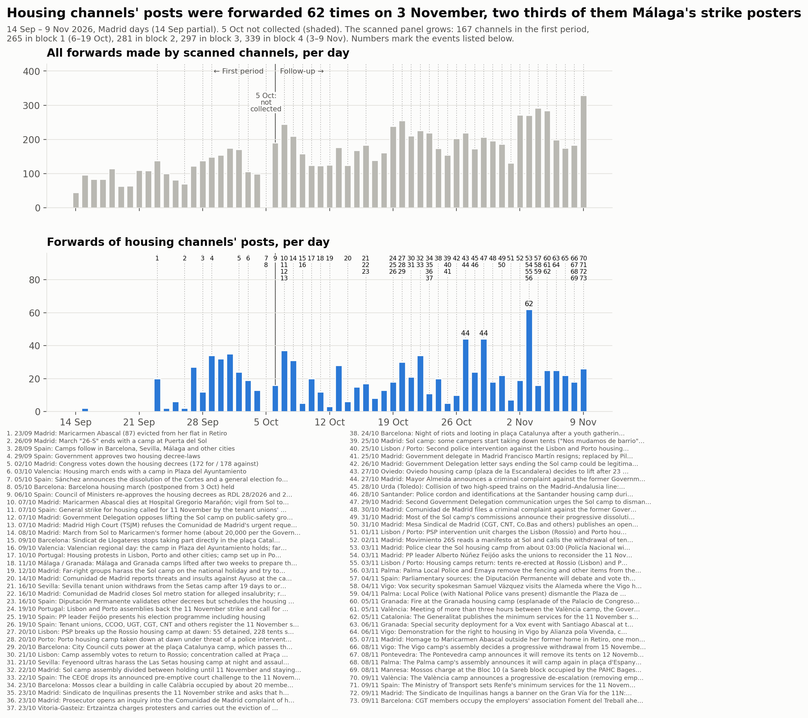
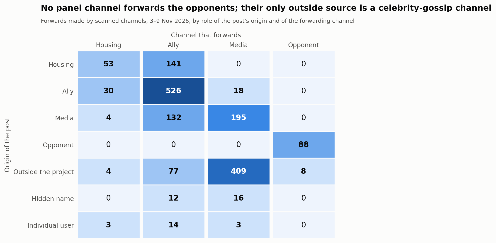
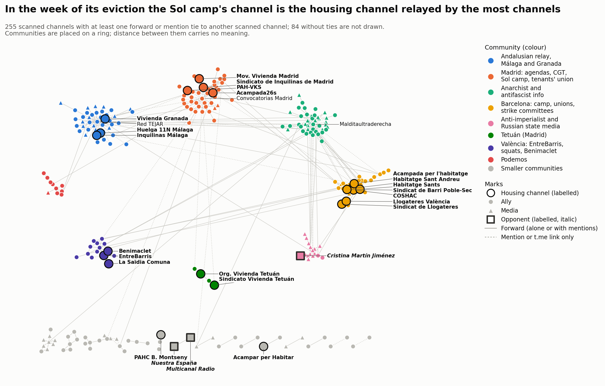

# Bloc 4: del 3 al 9 de novembre del 2026

<a href="../followup_block4.html">English</a> · <a href="../es/followup_block4.html">Español</a> · <strong>Català</strong>

Forma part del [seguiment](followup.md) de la mobilització per l'habitatge a Telegram.
El bloc 4 cobreix del 3 de novembre a les 00:00 al 9 de novembre a les 24:00, hora de
Madrid (2026-11-02T23:00Z a 2026-11-09T23:00Z, tot en horari d'hivern). És la setmana
anterior a la vaga general de l'11 de novembre.

- **Comparacions:** amb el bloc 3 (27 d'octubre – 2 de novembre), de la mateixa durada.
  Quan són comparables, també amb el [primer període](acampadas_vivienda_technical_report.md)
  (14 de setembre – 5 d'octubre).
- **El buit del 5 d'octubre** continua sense omplir-se i apareix ombrejat a la línia
  temporal.
- **Dues execucions:** una primera execució, el 7 de novembre, va cobrir del 3 al 6 de
  novembre. El 10 de novembre el bloc es va ampliar fins al seu final natural, el 9 de
  novembre, i tots els passos es van repetir sobre la setmana completa. El bloc 5 va del
  10 al 16 de novembre, la setmana de la vaga.
- **Moment de la recollida:** el bloc va acabar 2 hores i 38 minuts abans de les
  descàrregues i de l'anàlisi. No s'hi inclouen les publicacions ni les edicions
  posteriors.

*Traducció de l'original en anglès. Les figures i el registre de revisió són en anglès.*

## 1. Què va passar al bloc

Fets datats, cadascun amb una font de premsa llevat que la nota digui una altra cosa. En
resum:

**Les acampades**
- **3 nov, Madrid.** Des de les 03:00 aproximadament, la Policía Nacional i la Policía
  Municipal van desallotjar l'acampada de Sol; dues persones van ser detingudes.
  - Mida: unes 300 persones hi dormien (fonts policials citades per EFE), o més de 330
    desallotjades (Delegació del Govern).
  - Violència: la Delegació afirma que l'operació es va fer «sin violencia». Acampada 26S
    denuncia cops, gas pebre i persones ferides.
  - Aquell mateix vespre hi va haver una marxa de Sol a Cibeles i una asseguda a Sol
    (canal de l'acampada).
- **3–6 nov, Palma.**
  - 3 nov: l'ajuntament va retirar la tanca de l'acampada.
  - 4 nov, al vespre: la Policia Local va desmuntar l'acampada (només el grup de
    l'acampada i titulars compartits).
  - 8 nov: l'assemblea va anunciar que tornarà a acampar després de la marxa de l'11N
    (Última Hora).
- **3 nov, Lisboa i Porto.** Les tendes es van tornar a muntar després d'una resolució
  d'un tribunal administratiu.
- **4–9 nov, Barcelona.** L'acampada va dir que l'ajuntament li havia tallat
  l'electricitat i que s'hi queda: «Ens deixeu sense llum, però no sense lluita» (només
  publicacions del canal).
- **5 nov, Granada.** Un incendi a l'acampada («al parecer provocado») i un atac amb pals
  (Europa Press). El 6 de novembre es va fixar un dispositiu de seguretat per a un acte de
  Vox amb Abascal al costat de l'acampada.
- **5 i 9 nov, València.** L'acampada es va reunir durant més de tres hores amb la
  Delegació i l'ajuntament. El 9 de novembre va anunciar una desescalada progressiva, «No
  nos vamos». Aquell dia es va fer la reunió tècnica entre la Delegació i l'ajuntament; no
  es va trobar cap informació de premsa sobre el resultat.
- **8 nov, Vigo i Pontevedra.** Totes dues acampades van decidir retirar-se després de
  la vaga: Vigo de manera progressiva a partir del 15 de novembre, Pontevedra el 12 de
  novembre (EFE).
- **9 nov.** Les acampades van publicar un manifest conjunt, difós pel canal de l'acampada
  de Barcelona amb Sevilla, Granada i València (només publicacions de canals).

**La vaga i el moviment per l'habitatge**
- **3 nov.** El líder del PP, Feijóo, va demanar als sindicats que reconsideressin la
  vaga.
- **4 nov.** Els dos decrets d'habitatge aniran a la Diputació Permanent el 12 de
  novembre.
- **5 i 9 nov.** Es van fixar serveis mínims: Catalunya i, després, Renfe (75 % de
  Rodalies en hores punta).
- **7 nov, Madrid.** Es va fer un homenatge a Maricarmen Abascal davant la seva antiga
  casa, un mes després de la seva mort.
- **8 nov, Manresa.** Els Mossos van carregar al Bloc 10, un edifici de la Sareb ocupat
  per la PAHC Bages el 7 de novembre. El desallotjament es va aturar quan la Sareb va
  acceptar cedir l'edifici.
- **9 nov, Barcelona.** La CGT va ocupar la patronal Foment del Treball.
- **9 nov, Madrid.** El sindicat de llogateres va penjar una pancarta a la Gran Vía
  (només titular).
- **Vox i Granada:**
  - 4 nov: el portaveu de seguretat de Vox va visitar l'acampada de Vigo.
  - 6 nov: l'acte d'Abascal a Granada.

## 2. La mostra

### Panell i revisió

- **Panell:** 325 canals a l'inici de l'ampliació (297 a l'inici del bloc, més 28 admesos
  el 3–6 de novembre), analitzats i descarregats durant tota la setmana.
- **No llegibles:**
  - @elsaltomadrid (privat des del bloc 1).
  - @mitxisantifascistas: es va tornar privat entre el 6 i el 10 de novembre. No va
    publicar res el 3–6 de novembre; les seves publicacions del 7–9 de novembre no es
    poden llegir.
- **Publicacions:** 16.064 al bloc.

La revisió es va fer dues vegades:
- **Execució del 3–6 de novembre:** 184 candidats, **28 admesos**.
- **Execució de la setmana completa:** 229 candidats, **14 admesos**.
  - 7 no llegibles; 5 ja estaven admesos.
  - Una cerca de còpies locals de canals coneguts (38 noms) va trobar un resultat, el
    centre de mitjans de la vaga de Mallorca @centredemitjans (30 subscriptors). La seva
    vista prèvia pública, llegida a mà, mostra dues publicacions del 5 de novembre sense
    text, així que no es va afegir.
- **Registre:** totes les decisions de les dues execucions, s'afegís o no el canal, són al
  [registre de revisió](../followup_review_log.csv) (bloc 4, rondes *review* i
  *extension*).

El panell té ara **339 canals**: 31 d'habitatge, 211 aliats, 94 mitjans i 3 opositors.

Admesos a la ronda de la setmana completa:
- **aliats (11):**
  - Regularización Ya; Samidoun Barcelona; IAC (sindicat).
  - Ateneo La Maliciosa; AV La Unión de Hortaleza.
  - Asamblea Libertaria de Lorca; Quejío Andalú; Bizkaia E28 Koordinadora.
  - Teixint Patraix i Camins al Grau i Algirós (assemblees de barri i comitès de vaga de
    València); una agenda de cartells de Sevilla.
- **mitjans (2):** RadioTopo (de suport); RUSSPAIN, *informativa*, de la xarxa de
  @rusmadrid.
- **opositor (1):** **Cristina Martín Jiménez**, el canal d'una persona (una autora). El 9
  de novembre es va burlar de la ministra de Treball per donar suport a «una huelga
  general contra la cartera ministerial que ella misma ostenta... Si no existiera habría
  que inventarla». Judici: es podria llegir com a adreçat només a la ministra.

Quatre dels 14 s'havien rebutjat el 3–6 de novembre perquè encara no havien publicat
sobre la mobilització (IAC, Samidoun, Regularización Ya, La Maliciosa).

**Regla del 15 % i dels deu candidats:** no es va activar.
- El reenviador admès més gran fa 13 reenviaments, el 0,8 % de 1.733 (Teixint Patraix).
- Com a màxim, 7 nodes estan referenciats només per un canal admès (RUSSPAIN).
- @rusmadrid fa 86 esdeveniments d'enllaç (el 6,9 % dels enllaços), sobretot als seus
  canals germans.

### Postura del panell

> **Regla revisada (10 de novembre del 2026).** Aquí *crítica des de dins* inclou els
> canals que donen suport a la vaga alhora que qüestionen CCOO i UGT o la seva
> estratègia. La regla es va revisar després: aquests canals compten com a de suport,
> amb la crítica registrada a part, i només els que rebutgen la mateixa vaga són
> *crítics amb la vaga*. Vegeu la [visió general del seguiment](followup.md).
> Aquest informe es manté tal com es va publicar.

339 canals (els 14 canals admesos a l'execució de la setmana completa porten la postura
de la seva revisió):

| Paper | de suport | crítica des de dins | informativa | hostil | cap | no llegible |
|---|---|---|---|---|---|---|
| habitatge (31) | 19 | 1 | 0 | 0 | 11 | 0 |
| aliat (211) | 159 | 4 | 1 | 0 | 47 | 0 |
| mitjà (94) | 23 | 3 | 35 | 0 | 32 | 1 |
| opositor (3) | 0 | 0 | 0 | 3 | 0 | 0 |

- **Papers:** cap canal no va canviar de paper.
- **Canvis de postura:** 104 canals van canviar de postura des del bloc 3. 70 van passar
  de *cap* a una postura activa; 19 a l'inrevés.
- **Els últims dies abans de la vaga** van sumar molts canals que havien estat en silenci
  el 3–6 de novembre: CNT Madrid, CA-AIT, grups gallecs, andalusos i bascos, canals de
  Podemos, mitjans de moviments italians i francesos.
- **Opositors (3).**
  - Nuestra España: el desallotjament de Sol; la «doble vara de medir con los desalojos»
    de Jupol; «las armas de Sol»; «CCOO enfría la huelga general» (9 nov).
  - Multicanal Radio: reenvia aquestes publicacions i titula el seu propi vídeo «¿EN QUE
    MARISQUERIA ES LA HUELGA?» (9 nov).
  - La nova opositora individual, més amunt.
  - Els indicis són enquadraments adversos i burla, no atacs explícits.
- ***Crítica des de dins* (8):**
  - El sindicat d'habitatge de Granada.
  - Izquierda Diario i Liza: el bloc per la independència de classe, «Las direcciones de
    CCOO y UGT quieren convertir la huelga en un acto de campaña».
  - CA-AIT Marina Alta; Bultza («11N pantomima general»); Malditaultraderecha.
  - DiarioOctubre («CCOO y UGT operan para que la huelga... sea un fracaso»).
  - Insurgente («UGT se pone muy nerviosa ante la posibilidad de que la Huelga General sea
    contra el gobierno»).
  - Tots donen suport a la vaga i discuteixen el paper de CCOO i UGT.
- **Casos mantinguts com a *informatius*:**
  - Un canal de notícies de Madrid (@cuidadmadrid) recull l'«acampada ilegal» de la
    Comunidad.
  - Un bot (@roto2botfc) republica publicacions d'X que amenacen els piquets («pueden
    salir escaldados»). Són publicacions d'altres persones, no la posició pròpia del bot.

### Baixes i noms

- **En silenci:** 19 canals no van publicar res a la setmana, 9 d'ells d'habitatge: La
  PAH, PAH Catalanes, La Saïdia Comuna, Carabanchel, Cuadernos de trabajo, Formaciones
  Inquilinas, Les Corts, Sindicat d'Habitatge Socialista, València no està en venda.
  Comptant @mitxisantifascistas, que es va tornar privat, són 20.
- **Privats:** @elsaltomadrid, @mitxisantifascistas.
- **Canvis de nom:**
  - «Málaga para Vivir» → «Comité de Huelga 11N • Málaga».
  - «Acampada26s» → «Acampada 26S».
  - Kontrainfo Antifa hi afegeix «/ FAK!».
  - @airbnbcrepa → @lecitta.

## 3. Anàlisi

### Volum

| Al dia | Bloc 3 | Bloc 4 |
|---|---|---|
| Reenviaments fets pels canals analitzats (sense autoreenviaments) | 194,4 | **247,6** |
| El mateix, panell al final del bloc 2 (281 canals) | 190,1 | 228,9 |
| El mateix, els 167 canals del primer període | 126,0 | 143,0 |
| Reenviaments de publicacions de canals d'habitatge | 25,1 | 27,7 |
| El mateix, els 167 canals del primer període | 21,1 | 20,9 |
| Publicacions sobre la mobilització (termes de participació) | 76,0 | 166,1 |

- **Reenviaments:** amb panells iguals, van pujar una cinquena part respecte al bloc 3.
  Els reenviaments de publicacions de canals d'habitatge gairebé no es van moure: 20,9 al
  dia als canals del primer període, davant de 21,1. La pujada la porten els canals
  aliats i els mitjans, no els canals d'habitatge.
- **Pics:**
  - Publicacions d'habitatge: **62 reenviaments el 3 de novembre**. El comitè de vaga de
    Màlaga en suma 41 (àlbums de cartells); l'acampada de Sol 8, COSHAC 7 i l'acampada de
    Barcelona 3.
  - Tots els reenviaments: **329 el 9 de novembre**, dos dies abans de la vaga.
- **Publicacions sobre la mobilització:**
  - Per dia: 200 el 3 de novembre, 159–171 el 4–6, 95 el 7 (dissabte), 120 el 8 i **253
    el 9 de novembre**.
  - En total: 1.163, davant de 532 al bloc 3; 1.034 sense els canals afegits en aquest
    bloc.
  - Per paper: habitatge 153, aliats 808, mitjans 194, opositors 8.
  - Per postura: de suport 1.011, crítica des de dins 48, informativa 93, hostil 8.
  - La llista de termes va canviar (apartat 4), així que el recompte no és estrictament
    comparable.
- **Reenviadors més grans:** Red TEJAR (197, 11,4 %), Prima Linea (151), Los Sombreros
  Blancos (146), ANTIIMPERIALISTAS.COM (140) i Multicanal Radio (96). Els cinc primers fan
  el 42,1 % (46,5 % al bloc 3).

### Qui reenvia qui

| Reenviament (origen → reenviador) | Bloc 3 | Bloc 4 |
|---|---|---|
| habitatge → habitatge | 67 | 53 |
| habitatge → aliat | 108 | 141 |
| aliat → habitatge | 13 | 30 |
| aliat → aliat | 310 | 526 |
| mitjà → aliat | 118 | 132 |
| fora del panell → mitjà | 347 | 409 |
| opositor → opositor | 76 | 88 |
| fora → opositor | 5 | 8 |

- **Blocs de la mateixa durada:** els totals es comparen directament.
- **Aliat → aliat** va créixer un 70 %.
- **Els canals d'habitatge** es van reenviar menys entre ells (67 → 53) i van reenviar
  aliats més del doble de vegades (13 → 30).
- **Opositors:** cap canal del panell no els reenvia, i ells no reenvien cap canal del
  panell.

### Node central, difusors, territoris i acampades

- **Difós per més canals:** el **canal de l'acampada de Sol**: reenviat per 7 canals, 9
  vegades, 8 d'elles el dia del desallotjament (bloc 3: 2 i 2).
- **El sindicat de llogateres de Madrid:** segon per amplitud, reenviat per 5 canals, 13
  vegades (bloc 3: 2 i 3), sobretot per CGT Madrid i la seva zona sud i per Noticias
  FETAP. El seu canal no va publicar res sobre el desallotjament.
- **El canal d'habitatge més reenviat:** el comitè de vaga de Màlaga, 132 reenviaments
  per 4 canals (bloc 3: 128 per 4).
- **Altres acampades:**
  - L'acampada de Barcelona va ser reenviada per 3 canals (cap al bloc 3).
  - El grup de Mallorca va fer 8 reenviaments i ningú no el va reenviar.
- **Difusors:** 17 dels 31 canals d'habitatge no van ser difosos per cap canal analitzat.
- **Territoris:** deu vincles entre canals d'habitatge; dos creuen territoris. El
  Sindicat de Llogateres (Barcelona) reenvia Llogateres València, i l'acampada de Sol
  enllaça la de Barcelona. Els grups territorials continuen sense reenviar-se entre ells.

### Vincles que van aparèixer i desaparèixer

Hi ha 295 canals del panell analitzats als dos blocs:

- **mantinguts:** 145 vincles;
- **nous:** 204 (141 de reenviament, 63 d'enllaç);
- **desapareguts:** 122 (91 de reenviament, 31 d'enllaç).

El bloc té més vincles que el bloc 3 (349 davant de 267).

### Contacte entre els opositors i la resta

Es van llegir tots els vincles:
- Multicanal Radio reenvia 8 vegades un canal de xafarderies de famosos (@elmarujeo).
- MT News enllaça dues vegades la nova opositora, al seu programa de tecnologia a RT.
  Aquestes publicacions no tracten de la mobilització; no en són ni difusió ni cites
  hostils.
- La nova opositora enllaça 6 vegades el canal de RT.
- **No hi ha contacte sobre la mobilització** entre els opositors i la resta.

### Comunitats

- **Graf combinat:** 255 nodes i 402 arestes; 84 canals analitzats no tenen vincles.
- **Partició:** consens de 50 execucions de Louvain, 23 comunitats, modularitat 0,744
  (0,163 per paper).
- **Estabilitat:** 11 particions diferents; la més freqüent apareix en el 28 %.
  L'estabilitat mitjana dels nodes és 0,97; 7 nodes queden per sota de 0,8.
- **Coincidència amb el bloc 3:** índex de Rand ajustat **0,403** en 168 canals
  compartits; 22 canals només són al bloc 3 i 87 només al bloc 4. El bloc 3 tenia 0,587
  amb el bloc 2.
- **Què canvia:** el panell va créixer, i molts canals que estaven en silenci al bloc 3
  ara reenvien.

Les vuit comunitats més grans, amb els noms que fa servir la figura:

1. Informació anarquista i antifeixista, inclosa la basca (43).
2. Madrid: agendes, CGT, l'acampada de Sol i el sindicat de llogateres (43). Els dos
   grups de Madrid del bloc 3 es van fusionar.
3. Difusor andalús, Màlaga i Granada (42).
4. Barcelona: l'acampada, els sindicats d'habitatge i els comitès de vaga (33).
5. Mitjans antiimperialistes i estatals russos (16), amb la nova opositora.
6. València: EntreBarris, cases okupades, Benimaclet (14).
7. Podemos (10).
8. Els dos grups d'habitatge de Tetuán amb la seva agenda i La Enredadera (4).

A banda: els canals de CCOO formen el seu propi grup (6), i també la xarxa de notícies de
Madrid (5).

## 4. Llistes de termes

La llista del bloc 4 hi afegeix:

- el desallotjament de Sol anomenat sense una paraula d'acampada;
- les protestes de Portugal («manifestantes por… la vivienda»);
- «el día/dia 11»;
- «hacia / cap a la huelga/vaga general»;
- «huelga general de clase»;
- el basc «#Az11…»;
- «huelga general 11NOV»;
- afegits amb l'ampliació: el francès i l'italià «grève générale / sciopero generale
  du/dell' 11 nov».

Les proves:

- **Positius coneguts:** en coincideixen 16 de 18.
- **Canals aliens:** cap fals positiu.
- **Coincidències noves:** es van llegir totes les publicacions guanyades (24 a la primera
  execució, 5 a l'ampliació).
- **Continua sent un fals positiu:** el «comité de huelga mixto» de la vaga educativa de
  Madrid.
- **Omissions acceptades:** «huelga general» sola (les vagues de França omplen el bloc);
  publicacions curtes sense paraula de vaga, com «¡ESTO ES SOLO EL PRINCIPIO!» de Liza.

Recomptes: 16.064 publicacions; **1.163 coincideixen amb un terme de participació** (910
publicacions pròpies i 253 reenviaments, en 239 canals); 412 només de context.

## 5. Decisions que podrien haver estat unes altres

- **Dates del bloc:** primer del 3 al 6 de novembre, després la setmana completa.
- **Opositors:**
  - Nuestra España i Multicanal Radio es mantenen com a *hostils* per enquadrament i
    burla.
  - Cristina Martín Jiménez admesa com a opositora per una publicació que es burla de la
    ministra.
- ***Crítica des de dins*:** Bultza (podria ser hostil); Malditaultraderecha per un
  comentari; Insurgente i DiarioOctubre per titulars.
- ***Informativa*:**
  - Diario Socialista, per titulars.
  - @cuidadmadrid, que recull l'«acampada ilegal».
  - El bot @roto2botfc, que republica una amenaça als piquets.
  - Global Project i InfoAut, malgrat un enquadrament favorable.
- ***De suport* amb indicis escassos:** ExWorkers, TodoAlTrece, CTXT, Supernova, CSOA CSN,
  Glob4lRevolution (l'ocupació de Manresa), RadioTopo.
- **Admissions:**
  - Primera execució: El Ojo Noticias i Osservatorio Repressione per una notícia cadascun;
    els canals de la xarxa de notícies de Madrid, no rebutjats com a agregadors.
  - Comitès de vaga i assemblees de barri amb el paper *aliat*, no d'habitatge. Teixint
    Patraix podria ser d'habitatge com a assemblea d'habitatge.
- **Rebuigs:** el grup de cartells MovimentsSocials; el xat de Malditaultraderecha; Rural
  foro (un grup que republica una invitació d'octubre a l'acampada de Granada).
- **Comptar les acampades de Portugal** i el Bloc 10 de Manresa com a part de la
  mobilització.

## 6. Què no es va verificar

- **Moment de la recollida:** hi falten les publicacions posteriors a les descàrregues (10
  de novembre, 01:38–02:20 UTC) i les edicions posteriors. Els reenviaments tardans de
  publicacions del bloc 4 apareixeran a l'anàlisi del bloc 5.
- **Context sense un article de premsa llegit sencer:**
  - El desmuntatge de l'acampada de Palma (4 de novembre).
  - El tall de llum a Barcelona i la mesa de negociació.
  - El manifest conjunt de les acampades.
  - El resultat de la reunió del 9 de novembre a València.
  - La pancarta de la Gran Vía i les declaracions d'Ayuso i d'un portaveu del PP (només
    titulars).
- **Profunditat de lectura:**
  - **3–6 nov:** unes dues terceres parts dels canals amb publicacions coincidents es van
    llegir fins a 700 caràcters per publicació, llevat que una publicació tingués paraules
    de crítica. Els canals amb 1–29 publicacions no coincidents es van llegir des del
    començament de cada publicació.
  - **7–9 nov, canals ja actius el 3–6 de novembre:** només es van llegir senceres les
    publicacions amb paraules de crítica o hostils. Un canvi de postura expressat amb
    altres paraules passaria desapercebut.
  - **7–9 nov, tots els altres:** els canals d'habitatge es van llegir sencers, i totes
    les publicacions coincidents dels canals que eren a *cap*.
  - **Enllaços:** no es van obrir les publicacions que només són enllaços a X.
- **Mapa de la xarxa:** la disposició no és idèntica entre representacions. Algunes
  línies guia passen a prop d'etiquetes veïnes; cap text no se superposa.
- **Paleta:** com als blocs 1–3. Els parells adjacents passen la prova. Tots els parells
  fallen per a verd/taronja (lectors amb daltonisme) i vermell/taronja (visió normal).
  Aquests parells estan separats a l'anell, i la llegenda els anomena.
- **No comprovat:** si els canals en silenci estan inactius o han estat eliminats.

**Com citar aquesta pàgina.**

DataPolitik (Heurística). <em>Bloc 4: del 3 al 9 de novembre del 2026</em>. Dins de <em>Acampades per l'habitatge i xarxes de comunicació a Telegram a Espanya, tardor del 2026</em>. Període d'observació: 3–9 de novembre del 2026. Publicat el 10 de novembre del 2026. <a href="https://datapolitik.github.io/acampadas-vivienda-report/ca/followup_block4.html">https://datapolitik.github.io/acampadas-vivienda-report/ca/followup_block4.html</a>

Text i figures originals: [CC BY 4.0](https://creativecommons.org/licenses/by/4.0/) · [Ús i citació](index.md#use-and-citation)

---

Un estudi de [DataPolitik](https://www.heuristica.barcelona/datapolitik/), d'[Heurística](https://www.heuristica.barcelona/). · [Inici](index.md) · [Presentació del seguiment](followup.md)
