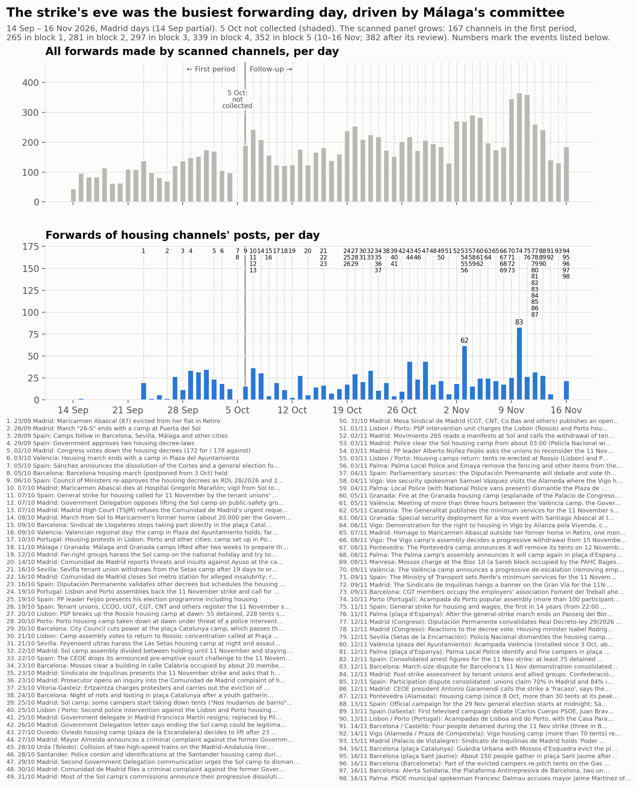
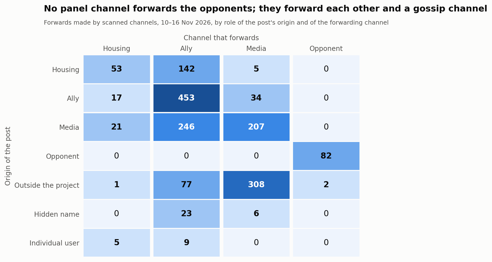
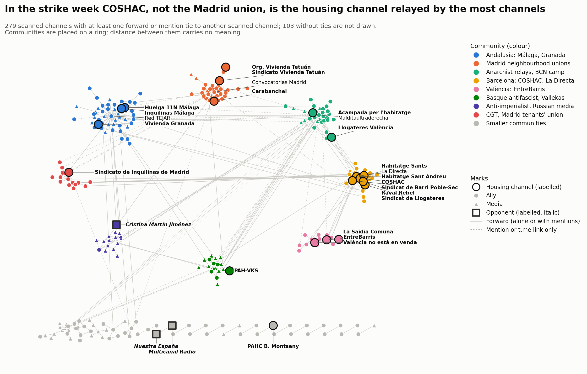
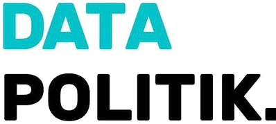

# Bloc 5: del 10 al 16 de novembre del 2026

<a href="../followup_block5.html">English</a> · <a href="../es/followup_block5.html">Español</a> · <strong>Català</strong>

Forma part del [seguiment](followup.md) de la mobilització per l'habitatge a Telegram.
El bloc 5 cobreix del 10 de novembre a les 00:00 al 16 de novembre a les 24:00, hora de
Madrid (2026-11-09T23:00Z a 2026-11-16T23:00Z). És la setmana de la vaga general de l'11 de
novembre, i l'últim bloc del seguiment.

- **El dia de vaga** (10 nov 22:00 a 12 nov 03:00) es va analitzar a part, hora per hora, a
  l'[informe del dia de vaga](followup_strike_day.md). Aquesta pàgina no el repeteix. Cobreix el
  bloc sencer, inclòs el dia de vaga, i els dies posteriors.
- **Comparacions:** amb el [bloc 4](followup_block4.md) (3–9 de novembre), de la mateixa durada;
  quan són comparables, amb el [primer període](acampadas_vivienda_technical_report.md) (14 de
  setembre – 5 d'octubre).
- **El buit del 5 d'octubre** continua sense omplir-se i apareix ombrejat a la línia temporal.
- **Moment de la recollida:** recollit el 19 de novembre, 2 dies i mig després del final del bloc,
  amb un dia complet de marge. Les publicacions eliminades o editades abans de la recollida hi són
  tal com eren aleshores.

*Traducció de l'original en anglès. Les figures i el registre de revisió són en anglès.*

## 1. Què va passar al bloc

Fets datats, cadascun amb una font de premsa i una nota sobre com es va confirmar. Els fets
horaris del dia de vaga són a l'[informe del dia de vaga](followup_strike_day.md).

**La vaga (11 nov).** Les xifres consolidades publicades després no coincideixen:
- **Detencions:** almenys 75 detinguts i 1.044 incidents (Demócrata, 12 nov); 39 de la Policía
  Nacional i la Guardia Civil (Interior); 52 dels Mossos a Barcelona; 16 de l'Ertzaintza. Els totals
  no quadren entre fonts.
- **Manifestació de Barcelona:** unes 57.000 persones (Mossos), més de 50.000 (Collboni), unes
  40.000 (Guàrdia Urbana), 400.000 (organitzadors).
- **Manifestació de Madrid:** 120.000 (Delegació del Govern) davant de 400.000, 600.000 o 750.000
  segons els organitzadors, depenent del mitjà.
- **Seguiment:** els sindicats reivindiquen un 70 % a Madrid i un 84 % a Catalunya. La CEOE i
  Cepyme en parlen com d'un «fracaso» (per sota del 5 %), i Garamendi expressa «apoyo explícito»
  a la policia.

**Les acampades es desmunten**
- **12 nov, Sevilla.** La Policía Nacional va desmuntar l'acampada de les Setas de matinada, hores
  després de la vaga (El Salto).
- **12 nov, València.** L'acampada va retirar les tendes després de 40 dies, dient que, si no, la
  policia la desallotjaria. La Delegació nega haver fixat cap termini.
- **12–13 nov, Pontevedra.** L'acampada va retirar les tendes, tal com havia anunciat.
- **11–16 nov, Palma.** L'acampada es va tornar a muntar a la plaça d'Espanya després de la
  manifestació (11 nov) i els acampats van ser multats (12 nov). Missatges al grup de Telegram de
  l'acampada parlaven de desacampar el 15 de novembre; cap informació de premsa no ho confirma. El
  16 de novembre el PSOE va acusar el batlle de pressionar la policia.
- **14–15 nov, Vigo.** L'acampada va confirmar que es retiraria progressivament a partir del 15 de
  novembre; cap font no confirma que ho fes.
- **16 nov, Barcelona.** La Guàrdia Urbana i els Mossos van desallotjar l'acampada de la plaça
  Catalunya després de 47 dies. Les xifres varien: uns 465 agents, 295 persones, 80 identificades,
  0 o 3 detencions. Unes 150 persones es van concentrar a la plaça Sant Jaume, on 5 o 6 van
  començar una vaga de fam. Part dels acampats es van tornar a instal·lar a la Barceloneta.
- **No trobat:** res sobre Sol després de l'11 de novembre, ni sobre les acampades de Granada,
  Màlaga, Bilbao o Saragossa.

**Decrets, eleccions, repressió**
- **12 nov.** La Diputació Permanent va convalidar el RDL 29/2026, el «decreto Maricarmen» (35–34),
  i va rebutjar el RDL 28/2026 sobre la pròrroga automàtica dels lloguers, amb el vot en contra del
  PNB.
- **13 nov.** Va començar la campanya electoral. Feijóo va prometre derogar la llei d'habitatge i
  aprovar una llei «antiocupas». L'habitatge va ser un dels temes del primer debat televisat.
- **14 nov.** Quatre persones detingudes durant la vaga van entrar a presó preventiva: tres a
  Barcelona (membres del comitè de vaga de Sant Martí i del sindicat d'habitatge de la Verneda,
  segons COSHAC) i una a Castelló. Hi va haver marxes de solidaritat el 14–16 de novembre.
- **15 nov, Madrid.** El Sindicato de Inquilinas va fer el seu acte de Vistalegre (unes 8.000
  persones): «votar puede ser necesario pero no es suficiente». Va convocar protestes europees per
  al 20–22 de novembre i va dir que no formaria cap partit.
- **No trobat:** cap nova vaga general, indefinida o de lloguers convocada per a una data; cap
  valoració del govern sobre la vaga.

## 2. La mostra

### Panell i revisió

- **Panell:** 352 canals, inclosos els 13 admesos a la revisió del dia de vaga.
- **Descàrregues:** 347 descarregats. Cinc són privats:
  - @elsaltomadrid, @mitxisantifascistas i Fullblack161, com abans;
  - nous en aquest bloc: @palestina_sos_bcn i el comitè de vaga de la Marina Alta.
- **Publicacions:** 15.509 al bloc (16.667 amb els canals admesos més avall).
- **Ronda de revisió:** 204 candidats, 3 exclosos perquè només els referenciaven opositors (RT, el
  canal d'Abascal, un canal de xafarderies). Una cerca de 40 noms de còpies d'acampades, comitès
  posteriors a la vaga i canals de vaga de fam no va trobar res. **30 admesos**:
  - **habitatge (1):** Raval Rebel Difusió, l'assemblea d'habitatge del Raval (Barcelona).
  - **aliats (16):** CCOO Educación Madrid (convocant: CCOO), CGT Castelló (convocant: CGT), els
    pensionistes de COESPE, PCPE, CNT Gijón, Salamanca Antinuclear, Ecologistes en Acció, L'Alzina,
    Barris Sants, Octubre casal, Antirepressiva de Ponent, IU Parla, Karmela, Ongi Etorri
    Errefuxiatuak, Local Anarquista Magdalena, Espacio La Atenea. Tots de suport.
  - **mitjans (13):** set de suport (Carne Cruda, Contre Attaque, Radio Monotes, Irola Irratia,
    Deialdiak Nafarroa, StopBulos24, Global Youth Voice); sis informatius (InfoDefense Spain, Napoli
    Monitor, Incursioni, Bizi Baratzea, i els canals de notícies en rus d'Alacant i de Màlaga).
  - **Corregits en la comprovació:**
    - El centre de mitjans de la vaga de Mallorca es va tornar a proposar, però ja és al panell
      des de la revisió del dia de vaga.
    - Lakshina Noticias es va proposar per tres publicacions «pròpies» sobre la vaga, totes còpies
      literals de Satélite Rojo. Es va rebutjar com a agregador, com a la revisió del dia de vaga.
  - Totes les decisions són al [registre de revisió](../followup_review_log.csv) (bloc 5, ronda
    *review*).
- **El panell té ara 382 canals:** 32 d'habitatge, 230 aliats, 117 mitjans, 3 opositors.
- **Regla del 15 % i dels deu candidats:** no es va activar. Els canals admesos fan 96 de 1.714
  reenviaments (5,6 %); el més gran, CCOO Educación Madrid, en fa 51 (3,0 %). Com a màxim, 2 nodes
  depenen d'un sol canal admès.

### Postura del panell

352 canals abans de la revisió:

| Paper | de suport | crítica amb la vaga | informativa | hostil | cap | no llegible |
|---|---|---|---|---|---|---|
| habitatge (31) | 20 | 0 | 0 | 0 | 11 | 0 |
| aliat (214) | 161 | 0 | 4 | 0 | 47 | 2 |
| mitjà (104) | 38 | 0 | 42 | 0 | 22 | 2 |
| opositor (3) | 0 | 0 | 0 | 3 | 0 | 0 |

Amb els 30 canals admesos: habitatge, 21 de suport; aliats, 177; mitjans, 45 de suport i 48
informatius.

- **Cap canvi de paper.** Els tres opositors es mantenen com a *hostils*:
  - Nuestra España: «El fracaso absoluto de la huelga general convierte el 11-N en un batacazo
    histórico» (#2382), a més de peces sobre el patrimoni del líder d'UGT i sobre les subvencions
    de CCOO/UGT;
  - Multicanal Radio, que les reenvia;
  - Cristina Martín Jiménez, per una publicació del dia de vaga.
- **Cap canal no és *crític amb la vaga*.** Bultza, l'únic del bloc 4, no té cap publicació sobre
  la vaga aquesta setmana. Presos Revolucionarios escriu «11N pantomima general» sobre les «mafias
  sindicales», però dona suport a la jornada com un pas cap a una vaga indefinida. Segons la regla
  del 10 de novembre és *de suport*, amb tres etiquetes de crítica (decisió discutible).
- **Etiquetes de crítica en 54 canals del panell:**
  - **govern: 49** (38 pròpies, 11 de difusió). Les càrregues policials del dia de vaga i els
    quatre vaguistes en presó preventiva, atribuïts a «el gobierno 'progresista'» (PAH Vallekas, La
    Villana) o al govern del PSOE i Sumar («¡¡NO VOTES A QUIEN TE APALEA!!», Unidad COESPE). El
    PSC, pels detinguts i el desallotjament de la plaça Catalunya («la repressió del govern del
    PSC»). El decret («no soluciona», PAH Vallekas).
  - **sindicats majoritaris: 13** (10 pròpies); **estratègia: 8** (5 pròpies); **moviment: 1** (de
    difusió).
  - Al bloc 4 la crítica anava sobretot contra CCOO i UGT. A la setmana de la vaga es gira cap al
    govern i el PSC.
- **Canvis de postura des del bloc 4:** 34 canals van passar de *de suport* a *cap* (en silenci
  sobre la mobilització després de la vaga) i 34 a l'inrevés. 15 van passar de *cap* a
  *informativa*.

### Baixes i noms

- **En silenci:** 29 canals no van publicar res al bloc, 8 d'ells d'habitatge: La PAH, PAH
  Catalanes, Carabanchel, Benimaclet, Cuadernos de trabajo, Formaciones Inquilinas (el canal de
  formació del sindicat de Madrid), Les Corts, Sindicat d'Habitatge Socialista. El canal principal
  del sindicat de Madrid, l'acampada de Barcelona i l'acampada de Sol sí que van publicar.
- **Privats:** 5 (més amunt).
- **Canvis de nom:**
  - «Sindicato de Vivienda de Carabanchel» → «…de Carabanchel y Latina»;
  - «Málaga para Vivir» → «Comité de Huelga 11N • Málaga»;
  - Acampada26s → «Acampada 26S»;
  - Kontrainfo Antifa hi afegeix «/ FAK!»;
  - @airbnbcrepa → @lecitta.

## 3. Anàlisi

### Volum

| Al dia | Bloc 4 | Bloc 5 | Bloc 5 sense l'11 de nov | 12–16 nov |
|---|---|---|---|---|
| Reenviaments fets pels canals analitzats (sense autoreenviaments) | 247,6 | **241,6** | 221,7 | **192,8** |
| El mateix, panell al final del bloc 4 (352 canals) | — | 228,1 | | |
| El mateix, els 167 canals del primer període | 143,0 | 133,3 | | |
| Reenviaments de publicacions de canals d'habitatge | 27,7 | 28,6 | 28,8 | **18,0** |
| El mateix, els 167 canals del primer període | 20,9 | 19,6 | | |
| Publicacions sobre la mobilització (termes del bloc 5) | 196,3 | **306,4** | 206,2 | **142,0** |

- **La setmana de la vaga en conjunt** va reenviar tant com la setmana prèvia. Els dos dies amb
  més reenviaments del seguiment són la vigília (10 nov, 366) i el dia de vaga (11 nov, 361).
- **Les publicacions sobre la mobilització** van pujar la meitat: 2.145 davant de 1.374 al bloc 4.
  El bloc 4 es torna a comptar amb la llista de termes més àmplia del bloc 5; amb la seva pròpia
  llista en tenia 1.163. Només l'11 de novembre en té 908. El pic de publicacions, a diferència
  dels reenviaments, és el dia de vaga.
- **Després de la vaga** tot cau:
  - del 12 al 16 de novembre el panell va reenviar un 22 % menys al dia que al bloc 4;
  - va reenviar publicacions de canals d'habitatge un terç menys sovint;
  - va publicar sobre la mobilització un 28 % menys;
  - el 15 de novembre, diumenge, té 132 reenviaments, el mínim des de l'1 de novembre (130), i 49
    publicacions sobre la mobilització.
- **Pics de publicacions d'habitatge reenviades:** **83 el 10 de novembre**, el màxim del
  seguiment. 64 són del comitè de vaga de Màlaga (cartells i l'inici de la nit), difosos per La
  Invisible (19), el sindicat de Màlaga (19), Red TEJAR (15) i Suburbia (11). Només 27 el mateix
  dia de vaga.
- **Per paper:** habitatge 162, aliats 1.129, mitjans 825, opositors 29.
- **Per postura:** de suport 1.828, informativa 283, hostil 29, crítica amb la vaga 0.
  - Les publicacions dels mitjans sobre la mobilització es van quadruplicar (194 al bloc 4): els
    mitjans van cobrir la vaga.
  - Les publicacions dels opositors van passar de 8 a 29.
  - Els recomptes per paper i per postura del bloc 4 fan servir la seva pròpia llista, més
    estreta, així que aquestes pujades estan una mica sobredimensionades.
- **Sensibilitat:**
  - Sense els 13 canals admesos a la revisió del dia de vaga: 145 publicacions menys (Horitzó 63,
    el centre de mitjans de Mallorca 30) i 4 reenviaments menys.
  - Sense els 30 admesos a la revisió d'aquest bloc: 133 publicacions menys i 94 reenviaments
    menys.
  - Sense tots dos grups: 1.593 reenviaments i 1.867 publicacions.
- **Reenviadors més grans:** Red TEJAR (206, 12,2 %), Los Sombreros Blancos (113),
  ANTIIMPERIALISTAS.COM (105), Prima Linea (86), Multicanal Radio (84). Els cinc primers fan el
  35,1 % (42,1 % al bloc 4).

### La vida posterior del dia de vaga

Reenviaments fets del 12 al 16 de novembre de publicacions aparegudes dins de la finestra del dia
de vaga:
- **41 reenviaments, el 4,2 % dels 984 reenviaments d'aquells dies.**
- 13 es van fer entre les 00:00 i les 03:00 del 12 de novembre, encara dins de la finestra. La
  majoria són difusions en bloc d'agregadors, no sobre la mobilització.
- 25 es van fer el matí del 12 de novembre: els recomptes de detencions d'Alerta Solidària,
  «LLIBERTAT DETINGUDES» de COSHAC, les fotos d'ARGIA, la crònica de la manifestació d'EntreBarris,
  l'Antirepressiva de Barcelona.
- 3 es van fer després del 12 de novembre.
- **Per paper del reenviador:** mitjans 23, aliats 17, habitatge 1 (el sindicat de Sant Andreu,
  que reenvia Alerta Solidària).
- **Per origen:** fora del panell 18, mitjans 13, aliats 8, habitatge 2 (COSHAC #41, EntreBarris
  #1946).

Les publicacions del mateix dia gairebé no es van difondre després. El que el panell va reenviar a
partir del 12 de novembre és material nou: les detencions, les crides de solidaritat, els
desallotjaments de les acampades.

### Qui reenvia qui

| Reenviament (origen → reenviador) | Bloc 4 | Bloc 5 |
|---|---|---|
| habitatge → habitatge | 53 | 53 |
| habitatge → aliat | 141 | 142 |
| aliat → habitatge | 30 | 17 |
| aliat → aliat | 526 | 453 |
| mitjà → aliat | 132 | 246 |
| mitjà → mitjà | 195 | 207 |
| fora del panell → mitjà | 409 | 308 |
| opositor → opositor | 88 | 82 |
| fora → opositor | 8 | 2 |

- **Els aliats van reenviar mitjans** gairebé el doble de vegades (132 → 246): la cobertura de la
  vaga, les detencions i els desallotjaments. Les fonts principals són Kontrainfo Antifa (39), La
  Directa (37), Diario Socialista (22) i els dos canals d'El Salto (24).
- **Els canals d'habitatge** es van reenviar tant com al bloc 4, i van reenviar menys aliats
  (30 → 17).
- **Opositors:** cap canal del panell no els reenvia, i ells no reenvien cap canal del panell. La
  seva única font externa és un canal de xafarderies de famosos (2 reenviaments).

### Node central, difusors, territoris i acampades

- **Difós per més canals:** **COSHAC**, reenviat per 10 canals, 30 vegades (bloc 4: 2 i 7). Tots
  deu són a Barcelona: el sindicat de Sant Andreu (14), el comitè de vaga de Sant Andreu, el
  sindicat de Sants, La Cinètika, Raval Rebel, el Poble-sec i els grups antirepressius. Les seves
  publicacions són la convocatòria de vaga, el recompte de detencions i «LLIBERTAT DETINGUDES».
- **EntreBarris (València):** segon, 7 canals i 23 reenviaments, tots de canals de barris de
  València (bloc 4: cap).
- **El sindicat de llogateres de Madrid:** quart per amplitud, reenviat per 3 canals, 6 vegades
  (bloc 4: 5 i 13). **Ja no és el node central.** Va publicar 14 vegades: la vaga, «750.000
  personas», «Si es necesario, las huelgas seguirán», Vistalegre.
- **El canal d'habitatge més reenviat:** el comitè de vaga de Màlaga, 91 reenviaments per 5 canals
  (bloc 4: 132 per 4).
- **Les acampades no es van reenviar gens.**
  - L'acampada de Sol: 0 (bloc 4: 9 reenviaments per 7 canals).
  - L'acampada de Barcelona: 0, tot i que els mitjans i els aliats del panell van cobrir el seu
    desallotjament del 16 de novembre en publicacions pròpies.
  - El grup de Mallorca va fer 5 reenviaments.
- **Difusors:** 17 dels 31 canals d'habitatge no van ser difosos per cap canal analitzat.
- **Territoris:** deu vincles entre canals d'habitatge, **cap entre territoris** (bloc 4: 2). Cada
  territori difon els seus: Barcelona (COSHAC i els seus sindicats), València (EntreBarris), Màlaga.

### Vincles que van aparèixer i desaparèixer

Hi ha 336 canals del panell analitzats als dos blocs:

- **mantinguts:** 196 vincles;
- **nous:** 183 (139 de reenviament, 44 d'enllaç);
- **desapareguts:** 229 (154 de reenviament, 75 d'enllaç).

El bloc té menys vincles que el bloc 4 (379 davant de 425).

### Contacte entre els opositors i la resta

Es van llegir tots els vincles:
- Multicanal Radio reenvia dues vegades un canal de xafarderies de famosos i enllaça una vegada el
  canal d'Abascal, per convidar-lo al seu programa.
- Cristina Martín Jiménez enllaça RT set vegades, pel seu programa a RT.
- **MT News (mitjà) enllaça una vegada Cristina Martín Jiménez,** al seu programa a RT sobre
  Ucraïna (#75561). És l'únic vincle entre un canal del panell i un opositor: una difusió, sense
  relació amb la mobilització.
- **No hi ha contacte sobre la mobilització** entre els opositors i la resta. Les publicacions dels
  opositors sobre la vaga («fracaso absoluto», «huelga de los extremistas de Sánchez») no les va
  recollir cap canal del panell.

### Comunitats

- **Graf combinat:** 279 nodes i 422 arestes; 103 canals analitzats no tenen vincles.
- **Partició:** consens de 50 execucions de Louvain, 27 comunitats, modularitat 0,750 (0,170 per
  paper).
- **Estabilitat:** 25 particions diferents; la més freqüent apareix en el 18 %. L'estabilitat
  mitjana dels nodes és 0,97; 9 nodes queden per sota de 0,8, cap per sota de 0,6. Louvain
  intercanvia uns quants nodes perifèrics entre execucions; les comunitats en si són estables.
- **Coincidència amb el bloc 4:** índex de Rand ajustat **0,498** en 212 canals compartits; 43
  canals només són al bloc 4 i 67 només al bloc 5.

Les comunitats més grans, amb els noms que fa servir la figura:

1. Andalusia: Red TEJAR amb Màlaga i Granada (47).
2. Sindicats de barri i agendes de Madrid: Tetuán, Carabanchel, Convocatorias Madrid (34).
3. Difusors anarquistes, amb l'acampada de Barcelona i el sindicat de llogateres de València (33).
4. Barcelona: COSHAC, els seus sindicats, Raval Rebel, el Sindicat de Llogateres, La Directa,
   Alerta Solidària (32).
5. Canals antifeixistes bascos amb PAH Vallekas (19).
6. Mitjans de moviments francesos i italians (17; en gris a la figura: només hi ha vuit colors).
7. Mitjans antiimperialistes i estatals russos (16), amb l'opositora Cristina Martín Jiménez.
8. **Canals de la CGT amb el sindicat de llogateres de Madrid** (16).
9. València: EntreBarris i els seus barris (14).

Comparat amb el bloc 4:
- **Madrid es divideix.** El sindicat ara és amb els canals de la CGT que el difonen. Els
  sindicats de barri són amb les agendes de Madrid. L'acampada de Sol no té cap vincle al bloc.
- **Barcelona es divideix.** L'acampada és amb els difusors anarquistes, i els sindicats amb La
  Directa i els grups antirepressius.
- **CCOO** manté el seu propi grup (7).

## 4. Llistes de termes

El bloc 5 parteix de la llista del dia de vaga:

- **Els termes que només es van fer servir el dia de vaga es van tornar a provar sobre les 11.778
  publicacions del bloc fora de la finestra**:
  - «huelga general» sola: 28–29 de 30 sobre aquesta vaga. Es manté: després de l'11 de novembre,
    «la vaga general» en aquest panell és aquesta.
  - piquete: 23 de 27. Es manté.
  - Les consignes, les etiquetes i els termes de vaga a prop d'habitatge: es mantenen.
  - **«seguimiento de la huelga» / «servicios mínimos»: eliminats.** Fora de la finestra coincideixen
    sobretot amb altres vagues (docents de Madrid, Renfe, neteja d'hospitals).
- **Afegits:**
  - «desacamp…»; «pararlo todo / aturar-ho tot»;
  - «vaguist…» (els vaguistes a la presó);
  - «al carrer» a prop d'habitatge («van sortir al carrer per reclamar un habitatge digne»);
  - el desallotjament de la plaça Catalunya sense una paraula d'acampada;
  - «N11», distingint majúscules i minúscules.
  - Es van llegir els 35 guanys: tots certs.
- **Positius coneguts:** 13 de 13.
- **Canals aliens:** Al Mayadeen, Cubadebate i Franceinfo només coincideixen en publicacions sobre
  aquesta vaga.
- **Omissions acceptades:** publicacions sobre els quatre detinguts sense paraula de vaga; algunes
  publicacions curtes en directe.

Recomptes: 15.509 publicacions; **2.012 coincideixen amb un terme de participació** (1.622
publicacions pròpies, 390 reenviaments, en 269 canals); 264 només de context.

## 5. Decisions que podrien haver estat unes altres

- **Postura:**
  - Presos Revolucionarios *de suport* malgrat «11N pantomima general».
  - DiarioOctubre *de suport* per un article («hay que considerarla un éxito»).
  - *de suport* per una publicació o una difusió: ahorapodemos (sobre Marlaska), Ateneo
    Palestino, CNT AIT, Ecologistas Madrid, EconomiaCGT, Gen Z, La Idea, El Viejo Topo, Cerveaux
    non disponibles.
  - Mitjans d'esquerres mantinguts a *informativa* per titulars: El Salto, eldiario.es, Diario
    Socialista, Canal Red, Diario Red, La Protesta, La Otra Andalucía, InfoAgitación, Todo Al Trece;
    BERRIA (la seva plantilla es va sumar a la vaga).
  - *cap* on només es van publicar enllaços o imatges: PAH Barcelona (enllaços a X), Eskalera
    Karakola, CTXT.
  - Organización Vivienda Tetuán *cap* (organització d'habitatge, res sobre la vaga ni les
    acampades).
  - Palestina SOS BCN, privat des del dia de vaga, mantingut *de suport* per les seves publicacions
    del dia de vaga.
- **Crítica:**
  - Els genèrics «gobierne quien gobierne» / «els governs» llegits com a govern (CGT Metal Madrid,
    CSOA Horta, CGT UCM).
  - L'«impropia de un país que se hace llamar progresista» del sindicat de Madrid llegit com a
    govern, veu pròpia.
  - El PSC comptat com a govern (l'ajuntament de Collboni, la Generalitat d'Illa).
- **Admissions:**
  - Una publicació pròpia marginal: Bizi Baratzea, Global Youth Voice, Incursioni, IU Parla, Napoli
    Monitor, Espacio La Atenea.
  - La publicació de L'Alzina és la crida d'Ecologistes en Acció, copiada.
  - Deialdiak Nafarroa admès pels peus de cartells.
  - InfoDefense Spain (una xarxa prorussa) admès com a mitjà informatiu.
- **Rebuigs:** els xats de Marx21 i Malditaultraderecha (els membres donen suport a la vaga; els
  xats es deixen fora); Encuentro Madrid (la vaga és un dels temes d'un debat abstencionista).
- **Vida posterior comptada des del 12 de novembre a les 00:00,** tot i que les 00:00–03:00 són
  dins de la finestra.
- **Comunitats:** la comunitat de mitjans francesos i italians dibuixada en gris per donar un color
  a València.

## 6. Què no es va verificar

- **Context sense un article de premsa llegit sencer:** el desacampament de Palma el 15 de
  novembre (només missatges del grup); si Vigo va començar a desmuntar; l'estat de les acampades
  de Granada, Màlaga, Sol i Palma el 16 de novembre; la data del debat televisat (deduïda); el
  recurs anunciat de Vox contra el decret.
- **Profunditat de lectura:**
  - La finestra del dia de vaga no es va tornar a llegir: les seves decisions valen per a les
    publicacions de la finestra.
  - Fora de la finestra, les publicacions coincidents es van llegir fins a 600 caràcters, vuit per
    canal, llevat que tinguessin una paraula de crítica o hostil. Una postura expressada amb altres
    paraules en publicacions posteriors passaria desapercebuda.
  - Els canals amb 30 o més publicacions no coincidents només es van llegir al voltant de paraules
    clau àmplies.
- **Codificació per lots.** La codificació de postures i de la revisió es va dividir en lots,
  cadascun codificat per un agent d'IA amb unes instruccions escrites. Es van comprovar totes les
  files hostils, les etiquetes de crítica i les notes de judici, i totes les admissions; la majoria
  de les files *de suport* i *cap* no es van tornar a llegir.
- **Enllaços:** no es van obrir les publicacions que només són enllaços a X o Instagram.
- **Mapa de la xarxa:** la disposició no és idèntica entre representacions. Les línies guia del
  grup de Barcelona són denses; cap text no se superposa.
- **No comprovat:** si els canals en silenci estan inactius o han estat eliminats.

**Com citar aquesta pàgina.**

DataPolitik (Heurística). <em>Bloc 5: del 10 al 16 de novembre del 2026</em>. Dins de <em>Acampades per l'habitatge i xarxes de comunicació a Telegram a Espanya, tardor del 2026</em>. Període d'observació: 10–16 de novembre del 2026. Publicat el 20 de novembre del 2026. <a href="https://datapolitik.github.io/acampadas-vivienda-report/ca/followup_block5.html">https://datapolitik.github.io/acampadas-vivienda-report/ca/followup_block5.html</a>

Text i figures originals: [CC BY 4.0](https://creativecommons.org/licenses/by/4.0/) · [Ús i citació](index.md#use-and-citation)

---

Un estudi de [DataPolitik](https://www.heuristica.barcelona/datapolitik/), d'[Heurística](https://www.heuristica.barcelona/). · [Inici](index.md) · [Presentació del seguiment](followup.md)
