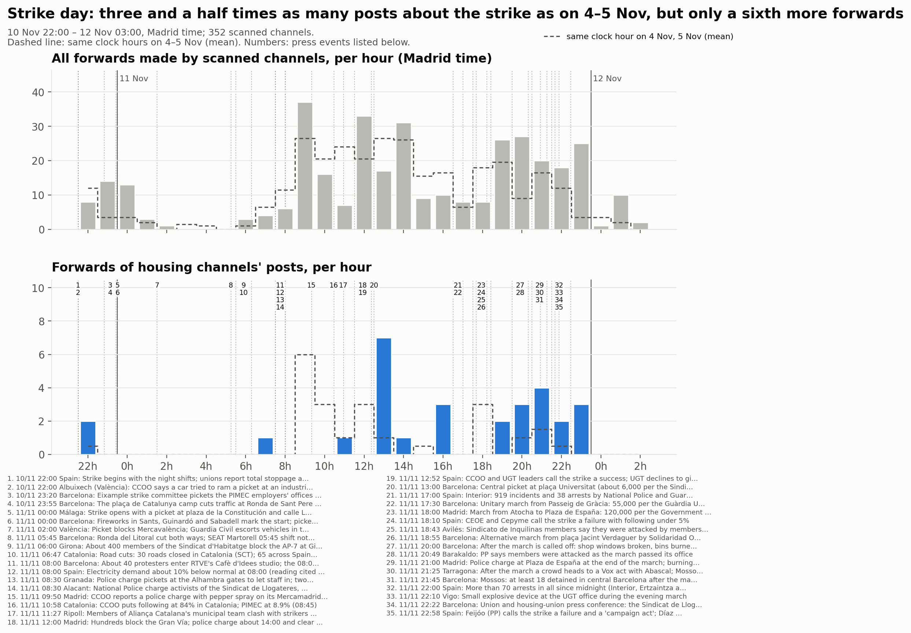
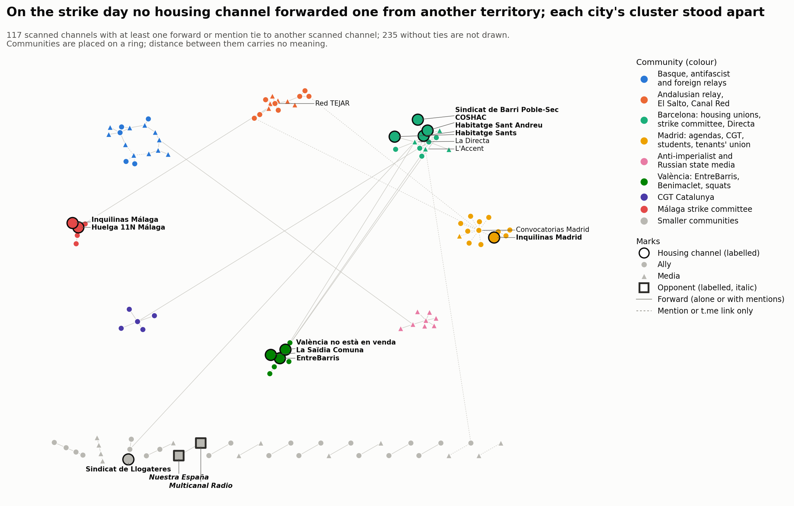
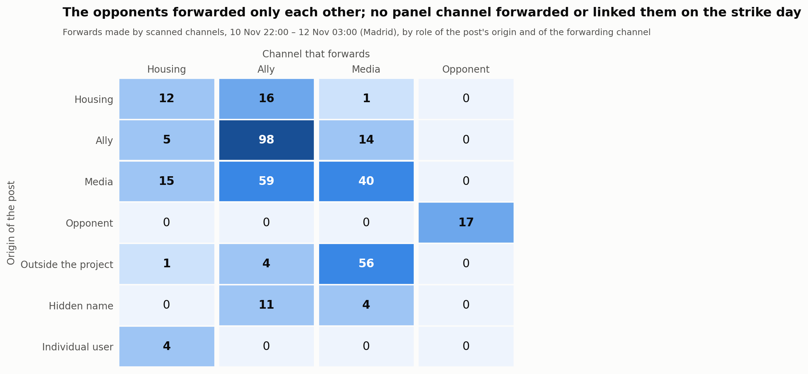

# Dia de vaga: del 10 de novembre a les 22:00 al 12 de novembre a les 03:00

<a href="../followup_strike_day.html">English</a> · <a href="../es/followup_strike_day.html">Español</a> · <strong>Català</strong>

Forma part del [seguiment](followup.md) de la mobilització per l'habitatge a Telegram. Aquesta pàgina
cobreix la vaga general de l'11 de novembre del 2026 com una **finestra** de 29 hores, hora local de
Madrid, final exclòs (2026-11-10T21:00Z a 2026-11-12T02:00Z):
- S'obre a les 22:00 de la vigília, quan van començar els primers torns de nit i els piquets.
- Es tanca a les 03:00 de l'endemà de la vaga, perquè hi quedin dins les manifestacions del vespre i
  els seus primers relats.

La finestra és dins del bloc 5 (10–16 de novembre). Els seus fets continuen pertanyent al bloc 5,
que s'analitzarà sencer després, finestra inclosa.

- **Comparacions:**
  - Les **mateixes hores de rellotge del dimecres 4 i el dijous 5 de novembre** (mitjana), dos dies
    feiners corrents del [bloc 4](followup_block4.md), sense cap fet important marcat. Les hores de
    dins de la finestra mai no compten com a referència.
  - El **bloc 4** (3–9 de novembre) per a l'estructura: papers, vincles, comunitats.
- **Recollida:** feta el 12 de novembre des de les 15:07 UTC, tretze hores després del tancament de
  la finestra. No s'hi inclouen les publicacions ni les edicions posteriors.
- **Panell:** 339 canals a l'inici; 352 després de la ronda de revisió (§6). 3 privats.

## 1. El dia a Telegram, hora a hora, davant del relat de la premsa

El relat de la premsa té 36 fets amb hora, que es llisten a sota; els 35 de dins de la finestra van
numerats a la línia temporal. Fonts:
- llegides literalment: els directes de La Directa i de Nació Digital, Euronews, El Español i
  Demócrata;
- llegides en part: els directes d'eldiario.es i de The Objective, Infobae;
- només resums de cerca per a alguns fets, com indica la nota de cadascun.

<strong>Els 36 fets del relat de la premsa (35 numerats a la línia temporal)</strong>

<table style="font-size:85%;border-collapse:collapse"><thead><tr><th style="border:1px solid #d0d7de;padding:4px 8px;vertical-align:top">Núm.</th><th style="border:1px solid #d0d7de;padding:4px 8px;vertical-align:top">Hora de Madrid</th><th style="border:1px solid #d0d7de;padding:4px 8px;vertical-align:top">Lloc</th><th style="border:1px solid #d0d7de;padding:4px 8px;vertical-align:top">Fet</th><th style="border:1px solid #d0d7de;padding:4px 8px;vertical-align:top">Fonts</th><th style="border:1px solid #d0d7de;padding:4px 8px;vertical-align:top">Nota</th></tr></thead><tbody><tr><td style="border:1px solid #d0d7de;padding:4px 8px;vertical-align:top">– <small>abans de la finestra</small></td><td style="border:1px solid #d0d7de;padding:4px 8px;vertical-align:top">10&nbsp;nov&nbsp;20:00</td><td style="border:1px solid #d0d7de;padding:4px 8px;vertical-align:top">Martorell</td><td style="border:1px solid #d0d7de;padding:4px 8px;vertical-align:top">Primers piquets del torn de nit a la planta de la SEAT (CCOO, CGT, UGT)</td><td style="border:1px solid #d0d7de;padding:4px 8px;vertical-align:top"><a href="https://directa.cat/minut-a-minut-11n-vaga-general/">La Directa</a></td><td style="border:1px solid #d0d7de;padding:4px 8px;vertical-align:top">Publicació de Directa a les 20:38 (hora del fet &quot;a partir de les 20h&quot;); abans de la finestra. També ho recull Diario Socialista</td></tr><tr><td style="border:1px solid #d0d7de;padding:4px 8px;vertical-align:top">1</td><td style="border:1px solid #d0d7de;padding:4px 8px;vertical-align:top">10&nbsp;nov&nbsp;22:00</td><td style="border:1px solid #d0d7de;padding:4px 8px;vertical-align:top">Espanya</td><td style="border:1px solid #d0d7de;padding:4px 8px;vertical-align:top">La vaga comença amb els torns de nit; els sindicats parlen d&#x27;aturada total a la SEAT de Martorell</td><td style="border:1px solid #d0d7de;padding:4px 8px;vertical-align:top"><a href="https://directa.cat/minut-a-minut-11n-vaga-general/">La Directa</a>, <a href="https://www.eldiario.es/economia/huelga-general-11-noviembre-ultima-hora-directo-arranca-gran-paro-vivienda_133_13653845.html">eldiario.es</a></td><td style="border:1px solid #d0d7de;padding:4px 8px;vertical-align:top">Publicació de Directa a les 22:00: 327 persones a dins amb serveis mínims, d&#x27;una plantilla de més de 13.000 (xifra sindical). Interior compta incidents des de les 22:00 del dimarts (eldiario.es)</td></tr><tr><td style="border:1px solid #d0d7de;padding:4px 8px;vertical-align:top">2</td><td style="border:1px solid #d0d7de;padding:4px 8px;vertical-align:top">10&nbsp;nov&nbsp;22:00</td><td style="border:1px solid #d0d7de;padding:4px 8px;vertical-align:top">Albuixech (València)</td><td style="border:1px solid #d0d7de;padding:4px 8px;vertical-align:top">CCOO denuncia que un cotxe va intentar envestir un piquet en un polígon</td><td style="border:1px solid #d0d7de;padding:4px 8px;vertical-align:top"><a href="https://www.eldiario.es/economia/huelga-general-11-noviembre-ultima-hora-directo-arranca-gran-paro-vivienda_133_13653845.html">eldiario.es</a></td><td style="border:1px solid #d0d7de;padding:4px 8px;vertical-align:top">Publicació d&#x27;eldiario.es a les 21:59 de l&#x27;11 de novembre; fet &quot;cap a les 22:00 del dimarts&quot;. Versió de CCOO, sense confirmació policial</td></tr><tr><td style="border:1px solid #d0d7de;padding:4px 8px;vertical-align:top">3</td><td style="border:1px solid #d0d7de;padding:4px 8px;vertical-align:top">10&nbsp;nov&nbsp;23:20</td><td style="border:1px solid #d0d7de;padding:4px 8px;vertical-align:top">Barcelona</td><td style="border:1px solid #d0d7de;padding:4px 8px;vertical-align:top">El comitè de vaga de l&#x27;Eixample fa un piquet amb bengales davant la seu de la patronal PIMEC</td><td style="border:1px solid #d0d7de;padding:4px 8px;vertical-align:top"><a href="https://directa.cat/minut-a-minut-11n-vaga-general/">La Directa</a></td><td style="border:1px solid #d0d7de;padding:4px 8px;vertical-align:top">Publicació de Directa a les 23:20; també ho recull Diario Socialista (resum de cerca)</td></tr><tr><td style="border:1px solid #d0d7de;padding:4px 8px;vertical-align:top">4</td><td style="border:1px solid #d0d7de;padding:4px 8px;vertical-align:top">10&nbsp;nov&nbsp;23:55</td><td style="border:1px solid #d0d7de;padding:4px 8px;vertical-align:top">Barcelona</td><td style="border:1px solid #d0d7de;padding:4px 8px;vertical-align:top">L&#x27;acampada de la plaça de Catalunya talla el trànsit a la Ronda de Sant Pere / Passeig de Gràcia</td><td style="border:1px solid #d0d7de;padding:4px 8px;vertical-align:top"><a href="https://directa.cat/minut-a-minut-11n-vaga-general/">La Directa</a></td><td style="border:1px solid #d0d7de;padding:4px 8px;vertical-align:top">&quot;Poc abans de mitjanit&quot; (publicació de Directa a les 00:05); el directe d&#x27;un mitjà barceloní el situa a les 00:10 (resum de cerca). És l&#x27;únic sobre les acampades que es va trobar a la premsa d&#x27;aquella nit</td></tr><tr><td style="border:1px solid #d0d7de;padding:4px 8px;vertical-align:top">5</td><td style="border:1px solid #d0d7de;padding:4px 8px;vertical-align:top">11&nbsp;nov&nbsp;00:00</td><td style="border:1px solid #d0d7de;padding:4px 8px;vertical-align:top">Màlaga</td><td style="border:1px solid #d0d7de;padding:4px 8px;vertical-align:top">La vaga arrenca amb un piquet a la plaza de la Constitución i el carrer Larios; piquets de CCOO a Mercamálaga i a les cotxeres</td><td style="border:1px solid #d0d7de;padding:4px 8px;vertical-align:top"><a href="https://www.andaluciainformacion.es/articulo/malaga-sociedad/huelga-general-arranca-malaga-reivindicaciones-vivienda-salarios-servicios-publicos/202611110950183533271.html">Andalucía Información</a></td><td style="border:1px solid #d0d7de;padding:4px 8px;vertical-align:top">D&#x27;un resum de cerca d&#x27;Andalucía Información i El Español Málaga, no llegit sencer. Després la policia va carregar contra piquets a Mercamálaga i a les cotxeres de l&#x27;EMT (titular d&#x27;El Español Málaga); CCOO: &quot;todos nuestros piquetes han sido informativos y pacíficos&quot;</td></tr><tr><td style="border:1px solid #d0d7de;padding:4px 8px;vertical-align:top">6</td><td style="border:1px solid #d0d7de;padding:4px 8px;vertical-align:top">11&nbsp;nov&nbsp;00:00</td><td style="border:1px solid #d0d7de;padding:4px 8px;vertical-align:top">Barcelona</td><td style="border:1px solid #d0d7de;padding:4px 8px;vertical-align:top">Petards a Sants, el Guinardó i Sabadell marquen l&#x27;inici; piquets pels carrers</td><td style="border:1px solid #d0d7de;padding:4px 8px;vertical-align:top"><a href="https://directa.cat/minut-a-minut-11n-vaga-general/">La Directa</a></td><td style="border:1px solid #d0d7de;padding:4px 8px;vertical-align:top">Publicació de Directa a les 00:00</td></tr><tr><td style="border:1px solid #d0d7de;padding:4px 8px;vertical-align:top">7</td><td style="border:1px solid #d0d7de;padding:4px 8px;vertical-align:top">11&nbsp;nov&nbsp;02:00</td><td style="border:1px solid #d0d7de;padding:4px 8px;vertical-align:top">València</td><td style="border:1px solid #d0d7de;padding:4px 8px;vertical-align:top">Un piquet bloqueja Mercavalència; la Guàrdia Civil escorta l&#x27;entrada de vehicles dues hores després</td><td style="border:1px solid #d0d7de;padding:4px 8px;vertical-align:top"><a href="https://directa.cat/minut-a-minut-11n-vaga-general/">La Directa</a></td><td style="border:1px solid #d0d7de;padding:4px 8px;vertical-align:top">Publicació de Directa a les 02:00; peu de foto d&#x27;eldiario.es dels piquets de Mercavalència &#x27;en la madrugada&#x27;</td></tr><tr><td style="border:1px solid #d0d7de;padding:4px 8px;vertical-align:top">8</td><td style="border:1px solid #d0d7de;padding:4px 8px;vertical-align:top">11&nbsp;nov&nbsp;05:45</td><td style="border:1px solid #d0d7de;padding:4px 8px;vertical-align:top">Barcelona</td><td style="border:1px solid #d0d7de;padding:4px 8px;vertical-align:top">Ronda del Litoral tallada en els dos sentits; no es deixa entrar el torn de les 05:45 a la SEAT de Martorell</td><td style="border:1px solid #d0d7de;padding:4px 8px;vertical-align:top"><a href="https://directa.cat/minut-a-minut-11n-vaga-general/">La Directa</a>, <a href="https://naciodigital.cat/societat/la-vaga-general-de-l11-n-en-directe-talls-a-les-carreteres-manifestacions-i-reaccions-politiques.html">Nació Digital</a></td><td style="border:1px solid #d0d7de;padding:4px 8px;vertical-align:top">Publicació de Directa a les 05:45; Nació a les 07:20 (porta de la SEAT, accés a l&#x27;A-2 tallat, pneumàtics cremats)</td></tr><tr><td style="border:1px solid #d0d7de;padding:4px 8px;vertical-align:top">9</td><td style="border:1px solid #d0d7de;padding:4px 8px;vertical-align:top">11&nbsp;nov&nbsp;06:00</td><td style="border:1px solid #d0d7de;padding:4px 8px;vertical-align:top">Girona</td><td style="border:1px solid #d0d7de;padding:4px 8px;vertical-align:top">Unes 400 persones del Sindicat d&#x27;Habitatge bloquegen l&#x27;AP-7 a Girona Oest</td><td style="border:1px solid #d0d7de;padding:4px 8px;vertical-align:top"><a href="https://naciodigital.cat/societat/la-vaga-general-de-l11-n-en-directe-talls-a-les-carreteres-manifestacions-i-reaccions-politiques.html">Nació Digital</a></td><td style="border:1px solid #d0d7de;padding:4px 8px;vertical-align:top">Publicació de Nació a les 07:49; hi van entrar cap a les 06:00 després d&#x27;un piquet a la planta de Nestlé</td></tr><tr><td style="border:1px solid #d0d7de;padding:4px 8px;vertical-align:top">10</td><td style="border:1px solid #d0d7de;padding:4px 8px;vertical-align:top">11&nbsp;nov&nbsp;06:47</td><td style="border:1px solid #d0d7de;padding:4px 8px;vertical-align:top">Catalunya</td><td style="border:1px solid #d0d7de;padding:4px 8px;vertical-align:top">Talls de carretera: 30 vies tancades a Catalunya (SCT); 65 a tot Espanya a les 08:34</td><td style="border:1px solid #d0d7de;padding:4px 8px;vertical-align:top"><a href="https://directa.cat/minut-a-minut-11n-vaga-general/">La Directa</a></td><td style="border:1px solid #d0d7de;padding:4px 8px;vertical-align:top">Publicacions de Directa a les 06:47 i 08:34 (Servei Català de Trànsit). Nació: un màxim d&#x27;unes 50 a Catalunya, cinc a les 15:15. Les xifres varien segons la font i l&#x27;hora</td></tr><tr><td style="border:1px solid #d0d7de;padding:4px 8px;vertical-align:top">11</td><td style="border:1px solid #d0d7de;padding:4px 8px;vertical-align:top">11&nbsp;nov&nbsp;08:00</td><td style="border:1px solid #d0d7de;padding:4px 8px;vertical-align:top">Barcelona</td><td style="border:1px solid #d0d7de;padding:4px 8px;vertical-align:top">Unes 40 persones entren al plató del Cafè d&#x27;Idees de RTVE; s&#x27;interromp el programa de les 08:00</td><td style="border:1px solid #d0d7de;padding:4px 8px;vertical-align:top"><a href="https://directa.cat/minut-a-minut-11n-vaga-general/">La Directa</a>, <a href="https://es.euronews.com/2026/11/12/fuerza-en-la-calle-pero-seguimiento-escaso-en-el-trabajo-la-huelga-general-del-11n">Euronews</a></td><td style="border:1px solid #d0d7de;padding:4px 8px;vertical-align:top">Publicació de Directa a les 08:12; The Objective (resum de pàgina, no literal) parla d&#x27;unes 50 persones encaputxades</td></tr><tr><td style="border:1px solid #d0d7de;padding:4px 8px;vertical-align:top">12</td><td style="border:1px solid #d0d7de;padding:4px 8px;vertical-align:top">11&nbsp;nov&nbsp;08:00</td><td style="border:1px solid #d0d7de;padding:4px 8px;vertical-align:top">Espanya</td><td style="border:1px solid #d0d7de;padding:4px 8px;vertical-align:top">La demanda elèctrica, un 10 % per sota del normal a les 08:00 (lectura que citen els sindicats)</td><td style="border:1px solid #d0d7de;padding:4px 8px;vertical-align:top"><a href="https://naciodigital.cat/societat/la-vaga-general-de-l11-n-en-directe-talls-a-les-carreteres-manifestacions-i-reaccions-politiques.html">Nació Digital</a></td><td style="border:1px solid #d0d7de;padding:4px 8px;vertical-align:top">Publicació de Nació a les 08:20 (Cadena SER); no s&#x27;indica la referència. Altres lectures: −6,64 % a les 10:00 respecte al dimarts (Nació 11:13); −15,49 % entre les 10 i les 11 respecte a la previsió de REE (eldiario.es, resum de pàgina); −3,4 % en tot el dia respecte al 10 de novembre (Euronews); −4,7 % respecte a la previsió a les 17:00 (El Español). No són comparables tal com es donen</td></tr><tr><td style="border:1px solid #d0d7de;padding:4px 8px;vertical-align:top">13</td><td style="border:1px solid #d0d7de;padding:4px 8px;vertical-align:top">11&nbsp;nov&nbsp;08:30</td><td style="border:1px solid #d0d7de;padding:4px 8px;vertical-align:top">Granada</td><td style="border:1px solid #d0d7de;padding:4px 8px;vertical-align:top">La policia carrega contra els piquets a les portes de l&#x27;Alhambra per deixar entrar la plantilla; dues persones del piquet detingudes</td><td style="border:1px solid #d0d7de;padding:4px 8px;vertical-align:top"><a href="https://www.cope.es/actualidad/espana/al-minuto/huelga-general-11-noviembre-sigue-directo-jornada-paro-espana-20261111_3472630.html">COPE</a></td><td style="border:1px solid #d0d7de;padding:4px 8px;vertical-align:top">COPE (resum de cerca) i The Objective (resum de pàgina, 11:49): piquets des de les 06:30; l&#x27;Alhambra va obrir cap a les 11:00. No llegit literalment</td></tr><tr><td style="border:1px solid #d0d7de;padding:4px 8px;vertical-align:top">14</td><td style="border:1px solid #d0d7de;padding:4px 8px;vertical-align:top">11&nbsp;nov&nbsp;08:30</td><td style="border:1px solid #d0d7de;padding:4px 8px;vertical-align:top">Alacant</td><td style="border:1px solid #d0d7de;padding:4px 8px;vertical-align:top">La Policia Nacional carrega contra activistes del Sindicat de Llogateres, el Sindicat de Vivenda de Carolines i OJS</td><td style="border:1px solid #d0d7de;padding:4px 8px;vertical-align:top"><a href="https://directa.cat/minut-a-minut-11n-vaga-general/">La Directa</a></td><td style="border:1px solid #d0d7de;padding:4px 8px;vertical-align:top">Publicació de Directa a les 08:30; només la versió de Directa</td></tr><tr><td style="border:1px solid #d0d7de;padding:4px 8px;vertical-align:top">15</td><td style="border:1px solid #d0d7de;padding:4px 8px;vertical-align:top">11&nbsp;nov&nbsp;09:50</td><td style="border:1px solid #d0d7de;padding:4px 8px;vertical-align:top">Madrid</td><td style="border:1px solid #d0d7de;padding:4px 8px;vertical-align:top">CCOO denuncia una càrrega policial amb gas pebre contra el seu piquet de Mercamadrid de matinada i presenta una denúncia penal</td><td style="border:1px solid #d0d7de;padding:4px 8px;vertical-align:top"><a href="https://www.elespanol.com/invertia/economia/empleo/20261111/ceoe-cifra-seguimiento-huelga-ugt-descarta-dar-nuevos-datos-aburrido/1003744454617_0.html">El Español</a></td><td style="border:1px solid #d0d7de;padding:4px 8px;vertical-align:top">Fet &#x27;la pasada madrugada&#x27; (El Español); 09:50 i 10:30 són hores de publicació de The Objective (resum de pàgina). CCOO: 1 detenció i 13 ferits (segons el sindicat). L&#x27;alcalde de Madrid va admetre incidents a Mercamadrid i a cotxeres de l&#x27;EMT (The Objective 12:04, resum)</td></tr><tr><td style="border:1px solid #d0d7de;padding:4px 8px;vertical-align:top">16</td><td style="border:1px solid #d0d7de;padding:4px 8px;vertical-align:top">11&nbsp;nov&nbsp;10:58</td><td style="border:1px solid #d0d7de;padding:4px 8px;vertical-align:top">Catalunya</td><td style="border:1px solid #d0d7de;padding:4px 8px;vertical-align:top">CCOO xifra el seguiment en el 84 % a Catalunya; PIMEC, en el 8,9 % (08:45)</td><td style="border:1px solid #d0d7de;padding:4px 8px;vertical-align:top"><a href="https://naciodigital.cat/societat/la-vaga-general-de-l11-n-en-directe-talls-a-les-carreteres-manifestacions-i-reaccions-politiques.html">Nació Digital</a></td><td style="border:1px solid #d0d7de;padding:4px 8px;vertical-align:top">Publicacions de Nació a les 10:13 i 10:58; PIMEC 8,3 % a les 11:42; sector públic de la Generalitat 12,8 % (16:25)</td></tr><tr><td style="border:1px solid #d0d7de;padding:4px 8px;vertical-align:top">17</td><td style="border:1px solid #d0d7de;padding:4px 8px;vertical-align:top">11&nbsp;nov&nbsp;11:27</td><td style="border:1px solid #d0d7de;padding:4px 8px;vertical-align:top">Ripoll</td><td style="border:1px solid #d0d7de;padding:4px 8px;vertical-align:top">Membres de l&#x27;equip municipal d&#x27;Aliança Catalana s&#x27;enfronten a vaguistes en un piquet davant d&#x27;un supermercat</td><td style="border:1px solid #d0d7de;padding:4px 8px;vertical-align:top"><a href="https://naciodigital.cat/societat/la-vaga-general-de-l11-n-en-directe-talls-a-les-carreteres-manifestacions-i-reaccions-politiques.html">Nació Digital</a>, <a href="https://directa.cat/minut-a-minut-11n-vaga-general/">La Directa</a></td><td style="border:1px solid #d0d7de;padding:4px 8px;vertical-align:top">Publicació de Nació a les 11:27 (empentes, puntades de peu); Directa 15:41: la policia separa l&#x27;alcaldessa dels manifestants</td></tr><tr><td style="border:1px solid #d0d7de;padding:4px 8px;vertical-align:top">18</td><td style="border:1px solid #d0d7de;padding:4px 8px;vertical-align:top">11&nbsp;nov&nbsp;12:00</td><td style="border:1px solid #d0d7de;padding:4px 8px;vertical-align:top">Madrid</td><td style="border:1px solid #d0d7de;padding:4px 8px;vertical-align:top">Centenars de persones bloquegen la Gran Vía; la policia carrega cap a les 14:00 i l&#x27;esvaeix cap a les 14:30</td><td style="border:1px solid #d0d7de;padding:4px 8px;vertical-align:top"><a href="https://es.euronews.com/2026/11/12/fuerza-en-la-calle-pero-seguimiento-escaso-en-el-trabajo-la-huelga-general-del-11n">Euronews</a>, <a href="https://naciodigital.cat/societat/la-vaga-general-de-l11-n-en-directe-talls-a-les-carreteres-manifestacions-i-reaccions-politiques.html">Nació Digital</a></td><td style="border:1px solid #d0d7de;padding:4px 8px;vertical-align:top">Euronews (càrregues cap a les 14:00, denúncies de gas pebre); publicació de Nació a les 14:40; The Objective (resum): unes dues hores de bloqueig, 2 detencions</td></tr><tr><td style="border:1px solid #d0d7de;padding:4px 8px;vertical-align:top">19</td><td style="border:1px solid #d0d7de;padding:4px 8px;vertical-align:top">11&nbsp;nov&nbsp;12:52</td><td style="border:1px solid #d0d7de;padding:4px 8px;vertical-align:top">Espanya</td><td style="border:1px solid #d0d7de;padding:4px 8px;vertical-align:top">Els líders de CCOO i UGT donen la vaga per un èxit; UGT no dona xifra estatal</td><td style="border:1px solid #d0d7de;padding:4px 8px;vertical-align:top"><a href="https://www.elespanol.com/invertia/economia/empleo/20261111/ceoe-cifra-seguimiento-huelga-ugt-descarta-dar-nuevos-datos-aburrido/1003744454617_0.html">El Español</a></td><td style="border:1px solid #d0d7de;padding:4px 8px;vertical-align:top">Hora d&#x27;eldiario.es (resum de pàgina). Xifres sindicals per comunitat: 84 % Catalunya; 70 % Andalusia, Madrid, Aragó; 60 % País Valencià, Castella-la Manxa (Euronews); 41 % Extremadura i Castella-la Manxa (capçalera d&#x27;eldiario.es). Desacord: vegeu 18:10</td></tr><tr><td style="border:1px solid #d0d7de;padding:4px 8px;vertical-align:top">20</td><td style="border:1px solid #d0d7de;padding:4px 8px;vertical-align:top">11&nbsp;nov&nbsp;13:00</td><td style="border:1px solid #d0d7de;padding:4px 8px;vertical-align:top">Barcelona</td><td style="border:1px solid #d0d7de;padding:4px 8px;vertical-align:top">El piquet central de la plaça Universitat (unes 6.000 persones segons el Sindicat de Llogateres) avança cap a la plaça Catalunya</td><td style="border:1px solid #d0d7de;padding:4px 8px;vertical-align:top"><a href="https://directa.cat/minut-a-minut-11n-vaga-general/">La Directa</a>, <a href="https://naciodigital.cat/societat/la-vaga-general-de-l11-n-en-directe-talls-a-les-carreteres-manifestacions-i-reaccions-politiques.html">Nació Digital</a></td><td style="border:1px solid #d0d7de;padding:4px 8px;vertical-align:top">Publicació de Directa a les 15:30 (dissolt cap a les 14:00); Nació a les 13:09. Guàrdia Urbana: unes 3.000 persones als piquets centrals (resum de cerca)</td></tr><tr><td style="border:1px solid #d0d7de;padding:4px 8px;vertical-align:top">21</td><td style="border:1px solid #d0d7de;padding:4px 8px;vertical-align:top">11&nbsp;nov&nbsp;17:00</td><td style="border:1px solid #d0d7de;padding:4px 8px;vertical-align:top">Espanya</td><td style="border:1px solid #d0d7de;padding:4px 8px;vertical-align:top">Interior: 919 incidents i 38 detencions de la Policia Nacional i la Guàrdia Civil des de les 22:00 del dimarts</td><td style="border:1px solid #d0d7de;padding:4px 8px;vertical-align:top"><a href="https://www.eldiario.es/economia/huelga-general-11-noviembre-ultima-hora-directo-arranca-gran-paro-vivienda_133_13653845.html">eldiario.es</a></td><td style="border:1px solid #d0d7de;padding:4px 8px;vertical-align:top">Publicació d&#x27;eldiario.es a les 23:57 (literal); Madrid, 15. Euronews dona 1.144 incidents per al mateix interval; Demócrata, 1.044. Exclou Mossos i Ertzaintza</td></tr><tr><td style="border:1px solid #d0d7de;padding:4px 8px;vertical-align:top">22</td><td style="border:1px solid #d0d7de;padding:4px 8px;vertical-align:top">11&nbsp;nov&nbsp;17:30</td><td style="border:1px solid #d0d7de;padding:4px 8px;vertical-align:top">Barcelona</td><td style="border:1px solid #d0d7de;padding:4px 8px;vertical-align:top">Manifestació unitària des del Passeig de Gràcia: 55.000 persones segons la Guàrdia Urbana; 400.000 segons els convocants</td><td style="border:1px solid #d0d7de;padding:4px 8px;vertical-align:top"><a href="https://naciodigital.cat/societat/la-vaga-general-de-l11-n-en-directe-talls-a-les-carreteres-manifestacions-i-reaccions-politiques.html">Nació Digital</a>, <a href="https://www.infobae.com/espana/2026/11/11/huelga-general-en-espana-en-directo-piquetes-incidencia-en-transportes-y-empresas-reacciones-y-ultima-hora-de-las-elecciones-generales/">Infobae</a></td><td style="border:1px solid #d0d7de;padding:4px 8px;vertical-align:top">Sortida a les 17:30 (guia de betevé, resum de cerca); Nació 18:55 (55.000) i 20:14 (400.000, Sindicat de Llogateres); un resum en dona 50.000</td></tr><tr><td style="border:1px solid #d0d7de;padding:4px 8px;vertical-align:top">23</td><td style="border:1px solid #d0d7de;padding:4px 8px;vertical-align:top">11&nbsp;nov&nbsp;18:00</td><td style="border:1px solid #d0d7de;padding:4px 8px;vertical-align:top">Madrid</td><td style="border:1px solid #d0d7de;padding:4px 8px;vertical-align:top">Manifestació d&#x27;Atocha a la Plaza de España: 120.000 persones segons la Delegació del Govern; 400.000 segons el Sindicato de Inquilinas</td><td style="border:1px solid #d0d7de;padding:4px 8px;vertical-align:top"><a href="https://www.eldiario.es/economia/huelga-general-11-noviembre-ultima-hora-directo-arranca-gran-paro-vivienda_133_13653845.html">eldiario.es</a>, <a href="https://www.infobae.com/espana/2026/11/11/huelga-general-en-espana-en-directo-piquetes-incidencia-en-transportes-y-empresas-reacciones-y-ultima-hora-de-las-elecciones-generales/">Infobae</a></td><td style="border:1px solid #d0d7de;padding:4px 8px;vertical-align:top">eldiario.es 23:27; Infobae 19:21; The Objective 20:21 en dona 600.000 segons el Sindicato de Inquilinas. Sota la pluja</td></tr><tr><td style="border:1px solid #d0d7de;padding:4px 8px;vertical-align:top">24</td><td style="border:1px solid #d0d7de;padding:4px 8px;vertical-align:top">11&nbsp;nov&nbsp;18:10</td><td style="border:1px solid #d0d7de;padding:4px 8px;vertical-align:top">Espanya</td><td style="border:1px solid #d0d7de;padding:4px 8px;vertical-align:top">CEOE i Cepyme donen la vaga per fracassada, amb un seguiment per sota del 5 %</td><td style="border:1px solid #d0d7de;padding:4px 8px;vertical-align:top"><a href="https://www.elespanol.com/invertia/economia/empleo/20261111/ceoe-cifra-seguimiento-huelga-ugt-descarta-dar-nuevos-datos-aburrido/1003744454617_0.html">El Español</a></td><td style="border:1px solid #d0d7de;padding:4px 8px;vertical-align:top">El Español ho va publicar a les 18:10 (el resum d&#x27;eldiario.es ho situa a les 18:46). Electricitat −4,7 % respecte a la previsió de REE; els sindicats discuteixen la mesura</td></tr><tr><td style="border:1px solid #d0d7de;padding:4px 8px;vertical-align:top">25</td><td style="border:1px solid #d0d7de;padding:4px 8px;vertical-align:top">11&nbsp;nov&nbsp;18:43</td><td style="border:1px solid #d0d7de;padding:4px 8px;vertical-align:top">Avilés</td><td style="border:1px solid #d0d7de;padding:4px 8px;vertical-align:top">Membres del Sindicato de Inquilinas denuncien que membres de Núcleo Nacional els van agredir mentre cridaven a la vaga</td><td style="border:1px solid #d0d7de;padding:4px 8px;vertical-align:top"><a href="https://www.eldiario.es/economia/huelga-general-11-noviembre-ultima-hora-directo-arranca-gran-paro-vivienda_133_13653845.html">eldiario.es</a></td><td style="border:1px solid #d0d7de;padding:4px 8px;vertical-align:top">Hora de publicació d&#x27;eldiario.es, d&#x27;un resum de pàgina (no literal); només la versió del sindicat</td></tr><tr><td style="border:1px solid #d0d7de;padding:4px 8px;vertical-align:top">26</td><td style="border:1px solid #d0d7de;padding:4px 8px;vertical-align:top">11&nbsp;nov&nbsp;18:55</td><td style="border:1px solid #d0d7de;padding:4px 8px;vertical-align:top">Barcelona</td><td style="border:1px solid #d0d7de;padding:4px 8px;vertical-align:top">Manifestació alternativa des de la plaça Jacint Verdaguer de Solidaridad Obrera i el Sindicat d&#x27;Habitatge Socialista: 10.000 persones segons els convocants</td><td style="border:1px solid #d0d7de;padding:4px 8px;vertical-align:top"><a href="https://directa.cat/minut-a-minut-11n-vaga-general/">La Directa</a>, <a href="https://www.infobae.com/espana/2026/11/11/huelga-general-en-espana-en-directo-piquetes-incidencia-en-transportes-y-empresas-reacciones-y-ultima-hora-de-las-elecciones-generales/">Infobae</a></td><td style="border:1px solid #d0d7de;padding:4px 8px;vertical-align:top">Publicació de Directa a les 18:55; Infobae 19:19 (unes 10.000 persones segons els convocants; sense xifra oficial)</td></tr><tr><td style="border:1px solid #d0d7de;padding:4px 8px;vertical-align:top">27</td><td style="border:1px solid #d0d7de;padding:4px 8px;vertical-align:top">11&nbsp;nov&nbsp;20:00</td><td style="border:1px solid #d0d7de;padding:4px 8px;vertical-align:top">Barcelona</td><td style="border:1px solid #d0d7de;padding:4px 8px;vertical-align:top">Després de donar-se per acabada la manifestació: aparadors trencats, contenidors cremats, petards contra els Mossos; càrregues dels antiavalots</td><td style="border:1px solid #d0d7de;padding:4px 8px;vertical-align:top"><a href="https://naciodigital.cat/societat/la-vaga-general-de-l11-n-en-directe-talls-a-les-carreteres-manifestacions-i-reaccions-politiques.html">Nació Digital</a>, <a href="https://directa.cat/minut-a-minut-11n-vaga-general/">La Directa</a></td><td style="border:1px solid #d0d7de;padding:4px 8px;vertical-align:top">Directa 19:59 (primeres càrregues); Nació 20:05 i 20:54 (foc a la botiga d&#x27;Apple del Passeig de Gràcia; contenidors al voltant de la plaça Catalunya)</td></tr><tr><td style="border:1px solid #d0d7de;padding:4px 8px;vertical-align:top">28</td><td style="border:1px solid #d0d7de;padding:4px 8px;vertical-align:top">11&nbsp;nov&nbsp;20:49</td><td style="border:1px solid #d0d7de;padding:4px 8px;vertical-align:top">Barakaldo</td><td style="border:1px solid #d0d7de;padding:4px 8px;vertical-align:top">El PP denuncia que van agredir afiliats quan la manifestació passava davant de la seva seu</td><td style="border:1px solid #d0d7de;padding:4px 8px;vertical-align:top"><a href="https://theobjective.com/sociedad/2026-11-11/ultima-hora-huelga-general-11-n/directo/">The Objective</a></td><td style="border:1px solid #d0d7de;padding:4px 8px;vertical-align:top">Publicacions de The Objective a les 20:49 i 21:55; eldiario.es (resum, 21:40): dos afiliats hospitalitzats després del llançament d&#x27;un objecte. Versió del PP</td></tr><tr><td style="border:1px solid #d0d7de;padding:4px 8px;vertical-align:top">29</td><td style="border:1px solid #d0d7de;padding:4px 8px;vertical-align:top">11&nbsp;nov&nbsp;21:00</td><td style="border:1px solid #d0d7de;padding:4px 8px;vertical-align:top">Madrid</td><td style="border:1px solid #d0d7de;padding:4px 8px;vertical-align:top">Càrrega policial a la Plaza de España al final de la manifestació; contenidors cremant als carrers propers</td><td style="border:1px solid #d0d7de;padding:4px 8px;vertical-align:top"><a href="https://www.eldiario.es/economia/huelga-general-11-noviembre-ultima-hora-directo-arranca-gran-paro-vivienda_133_13653845.html">eldiario.es</a>, <a href="https://theobjective.com/sociedad/2026-11-11/ultima-hora-huelga-general-11-n/directo/">The Objective</a></td><td style="border:1px solid #d0d7de;padding:4px 8px;vertical-align:top">Fet cap a les 21:00 (eldiario.es 23:01); detencions: 4 (eldiario.es 23:27), 2 (The Objective 23:10) o 1 (21:38). El País, via Infobae, ja informa a les 20:07 de càrregues i gas pebre</td></tr><tr><td style="border:1px solid #d0d7de;padding:4px 8px;vertical-align:top">30</td><td style="border:1px solid #d0d7de;padding:4px 8px;vertical-align:top">11&nbsp;nov&nbsp;21:25</td><td style="border:1px solid #d0d7de;padding:4px 8px;vertical-align:top">Tarragona</td><td style="border:1px solid #d0d7de;padding:4px 8px;vertical-align:top">Després de la manifestació, un grup es dirigeix a un acte de Vox amb Abascal; els Mossos disparen bales de foam</td><td style="border:1px solid #d0d7de;padding:4px 8px;vertical-align:top"><a href="https://directa.cat/minut-a-minut-11n-vaga-general/">La Directa</a>, <a href="https://naciodigital.cat/societat/la-vaga-general-de-l11-n-en-directe-talls-a-les-carreteres-manifestacions-i-reaccions-politiques.html">Nació Digital</a></td><td style="border:1px solid #d0d7de;padding:4px 8px;vertical-align:top">Directa 21:25; Nació 21:28 (llançament de pedres contra el cordó policial)</td></tr><tr><td style="border:1px solid #d0d7de;padding:4px 8px;vertical-align:top">31</td><td style="border:1px solid #d0d7de;padding:4px 8px;vertical-align:top">11&nbsp;nov&nbsp;21:45</td><td style="border:1px solid #d0d7de;padding:4px 8px;vertical-align:top">Barcelona</td><td style="border:1px solid #d0d7de;padding:4px 8px;vertical-align:top">Mossos: com a mínim 18 detinguts al centre de Barcelona després de la manifestació</td><td style="border:1px solid #d0d7de;padding:4px 8px;vertical-align:top"><a href="https://directa.cat/minut-a-minut-11n-vaga-general/">La Directa</a>, <a href="https://theobjective.com/sociedad/2026-11-11/ultima-hora-huelga-general-11-n/directo/">The Objective</a></td><td style="border:1px solid #d0d7de;padding:4px 8px;vertical-align:top">Directa 21:59 (recompte a les 21:45); The Objective 22:03. L&#x27;alcalde de Barcelona en va dir 50 (The Objective 23:29); els Mossos, 52 el 12 de novembre (Directa, 12 nov 11:40, fora de la finestra)</td></tr><tr><td style="border:1px solid #d0d7de;padding:4px 8px;vertical-align:top">32</td><td style="border:1px solid #d0d7de;padding:4px 8px;vertical-align:top">11&nbsp;nov&nbsp;22:00</td><td style="border:1px solid #d0d7de;padding:4px 8px;vertical-align:top">Espanya</td><td style="border:1px solid #d0d7de;padding:4px 8px;vertical-align:top">Més de 70 detencions en total des de mitjanit (Interior, Ertzaintza i Mossos)</td><td style="border:1px solid #d0d7de;padding:4px 8px;vertical-align:top"><a href="https://www.eldiario.es/economia/huelga-general-11-noviembre-ultima-hora-directo-arranca-gran-paro-vivienda_133_13653845.html">eldiario.es</a></td><td style="border:1px solid #d0d7de;padding:4px 8px;vertical-align:top">Publicació d&#x27;eldiario.es a les 23:57 (literal). Ertzaintza 16; Mossos 18. Demócrata (12 nov 05:31): com a mínim 75. COPE: més de 50 a les 20:00. Les xifres varien segons la font i l&#x27;hora de tall</td></tr><tr><td style="border:1px solid #d0d7de;padding:4px 8px;vertical-align:top">33</td><td style="border:1px solid #d0d7de;padding:4px 8px;vertical-align:top">11&nbsp;nov&nbsp;22:10</td><td style="border:1px solid #d0d7de;padding:4px 8px;vertical-align:top">Vigo</td><td style="border:1px solid #d0d7de;padding:4px 8px;vertical-align:top">Un petit artefacte explosiu a la seu d&#x27;UGT durant la manifestació del vespre</td><td style="border:1px solid #d0d7de;padding:4px 8px;vertical-align:top"><a href="https://www.eldiario.es/economia/huelga-general-11-noviembre-ultima-hora-directo-arranca-gran-paro-vivienda_133_13653845.html">eldiario.es</a>, <a href="https://theobjective.com/sociedad/2026-11-11/ultima-hora-huelga-general-11-n/directo/">The Objective</a></td><td style="border:1px solid #d0d7de;padding:4px 8px;vertical-align:top">Hores de publicació (eldiario.es 22:10; The Objective 22:24); el subdelegat del Govern el va condemnar; la policia investiga</td></tr><tr><td style="border:1px solid #d0d7de;padding:4px 8px;vertical-align:top">34</td><td style="border:1px solid #d0d7de;padding:4px 8px;vertical-align:top">11&nbsp;nov&nbsp;22:22</td><td style="border:1px solid #d0d7de;padding:4px 8px;vertical-align:top">Barcelona</td><td style="border:1px solid #d0d7de;padding:4px 8px;vertical-align:top">Roda de premsa sindical i dels sindicats d&#x27;habitatge: el Sindicat de Llogateres diu &#x27;les vagues seguiran&#x27;</td><td style="border:1px solid #d0d7de;padding:4px 8px;vertical-align:top"><a href="https://directa.cat/minut-a-minut-11n-vaga-general/">La Directa</a></td><td style="border:1px solid #d0d7de;padding:4px 8px;vertical-align:top">Publicació de Directa a les 22:22 (també hi intervenen CGT, COSHAC, IAC)</td></tr><tr><td style="border:1px solid #d0d7de;padding:4px 8px;vertical-align:top">35</td><td style="border:1px solid #d0d7de;padding:4px 8px;vertical-align:top">11&nbsp;nov&nbsp;22:58</td><td style="border:1px solid #d0d7de;padding:4px 8px;vertical-align:top">Espanya</td><td style="border:1px solid #d0d7de;padding:4px 8px;vertical-align:top">Feijóo (PP) dona la vaga per fracassada i en diu &#x27;acte de campanya&#x27;; Díaz (Govern) l&#x27;havia donat per un èxit a les 21:50</td><td style="border:1px solid #d0d7de;padding:4px 8px;vertical-align:top"><a href="https://theobjective.com/sociedad/2026-11-11/ultima-hora-huelga-general-11-n/directo/">The Objective</a></td><td style="border:1px solid #d0d7de;padding:4px 8px;vertical-align:top">Publicacions de The Objective a les 21:50 i 22:58; Vox: Abascal, &#x27;vergonya&#x27; (21:10)</td></tr></tbody></table>

Les xifres en disputa:

| | Sindicats / convocants | Patronal / policia / govern |
|---|---|---|
| Seguiment | CCOO, 84 % a Catalunya; 60–70 % en altres llocs; al voltant del 41 % a Extremadura i Castella-la Manxa; UGT no va donar xifra estatal | CEOE, "per sota del 5 %", "fracaso"; PIMEC, 8,3–8,9 %; sector públic de la Generalitat, 12,8 % |
| Electricitat | "más propios de un domingo" | cinc lectures, no comparables: −10 % a les 08:00; −6,6 % a les 10:00 respecte al dimarts; −3,4 % en tot el dia respecte al 10 de novembre |
| Manifestació de Madrid | 400.000 (Sindicato de Inquilinas) | 120.000 (Delegació del Govern) |
| Manifestació de Barcelona | 400.000 (convocants) | 55.000 (Guàrdia Urbana) |
| Detencions | "una cinquantena" a Barcelona (COSHAC, 23:04) | 38 de la Policia Nacional i la Guàrdia Civil fins a les 17:00; més de 70 en total a les 22:00; com a mínim 18 dels Mossos a Barcelona a les 21:45 |

**A la finestra, el panell va publicar 802 vegades sobre la mobilització, davant de 225 a les
mateixes hores del 4 i el 5 de novembre: 3,6 vegades més.** Això compta els canals que ja eren al
panell abans de la finestra, els únics amb publicacions de referència. Amb els 13 canals admesos al
§6, la xifra és 923.

**Els reenviaments gairebé no van pujar:** 355 davant de 309, un 15 % més (357 amb els canals
admesos). Reenviaments de publicacions de canals d'habitatge: 29 davant de 21.

La llista de termes de la finestra també es va aplicar als dies de referència. És més àmplia que la
del bloc 4 (§7), així que, en tot cas, la referència està sobreestimada.

| Part del dia (Madrid) | Reenviaments | Referència | Publicacions d'habitatge reenviades | Referència | Publicacions sobre la mobilització | Referència |
|---|---|---|---|---|---|---|
| Prèvia, 10 nov 22:00–24:00 | 22 | 15,5 | 2 | 0,5 | 36 | 15 |
| Nit, 00:00–06:00 | 17 | 8 | 0 | 0 | 80 | 3 |
| Matí, 06:00–12:00 | 73 | 90 | 2 | 10 | 301 | 66 |
| Tarda, 12:00–18:00 | 108 | 111,5 | 11 | 4,5 | 264 | 70,5 |
| Vespre, 18:00–24:00 | 124 | 78,5 | 14 | 6 | 228 | 68,5 |
| Matinada, 12 nov 00:00–03:00 | 13 | 5,5 | 0 | 0 | 14 | 1,5 |

Les publicacions d'aquesta taula inclouen els canals admesos.

**Prèvia (22:00–24:00).** A la premsa: piquets del torn de nit a la SEAT de Martorell; el comitè de
vaga de l'Eixample a la seu de PIMEC; sindicalistes a les portes de Mercabarna; un cotxe que, segons
CCOO, va intentar envestir un piquet a prop de València. L'acampada de la plaça de Catalunya va
tallar el trànsit poc abans de mitjanit.

A Telegram:
- El comitè de vaga de Màlaga va publicar "El Comité de Huelga se concentra en la Plaza de la
  Constitución" (22:49). El grup d'habitatge de Sants va reenviar la publicació de La Directa sobre
  Mercabarna (22:52).
- El canal de CCOO: "¡EMPIEZA LA JORNADA DE HUELGA GENERAL!" (22:55). El d'UGT: Pepe Álvarez "en el
  piquete de salida" a la Puerta del Sol (22:27).
- El canal de l'acampada de Barcelona va publicar per última vegada a la finestra a les 23:05:
  "L'ACAMPADA CONTINUA!" i dues entrevistes. **No va publicar el mateix dia de vaga.**

**Nit (00:00–06:00).** Les publicacions sobre la mobilització van arribar des del principi: 80,
davant de 3 a les mateixes hores d'un dia corrent. Hi va haver pocs reenviaments (17).
- Inici de la vaga: "COMENÇA LA VAGA GENERAL!" (sindicat del Poble-sec, 00:02; Sindicat de
  Llogateres de Barcelona, 01:02); "Paramos todo. Estamos en huelga general" (CNT Madrid, 00:11).
- Piquets nocturns: CCOO del Hábitat va publicar fotos de piquets d'Astúries, Saragossa, Madrid,
  València i Castelló durant tota la nit.
- Els primers relats d'actuació policial, abans de cap notícia de premsa llegida:
  - EntreBarris: "Piquet a Mercavalència" (03:09);
  - Horitzó: un vehicle que "envesteix el piquet de Mercavalencia i és protegit per la policia"
    (04:12);
  - La Villana de Vallekas, just després de la nit: "La policía progresista ha cargado y echado gas
    pimienta, también en Mercamadrid" (06:14);
  - UGT: "Máxima tensión en Mercamadrid" (02:14).
- La premsa recull la càrrega de Mercamadrid només a partir d'una denúncia de CCOO publicada a les
  09:50 (fet 15).

**Matí (06:00–12:00): talls de carretera i piquets, publicats, no reenviats.** Les cinc hores amb més
publicacions sobre la mobilització són les 09:00 (66), les 12:00 (63), les 13:00 (62), les 11:00 (58)
i les 10:00 (56).

De què tractaven aquestes publicacions:
- sobretot de piquets (paraules de piquet en 20–33 publicacions coincidents per hora) i de talls de
  carretera (15 a les 09:00);
- de càrregues policials i detencions (11 a les 09:00, 10 a les 12:00);
- de les convocatòries de manifestació, des de les 12:00.

Venien sobretot de canals de cobertura en directe: L'Accent, La Directa, el Centre de mitjans 11N,
Horitzó, els canals de CCOO i Arainfo.

Els reenviaments van quedar per sota d'un matí corrent: 73 davant de 90. Les publicacions
d'habitatge es van reenviar dues vegades, davant de 10. El pic de reenviaments de les 09:00 (37) són
sobretot dos reenviaments en bloc: CGT Madrid va reenviar 11 publicacions de CGT Zona Sur, i Alerta
Solidària 8 de la COS.

Els fets del matí recollits per la premsa apareixen tots a Telegram a la mateixa hora o abans: els
talls de l'AP-7 i de la Ronda Litoral, el plató de RTVE, la càrrega de l'Alhambra, Alacant, Ripoll.
El Sindicat de Llogateres de Barcelona va publicar "Hem tallat més de 60 carreteres a tot
Catalunya... EL PAÍS S'HA ATURAT" a les 09:54. El Servei Català de Trànsit comptava 65 carreteres
tallades a tot Espanya a les 08:34.

**Tarda (12:00–18:00).** Els reenviaments van estar al nivell corrent (108 davant de 111,5). Dos
reenviaments en bloc més: CCOO Eiffage Madrid va reenviar 16 publicacions de CCOO Industria a les
12:00, entre elles "ÉXITO ROTUNDO DE LA HUELGA GENERAL DEL 11N".

**Les publicacions d'habitatge es van reenviar més a les 13:00 (7).** "SEGUIMOS EN HUELGA" i "LO
PARAMOS TODO", del comitè de vaga de Màlaga, les van reenviar el Sindicato de Inquilinas de Màlaga i
La Invisible (6), i la COSHAC la va reenviar el sindicat d'habitatge de Sant Andreu.

El Sindicato de Inquilinas de Madrid va publicar "LO HEMOS PARADO TODO" (11:52) i una actualització
amb xifres de seguiment i talls de carretera (12:02). CGT Madrid i CGT Zona Sur van reenviar la
primera a les 16:22.

La disputa sobre el seguiment va arribar al panell com les xifres de cada part:
- els percentatges per sector de CCOO (des de les 07:20);
- el titular d'El Español "Fracasa la huelga general", reenviat per rebatre'l ("La realidad es que
  ha habido más del 80% de seguimiento", Revolución Comunista, 18:15).

**Vespre (18:00–24:00): les manifestacions, i reenviaments per sobre d'un vespre corrent** (124
davant de 78,5; publicacions d'habitatge, 14 davant de 6).
- Manifestacions: les de Barcelona i Madrid (fets 22–23) es van cobrir en directe. La de València es
  va reenviar des d'EntreBarris ("la vaga de l'11N, han sigut un èxit", 20:10) en quatre canals de
  València. Horitzó va informar de la manifestació separada del Sindicat d'Habitatge Socialista i
  Solidaritat Obrera ("10.000 persones", 21:58).
- Després de la manifestació de Barcelona (fets 27, 31): les xifres de detencions de La Directa les
  van reenviar el comitè i el sindicat d'habitatge de Sant Andreu i Palestina SOS. Les bales de foam
  dels Mossos a Tarragona (fet 30) van sortir a les 21:41.
- Acampades:
  - El centre de mitjans de la vaga de Mallorca va publicar a les 23:16: "L'acampada a la plaça torna
    a ser una realitat!" (@centredemitjans #134). L'acampada de Palma es torna a muntar després de la
    manifestació. La premsa no va recollir res sobre l'acampada de Palma aquell dia.
  - Un canal de València va reenviar a les 20:02 que l'acampada de València estava amenaçada de
    desallotjament ("Esta nit, tots a la plaça", @valldignaanarquista #5381). Segons resums de cerca,
    l'acampada va començar a desmuntar-se el 12 de novembre, fora de la finestra.
- Publicacions de tancament del dia: "LLIBERTAT DETINGUDES", de la COSHAC (23:04); la crida de
  l'acampada de Sol a pujar vídeos de "la represión policial... durante la jornada de Huelga General
  como en la manifestación" (22:51).

**Matinada (00:00–03:00).** Poca cosa: 13 reenviaments, 10 d'ells de canals prorussos sobre altres
temes.

**El que no és a Telegram, o no es va trobar:**
- El final de la manifestació de Madrid i la càrrega de la Plaza de España (fet 29) només apareixen
  reenviats (TASS, MT News, la crida de l'acampada de Sol).
- Cap canal del panell no va publicar l'artefacte a la seu d'UGT a Vigo (fet 33).
- La denúncia del PP a Barakaldo (fet 28) no apareix en cap publicació del panell.

## 2. Qui ho va difondre

**Cobertura en directe.** 19 canals van publicar sobre la mobilització en vuit hores diferents o
més:
- Horitzó (21 hores; admès en aquesta finestra);
- La Directa (20);
- L'Accent, Canal CCOO i CCOO del Hábitat (18 cadascun);
- elPlural (14), Arainfo (13), MT News (12);
- el comitè de vaga de Sant Andreu, Crític i UGT (11 cadascun);
- el Centre de mitjans 11N (10; admès) i teleSUR (10);
- CGT Catalunya (9);
- el sindicat d'habitatge de Sant Andreu (9), AhotsaInfo (8), EntreBarris (8), Satélite Rojo (8) i
  TASS (8).

Dos d'ells són canals d'habitatge (Sant Andreu, EntreBarris). La majoria són mitjans o canals dels
sindicats convocants.

**Els més reenviats:**
- La Directa (31 reenviaments);
- CCOO Industria (25);
- Nuestra España (17, tots de Multicanal Radio);
- la COS (16);
- MT News, CGT Zona Sur i el comitè de vaga de Màlaga (11 cadascun).

Els cinc canals que més van reenviar van fer el 37,5 % dels reenviaments de la finestra.

**El node central.** El Sindicato de Inquilinas de Madrid, convocant i node central dels blocs
anteriors:
- va publicar 4 vegades;
- va ser reenviat dues vegades, per CGT Madrid i CGT Zona Sur. A la setmana del bloc 4: 13 vegades,
  per 5 canals;
- és tercer per amplitud, darrere d'EntreBarris (6 canals, 6 reenviaments) i del comitè de vaga de
  Màlaga (4 canals, 11 reenviaments).

El Sindicat de Llogateres de Barcelona (11 publicacions) va ser reenviat dues vegades, per un canal.

**Les acampades.** Els canals de les acampades de Sol i de Barcelona no es van reenviar ni una
vegada a la finestra; al bloc 4 es van reenviar 9 i 3 vegades. El grup de l'acampada de Palma va fer
4 reenviaments. Les notícies de les acampades el dia de vaga van arribar al panell a través d'altres
canals (el Centre de mitjans, valldignaanarquista).

**Els convocants:**
- Els canals de CCOO (Canal CCOO, CCOO del Hábitat, CCOO Industria i els seus reenviadors) i els
  d'UGT van cobrir el dia hora a hora.
- Les federacions de la CGT van cobrir els seus piquets.
- Els sindicats de llogateres van publicar poc (Madrid 4, Barcelona 11, Màlaga 4), i sobretot
  convocatòries, consignes i balanços.

**Territoris.** **Cap reenviament entre canals d'habitatge no va creuar de territori.** Els cinc
vincles entre canals d'habitatge queden dins d'un mateix territori:
- COSHAC → Sant Andreu (5);
- comitè de Màlaga → Sindicato de Inquilinas de Màlaga (4);
- Poble-sec → Sant Andreu;
- EntreBarris → La Saïdia i València no està en venda.

El mapa mostra el grup de cada ciutat per separat: Barcelona (sindicats
d'habitatge, el comitè de Sant Andreu, La Directa, L'Accent), Madrid (agendes, CGT, estudiants, el
Sindicato de Inquilinas), València i Màlaga.

## 3. Postura i crítica durant el dia

La postura segueix la regla del 10 de novembre (vegeu la [presentació del seguiment](followup.md)),
i es decideix només amb les publicacions de la finestra.

| Paper (339 abans de la revisió) | de suport | crítica amb la vaga | informativa | hostil | cap | no llegible |
|---|---|---|---|---|---|---|
| habitatge | 15 | 0 | 0 | 0 | 16 | 0 |
| aliat | 89 | 0 | 3 | 0 | 118 | 1 |
| mitjà | 23 | 0 | 30 | 0 | 39 | 2 |
| opositor | 0 | 0 | 0 | 3 | 0 | 0 |

Publicacions sobre la mobilització per postura: de suport 783, informativa 123, hostil 16. Els 13
canals admesos hi afegeixen 8 canals de suport i 5 d'informatius.

**Ningú no va menystenir la vaga des de dins aquell dia: cap canal no és *crític amb la vaga*.**
Bultza, crític amb la vaga al bloc 4, no va publicar res sobre la vaga a la finestra. Presos
Revolucionarios:
- va cridar a "UNA HUELGA DE GUERRA GENERAL INDEFINIDA... Sin mafias sindicales del estado";
- va defensar els vaguistes davant de la policia;
- està codificat com a de suport, amb crítiques.

**La crítica va passar al govern.** Es van registrar crítiques en 18 canals (17 del panell i
OUTSIDERS.ESP, admès). El govern, un objecte que es registra des d'aquesta finestra, en suma 11 en
publicacions pròpies i 5 en reenviaments; les direccions de CCOO i UGT, 4 en publicacions pròpies i 1
en un reenviament; l'estratègia de la vaga, 3 en publicacions pròpies i 1 en un reenviament.

Gairebé totes les crítiques al govern culpen el govern PSOE–Sumar o les seves delegacions del Govern
de les càrregues policials:
- "La policía progresista ha cargado" (La Villana de Vallekas);
- "la policía del gobierno PSOE - SUMAR" (Unidad COESPE);
- "desautoritzats per la Subdelegació del Govern del Psoe i fortament reprimits per la policia"
  (L'Accent);
- "El gobierno progresista gaseando al pueblo de Madrid" (OUTSIDERS.ESP).

Els canals de Podemos hi afegeixen "la inacción del gobierno de PSOE y Sumar".

La crítica a CCOO i UGT és més rara que als blocs 3 i 4:
- Satélite Rojo: "desbordando a las cúpulas sindicales de CC.OO y UGT";
- Carmen Parejo: "A esta huelga no se llega porque lo imponga CCOO y UGT, sino porque el pueblo
  organizado se lo impone a ellos";
- Izquierda Diario: la vaga "impuesta desde abajo".

**Canvis de postura respecte al bloc 4** (setmana completa, codis anteriors a la revisió del 10 de
novembre):
- 21 canals van passar de *cap* a una postura activa;
- 88, de *de suport* a *cap* (cap publicació a la finestra);
- els mitjans van canviar en els dos sentits.

## 4. Opositors

Els tres opositors van continuar sent *hostils*. Cap paper no va canviar; una finestra mai no torna
un paper.

- **Nuestra España:** "Huelga salvaje: pocos piquetes muy violentos y bulos para simular seguimiento"
  (#2367); el Sindicato de Inquilinas "ocupó por la fuerza sede de Alquiler Seguro" (#2369); "El coste
  de los liberados sindicales llega a 1.900 millones" (#2368).
- **Multicanal Radio:** reenvia aquestes publicacions (17 reenviaments). Els seus propis programes:
  "11N: LA HUELGA DE LOS EXTREMISTAS DE SÁNCHEZ" (#4730), "Huelga FRACASADA y VANDALISMO" (#4732).
- **Cristina Martín Jiménez:** "El único objetivo de hoy era incrementar más si cabe la división entre
  todos para el beneficio de los títeres políticos. El pueblo contra el pueblo" (#19616).

Les seves 16 publicacions sobre la mobilització es concentren en dues tandes: 09:00–11:00 (10) i
18:00–23:00 (6).

**Contacte amb la resta: cap.** Cap canal del panell no va reenviar ni enllaçar cap opositor, i cap
opositor no va reenviar cap canal del panell. Els tres enllaços d'opositors de la finestra són tots
publicacions pròpies que apunten fora del panell:
- Cristina Martín Jiménez, al programa de RT;
- Multicanal Radio, al canal de Santiago Abascal i a un usuari sense identificar, en una publicació
  que convida Abascal al seu programa.

Aquests dos canals externs no es revisen, perquè es deixen fora els canals que només citen
opositors. Els opositors només es van reenviar entre ells.

L'hostilitat de què va informar la premsa no és al panell: l'atac a membres del Sindicato de
Inquilinas a Avilés, l'ampolla a Múrcia, l'enfrontament de Ripoll. Canals prorussos del panell van
reenviar el dia de vaga missatges que s'atribuïen atacs DDoS contra ministeris i ports espanyols
(@ophiucu). No esmenten la vaga.

## 5. La finestra davant del bloc 4 i les hores de referència

- **Volum.**
  - Els 357 reenviaments de la finestra en 29 hores són uns 295 cada 24 hores, davant de 253 al dia
    al bloc 4.
  - Les seves 923 publicacions sobre la mobilització, 802 sense els canals admesos, es comparen amb
    1.163 en tota la setmana del bloc 4. Aquella xifra feia servir la llista més estreta del bloc 4,
    així que no és directament comparable.
  - Davant de les hores de referència: publicacions ×3,6 amb el mateix panell; reenviaments, un 15 %
    més; publicacions d'habitatge reenviades, 29 davant de 21.
- **Matriu de papers:**
  - El flux més gran és aliat → aliat (98), i després publicacions de mitjans reenviades per aliats
    (59), fonts externes reenviades per mitjans (56, sobretot RT i mitjans russos) i mitjà → mitjà
    (40).
  - Les publicacions d'habitatge es van reenviar 29 vegades (12 per canals d'habitatge, 16 per
    aliats, 1 per un mitjà). A la setmana del bloc 4: 194 per canals d'habitatge i aliats.
- **Vincles** entre canals del panell: 106 a la finestra davant de 425 a la setmana del bloc 4 (62 es
  mantenen, 44 de nous). És una finestra de 29 hores davant d'una setmana; la xifra de vincles
  "desapareguts" (363) diu poca cosa.
- **Baixes:**
  - 127 canals del panell no van publicar a la finestra, 14 d'ells d'habitatge: La PAH, PAH
    Catalanes, PAH Vallekas, el sindicat d'habitatge de Granada i els dos de Tetuán, el Sindicat de
    Llogateres de València i d'altres.
  - @fullblackAntifa va passar a ser privat.
  - El canal de l'acampada de Sol va canviar el títol a "Acampada 26S"; @airbnbcrepa va canviar el nom
    d'usuari a @lecitta.
- **Comunitats** del graf combinat de la finestra:
  - 117 canals amb vincles, 118 arestes; 235 dels 352 canals analitzats no tenen cap vincle;
  - 23 comunitats, modularitat 0,832 (per paper, 0,200);
  - 7 particions diferents en 50 execucions (la més freqüent, en el 58 %); estabilitat mitjana dels
    nodes, 1,0;
  - **índex de Rand ajustat amb el bloc 4: 0,505**, sobre 97 canals compartits (158 només al bloc 4,
    20 només a la finestra).
  - **Un graf de 29 hores és escàs.** Les seves comunitats són petites i es basen en poques arestes,
    així que són menys estables que les d'un bloc. L'ARI compara un dia amb una setmana.
  - Les comunitats són territorials i organitzatives: sindicats d'habitatge de Barcelona amb La
    Directa i L'Accent; Madrid; València; Màlaga; CGT Catalunya; els canals de CCOO; mitjans
    antiimperialistes i mitjans estatals russos; reenviadors andalusos amb El Salto; reenviadors
    bascos, antifeixistes i estrangers.

## 6. Canals admesos (ronda de revisió lleugera)

Candidats:
- 45 canals i grups del graf (2 exclosos, citats només per opositors: @rtnoticias i el canal de
  Santiago Abascal);
- 5 usuaris públics;
- 3 resultats d'una cerca de comitès de vaga i còpies locals de canals coneguts: el comitè de vaga
  de la vall d'Aiara @grebabatzordea, @huelga11n i @vagageneral11n. Cap dels tres no va publicar a la
  finestra.

**13 admesos** (totes les decisions són al [registre de revisió](../followup_review_log.csv), bloc
*sd*):
- aliat: el **Centre de mitjans 11N** (el centre de mitjans de la vaga de Mallorca i Menorca); CGT
  Aragón - La Rioja (convocant de la vaga, CGT); Anarchist Stickers Archive;
- mitjà: Horitzó; La Veïnal (l'Agència 11N); Ekinklik; Radio Blackout; OUTSIDERS.ESP (tots de
  suport); BERRIA; ORAIN; CND; La Poderío; notícies de València en rus (tots informatius).

S'incorporen al panell a partir del bloc 5. Van fer 2 dels 358 reenviaments de la finestra i hi
afegeixen 121 publicacions sobre la mobilització. Cap canal admès no fa més del 15 % dels
reenviaments de la finestra.

No admesos:
- un agregador que copia RT i Satélite Rojo;
- el xat de Malditaultraderecha;
- La Marina Plaza (només enllaços);
- 34 canals sense publicacions pròpies, o sense cap sobre la vaga;
- 3 canals privats.

## 7. Decisions que podrien haver estat unes altres

- **Dies de referència** 4 i 5 de novembre: el calendari de fets del projecte no marca cap dia
  important. Els dos dies tenen fets locals (el desmuntatge de l'acampada de Palma, l'incendi de
  l'acampada de Granada).
- **"huelga general" sola com a terme que marca una publicació com a relativa a la mobilització, dins
  de la finestra.** Les 154 publicacions que afegeix per si sola tracten d'aquesta vaga, llevat de
  dues o tres referències històriques. El mateix val per a "piquete" i els hashtags. Aquests termes no
  serveixen per a dies corrents (el bloc 5 els ha de tornar a provar).
- **Cristina Martín Jiménez, *hostil*,** per una publicació pròpia (es podria llegir com a crítica
  amb la vaga).
- **Presos Revolucionarios, *de suport*,** amb tres crítiques (podria ser crític amb la vaga, com al
  bloc 3).
- Mitjans codificats *de suport* per una publicació pròpia: elPlural ("ElPlural, con la Huelga
  General"), Diari La Veu (editorial "una vaga justa i necessària"), ARGIA, Traficantes.
- El Salto codificat com a *informatiu* (de suport al bloc 4), perquè les seves publicacions de la
  finestra són notícies.
- *De suport* per un reenviament o una publicació: BelicaS, CCOO EMT Madrid, CA-AIT Marina Alta, Irene
  Zugasti, Marx21 Andalucía, XR Barcelona, Presos.org.es.
- Crítiques que podrien anar en un sentit o en un altre:
  - CGT Catalunya, estratègia, publicació pròpia ("desbordarà a tots els sindicats");
  - Izquierda Diario, CCOO i UGT, publicació pròpia ("impuesta desde abajo");
  - ExWorkers, estratègia, publicació pròpia ("walking out of work is not enough").
  - El relat d'Horitzó sobre un "bloc de classe independent" es va deixar sense crítica.
- **Revisió:**
  - el xat de Malditaultraderecha es va deixar fora per ser un xat, tot i que complia el llindar
    d'admissió;
  - La Poderío, admès per una publicació;
  - OUTSIDERS.ESP, admès sense coincidència amb els termes de cerca;
  - el Centre de mitjans, codificat com a *aliat* (un centre de mitjans del moviment) i no com a
    *mitjà*.

## 8. Què no es va verificar

- **Premsa:**
  - Els directes d'eldiario.es i de The Objective es van llegir literalment només per al vespre. Les
    seves entrades anteriors vénen de resums de pàgina, i les de la nit no es van llegir.
  - L'inici de la vaga a mitjanit a Màlaga, el desmuntatge de l'acampada de València i l'hora de
    sortida de la manifestació de Barcelona es basen en resums de cerca.
  - No es va trobar cap font de premsa sobre les acampades de Sol, Palma o Granada durant el dia.
  - Les xifres de detencions varien segons la font i l'hora de tall; no es va trobar el balanç final
    d'Interior.
- **Lectura de la postura:**
  - Les publicacions coincidents es van llegir fins als 300 caràcters, i només se'n van imprimir
    quatre per canal, llevat de les que tenien paraules de crítica o hostils, que es van llegir
    senceres. Pot ser que s'hagi escapat alguna crítica sense aquestes paraules en les publicacions no
    impreses de canals molt actius.
  - No es van obrir els enllaços a X, Instagram i YouTube (les onze publicacions de PAH Barcelona,
    Pablo Iglesias).
  - No es van obrir les imatges.
- **Recollida:**
  - Les descàrregues es van fer tretze hores després de la finestra. No es veuen les publicacions
    esborrades abans ni les edicions posteriors.
  - Les publicacions dels dies de referència vénen del panell del bloc 4, sense els 13 canals admesos
    aquí.
- **Sense més comprovació:** les previsualitzacions web dels resultats de la cerca no mostraven cap
  publicació a la finestra. No es va comprovar si el comitè d'Aiara només publica imatges i vídeos.

**Com citar aquesta pàgina.**

DataPolitik (Heurística). <em>Dia de vaga: del 10 de novembre a les 22:00 al 12 de novembre a les 03:00</em>. Dins de <em>Acampades per l'habitatge i xarxes de comunicació a Telegram a Espanya, tardor del 2026</em>. Període d'observació: 10–12 de novembre del 2026. Publicat el 13 de novembre del 2026. <a href="https://datapolitik.github.io/acampadas-vivienda-report/ca/followup_strike_day.html">https://datapolitik.github.io/acampadas-vivienda-report/ca/followup_strike_day.html</a>

Text i figures originals: [CC BY 4.0](https://creativecommons.org/licenses/by/4.0/) · [Ús i citació](index.md#use-and-citation)

---

Un estudi de [DataPolitik](https://www.heuristica.barcelona/datapolitik/), d'[Heurística](https://www.heuristica.barcelona/). · [Inici](index.md) · [Presentació del seguiment](followup.md)
