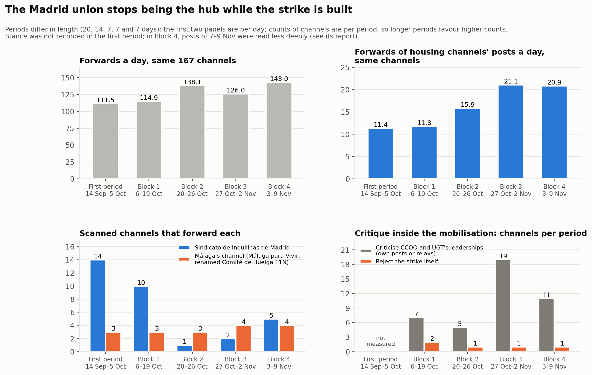

# Acampades per l'habitatge a Telegram, Espanya, tardor del 2026

Un repositori obert i documentat d'una recerca en curs.

<a href="../index.html">English</a> · <a href="../es/index.html">Español</a> · <strong>Català</strong>

Un estudi de [DataPolitik](https://www.heuristica.barcelona/datapolitik/), d'[Heurística](https://www.heuristica.barcelona/), Barcelona.

Un estudi dels canals públics de Telegram del moviment per l'habitatge a Espanya i dels
seus aliats durant les acampades que van seguir el desnonament de Maricarmen Abascal a
Madrid, i durant la vaga general per l'habitatge que va venir després: com es van
seleccionar i classificar els canals, i què mostren les seves xarxes de reenviaments i
mencions.

## Períodes

| Període | Dies (2026) | Canals al final | Informe |
|---|---|---|---|
| Primer estudi | 14 de setembre – 5 d'octubre | 167 | [Informe tècnic](acampadas_vivienda_technical_report.md) · [Anàlisi de comunitats](community_analysis.md) · [Revisió externa](external_review.md) · [Evidències (CSV, en anglès)](../external_review_log.csv) |
| Bloc 1 | 6–19 d'octubre | 265 | [Bloc 1](followup_block1.md) |
| Bloc 2 | 20–26 d'octubre | 281 | [Bloc 2](followup_block2.md) |
| Bloc 3 | 27 d'octubre – 2 de novembre | 297 | [Bloc 3](followup_block3.md) |
| Bloc 4 | 3–9 de novembre | | en curs |
| Bloc 5 | 10–16 de novembre, amb la vaga de l'11 de novembre | | pendent |

A partir del bloc 1, el primer estudi s'amplia en blocs setmanals: a cada bloc s'analitzen
els mateixos canals i s'hi afegeixen els que entren a la conversa. Com funcionen i com es
comparen s'explica a la [presentació del seguiment](followup.md); les decisions de
revisió són al [registre de revisió del seguiment (CSV, en anglès)](../followup_review_log.csv).

Cada període d'observació aporta noves dades i anàlisis. Els informes anteriors
continuen disponibles per documentar l'evolució de la recerca, incloses les
revisions i els canvis d'interpretació.

## Al llarg dels períodes

*Les figures són en anglès.*

1. **El sindicat de Madrid deixa de ser el node central.** El Sindicato de Inquilinas de
   Madrid és reenviat per 14 canals al primer estudi i per 10 al bloc 1, després de la
   mort de Maricarmen; després, per 1 i 2 als blocs 2 i 3.
2. **El canal del comitè de vaga de Màlaga concentra els reenviaments de contingut
   d'habitatge** des del bloc 2, però a través dels mateixos tres o quatre canals: volum
   sense amplitud.
3. **La mobilització passa de les acampades a la vaga de l'11 de novembre,** i els canals
   que donen suport a la vaga alhora que qüestionen els convocants passen de 5 a 13 en una
   setmana.
4. **Els grups territorials d'habitatge no es reenvien entre ells** en cap període; el
   primer vincle entre territoris, al bloc 3, és un comunicat conjunt de les acampades
   després de l'accident ferroviari d'Urda.
5. **Els canals de les mateixes acampades gairebé no es difonen** en cap període.
6. **Dos mitjans hostils formen una parella tancada** que cap altre canal reenvia ni cita
   (registrat des del bloc 1, quan es va introduir la categoria d'opositor).

## Sobre aquest lloc

Aquest repositori aplega els resultats successius d'una recerca en curs sobre les
xarxes de comunicació a Telegram al voltant de les mobilitzacions per l'habitatge a
Espanya. Publica informes, visualitzacions, documentació metodològica, decisions de
classificació i les evidències processades en què es basen les anàlisis, perquè el
procés de recerca es pugui seguir, els resultats es puguin examinar críticament i
quedi documentat com evolucionen les interpretacions a mesura que arriben noves
observacions.

Els resultats són provisionals, estan subjectes a revisió i no pretenen oferir una
representació exhaustiva del moviment.

- Només es van llegir canals i grups públics de Telegram, sense unir-s'hi.
- La recollida, la classificació i l'anàlisi les va fer un agent d'IA seguint un
  protocol escrit; l'equip va fixar el protocol, va prendre les decisions que canviaven
  la mostra o la classificació i en va revisar els resultats.
- El codi i les dades en brut no es publiquen.
- Als fitxers d'evidències, els comptes d'usuaris individuals i els orígens de
  reenviaments amb nom ocult estan pseudonimitzats, i s'ha eliminat el text dels missatges
  de membres de xats de grup. Els canals s'identifiquen pel seu nom d'usuari públic.
- La mostra és una bola de neu a partir d'una llavor de nou canals, no un cens. Convé
  llegir els apartats de limitacions abans de treure'n conclusions.
- Els informes dels blocs i del primer estudi són traduccions de l'original en anglès;
  les figures i els fitxers CSV són en anglès.

Els comentaris, les crítiques metodològiques, les correccions i els suggeriments són
benvinguts: es pot obrir una [incidència (*issue*) al repositori](https://github.com/DataPolitik/acampadas-vivienda-report/issues) o
escriure a través de la [pàgina de contacte d'Heurística](https://www.heuristica.barcelona/contactheu/).

---

Un estudi de [DataPolitik](https://www.heuristica.barcelona/datapolitik/), d'[Heurística](https://www.heuristica.barcelona/). · [Inici](index.md) · [Presentació del seguiment](followup.md)
