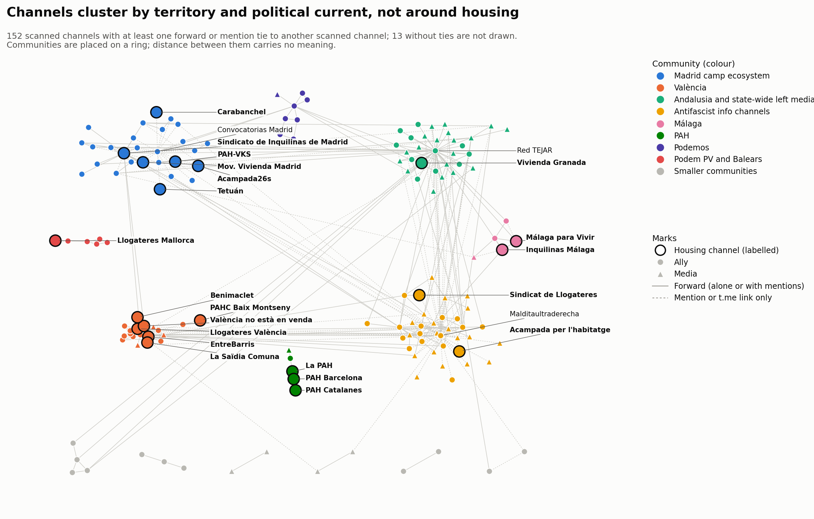

# Community analysis — acampadas_vivienda

Run on 2026-10-05. Window: 2026-09-14 to 2026-10-05. Method as in the barris report.

## Method

- **Nodes:** the 165 scanned project channels (24 `in-scope`/core, 91 `ally`, 50 `media`).
  External and unidentified nodes are left out because their own posts were not read.
- **Graphs:** forwards, links (@-mentions and t.me links), and the two combined.
  Edges are made undirected and weighted 1 + ln(count), so a pair that exchanges
  hundreds of forwards does not swamp the rest.
- **Communities:** Louvain (`networkx`, seed 42, resolution 1.0).
- **Stability:** 50 random seeds; share of runs giving the same partition, modularity
  range, and how often the members of each community stay together ("cohesion").
- **Comparison:** modularity of the partition given by the tags (core / ally / media).

Script: `scripts/analyze_communities.py`. Tables: `flows/communities_forward.csv`,
`flows/communities_link.csv`, `flows/communities_combined.csv`,
`flows/communities_summary.json`.

## Headline numbers

| | Forwards | Links | Combined |
|---|---|---|---|
| Channels with at least one tie | 139 | 83 | 152 |
| Undirected edges | 229 | 115 | 330 |
| Largest connected component | 115 | 83 | 134 |
| Communities | 18 | 7 | 13 |
| Modularity | 0.666 | 0.410 | 0.599 |
| Modularity of the tag partition | 0.070 | −0.064 | 0.026 |
| Same partition across 50 seeds | 48% | 84% | 8% |
| Modularity range across seeds | 0.664–0.666 | 0.409–0.412 | 0.586–0.600 |

The network is strongly clustered, and the clusters have nothing to do with the
core / ally / media tags: grouping by tag gives modularity near zero. Channels cluster
by territory and by political current.

## Forward communities

Members of each community stay together in at least 95% of runs.

| # | Community | Size | Core channels inside | Ties kept inside |
|---|---|---|---|---|
| 1 | Andalusian relay and state-wide left media, around Red TEJAR | 32 | Sindicato de Vivienda de Granada | 64% |
| 2 | València | 18 | Sindicat de Llogateres València, EntreBarris, València no està en venda, La Saïdia Comuna, Benimaclet per l'Habitatge | 84% |
| 3 | Madrid union and climate movement | 16 | Sindicato de Inquilinas de Madrid, Movimiento de Vivienda de Madrid | 61% |
| 4 | Antifascist info channels (Euskal Herria, international) | 15 | none | 64% |
| 5 | Podemos (Madrid and state) | 10 | none | 90% |
| 6 | Barcelona internationalist and anti-imperialist media | 7 | Sindicat de Llogateres | 61% |
| 7 | Sevilla Anticarcelaria and Malditaultraderecha | 6 | none | 33% |
| 8 | Podem País Valencià and Balears | 6 | Sindicat Llogateres Mallorca | 100% |
| 9 | Málaga | 5 | Sindicato de Inquilinas de Málaga, Málaga para Vivir | 55% |
| 10 | PAH | 5 | La PAH, PAH Barcelona, PAH Catalanes | 100% |
| 11 | Anticapitalistas | 4 | none | 68% |
| 12 | CCOO | 3 | none | 100% |
| 13–18 | Six pairs | 2 each | PAH-VKS (with La Villana de Vallekas), PAHC Baix Montseny (with InfoClau) | — |

Findings:

- **There is no housing community.** The 17 core channels that have forward ties are
  spread over 9 communities. Each sits inside its own territorial or organisational
  cluster: València, Madrid, Málaga, the PAH, Mallorca.
- **València is the only place where housing channels form the centre of a cluster,**
  with five core channels and 84% of ties kept inside.
- **The Madrid union clusters with the climate movement,** not with other housing
  channels: XR Madrid, XR España, Ecologistas en Acción and their Madrid branch are the
  channels that forward it most.
- **The PAH is a closed cluster.** All its ties stay inside; it neither forwards nor is
  forwarded by the tenant unions.
- **Seven core channels have no forward tie to any scanned channel:** Acampada26s,
  Acampada per l'habitatge, Sindicato de Vivienda de Carabanchel, Sindicato Vivienda
  Tetuán, Grup d'Habitatge de Les Corts, Sindicat d'Habitatge Socialista de Catalunya,
  Cuadernos de Trabajo.
- **Bridges between communities are allies, not housing channels.** Red TEJAR carries
  17 of the between-community ties, Sevilla Anticarcelaria 7, Malditaultraderecha 5,
  the Valldigna collective 5. The Madrid union, with 5, is the only core channel among
  the main bridges.

## Link communities

The link graph is smaller (83 channels) but forms a single connected component.

| # | Community | Size | Core channels inside |
|---|---|---|---|
| 1 | Channels Malditaultraderecha credits or mentions | 45 | Sindicat de Llogateres |
| 2 | Madrid camp ecosystem, around Convocatorias Madrid | 22 | Sindicato de Inquilinas de Madrid, PAH-VKS, Movimiento de Vivienda de Madrid, Acampada26s, Tetuán, Carabanchel |
| 3 | València anarchist and social-centre channels | 5 | none |
| 4 | Málaga | 5 | Sindicato de Inquilinas de Málaga, Málaga para Vivir |
| 5–7 | Three pairs | 2 each | Acampada per l'habitatge (with IzquierdaDiario) |

- **Mentions tie Madrid together where forwards do not.** Acampada26s, Tetuán and
  Carabanchel, isolated in the forward graph, join the Madrid union and PAH-VKS in one
  community here, because Convocatorias Madrid mentions the conveners of each call.
- **Community 1 is largely one channel's doing.** It reflects whom Malditaultraderecha
  credits as a source, so it describes that channel's reading list more than a group
  that interacts.
- **Fourteen core channels have no link tie,** including all the València and PAH
  channels, which reference no other scanned channel by @ or t.me link.

## Combined

Adding the two edge types gives 13 communities (modularity 0.599): antifascist and
Malditaultraderecha sphere (36), Andalusia and state-wide media (36), Madrid (27, six
core channels), València (19, six core), Podemos, Podem PV and Balears, PAH,
Anticapitalistas, CCOO and four pairs.

*The 152 scanned channels with at least one tie, coloured by community of the combined graph (consensus labels). Communities are placed on a ring; only ties carry meaning.*

This partition is the least stable: 31 different partitions over 50 seeds. The large
communities still hold (cohesion 0.82 to 0.97), but channels at the border between the
antifascist and Andalusian blocks move between them, so their exact sizes should not be
read closely. Only three core channels remain unconnected: Les Corts, Sindicat
d'Habitatge Socialista de Catalunya and Cuadernos de Trabajo, which posted nothing in
the window.

## How labels are assigned, and node stability

Louvain is randomised, so 50 runs with different seeds do not always agree.

| Graph | Different partitions in 50 runs | Label used | Communities | Mean node stability | Nodes below 0.8 |
|---|---|---|---|---|---|
| Forward | 8 | Seed 42 (the most frequent partition, 48% of runs) | 18 | 0.98 | 3 |
| Link | 3 | Seed 42 (the most frequent partition, 84% of runs) | 7 | 1.00 | 0 |
| Combined | 31 | Consensus of the 50 runs | 14 | 0.96 | 5 |
| Full | 46 | Consensus of the 50 runs | 19 | 0.96 | 45 |

- **Consensus partition** (Lancichinetti and Fortunato 2012): every pair of nodes is
  linked by the share of the 50 runs that put them in the same community; pairs below
  0.5 are dropped; Louvain is run 50 times on that graph. Both graphs converged at the
  first iteration, with all 50 runs returning the same partition.
- **Node stability** is the mean share of the 50 original runs in which a node sits
  with the other members of its labelled community. 1.0 means it is always with the
  same group; a low value marks a border node. It is given for all four graphs.
- The combined and full sections above describe the seed-42 partition. The consensus
  labels differ only at the margins: combined has 14 communities instead of 13 (the
  Málaga channels form their own community of 5), and full has 19 instead of 20.

Border nodes worth knowing about:

- **Sindicat de Llogateres (0.75 in the full graph)** is the only housing channel that
  is not firmly placed. It sits with the Malditaultraderecha and Barcelona
  internationalist block, because the channels that forward it belong there, but in a
  quarter of the runs it falls elsewhere. All other core channels score 0.96 or above.
- **The climate channels (XR Madrid, XR Málaga, XR España, 0.66)** move between the
  Madrid block, where they forward the Madrid union, and the Andalusian and state-wide
  media block.
- **Sevilla Anticarcelaria, Sevilla en Acción and Grupo Ruptura (0.61 to 0.64)** move
  between the Malditaultraderecha block and the Andalusian one.
- **In the combined graph,** the Valldigna collective, Diari La Veu and La Directa
  (0.63 to 0.64) sit at the edge of the València community, and Cañada Se Queda and
  ESLA EKO (0.65) at the edge of the Madrid one.

## Limits

- Only scanned channels are included; the 251 external and 342 unidentified nodes of
  the full graph are not.
- The project list was grown from the housing seed outward through allies, so the
  antifascist and media blocks reflect how the list was built as much as the field.
- Link ties are sensitive to signature habits (Malditaultraderecha, Convocatorias
  Madrid). Log weighting reduces this but does not remove it.

## Whole-graph communities (`community_full`)

The communities above cover only scanned channels, which leaves most nodes of the full
graph without a label. A further pass runs the same method on the whole graph: all 766
connected nodes (scanned, external, unidentified, users), both edge types together.

- 20 communities, modularity 0.703. Every node of the giant component (739 nodes) has
  a value; only the 12 isolated nodes do not.
- **Unscanned nodes join whoever references them.** An external or unidentified node
  has ties only to the scanned channels that forwarded or mentioned it, so it lands in
  that channel's community. Communities 2 (127 nodes) and 5 (65 nodes) each contain a
  single scanned channel, Fullblack161 and Prima Linea, plus the sources it relays.
- **The scanned channels group much as before:** Madrid camp ecosystem (community 3,
  six core channels), València (7, six core), Málaga (10), PAH (12), Podemos (9),
  Podem PV and Balears with the Mallorca union (13), and the Barcelona camp channel
  with the accounts it mentions (11).
- **Less stable in detail:** 46 different partitions over 50 seeds, with modularity
  between 0.701 and 0.704. The blocks are robust; the assignment of border nodes is not.

Table: `flows/communities_full.csv`.

## Description of the whole-graph communities (`community_full`)

Numbers are the values of `community_full` in the GEXF. "Project" counts scanned
channels (core, ally, media); "Other" counts external channels, unidentified handles
and users, which join the community of whoever references them. Names are descriptive
labels given by reading the members.

| # | Community | Nodes | Project | Other | Housing channels | Main allies and media | Stability |
|---|---|---|---|---|---|---|---|
| 1 | Malditaultraderecha sphere: antifascist counter-information, Seville and Barcelona | 129 | 18 | 111 | Sindicat de Llogateres | Malditaultraderecha, Sevilla Anticarcelaria, Palestina SOS Barcelona, Presos Revolucionarios; elPlural, Crític, Tot Barcelona | 0.87 |
| 2 | Fullblack161 and its sources | 127 | 1 | 126 | — | Fullblack161 (international antifa info); almost all other nodes are handles it credits | 1.00 |
| 3 | Madrid camp ecosystem | 104 | 23 | 81 | Sindicato de Inquilinas de Madrid, PAH-VKS, Movimiento de Vivienda de Madrid, Carabanchel, Tetuán, Acampada26s | Convocatorias Madrid, Ecologistas en Acción, La Villana de Vallekas, ESLA EKO, CSO La Rosa, Asamblea Popular de Carabanchel | 1.00 |
| 4 | Andalusian relay and state-wide left media | 87 | 38 | 49 | Sindicato de Vivienda de Granada | Red TEJAR, XR, Anticapitalistas, Liza; El Salto, Spanish Revolution, Canal Red, Diario Socialista, IzquierdaDiario, CTXT | 0.93 |
| 5 | Prima Linea and its sources | 65 | 1 | 64 | — | Prima Linea (French and Italian antifa info) and the channels it forwards | 1.00 |
| 6 | Anti-imperialist and international media | 62 | 4 | 58 | — | ANTIIMPERIALISTAS.COM, Satélite Rojo, teleSUR, Al Mayadeen | 1.00 |
| 7 | Basque, Galician and Cantabrian antifascist info | 59 | 10 | 49 | — | Sare Antifaxista, Brigada Laila Jaled, Mitxis na Galiza, Las calles contra el fascismo; España en Guerra, Alerta Gorria Irratia | 0.91 |
| 8 | València | 56 | 20 | 36 | Sindicat de Llogateres València, EntreBarris, València no està en venda, La Saïdia Comuna, Benimaclet per l'Habitatge, PAHC Baix Montseny | Valldigna collective, CSOA CSN, Ateneu del Cabanyal, Assemblea Feminista, Alerta Solidària; La Veu, L'Accent, La Directa | 1.00 |
| 9 | Podemos (Madrid and state) | 16 | 8 | 8 | — | Difusión para Podemos, Podemos, Podemos Madrid, Podemos Parla, Área Joven | 1.00 |
| 10 | Barcelona camp | 12 | 1 | 11 | Acampada per l'habitatge | The 11 other nodes are handles the camp channel mentions | 0.94 |
| 11 | Málaga | 12 | 6 | 6 | Sindicato de Inquilinas de Málaga, Málaga para Vivir | La Invisible, Convócala Málaga, Antifascistas; eldiario.es | 0.95 |
| 12 | PAH | 8 | 5 | 3 | La PAH, PAH Barcelona, PAH Catalanes | Privados de la Pública; La Cafetera | 1.00 |
| 13 | Podem País Valencià and Balears | 7 | 6 | 1 | Sindicat Llogateres Mallorca | Podem, Podem València and three of their spokespeople | 1.00 |
| 14 | Multicanal Radio and Nuestra España | 5 | 2 | 3 | — | The two outlets and what the radio relays | 1.00 |
| 15 | Marx21 | 5 | 2 | 3 | — | Marx21, Marx21 Andalucía | 1.00 |
| 16 | Anarchist news | 5 | 2 | 3 | — | InfoAgitación, Anarquismos | 1.00 |
| 17 | CCOO Madrid | 3 | 3 | 0 | — | Canal CCOO, CCOO Madrid, CCOO Eiffage | 1.00 |
| 18 | CCOO transport | 2 | 2 | 0 | — | CCOO Ciudadanía, CCOO EMT Madrid | 1.00 |
| 19 | Alba Pulido | 2 | 1 | 1 | — | A personal channel and one handle it mentions | 1.00 |

Reading notes:

- Communities 2, 5 and 10 are one scanned channel with the accounts it cites, not a
  group that interacts.
- PAHC Baix Montseny is in the València community (8) through its tie to InfoClau,
  which Alerta Solidària mentions; it is a Catalan channel, not a Valencian one.
- Sindicat de Llogateres (community 1) is the least firmly placed housing channel,
  with stability 0.75.
