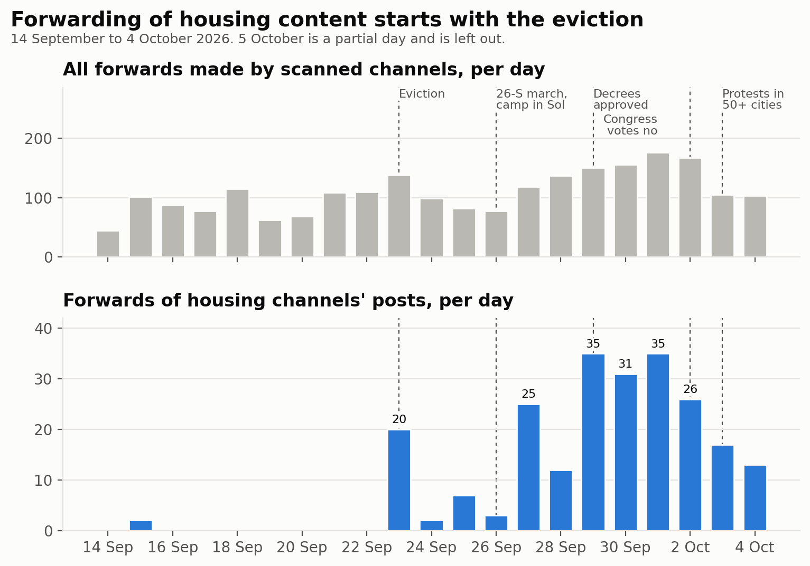
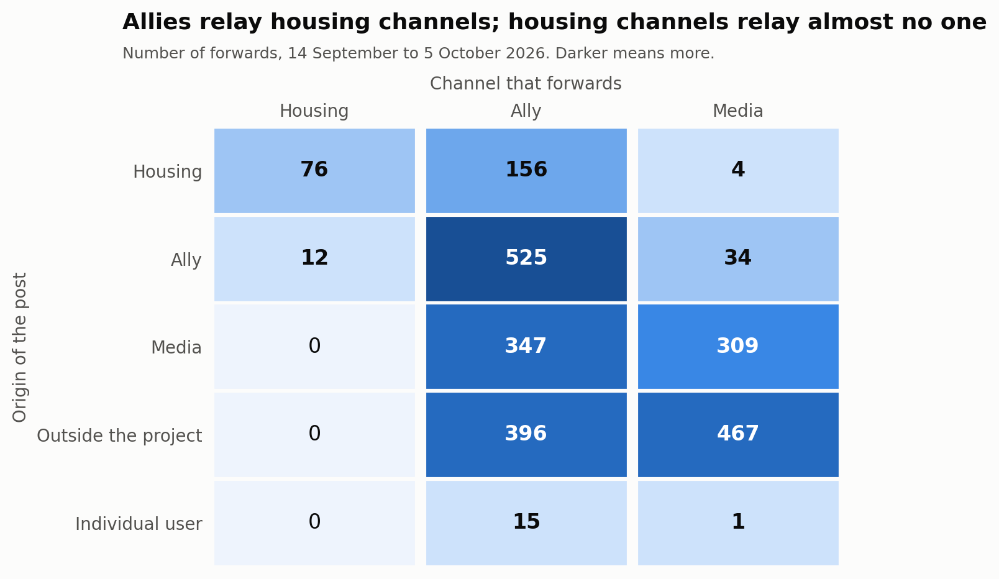
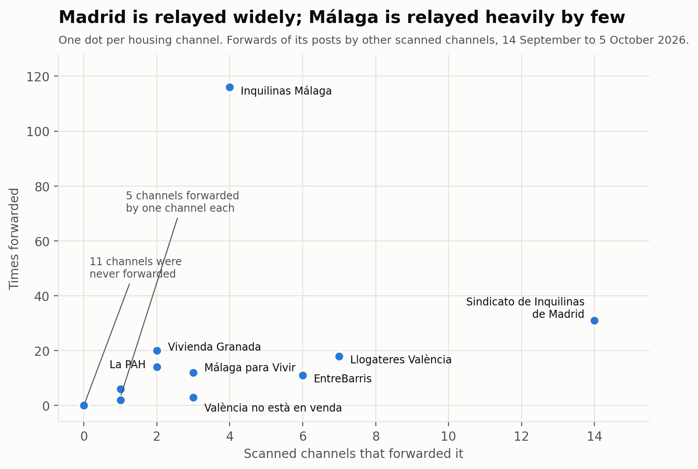
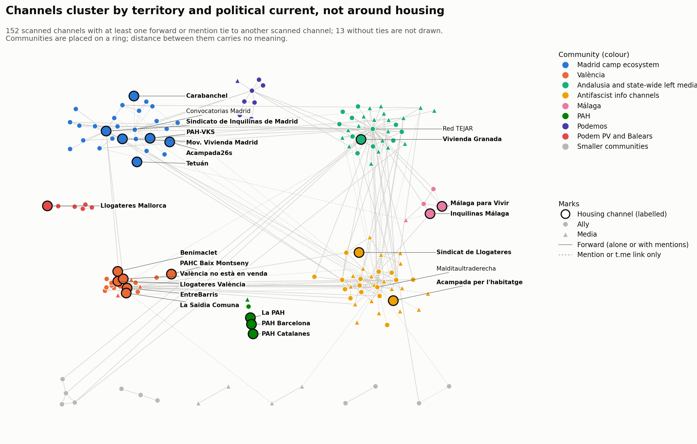
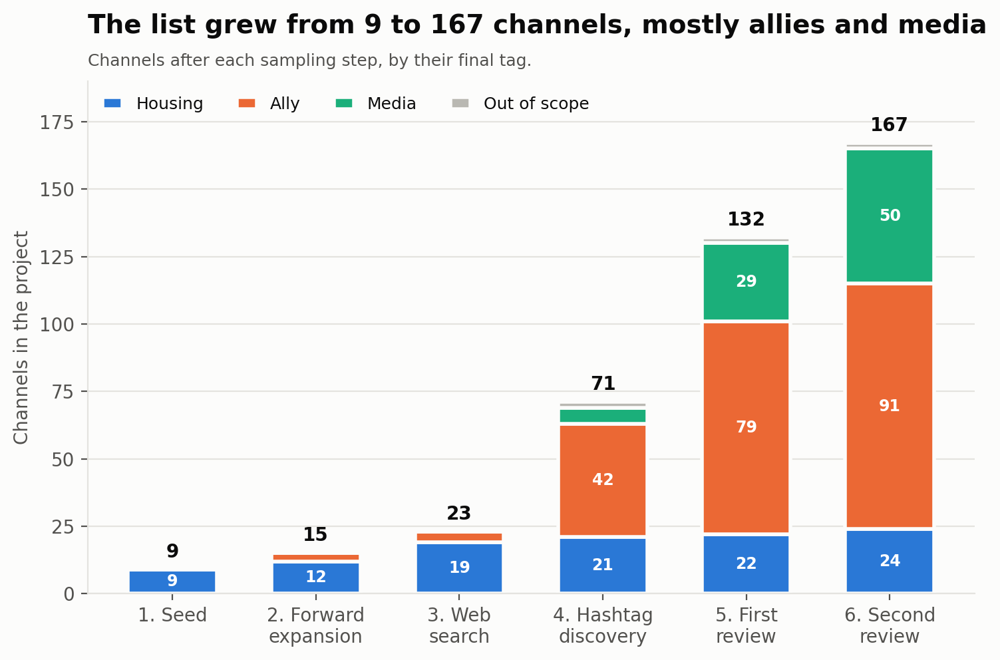

# Informe técnico: primer estudio, 14 de septiembre – 5 de octubre de 2026

<a href="../acampadas_vivienda_technical_report.html">English</a> · <strong>Español</strong> · <a href="../ca/acampadas_vivienda_technical_report.html">Català</a>

> Esta página trata del primer estudio, del 14 de septiembre al 5 de octubre de 2026. La movilización continuó: véase el [seguimiento](followup.md), del 6 de octubre a la huelga del 11 de noviembre.

Canales de Telegram del movimiento por la vivienda en España y de sus aliados durante las
acampadas por la vivienda de septiembre y octubre de 2026: cómo se construyó la lista de
canales, cómo se clasificaron los canales y qué muestran las redes de reenvíos y
menciones.

- **Fecha del informe:** 2026-10-05
- **Ventana de observación:** del 2026-09-14 al 2026-10-05 (21 días, empezando ocho días
  antes del desahucio de Maricarmen)
- **Datos:** solo canales y grupos públicos de Telegram, leídos sin unirse a ellos

*Traducción del original en inglés. Las figuras y el fichero de evidencias están en inglés.*

Documentos complementarios: la [revisión externa](external_review.md) (regla de
etiquetado y decisiones), las [evidencias por canal](../external_review_log.csv) (CSV) y
el [análisis de comunidades](community_analysis.md) (detección de comunidades en detalle).

---

## 1. Resumen

1. **La muestra tiene 167 canales:** 24 canales de vivienda, 91 aliados, 50 medios y 2
   fuera de ámbito. Creció desde una semilla de 9 canales mediante reenvíos, una búsqueda
   web, la búsqueda por hashtags y dos rondas revisadas de bola de nieve.
2. **Se analizaron 22.111 mensajes** en 165 canales, que dieron 2.403 eventos de reenvío
   y 5.753 eventos de enlace (menciones con @ y enlaces t.me), de los cuales 2.049 apuntan
   a otra cuenta.
3. **El grafo tiene 778 nodos y 1.115 aristas** (541 de reenvío, 574 de enlace). Solo 165
   nodos son canales analizados de la muestra; el resto son cuentas que reenvían o
   mencionan.
4. **Los canales de vivienda son fuentes, no difusores.** Los aliados reenviaron
   contenido de vivienda 156 veces; los canales de vivienda reenviaron contenido de
   aliados 12 veces. Los canales de vivienda casi nunca enlazan a otras cuentas de
   Telegram.
5. **El Sindicato de Inquilinas de Madrid es el único nodo central.** Lo reenvían 14
   canales y lo mencionan 6, en Madrid, València y Andalucía. Ningún otro canal de
   vivienda lo difunden más de 7.
6. **El reenvío de contenido de vivienda empieza con el desahucio.** Los reenvíos de
   publicaciones de canales de vivienda pasan de 0–2 al día antes del 23 de septiembre a
   20 ese día, y alcanzan un máximo de 35 al día el 29 de septiembre y el 1 de octubre.
7. **No hay una única comunidad de vivienda.** La red está muy agrupada (modularidad 0,67
   en reenvíos) por territorio y corriente política: Madrid, València, Málaga, la PAH,
   Podemos, canales de información antifascista. Los canales de vivienda están en 8 de
   las 19 comunidades del grafo completo.
8. **Los grupos territoriales de vivienda no se reenvían entre sí.** El grupo de la PAH
   es cerrado; València y Málaga son autosuficientes; el único vínculo entre territorios
   entre canales de vivienda es un canal de València que reenvía una vez al sindicato de
   Madrid. Solo las publicaciones del sindicato de Madrid viajan entre territorios, y lo
   hacen a través de aliados.
9. **Nadie reenvía los dos canales de las acampadas.** Acampada26s (Madrid) y Acampada
   per l'habitatge (Barcelona) solo aparecen a través de menciones.
10. **El volumen se concentra en unos pocos difusores.** Cinco canales hacen el 60 % de
    todos los reenvíos (solo Red TEJAR, el 24 %), y un canal hace el 62 % de todas las
    menciones salientes (Malditaultraderecha). Las medidas ponderadas describen sobre
    todo a estos canales.

---

## 2. Contexto

Antecedentes recogidos de la prensa y de Wikipedia el 2026-10-05; las fuentes no
coinciden en algunos detalles, que se señalan más abajo.

- **El desahucio.** Maricarmen Abascal, de 87 años, fue desahuciada del piso del distrito
  madrileño de Retiro en el que vivía desde 1956. Las fuentes de prensa dan el 22 o el 23
  de septiembre; el canal del propio sindicato de Madrid lo anunció para el 23 de
  septiembre, con un acto de apoyo el 22. La propietaria es la empresa Urbagestión. Un
  acuerdo hacia el 28 de septiembre le permitió volver.
- **Las acampadas.** Una marcha el 26 de septiembre («26-S») terminó con una acampada en
  la Puerta del Sol. Siguieron acampadas en Barcelona, Sevilla, Málaga y otras ciudades
  desde el 28 de septiembre, y en València, Alacant, Granada y Oviedo hacia el 3–5 de
  octubre.
- **Los decretos.** El Gobierno aprobó dos decretos ley de vivienda el 29 de septiembre.
  El Congreso los tumbó el 2 de octubre. «Decreto Maricarmen» se usa tanto para las cinco
  reivindicaciones del sindicato como para el paquete del Gobierno.
- **Tensión en Sol.** El 2 de octubre circuló un mensaje que decía que el sindicato de
  Madrid dejaría Sol; algunos medios lo publicaron y uno publicó un desmentido. Un medio
  informó de que la Coordinadora Juvenil Socialista tenía un papel creciente en la
  acampada.

---

## 3. Resultados

### 3.1 La lista de canales

| Etiqueta | Canales | Qué abarca |
|---|---|---|
| vivienda | 24 | Sindicatos de inquilinas, grupos de la PAH, asambleas de vivienda, los dos canales de acampada |
| aliado | 91 | Partidos, sindicatos, centros sociales, agendas de movimientos, grupos de solidaridad y antirrepresivos, canales de individuos |
| medio | 50 | Medios de información, revistas, editoriales, canales de comentario e información |
| fuera de ámbito | 2 | Un bot de hilos de un foro y un canal de memes |

Todos menos uno son canales de difusión; Acampada26s es un grupo.

Los 24 canales de vivienda por territorio: Madrid 6 (Sindicato de Inquilinas,
Movimiento de Vivienda de Madrid, Carabanchel, Tetuán, PAH-VKS, Acampada26s); Cataluña 7
(Sindicat de Llogateres, PAH Barcelona, PAH Catalanes, PAHC Baix Montseny, Les Corts,
Sindicat d'Habitatge Socialista, Acampada per l'habitatge); València 5; Málaga 2;
Granada 1; Mallorca 1; y dos canales estatales, La PAH y Cuadernos de Trabajo (sobre
métodos de organización).

Tres canales de vivienda no publicaron nada en la ventana: Grup d'Habitatge de Les
Corts, Sindicat d'Habitatge Socialista de Catalunya y Cuadernos de Trabajo.

### 3.2 Volumen y ritmo

| Medida | Valor |
|---|---|
| Mensajes analizados (último análisis de cada canal) | 22.111 en 165 canales |
| Eventos de reenvío | 2.403 (61 reenvíos de sí mismos) |
| Orígenes de reenvíos | 2.340 canales, 41 nombres ocultos, 16 usuarios, 6 grupos |
| Eventos de enlace | 5.753 (3.704 enlaces a sí mismos) |
| Eventos de enlace a otra cuenta | 2.049: 1.779 menciones con @ y 270 enlaces t.me |
| Mediana del retraso entre la publicación original y el reenvío | 0,9 horas |
| Reenvíos en menos de 1 hora / 24 horas | 51 % / 91 % |

Reenvíos al día, de todos los canales y de aquellos cuyo origen es un canal de vivienda:

| Periodo | Todos los reenvíos al día | Reenvíos de canales de vivienda al día |
|---|---|---|
| 14–22 sep (antes del desahucio) | 48–115 | 0–2 |
| 23 sep (desahucio) | 142 | 20 |
| 24–26 sep | 77–103 | 2–7 |
| 27–28 sep (tras la marcha) | 120–140 | 12–25 |
| 29 sep – 2 oct (decretos, votación en el Congreso) | 150–176 | 26–35 |
| 3–4 oct | 103–115 | 13–17 |

El 5 de octubre es un día parcial y se deja fuera.

*Figura 1. Reenvíos al día: todos los reenvíos hechos por canales analizados (arriba) y reenvíos de publicaciones de canales de vivienda (abajo), con los principales hechos marcados.*

### 3.3 Quién reenvía a quién

Eventos de reenvío entre papeles (origen → reenviador), sin reenvíos de sí mismos:

| Origen \ Reenviador | vivienda | aliado | medio |
|---|---|---|---|
| vivienda | 76 | 156 | 4 |
| aliado | 12 | 525 | 34 |
| medio | 0 | 347 | 309 |
| externo (fuera de la muestra) | 0 | 396 | 467 |
| usuario | 0 | 15 | 1 |

*Figura 2. Número de reenvíos según el papel del origen y del reenviador. Los orígenes con nombre oculto se cuentan como fuera de la muestra.*

- Los canales de vivienda reenvían casi solo entre sí (76) y un poco de aliados (12). No
  reenvían nada de medios ni de fuera de la muestra.
- Los aliados son los difusores: reenvían aliados, medios, fuentes externas y canales de
  vivienda.
- Los medios reenvían medios y fuentes externas, y canales de vivienda solo 4 veces.

Eventos de enlace entre papeles (cuenta referida → canal que la refiere):

| Referida \ Referente | vivienda | aliado | medio |
|---|---|---|---|
| vivienda | 3 | 70 | 1 |
| aliado | 0 | 192 | 26 |
| medio | 3 | 187 | 8 |
| externa | 0 | 895 | 38 |
| usuario no identificado o usuario | 25 | 338 | 263 |

Los canales de vivienda hacen referencia a otras cuentas 31 veces en total, 25 de ellas a
usuarios que no se pudieron asociar a una cuenta de Telegram.

### 3.4 Los canales de vivienda uno a uno

| Canal | Reenviado por (canales) | Veces reenviado | Reenvíos hechos | Mencionado o enlazado por (canales) |
|---|---|---|---|---|
| Sindicato de Inquilinas de Madrid | 14 | 31 | 0 | 6 |
| Sindicat de Llogateres València | 7 | 18 | 1 | 0 |
| EntreBarris | 6 | 11 | 10 | 0 |
| Sindicato de Inquilinas de Málaga | 4 | 116 | 2 | 0 |
| Málaga para Vivir | 3 | 12 | 44 | 2 |
| València no està en venda | 3 | 3 | 6 | 0 |
| La PAH | 2 | 14 | 0 | 0 |
| Sindicato de Vivienda de Granada | 2 | 20 | 0 | 0 |
| PAH-VKS | 1 | 6 | 0 | 2 |
| Sindicat de Llogateres | 1 | 1 | 0 | 1 |
| PAH Catalanes | 1 | 1 | 0 | 0 |
| La Saïdia Comuna | 1 | 1 | 4 | 0 |
| Sindicat Llogateres Mallorca | 1 | 2 | 0 | 0 |
| Acampada per l'habitatge (acampada de Barcelona) | 0 | 0 | 0 | 2 |
| Acampada26s (acampada de Madrid) | 0 | 0 | 0 | 2 |
| Movimiento de Vivienda de Madrid | 0 | 0 | 3 | 1 |
| Sindicato de Vivienda de Carabanchel | 0 | 0 | 0 | 1 |
| Sindicato Vivienda Tetuán | 0 | 0 | 0 | 1 |
| PAH Barcelona | 0 | 0 | 14 | 0 |
| Benimaclet per l'Habitatge | 0 | 0 | 3 | 0 |
| PAHC Baix Montseny | 0 | 0 | 1 | 0 |
| Les Corts, Sindicat d'Habitatge Socialista, Cuadernos de Trabajo | 0 | 0 | 0 | 0 |

Los recuentos son solo sobre canales analizados. La red completa también tiene aristas
hacia y desde usuarios no identificados, por eso algunos de estos canales tienen allí
más vecinos.

*Figura 3. Cada canal de vivienda según el número de canales analizados que lo reenviaron y el número de veces que fue reenviado.*

- **Amplitud frente a volumen.** El sindicato de Madrid es el que difunden más canales;
  el sindicato de Málaga es el reenviado más a menudo, pero solo por cuatro canales
  (Málaga para Vivir 44 veces, La Invisible 44, Red TEJAR 24, Antifascistas 4).
- **Dos tipos de canal de vivienda.** La mayoría solo publica (cero reenvíos hechos).
  Unos pocos actúan como difusores locales: Málaga para Vivir, PAH Barcelona y
  EntreBarris.

### 3.5 Los difusores que dominan el volumen

| Canal | Papel | Reenvíos hechos | Parte de todos los reenvíos |
|---|---|---|---|
| Red TEJAR (@andaluciajustayresiliente) | aliado | 586 | 24 % |
| Multicanal Radio | medio | 262 | 11 % |
| Prima Linea | medio | 241 | 10 % |
| ANTIIMPERIALISTAS.COM | medio | 184 | 8 % |
| Sare Antifaxista Euskal Herria | aliado | 162 | 7 % |

Las referencias salientes a otras cuentas están todavía más concentradas:
Malditaultraderecha hace 1.278 de 2.049 (62 %), Convocatorias Madrid 287 y Fullblack161
254. Los tres firman o citan fuentes en casi todas sus publicaciones.

### 3.6 Cascadas

Una cascada es una publicación original reenviada por varios canales analizados.

- 129 publicaciones de canales de vivienda se reenviaron al menos una vez: 60 por un
  canal, 38 por dos, 27 por tres y 4 por cuatro o más.
- **La más amplia:** una publicación del sindicato de Madrid del 23 de septiembre, el día
  del desahucio, reenviada por seis canales: CSO La Rosa, ESLA EKO, XR Madrid,
  Ecologistas Madrid, CS La Cheli y el canal de Tom Kucharz.
- **Las siguientes:** dos publicaciones del Sindicat de Llogateres València (23 y 27 de
  septiembre), reenviadas por cinco y cuatro canales de València, y una publicación del
  sindicato de Madrid del 24 de septiembre reenviada por cuatro.
- Las cascadas son sobre todo locales. Las excepciones son publicaciones del sindicato de
  Madrid: tres las reenvió también Red TEJAR (Andalucía), una de ellas junto con el
  colectivo de la Valldigna (València), y una València no està en venda. Las
  publicaciones de los canales de vivienda de València y Málaga solo se reenviaron dentro
  de su propio territorio.

### 3.7 Comunidades

El método y las tablas completas están en el [análisis de comunidades](community_analysis.md).

| Grafo | Nodos | Comunidades | Modularidad | Modularidad de la partición por etiquetas |
|---|---|---|---|---|
| Reenvíos, canales analizados | 139 | 18 | 0,666 | 0,070 |
| Enlaces, canales analizados | 83 | 7 | 0,410 | −0,064 |
| Combinado, canales analizados | 152 | 14 | 0,600 | 0,026 |
| Grafo completo, todos los nodos | 766 | 19 | 0,703 | — |

*Figura 4. Los 152 canales analizados con al menos un vínculo, coloreados por comunidad del grafo combinado de reenvíos y menciones. Los canales de vivienda aparecen contorneados y etiquetados. Las comunidades se sitúan en un anillo, así que solo los vínculos, no las distancias entre comunidades, tienen significado.*

- **Las etiquetas no explican la estructura.** Agrupar los canales en vivienda, aliado y
  medio da una modularidad cercana a cero. El territorio y la corriente política sí la
  explican.
- **Comunidades del grafo completo que contienen canales de vivienda:**

| Comunidad | Nodos | Canales de vivienda |
|---|---|---|
| Ecosistema de la acampada de Madrid | 104 | sindicato de Madrid, PAH-VKS, Movimiento de Vivienda de Madrid, Carabanchel, Tetuán, Acampada26s |
| València | 56 | Cinco canales de vivienda de València y PAHC Baix Montseny |
| Difusor andaluz y medios de izquierda estatales | 87 | Sindicato de Vivienda de Granada |
| Esfera de Malditaultraderecha | 129 | Sindicat de Llogateres |
| Málaga | 12 | sindicato de Málaga, Málaga para Vivir |
| Acampada de Barcelona | 12 | Acampada per l'habitatge |
| PAH | 8 | La PAH, PAH Barcelona, PAH Catalanes |
| Podem País Valencià y Baleares | 7 | Sindicat Llogateres Mallorca |

- **Reenvíos y menciones cuentan historias distintas sobre Madrid.** En el grafo de
  reenvíos, el sindicato de Madrid se agrupa con el movimiento climático (XR, Ecologistas
  en Acción), y el canal de la acampada y los sindicatos de barrio quedan sin conexión.
  En el grafo de enlaces todos se unen en una comunidad, porque Convocatorias Madrid
  menciona a los convocantes de cada convocatoria.
- **Los puentes entre comunidades son aliados.** Red TEJAR, Malditaultraderecha, el
  colectivo de la Valldigna y Sevilla Anticarcelaria llevan la mayoría de los vínculos
  entre comunidades. El sindicato de Madrid es el único canal de vivienda entre los
  puentes principales.
- **La ubicación es estable para los canales de vivienda.** 20 de los 21 canales de
  vivienda conectados siguen con su comunidad en al menos el 96 % de las ejecuciones.
  Sindicat de Llogateres (75 %) es la excepción.

### 3.8 Hashtags

Contados en una descarga temprana de 459 mensajes de los 20 primeros canales de vivienda
(del 14 de septiembre al 5 de octubre); no se repitió con la lista final.

- 86 mensajes llevan hashtags; 43 etiquetas distintas.
- El uso es regional: #AcampadaPorLaVivienda (31 mensajes) y #NosQuedamos (28) vienen
  casi solo de los dos canales de Málaga; #NiUnaMaricarmenMés, de los cuatro canales de
  València; #DecretoMaricarmen, de la PAH.
- Solo #HaciaLaHuelgaGeneral cruza territorios (Madrid y Málaga).
- El sindicato de Madrid usó #AcampadaMaricarmen y #AcampadaXMaricarmen del 15 al 17 de
  septiembre, antes del desahucio.

---

## 4. Metodología

### 4.1 Herramientas

- **Recogida** mediante la API pública de Telegram, con tgmon, una herramienta de
  seguimiento de Telegram construida sobre la biblioteca Telethon. Los canales y grupos se
  leen sin unirse a ellos.
- **Trabajo asistido por un agente.** La recogida, la clasificación y el análisis los
  llevó a cabo un agente de IA siguiendo un protocolo escrito; el equipo fijó el
  protocolo, tomó las decisiones que cambiaban la muestra o la clasificación y revisó los
  resultados.
- **Análisis de redes** con la biblioteca networkx.
- **Búsqueda web** para el contexto y para localizar los canales de organizaciones
  citadas en la prensa.

### 4.2 Ventana temporal

Toda la recogida usó «los últimos 21 días» en el momento de ejecución, el 2026-10-05, es
decir, desde aproximadamente las 09:45 UTC del 14 de septiembre. La ventana se abre ocho
días antes del desahucio para que se vea el periodo anterior a la movilización. Las
ejecuciones más tardías del día alcanzan mensajes algo posteriores; los eventos
guardados van del 14 de septiembre a las 12:02 al 5 de octubre a las 10:54 UTC.

### 4.3 Muestreo: cómo se construyó la lista de canales

La lista es una muestra de bola de nieve que crece desde una semilla, con un paso de
revisión antes de cada ampliación en las rondas posteriores.

| Paso | Método | Canales añadidos | Total |
|---|---|---|---|
| 1. Semilla | Una lista semilla de diez canales del movimiento por la vivienda compilada para el estudio; 9 tenían nombre de usuario público | 9 | 9 |
| 2. Expansión por reenvíos | Todos los canales de los que un canal de la muestra reenvió en la ventana | 6 | 15 |
| 3. Búsqueda web | Canales de convocantes de las acampadas citados en la prensa, y la lista de participantes de acampada26s.net; cada uno comprobado en la vista previa pública de Telegram | 8 | 23 |
| 4. Búsqueda por hashtags | Canales cuyas publicaciones en la ventana usaban uno de siete hashtags encontrados en las publicaciones de los canales semilla | 48 | 71 |
| 5. Primera revisión externa | Canales que aparecen en el grafo pero no en la muestra (133), revisados con la regla de etiquetado | 61 | 132 |
| 6. Segunda revisión externa | Los 85 canales que trajo el análisis de los añadidos del paso 5 | 35 | 167 |

*Figura 5. Tamaño de la lista de canales tras cada paso de muestreo, según la etiqueta final de cada canal.*

Detalles:

- **El paso 2** se repitió con los 20 canales de vivienda tras el paso 3 y no encontró
  nada nuevo: entre los canales de vivienda, el reenvío es cerrado.
- **Hashtags del paso 4:** #AcampadaPorLaVivienda (4 canales), #DecretoMaricarmen (7),
  #NiUnaMaricarmenMés (11), #NiUnaMaricarmenMás (0), #HaciaLaHuelgaGeneral (11),
  #AcampadaSol (15), #26s (0). La búsqueda por hashtags devuelve solo canales de difusión,
  no grupos. Seis resultados dudosos se clasificaron leyendo sus últimos 40 mensajes.
- **Los pasos 5 y 6** son los únicos en los que un canal tuvo que superar una prueba
  antes de añadirse (apartado 4.4). Los pasos 2 y 4 añaden lo que devuelve el método; sus
  resultados se etiquetaron después.
- **Parada.** El muestreo se detuvo tras el paso 6 por decisión, no porque se agotara.
  Analizar los añadidos del paso 6 trajo al grafo 132 canales externos más y 342 usuarios
  no identificados, cada vez más alejados de la vivienda (canales de información
  antifascista y antiimperialista internacionales). Estos no se revisaron.
- **No alcanzables.** Los canales sin nombre de usuario público no se pueden añadir. Dos
  importan: Difusión Asamblea de Vivienda Sevilla y el grupo de la acampada de València,
  Acampada Plaça Ajuntament. Grup d'Habitatge de Sants, de la lista semilla, no tenía un
  enlace utilizable.
- **No encontrados en Telegram:** los sindicatos de vivienda de Alacant, los sindicatos
  de inquilinas de Asturias, Derecho al Techo (Las Palmas) y los sindicatos de inquilinas
  de Sevilla y Zaragoza.

Consecuencias para la interpretación: la muestra no es un censo del movimiento por la
vivienda en Telegram, y sus partes de aliados y medios reflejan el camino recorrido (a
través de los canales anarquistas de València, Red TEJAR y Malditaultraderecha) tanto
como el propio campo.

### 4.4 Clasificación

**Etiquetas.** Cada canal lleva una etiqueta:

| Etiqueta | Papel en el grafo | Definición |
|---|---|---|
| vivienda (*in-scope*) | vivienda (*core*) | Organizaciones de vivienda: sindicatos de inquilinas, PAH, asambleas de vivienda, canales de acampada |
| aliado | aliado | Organizaciones y colectivos que no son organizaciones de vivienda; canales personales de individuos |
| medio | medio | Medios de información, revistas, editoriales, programas, canales de comentario e información |
| fuera de ámbito | no analizado | Ruido |

El esquema evolucionó durante el estudio: primero vivienda / fuera de ámbito; después
aliado sustituyó a fuera de ámbito para las organizaciones que no son de vivienda;
después medio se separó de aliado. Las etiquetas anteriores se revisaron cada vez para
que una sola regla valga para toda la lista.

**Regla para añadir un canal desde el grafo (pasos 5 y 6).**

1. *Prueba de implicación.* El canal debe tener al menos una publicación propia sobre las
   acampadas o el desahucio de Maricarmen en la ventana. Que lo reenvíe un canal de la
   muestra no basta.
2. *Etiqueta según el tipo de canal:* organización de vivienda → vivienda; otra
   organización o canal de individuo → aliado; medio de información → medio.
3. *Los agregadores y los chats* se deciden leyendo sus mensajes: aliado si el canal
   habla como actor del movimiento (lanza o difunde convocatorias, publica comunicados de
   colectivos); no se añade si solo republica titulares o es conversación abierta.
4. *No se añaden:* sin publicaciones sobre las acampadas, ruido o no legible.

**Evidencias.** De cada candidato se leyeron sus propias publicaciones en la ventana (sin
reenvíos, hasta 1.000 mensajes) y se hicieron dos recuentos por palabras clave: términos
de vivienda (vivienda, habitatge, desahuci-, desnona-, inquilin-, llogat-, alquiler,
lloguer, rentis-, más los términos de acampada) y términos de acampada (acampad-,
Maricarmen). La primera publicación que coincide se guarda en el registro. Se leyeron las
coincidencias únicas y todos los agregadores; se descartaron tres falsos positivos de
palabras clave.

**Resultado de las dos revisiones (215 canales):**

| Decisión | Ronda 1 | Ronda 2 |
|---|---|---|
| Añadido como vivienda | 1 | 2 |
| Añadido como aliado | 37 | 12 |
| Añadido como medio | 23 | 21 |
| No añadido | 69 | 50 |

**Decisiones que requirieron juicio** (todas registradas):

- Los canales de comentario e información de una sola persona o de un colectivo anónimo
  son medios, no aliados, cuando sus publicaciones sobre las acampadas comentan en lugar
  de movilizar (Geoestrategia y Política, España en Guerra, Prima Linea y similares).
- Los canales de agenda de movimientos (Convocatorias Madrid, Convócala Málaga y
  similares) son aliados, porque publican convocatorias más que noticias.
- Diario Socialista es medio por su tipo, aunque es la principal voz en Telegram del
  Movimiento Socialista; la organización juvenil de esa corriente, la Coordinadora
  Juvenil Socialista, es un aliado con el canal vacío.
- La regla mide la implicación, no la postura: Grupo Ruptura es aliado aunque su
  publicación critica la acampada.
- Los canales semilla se mantuvieron como vivienda tal como se facilitaron, incluidos
  Cuadernos de Trabajo y el colectivo de barrio La Saïdia Comuna.
- Los canales encontrados en los pasos 2 a 4 se etiquetaron por tipo sin la prueba de
  implicación.

### 4.5 Recogida de datos

**Reenvíos.** Para cada canal analizado, cada mensaje de la ventana que es un reenvío
produce un evento: reenviador, id y fecha del mensaje, origen (canal, grupo, usuario o
nombre oculto), id y fecha del mensaje original, y visualizaciones. Los eventos se
deduplican por reenviador y mensaje.

**Menciones y enlaces.** Para cada mensaje que *no* es un reenvío:

- Se registran las menciones con @ y las URL a `t.me` o `telegram.me` que nombran un
  nombre de usuario, una publicación o un id numérico de canal. Se ignoran los enlaces de
  invitación y las rutas de servicio (compartir, paquetes de stickers, etc.).
- Se omiten los enlaces dentro de mensajes reenviados; pertenecen al origen.
- Un evento por mensaje, destino y tipo. Un canal que se refiere a sí mismo se registra
  como enlace a sí mismo.
- **Identificar el destino.** Un usuario se compara con la muestra, con los orígenes ya
  vistos en reenvíos y con las cuentas ya vistas en la recogida. Todo lo demás se guarda
  como *usuario no identificado*. Los usuarios no se consultaron uno a uno, porque
  Telegram limita estrictamente esas consultas. Muchos usuarios no identificados son
  usuarios de Instagram o X pegados en las publicaciones.

**Conjunto analizado.** Todos los canales etiquetados como vivienda, aliado o medio (165).

**Descarga de mensajes.** Se descargaron las publicaciones de los 20 primeros canales de
vivienda para el recuento de hashtags.

### 4.6 Construcción del grafo

- **La dirección** sigue a la información: origen → reenviador, y cuenta referida → canal
  que la refiere.
- **Agregación.** Una arista por par ordenado y tipo. El peso de una arista de reenvío es
  el número de reenvíos; el de una arista de enlace, menciones más enlaces. Cada arista
  guarda la primera y la última fecha.
- **Dos tipos de arista** en un solo grafo, así que un par de canales puede tener una
  arista de cada tipo.
- **Los bucles** se eliminan (7 de reenvío, y todos los enlaces a sí mismos).
- **Papeles de los nodos:** vivienda, aliado y medio según las etiquetas; *externo* para
  canales y grupos identificados fuera de la muestra; *no identificado* para usuarios sin
  correspondencia; *usuario* para cuentas individuales.
- **Nodos aislados.** Se mantienen los canales analizados sin aristas de ningún tipo,
  para que el silencio sea visible (12 nodos).
- **Seudonimización.** Las cuentas de usuarios individuales están seudonimizadas.

Grafo final: 778 nodos (24 de vivienda, 91 aliados, 50 medios, 251 externos, 342 no
identificados, 20 usuarios) y 1.115 aristas.

### 4.7 Análisis de comunidades

- **Grafos.** No dirigidos; peso 1 + ln(recuento) para que los pares con cientos de
  eventos no anulen al resto. Cuatro grafos: reenvíos, enlaces y combinado entre canales
  analizados, y el grafo completo con todos los nodos y los dos tipos de arista.
- **Detección.** Louvain (resolución 1,0).
- **Estabilidad.** 50 ejecuciones con semillas de 0 a 49: número de particiones
  distintas, rango de modularidad y coasignación por pares.
- **Etiquetas.** Los grafos de reenvíos y de enlaces usan la partición de la semilla 42,
  que es también la más frecuente (48 % y 84 % de las ejecuciones). El combinado y el
  completo dieron 31 y 46 particiones distintas, así que se etiquetan con una partición
  de consenso (Lancichinetti y Fortunato 2012): los pares se unen con la proporción de
  ejecuciones que los ponen juntos, los pares por debajo de 0,5 se descartan y Louvain se
  vuelve a ejecutar sobre ese grafo hasta que todas las ejecuciones coinciden. Los dos
  convergieron en la primera pasada.
- **Estabilidad de los nodos.** Para cada nodo, la proporción media de las 50 ejecuciones
  en que está con los demás miembros de su comunidad etiquetada.
- **Comparación.** Modularidad de la partición por etiqueta, para comprobar si las
  etiquetas explican la estructura.
- **Nombres.** Las comunidades del grafo completo se nombraron leyendo a sus miembros.
  Cada nombre va ligado a un canal ancla, de modo que los nombres sobreviven a la
  renumeración.
- **Salvedad del grafo completo.** Los nodos no analizados solo tienen vínculos con los
  canales que los refieren, así que se unen a la comunidad de ese canal. Tres comunidades
  del grafo completo son un único canal analizado más las cuentas que cita.

### 4.8 Otros análisis

- **La mezcla de papeles, el volumen diario, el retraso y las cascadas** (apartado 3) se
  calcularon directamente a partir de los eventos de reenvío y de enlace. El retraso es
  la hora del reenvío menos la hora de la publicación original. Una cascada agrupa los
  eventos de reenvío por canal de origen e id del mensaje original.
- **Los hashtags** se contaron con una expresión regular sobre el texto del mensaje, sin
  distinguir mayúsculas, una vez por mensaje.

---

## 5. Limitaciones

**Muestreo**

- La lista es una bola de nieve a partir de una semilla de nueve canales. No es un censo,
  y las regiones donde no se encontró ningún canal (Alacant, Asturias, Canarias, Sevilla,
  Zaragoza) están ausentes, no en silencio.
- Las rondas posteriores se desvían de la vivienda hacia canales de información
  antifascista y antiimperialista. El muestreo se detuvo por decisión con 132 canales
  externos sin revisar.
- Los canales y grupos privados, y los que no tienen nombre de usuario, son invisibles.
  Esto excluye la mayor parte de la coordinación de las acampadas, que según la prensa
  funciona en grupos de WhatsApp y Telegram.
- Solo hay un grupo en la muestra; la búsqueda por hashtags devuelve solo canales.
- El paso de hashtags no registra qué hashtag encontró cada canal.

**Clasificación**

- La prueba de implicación es una coincidencia de palabras clave. Se pierden las
  publicaciones que son solo imagen y otras formulaciones, y una publicación que coincida
  basta para pasar.
- La frontera entre medio y aliado para los canales de comentario y los agregadores se
  basa en la lectura de unos pocos mensajes.
- Los canales añadidos en los pasos 2 a 4 no pasaron la prueba de implicación.

**Red**

- Una ventana de 21 días. La ausencia de un vínculo significa que no hubo reenvío ni
  mención en tres semanas, no que no haya relación.
- Los reenvíos con origen oculto (41) no se pueden atribuir; el contenido copiado y
  pegado no deja rastro.
- Los recuentos de menciones están inflados por firmas y citas de fuentes. Conviene usar
  la presencia de aristas, o las medidas con ponderación logarítmica, en lugar de los
  pesos brutos de enlace.
- 342 nodos son usuarios no identificados; una parte desconocida no son cuentas de
  Telegram.
- Las comunidades del grafo completo mezclan interacción con cita (apartado 4.7).
- El recuento de hashtags cubre 20 canales, no la lista final.

**Contexto**

- Los hechos de contexto vienen de la prensa y de Wikipedia consultadas un solo día, con
  informaciones contradictorias sobre la fecha del desahucio y sobre la salida del
  sindicato de Madrid de Sol.

**Protección de datos**

- Los datos en bruto, que contienen identificadores y nombres visibles de usuarios
  individuales que publicaron o fueron reenviados en grupos, no se publican. En los
  ficheros publicados, las cuentas de usuarios individuales y los orígenes de reenvíos
  con nombre oculto están seudonimizados.

---

## 6. Reproducibilidad

La ventana está fijada en el tiempo y el procedimiento se describe en el apartado 4. El
código y los datos en bruto no se publican; las evidencias de cada canal revisado, sí.

**Cómo citar esta página.**

DataPolitik (Heurística). <em>Informe técnico: primer estudio, 14 de septiembre – 5 de octubre de 2026</em>. En <em>Acampadas por la vivienda y redes de comunicación en Telegram en España, otoño de 2026</em>. Periodo de observación: 14 de septiembre – 5 de octubre de 2026. Publicado el 7 de noviembre de 2026. <a href="https://datapolitik.github.io/acampadas-vivienda-report/es/acampadas_vivienda_technical_report.html">https://datapolitik.github.io/acampadas-vivienda-report/es/acampadas_vivienda_technical_report.html</a>

Texto y figuras originales: [CC BY 4.0](https://creativecommons.org/licenses/by/4.0/) · [Uso y citación](index.md#use-and-citation)

---

Un estudio de [DataPolitik](https://www.heuristica.barcelona/datapolitik/), de [Heurística](https://www.heuristica.barcelona/). · [Inicio](index.md) · [Presentación del seguimiento](followup.md)
