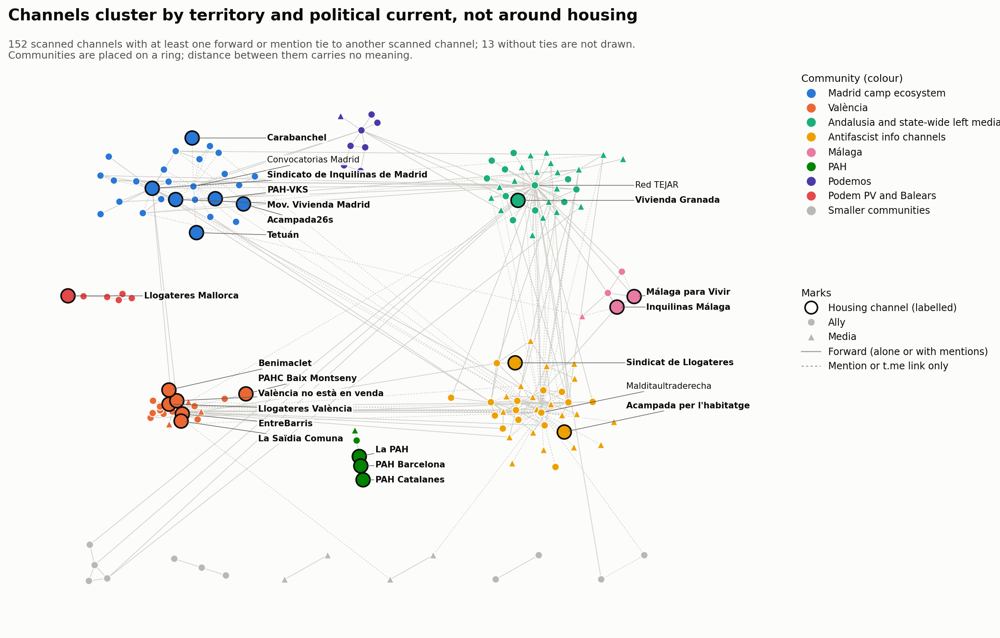

# Análisis de comunidades: primer estudio, 14 de septiembre – 5 de octubre de 2026

<a href="../community_analysis.html">English</a> · <strong>Español</strong> · <a href="../ca/community_analysis.html">Català</a>

> Esta página trata del primer estudio, del 14 de septiembre al 5 de octubre de 2026. La movilización continuó: véase el [seguimiento](followup.md), del 6 de octubre a la huelga del 11 de noviembre.

Hecho el 2026-10-05. Ventana: del 2026-09-14 al 2026-10-05.

*Traducción del original en inglés. Las figuras están en inglés.*

## Método

- **Nodos:** los 165 canales analizados de la muestra (24 de vivienda, 91 aliados, 50
  medios). Se dejan fuera los nodos externos y no identificados porque no se leyeron sus
  propias publicaciones.
- **Grafos:** reenvíos, enlaces (menciones con @ y enlaces t.me) y los dos combinados.
  Las aristas se hacen no dirigidas y con peso 1 + ln(recuento), para que una pareja que
  intercambia cientos de reenvíos no anule al resto.
- **Comunidades:** Louvain (semilla 42, resolución 1,0).
- **Estabilidad:** 50 semillas aleatorias; proporción de ejecuciones que dan la misma
  partición, rango de modularidad y frecuencia con que los miembros de cada comunidad
  siguen juntos («cohesión»).
- **Comparación:** modularidad de la partición que dan las etiquetas (vivienda / aliado /
  medio).

## Cifras principales

| | Reenvíos | Enlaces | Combinado |
|---|---|---|---|
| Canales con al menos un vínculo | 139 | 83 | 152 |
| Aristas no dirigidas | 229 | 115 | 330 |
| Mayor componente conexa | 115 | 83 | 134 |
| Comunidades | 18 | 7 | 13 |
| Modularidad | 0,666 | 0,410 | 0,599 |
| Modularidad de la partición por etiquetas | 0,070 | −0,064 | 0,026 |
| Misma partición en las 50 semillas | 48 % | 84 % | 8 % |
| Rango de modularidad entre semillas | 0,664–0,666 | 0,409–0,412 | 0,586–0,600 |

La red está muy agrupada, y los grupos no tienen nada que ver con las etiquetas de
vivienda / aliado / medio: agrupar por etiqueta da una modularidad cercana a cero. Los
canales se agrupan por territorio y por corriente política.

## Comunidades de reenvío

Los miembros de cada comunidad siguen juntos en al menos el 95 % de las ejecuciones.

| # | Comunidad | Tamaño | Canales de vivienda dentro | Vínculos que quedan dentro |
|---|---|---|---|---|
| 1 | Difusor andaluz y medios de izquierda estatales, alrededor de Red TEJAR | 32 | Sindicato de Vivienda de Granada | 64 % |
| 2 | València | 18 | Sindicat de Llogateres València, EntreBarris, València no està en venda, La Saïdia Comuna, Benimaclet per l'Habitatge | 84 % |
| 3 | Sindicato de Madrid y movimiento climático | 16 | Sindicato de Inquilinas de Madrid, Movimiento de Vivienda de Madrid | 61 % |
| 4 | Canales de información antifascista (Euskal Herria, internacional) | 15 | ninguno | 64 % |
| 5 | Podemos (Madrid y estatal) | 10 | ninguno | 90 % |
| 6 | Medios internacionalistas y antiimperialistas de Barcelona | 7 | Sindicat de Llogateres | 61 % |
| 7 | Sevilla Anticarcelaria y Malditaultraderecha | 6 | ninguno | 33 % |
| 8 | Podem País Valencià y Baleares | 6 | Sindicat Llogateres Mallorca | 100 % |
| 9 | Málaga | 5 | Sindicato de Inquilinas de Málaga, Málaga para Vivir | 55 % |
| 10 | PAH | 5 | La PAH, PAH Barcelona, PAH Catalanes | 100 % |
| 11 | Anticapitalistas | 4 | ninguno | 68 % |
| 12 | CCOO | 3 | ninguno | 100 % |
| 13–18 | Seis parejas | 2 cada una | PAH-VKS (con La Villana de Vallekas), PAHC Baix Montseny (con InfoClau) | — |

Resultados:

- **No hay una comunidad de vivienda.** Los 17 canales de vivienda que tienen vínculos de
  reenvío se reparten en 9 comunidades. Cada uno está dentro de su propio grupo
  territorial u organizativo: València, Madrid, Málaga, la PAH, Mallorca.
- **València es el único lugar donde los canales de vivienda forman el centro de un
  grupo,** con cinco canales de vivienda y el 84 % de los vínculos dentro.
- **El sindicato de Madrid se agrupa con el movimiento climático,** no con otros canales
  de vivienda: XR Madrid, XR España, Ecologistas en Acción y su sección de Madrid son los
  canales que más lo reenvían.
- **La PAH es un grupo cerrado.** Todos sus vínculos quedan dentro; ni reenvía a los
  sindicatos de inquilinas ni estos la reenvían.
- **Siete canales de vivienda no tienen ningún vínculo de reenvío con ningún canal
  analizado:** Acampada26s, Acampada per l'habitatge, Sindicato de Vivienda de
  Carabanchel, Sindicato Vivienda Tetuán, Grup d'Habitatge de Les Corts, Sindicat
  d'Habitatge Socialista de Catalunya, Cuadernos de Trabajo.
- **Los puentes entre comunidades son aliados, no canales de vivienda.** Red TEJAR lleva
  17 de los vínculos entre comunidades, Sevilla Anticarcelaria 7, Malditaultraderecha 5,
  el colectivo de la Valldigna 5. El sindicato de Madrid, con 5, es el único canal de
  vivienda entre los puentes principales.

## Comunidades de enlace

El grafo de enlaces es menor (83 canales), pero forma una única componente conexa.

| # | Comunidad | Tamaño | Canales de vivienda dentro |
|---|---|---|---|
| 1 | Canales a los que Malditaultraderecha cita o menciona | 45 | Sindicat de Llogateres |
| 2 | Ecosistema de la acampada de Madrid, alrededor de Convocatorias Madrid | 22 | Sindicato de Inquilinas de Madrid, PAH-VKS, Movimiento de Vivienda de Madrid, Acampada26s, Tetuán, Carabanchel |
| 3 | Canales anarquistas y de centros sociales de València | 5 | ninguno |
| 4 | Málaga | 5 | Sindicato de Inquilinas de Málaga, Málaga para Vivir |
| 5–7 | Tres parejas | 2 cada una | Acampada per l'habitatge (con IzquierdaDiario) |

- **Las menciones unen Madrid donde los reenvíos no lo hacen.** Acampada26s, Tetuán y
  Carabanchel, aislados en el grafo de reenvíos, se unen aquí al sindicato de Madrid y a
  PAH-VKS en una comunidad, porque Convocatorias Madrid menciona a los convocantes de cada
  convocatoria.
- **La comunidad 1 es en buena parte obra de un solo canal.** Refleja a quién cita
  Malditaultraderecha como fuente, así que describe la lista de lecturas de ese canal más
  que un grupo que interactúa.
- **Catorce canales de vivienda no tienen ningún vínculo de enlace,** entre ellos todos
  los de València y de la PAH, que no hacen referencia a ningún otro canal analizado con
  @ ni con enlace t.me.

## Combinado

Sumar los dos tipos de arista da 13 comunidades (modularidad 0,599): esfera antifascista
y de Malditaultraderecha (36), Andalucía y medios estatales (36), Madrid (27, seis
canales de vivienda), València (19, seis de vivienda), Podemos, Podem PV y Baleares, PAH,
Anticapitalistas, CCOO y cuatro parejas.

*Los 152 canales analizados con al menos un vínculo, coloreados por comunidad del grafo combinado (etiquetas de consenso). Las comunidades se sitúan en un anillo; solo los vínculos tienen significado.*

Esta partición es la menos estable: 31 particiones distintas en 50 semillas. Las
comunidades grandes se mantienen (cohesión de 0,82 a 0,97), pero los canales del borde
entre los bloques antifascista y andaluz pasan de uno a otro, así que sus tamaños exactos
no deben leerse con detalle. Solo tres canales de vivienda siguen sin conexión: Les
Corts, Sindicat d'Habitatge Socialista de Catalunya y Cuadernos de Trabajo, que no
publicaron nada en la ventana.

## Cómo se asignan las etiquetas, y estabilidad de los nodos

Louvain es aleatorio, así que 50 ejecuciones con semillas distintas no siempre coinciden.

| Grafo | Particiones distintas en 50 ejecuciones | Etiqueta usada | Comunidades | Estabilidad media por nodo | Nodos por debajo de 0,8 |
|---|---|---|---|---|---|
| Reenvíos | 8 | Semilla 42 (la partición más frecuente, 48 % de las ejecuciones) | 18 | 0,98 | 3 |
| Enlaces | 3 | Semilla 42 (la partición más frecuente, 84 % de las ejecuciones) | 7 | 1,00 | 0 |
| Combinado | 31 | Consenso de las 50 ejecuciones | 14 | 0,96 | 5 |
| Completo | 46 | Consenso de las 50 ejecuciones | 19 | 0,96 | 45 |

- **Partición de consenso** (Lancichinetti y Fortunato 2012): cada par de nodos se une
  con la proporción de las 50 ejecuciones que los ponen en la misma comunidad; los pares
  por debajo de 0,5 se descartan; Louvain se ejecuta 50 veces sobre ese grafo. Los dos
  grafos convergieron en la primera iteración, con las 50 ejecuciones devolviendo la
  misma partición.
- **La estabilidad de un nodo** es la proporción media de las 50 ejecuciones originales
  en que un nodo está con los demás miembros de su comunidad etiquetada. 1,0 significa
  que siempre está con el mismo grupo; un valor bajo indica un nodo de borde. Se da para
  los cuatro grafos.
- Los apartados del grafo combinado y del completo de más arriba describen la partición
  de la semilla 42. Las etiquetas de consenso solo difieren en los márgenes: el combinado
  tiene 14 comunidades en lugar de 13 (los canales de Málaga forman su propia comunidad
  de 5), y el completo tiene 19 en lugar de 20.

Nodos de borde que conviene conocer:

- **Sindicat de Llogateres (0,75 en el grafo completo)** es el único canal de vivienda
  que no está firmemente situado. Está con el bloque de Malditaultraderecha y el
  internacionalista de Barcelona, porque los canales que lo reenvían pertenecen a él,
  pero en una cuarta parte de las ejecuciones cae en otro sitio. Todos los demás canales
  de vivienda puntúan 0,96 o más.
- **Los canales climáticos (XR Madrid, XR Málaga, XR España, 0,66)** pasan del bloque de
  Madrid, donde reenvían al sindicato de Madrid, al bloque andaluz y de medios estatales.
- **Sevilla Anticarcelaria, Sevilla en Acción y Grupo Ruptura (0,61 a 0,64)** pasan del
  bloque de Malditaultraderecha al andaluz.
- **En el grafo combinado,** el colectivo de la Valldigna, Diari La Veu y La Directa
  (0,63 a 0,64) están en el borde de la comunidad de València, y Cañada Se Queda y ESLA
  EKO (0,65) en el borde de la de Madrid.

## Límites

- Solo se incluyen canales analizados; los 251 nodos externos y los 342 no identificados
  del grafo completo, no.
- La lista de canales creció desde la semilla de vivienda hacia fuera a través de los
  aliados, así que los bloques antifascista y de medios reflejan tanto cómo se construyó
  la lista como el propio campo.
- Los vínculos de enlace son sensibles a los hábitos de firma (Malditaultraderecha,
  Convocatorias Madrid). La ponderación logarítmica lo reduce, pero no lo elimina.

## Comunidades del grafo completo

Las comunidades de más arriba cubren solo los canales analizados, lo que deja sin
etiqueta a la mayoría de los nodos del grafo completo. Una pasada más aplica el mismo
método al grafo completo: los 766 nodos conectados (analizados, externos, no
identificados, usuarios), con los dos tipos de arista juntos.

- 20 comunidades, modularidad 0,703. Todos los nodos de la componente gigante (739
  nodos) tienen un valor; solo los 12 nodos aislados no lo tienen.
- **Los nodos no analizados se unen a quien hace referencia a ellos.** Un nodo externo o
  no identificado solo tiene vínculos con los canales analizados que lo reenviaron o
  mencionaron, así que cae en la comunidad de ese canal. Las comunidades 2 (127 nodos) y
  5 (65 nodos) contienen cada una un único canal analizado, Fullblack161 y Prima Linea,
  más las fuentes que difunde.
- **Los canales analizados se agrupan de forma muy parecida a antes:** ecosistema de la
  acampada de Madrid (comunidad 3, seis canales de vivienda), València (7, seis de
  vivienda), Málaga (10), PAH (12), Podemos (9), Podem PV y Baleares con el sindicato de
  Mallorca (13), y el canal de la acampada de Barcelona con las cuentas que menciona (11).
- **Menos estable en el detalle:** 46 particiones distintas en 50 semillas, con
  modularidad entre 0,701 y 0,704. Los bloques son robustos; la asignación de los nodos
  de borde, no.

## Descripción de las comunidades del grafo completo

Los números identifican las comunidades del grafo completo. «Muestra» cuenta los canales
analizados (vivienda, aliado, medio); «Otros» cuenta canales externos, usuarios no
identificados y usuarios, que se unen a la comunidad de quien hace referencia a ellos.
Los nombres son etiquetas descriptivas dadas tras leer a los miembros.

| # | Comunidad | Nodos | Muestra | Otros | Canales de vivienda | Principales aliados y medios | Estabilidad |
|---|---|---|---|---|---|---|---|
| 1 | Esfera de Malditaultraderecha: contrainformación antifascista, Sevilla y Barcelona | 129 | 18 | 111 | Sindicat de Llogateres | Malditaultraderecha, Sevilla Anticarcelaria, Palestina SOS Barcelona, Presos Revolucionarios; elPlural, Crític, Tot Barcelona | 0,87 |
| 2 | Fullblack161 y sus fuentes | 127 | 1 | 126 | — | Fullblack161 (información antifascista internacional); casi todos los demás nodos son usuarios que cita | 1,00 |
| 3 | Ecosistema de la acampada de Madrid | 104 | 23 | 81 | Sindicato de Inquilinas de Madrid, PAH-VKS, Movimiento de Vivienda de Madrid, Carabanchel, Tetuán, Acampada26s | Convocatorias Madrid, Ecologistas en Acción, La Villana de Vallekas, ESLA EKO, CSO La Rosa, Asamblea Popular de Carabanchel | 1,00 |
| 4 | Difusor andaluz y medios de izquierda estatales | 87 | 38 | 49 | Sindicato de Vivienda de Granada | Red TEJAR, XR, Anticapitalistas, Liza; El Salto, Spanish Revolution, Canal Red, Diario Socialista, IzquierdaDiario, CTXT | 0,93 |
| 5 | Prima Linea y sus fuentes | 65 | 1 | 64 | — | Prima Linea (información antifascista francesa e italiana) y los canales que reenvía | 1,00 |
| 6 | Medios antiimperialistas e internacionales | 62 | 4 | 58 | — | ANTIIMPERIALISTAS.COM, Satélite Rojo, teleSUR, Al Mayadeen | 1,00 |
| 7 | Información antifascista vasca, gallega y cántabra | 59 | 10 | 49 | — | Sare Antifaxista, Brigada Laila Jaled, Mitxis na Galiza, Las calles contra el fascismo; España en Guerra, Alerta Gorria Irratia | 0,91 |
| 8 | València | 56 | 20 | 36 | Sindicat de Llogateres València, EntreBarris, València no està en venda, La Saïdia Comuna, Benimaclet per l'Habitatge, PAHC Baix Montseny | colectivo de la Valldigna, CSOA CSN, Ateneu del Cabanyal, Assemblea Feminista, Alerta Solidària; La Veu, L'Accent, La Directa | 1,00 |
| 9 | Podemos (Madrid y estatal) | 16 | 8 | 8 | — | Difusión para Podemos, Podemos, Podemos Madrid, Podemos Parla, Área Joven | 1,00 |
| 10 | Acampada de Barcelona | 12 | 1 | 11 | Acampada per l'habitatge | Los otros 11 nodos son usuarios que menciona el canal de la acampada | 0,94 |
| 11 | Málaga | 12 | 6 | 6 | Sindicato de Inquilinas de Málaga, Málaga para Vivir | La Invisible, Convócala Málaga, Antifascistas; eldiario.es | 0,95 |
| 12 | PAH | 8 | 5 | 3 | La PAH, PAH Barcelona, PAH Catalanes | Privados de la Pública; La Cafetera | 1,00 |
| 13 | Podem País Valencià y Baleares | 7 | 6 | 1 | Sindicat Llogateres Mallorca | Podem, Podem València y tres de sus portavoces | 1,00 |
| 14 | Multicanal Radio y Nuestra España | 5 | 2 | 3 | — | Los dos medios y lo que difunde la radio | 1,00 |
| 15 | Marx21 | 5 | 2 | 3 | — | Marx21, Marx21 Andalucía | 1,00 |
| 16 | Noticias anarquistas | 5 | 2 | 3 | — | InfoAgitación, Anarquismos | 1,00 |
| 17 | CCOO Madrid | 3 | 3 | 0 | — | Canal CCOO, CCOO Madrid, CCOO Eiffage | 1,00 |
| 18 | CCOO transporte | 2 | 2 | 0 | — | CCOO Ciudadanía, CCOO EMT Madrid | 1,00 |
| 19 | Alba Pulido | 2 | 1 | 1 | — | Un canal personal y un usuario que menciona | 1,00 |

Notas de lectura:

- Las comunidades 2, 5 y 10 son un canal analizado con las cuentas que cita, no un grupo
  que interactúa.
- PAHC Baix Montseny está en la comunidad de València (8) por su vínculo con InfoClau, a
  quien menciona Alerta Solidària; es un canal catalán, no valenciano.
- Sindicat de Llogateres (comunidad 1) es el canal de vivienda situado con menos firmeza,
  con estabilidad 0,75.

---

Un estudio de [DataPolitik](https://www.heuristica.barcelona/datapolitik/), de [Heurística](https://www.heuristica.barcelona/). · [Inicio](index.md) · [Presentación del seguimiento](followup.md)
