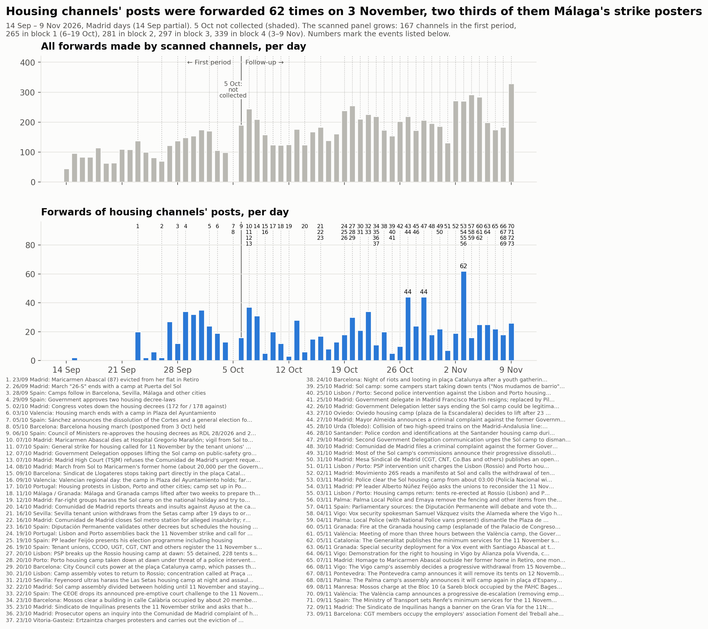

# Seguimiento: del 6 de octubre al 9 de noviembre de 2026

<a href="../followup.html">English</a> · <strong>Español</strong> · <a href="../ca/followup.html">Català</a>

El [primer estudio](acampadas_vivienda_technical_report.md) cubrió del 14 de septiembre
al 5 de octubre de 2026. La movilización continuó: Maricarmen Abascal murió el 7 de
octubre, los sindicatos de inquilinas convocaron una huelga general por la vivienda para
el 11 de noviembre y las acampadas empezaron a levantarse. Este seguimiento amplía el
estudio en el tiempo, en bloques semanales, hasta la huelga.

**Estado:** aquí se publican los bloques 1 a 4 (6 de octubre – 9 de noviembre). El
bloque 5 (10–16 de noviembre, la huelga) se añadirá cuando esté completo.

| Bloque | Días (hora de Madrid) | Informe |
|---|---|---|
| 1 | 6–19 de octubre | [Bloque 1](followup_block1.md) |
| 2 | 20–26 de octubre | [Bloque 2](followup_block2.md) |
| 3 | 27 de octubre – 2 de noviembre | [Bloque 3](followup_block3.md) |
| 4 | 3–9 de noviembre | [Bloque 4](followup_block4.md) |

Todas las decisiones de revisión, se añadiera o no el canal, están en el [registro de
revisión del seguimiento (CSV, en inglés)](../followup_review_log.csv).

## Cómo funciona el seguimiento

- **Un panel.** Los 167 canales del primer estudio se analizan en cada bloque, y los
  canales admitidos en un bloque se incorporan al panel a partir del siguiente. No se
  elimina ningún canal: si un canal deja de publicar, eso es un resultado. Así los
  bloques se pueden comparar con los mismos canales.
- **Una ronda de revisión por bloque.** Se leen los canales y grupos que aparecen en el
  grafo de reenvíos o menciones de un bloque, y los nombres de usuario que las páginas
  públicas de Telegram muestran como canales públicos. Un candidato se admite si tiene al
  menos una publicación propia sobre la movilización en el bloque (tres si publica más de
  300 veces en el bloque). El bloque 1 tuvo una ronda adicional de expansión por
  reenvíos y de búsqueda por hashtags.
- **Postura, bloque a bloque.** Cada canal recibe una postura para cada bloque, a partir
  del texto completo de sus publicaciones: de apoyo; crítica con la huelga (comparte los
  objetivos del movimiento pero rechaza o desdeña la propia huelga del 11 de noviembre);
  hostil; informativa; o ninguna. Aparte, se registra qué critica cada canal, en
  publicaciones propias o en reenvíos: las direcciones de CCOO y UGT, la estrategia de la
  huelga u otras organizaciones del movimiento. *Regla revisada el 10 de noviembre de
  2026:* hasta entonces, los canales que apoyaban la huelga mientras cuestionaban a CCOO y
  UGT o su estrategia se clasificaban como «crítica desde dentro»; ahora cuentan como de
  apoyo, con la crítica registrada. Los informes de bloque mantienen la etiqueta
  anterior.
- **Opositores.** Un canal cuyas publicaciones sobre la movilización son hostiles se
  etiqueta como *opositor*, sea cual sea su tipo. Los opositores se analizan, de modo que
  se ven sus vínculos con el resto, pero los canales que reenvían no se revisan salvo que
  otro canal también los reenvíe. El primer estudio no tenía esta categoría.
- **Días fijos.** Los bloques van de medianoche a medianoche, hora de Madrid. **El 5 de
  octubre es un hueco:** la recogida del primer estudio terminó el 5 de octubre a las
  10:54 UTC y el seguimiento empieza el 6 de octubre.
- **Trabajo asistido por un agente.** La recogida, la clasificación y el análisis los
  llevó a cabo un agente de IA siguiendo un protocolo escrito; el equipo fijó el
  protocolo, tomó las decisiones que cambiaban la muestra o la clasificación y revisó los
  resultados.
- **Términos de búsqueda por bloque.** Las palabras que indican que una publicación trata
  de la movilización se revisan y se prueban en cada bloque, porque el vocabulario cambia:
  de las acampadas a la muerte de Maricarmen, los decretos y la huelga.

## La trayectoria

*Las figuras están en inglés.*

| | Primer periodo | Bloque 1 | Bloque 2 | Bloque 3 | Bloque 4 |
|---|---|---|---|---|---|
| Días | 14 sep – 5 oct (20) | 6–19 oct (14) | 20–26 oct (7) | 27 oct – 2 nov (7) | 3–9 nov (7) |
| Canales en el panel al final | 167 | 265 | 281 | 297 | 339 |
| Reenvíos al día, los 167 canales del primer estudio | 111,5 | 114,9 | 138,1 | 126,0 | 143,0 |
| Reenvíos al día de publicaciones de canales de vivienda, mismos canales | 11,4 | 11,8 | 15,9 | 21,1 | 20,9 |
| Publicaciones sobre la movilización al día, todos los canales | — | 101 | 73 | 76 | 166 |
| Canales que reenvían al Sindicato de Inquilinas de Madrid | 14 | 10 | 1 | 2 | 5 |
| Canales que reenvían el canal del comité de huelga de Málaga | 3 | 3 | 3 | 4 | 4 |
| Canales que critican a las direcciones de CCOO y UGT (publicaciones propias o reenvíos) | — | 7 | 5 | 19 | 11 |
| Canales críticos con la propia huelga | — | 2 | 1 | 1 | 1 |
| Canales opositores | — | 2 | 2 | 2 | 3 |
| Parte de los reenvíos de los cinco mayores reenviadores | 60 % | 51,1 % | 48,5 % | 46,5 % | 42,1 % |
| Comunidades (modularidad) | 14 (0,60) | 13 (0,698) | 18 (0,735) | 19 (0,736) | 23 (0,744) |
| Coincidencia con las comunidades del periodo anterior (índice de Rand ajustado) | — | 0,512 | 0,586 | 0,587 | 0,403 |

«—»: no medido en ese periodo. En el primer estudio no se descargaron las publicaciones
de toda la muestra ni se registró la postura. En el bloque 4 la lista de términos se
amplió, así que su recuento de publicaciones sobre la movilización no es estrictamente
comparable, y las publicaciones del 7–9 de noviembre se leyeron con menos profundidad
para la postura (véase el informe del bloque). Los recuentos de crítica siguen la regla
revisada el 10 de noviembre de 2026; los reenvíos se encontraron leyendo las publicaciones
que nombran a CCOO, UGT o las direcciones sindicales.

## Principales resultados hasta ahora

1. **El sindicato de Madrid deja de ser el nodo central.** En el primer estudio, el
   Sindicato de Inquilinas de Madrid era reenviado por 14 canales, más que ningún otro
   canal de vivienda. En el bloque 1, tras la muerte de Maricarmen, por 10; en los
   bloques 2, 3 y 4, por 1, 2 y 5. Publica mucho menos en su canal y, según su propia
   versión, ya no mantiene un punto permanente en Sol; no publicó nada sobre el desalojo
   de la acampada el 3 de noviembre.
2. **El canal de Málaga concentra los reenvíos de contenido de vivienda.** Málaga para
   Vivir, rebautizado «Comité de Huelga 11N · Málaga», suma 98 de los 130 reenvíos de
   publicaciones de canales de vivienda en el bloque 2, 128 de 176 en el bloque 3 y 132 en
   el bloque 4. Sus publicaciones las reenvían muchas veces los mismos tres o cuatro
   canales: volumen sin amplitud.
3. **La movilización pasa de las acampadas a la huelga, y quienes la apoyan discuten
   quién la dirige.** Las publicaciones de los bloques 2 a 4 tratan casi todas de construir la
   huelga del 11 de noviembre, y en el bloque 4, la semana anterior, las publicaciones
   sobre la movilización se duplican con creces (1.163 frente a 532, con una lista de
   términos más amplia). Los canales que critican a las direcciones de CCOO y UGT, en
   publicaciones propias o en reenvíos, son 7, 5, 19 y 11 en los bloques 1 a 4. Casi
   todos apoyan la huelga, y varios pertenecen a organizaciones que firmaron la
   convocatoria, sobre todo CGT, cuya federación de Madrid envió una carta abierta a CCOO
   y UGT; el sindicato de vivienda de Granada convoca su propia manifestación. Los canales
   que rechazan la propia huelga siguen siendo marginales: uno o dos por bloque.
4. **Los grupos territoriales se conectan por debajo de sus canales de vivienda.** Hasta
   el bloque 3, todos los reenvíos entre canales de vivienda quedan dentro de Madrid,
   Barcelona, València o Málaga. El primer vínculo entre territorios aparece en el bloque
   3, y es una mención: un comunicado conjunto de las acampadas de varias ciudades tras el
   accidente ferroviario de Urda. En el bloque 4 dos vínculos cruzan territorios: el
   Sindicat de Llogateres (Barcelona) reenvía a Llogateres València, y el canal de la
   acampada de Sol enlaza el de la acampada de Barcelona. Los demás canales de cada grupo
   están menos cerrados:
    - Entre el 7 y el 11 % de los vínculos entre canales de territorio conocido cruzan
      territorios en cada bloque. La mayoría los sostienen colectivos anarquistas y
      antirrepresivos, grupos de solidaridad con Palestina y medios en catalán (entre
      Cataluña y València).
    - Entre el 40 y el 50 % de los demás canales territoriales tienen un vínculo con un
      canal estatal, frente a entre un quinto y un tercio de los canales de vivienda.
    - Las organizaciones presentes en varios territorios los unen a través de sus canales
      estatales, no directamente. Los canales de CGT de Madrid y de Cataluña se conectan
      con sus canales confederales; en los bloques 1 y 3, los canales de vivienda de Madrid
      y de Barcelona quedan a tres pasos solo a través de canales de CGT.
    - Las comunidades siguen siendo sobre todo territoriales: unos cuatro de cada cinco
      canales están en una comunidad encabezada por su propio territorio. La mezcla se
      concentra en la comunidad anarquista y antifascista, en la comunidad de CGT de los
      bloques 2 y 3 (con las dos acampadas en el bloque 3) y entre Cataluña y València.

    Los territorios se asignaron a partir del nombre, la descripción y los lugares citados
    en las publicaciones de cada canal; algunas asignaciones son inciertas.

5. **Los canales de las propias acampadas se difunden poco, salvo en el desalojo de
   Sol.** El canal de la acampada de Sol publicó 50, 32, 11 y 33 veces en los cuatro
   bloques y fue reenviado 3, 7, 2 y 9 veces; en el bloque 4 lo difundieron 7 canales,
   más que a ningún otro canal de vivienda, y 8 de sus 9 reenvíos fueron el día del
   desalojo. El de la acampada de Barcelona publicó 103, 24, 19 y 34 veces y fue
   reenviado una vez, una vez, ninguna y 3 veces.
6. **Los sindicatos de vivienda de Barcelona forman un grupo propio**, y en el bloque 3
   las acampadas de Sol y de Barcelona quedan en una misma comunidad con los sindicatos
   de la CGT que difunden sus publicaciones. En el bloque 4 cada acampada queda con su
   ciudad: las agendas de Madrid, la CGT, la acampada de Sol y el sindicato de inquilinas
   forman una comunidad, y la acampada, los sindicatos de vivienda y los comités de huelga
   de Barcelona, otra. Los demás grupos territoriales (València, Málaga con el difusor
   andaluz) se mantienen desde el primer estudio.
7. **Los opositores siguen aislados.** Dos medios son hostiles en todos los bloques:
   **Nuestra España Noticias** y **Multicanal Radio**. Multicanal Radio reenvía a Nuestra
   España (149, 74, 76 y 88 veces) y noticias del corazón; ningún otro canal reenvía ni
   cita a ninguno de los dos. Su hostilidad está en sus propias publicaciones, por
   ejemplo el titular de Nuestra España «La ridícula huelga general que llega ocho años
   tarde» y el de Multicanal Radio «Sindicato de Inquilinas, la mano de la Revolución de
   la Ultra-izquierda». En los bloques 3 y 4 su postura se apoya en indicios más débiles
   (titulares adversos y burla sin un ataque explícito); leídos como informativos, ambos
   volverían a ser medios. En el bloque 4 se admitió una tercera opositora, el canal de
   una autora (**Cristina Martín Jiménez**), por una publicación que se burla de la
   ministra de Trabajo; enlaza el canal de RT y no tiene contacto sobre la movilización
   con el resto del panel. En el primer estudio, Multicanal Radio era el segundo mayor
   reenviador, etiquetado como medio, porque no existía la categoría de opositor.

## La línea temporal continua

## Límites

- **La muestra crece por diseño.** Las comparaciones entre periodos se hacen con los
  mismos canales donde importa (las filas «mismos canales» de la tabla); los totales
  sobre todos los canales no son comparables.
- **Los bloques tienen distinta duración.** Los recuentos de canales por periodo
  favorecen a los periodos más largos.
- **Solo texto.** Las imágenes, los vídeos y los artículos enlazados en general no se
  leyeron.
- **Los canales y grupos privados son invisibles,** entre ellos varios canales de
  acampadas y de asambleas de vivienda (véase el informe de cada bloque).
- **La postura y la categoría de opositor son juicios**, recogidos en el informe de cada
  bloque con sus alternativas.
- **El contexto** procede de la prensa; las discrepancias entre fuentes se señalan en
  cada bloque.

**Cómo citar esta página.**

DataPolitik (Heurística). <em>Seguimiento: del 6 de octubre al 9 de noviembre de 2026</em>. En <em>Acampadas por la vivienda y redes de comunicación en Telegram en España, otoño de 2026</em>. Periodo de observación: 6 de octubre – 9 de noviembre de 2026. Versión del 10 de noviembre de 2026. <a href="https://datapolitik.github.io/acampadas-vivienda-report/es/followup.html">https://datapolitik.github.io/acampadas-vivienda-report/es/followup.html</a>

Texto y figuras originales: [CC BY 4.0](https://creativecommons.org/licenses/by/4.0/) · [Uso y citación](index.md#use-and-citation)

---

Un estudio de [DataPolitik](https://www.heuristica.barcelona/datapolitik/), de [Heurística](https://www.heuristica.barcelona/). · [Inicio](index.md) · [Presentación del seguimiento](followup.md)
