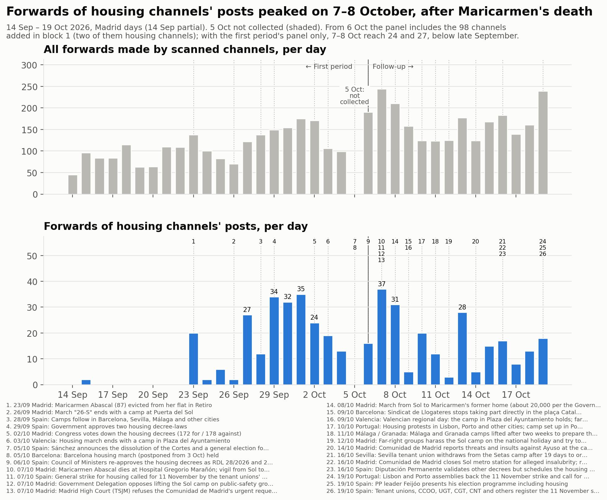
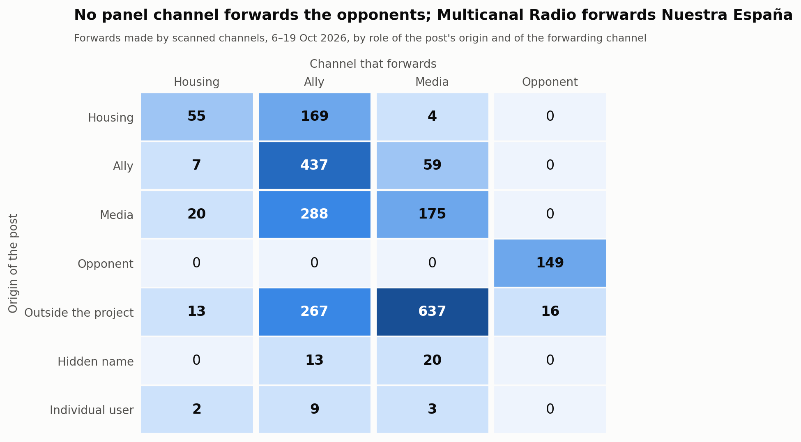
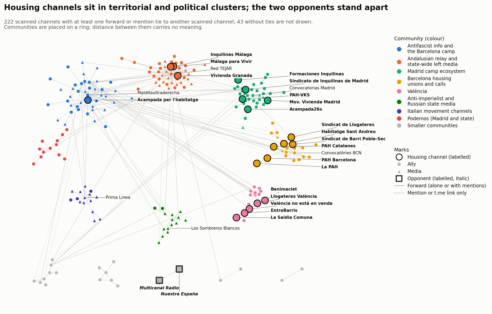

# Bloque 1: del 6 al 19 de octubre de 2026

<a href="../followup_block1.html">English</a> · <strong>Español</strong> · <a href="../ca/followup_block1.html">Català</a>

Forma parte del [seguimiento](followup.md) de la movilización por la vivienda en Telegram.
El bloque 1 cubre del 6 de octubre a las 00:00 al 19 de octubre a las 24:00, hora de Madrid
(2026-10-05T22:00Z a 2026-10-19T22:00Z). La referencia es el [primer periodo](acampadas_vivienda_technical_report.md)
(del 14 de septiembre al 5 de octubre). **El 5 de octubre es un hueco:** la recogida del
primer periodo terminó el 5 de octubre a las 10:54 UTC y el seguimiento empieza el 6 de
octubre; el hueco no se rellenó y aparece sombreado en la línea temporal.

*Traducción del original en inglés. Las figuras y el registro de revisión están en inglés.*

## 1. Qué pasó en el bloque

Hechos fechados, cada uno con al menos una fuente de prensa. En resumen:

- **6 oct.** El Consejo de Ministros volvió a aprobar los dos decretos de vivienda que el
  Congreso había tumbado el 2 de octubre. El 5 de octubre se habían convocado elecciones
  generales.
- **7 oct.** Maricarmen Abascal (87 años), cuyo desahucio el 23 de septiembre originó las
  protestas, murió en el hospital, y una concentración fue de Sol al Congreso. Los
  sindicatos de inquilinas convocaron una **huelga general por la vivienda para el 11 de
  noviembre**. El Tribunal Superior de Justicia de Madrid (TSJM) volvió a negarse a
  ordenar el desalojo de la acampada de Sol. Las fuentes fechan esta negativa el 5 o el 7
  de octubre; se registra el 7 de octubre con una nota.
- **8 oct.** Unas 20.000 personas marcharon de Sol a la antigua casa de Maricarmen (cifra
  de la Delegación del Gobierno).
- **9–11 oct.** El Sindicat de Llogateres dejó de participar directamente en la acampada
  de plaça Catalunya. La acampada de València resistió en el día de la Comunitat. Se
  montó una acampada en Oporto. Las acampadas de Málaga y Granada se levantaron para
  preparar la huelga, según la prensa. Las publicaciones de CAT-AIT Granada, admitido en
  la segunda ronda, lo contradicen: difunden las asambleas de la acampada de Granada del
  13 y el 14 de octubre y organizan una charla «en la Acampada de Granada» el 16 y el 17
  de octubre. Sin resolver.
- **12 oct.** Grupos de extrema derecha hostigaron la acampada de Sol en la fiesta
  nacional. Las informaciones hablan de dos o de cinco detenciones.
- **14–16 oct.** La Comunidad de Madrid denunció ante la fiscalía amenazas contra Ayuso y
  cerró la estación de metro de Sol. El sindicato de inquilinas de Sevilla dejó la
  acampada de las Setas. La Diputación Permanente fijó la votación de los decretos para
  el 12 de noviembre.
- **19 oct.** Asambleas en Lisboa y Oporto apoyaron la huelga del 11 de noviembre. Feijóo
  (PP) presentó su programa, que incluye la vivienda.

## 2. La muestra

### Panel y revisión

El seguimiento empezó con los 167 canales del primer periodo: 24 de vivienda (*in-scope*),
91 aliados, 50 medios y 2 fuera de ámbito. No se eliminó ningún canal. Los dos canales
fuera de ámbito se mantuvieron en el panel y recibieron un papel tras leerlos (véase más
abajo). Dos rondas añadieron **98 canales**. Todas las decisiones, se añadiera o no el
canal, están en el [registro de revisión](../followup_review_log.csv) (bloque 1, columna
`round`).

- **Ronda de revisión:** 78 canales (49 aliados, 28 medios, 1 de vivienda) de 296
  candidatos leídos.
- **Segunda ronda (expansión por reenvíos y búsqueda por hashtags)**, una ronda adicional
  hecha después de la revisión: 20 canales (15 aliados, 3 medios, 2 de vivienda) de 72
  candidatos leídos.
  - **Búsqueda por hashtags:** la búsqueda de hashtags de Telegram con 13 hashtags de
    campaña del bloque devolvió 26 canales. 15 ya estaban en el panel, **entre ellos los
    dos opositores**; uno ya se había rechazado; 10 eran nuevos.
  - **Expansión por reenvíos:** los orígenes de reenvíos que aún no estaban en el panel
    ni se habían revisado, tomados de los reenvíos recogidos. Los 63 los reenviaban solo
    canales admitidos en la ronda de revisión.
  - Ningún candidato de ninguno de los dos tipos era hostil.
  - El diseño prevé una ronda de revisión por bloque. Esta ronda es un añadido y se
    mantiene aparte en el registro y en la prueba de sensibilidad de más abajo.

**Panel tras el bloque 1 (265 canales), por papel y postura en el bloque 1.** Entre
paréntesis, los canales añadidos en el bloque 1 (ronda de revisión + segunda ronda).

| Papel | de apoyo | crítica desde dentro | informativa | hostil | ninguna | no legible | total |
|---|---|---|---|---|---|---|---|
| vivienda | 25 (1+2) | 0 | 0 | 0 | 2 | 0 | 27 (1+2) |
| aliado | 134 (46+14) | 3 (1+1) | 2 (2+0) | 0 | 16 | 0 | 155 (49+15) |
| medio | 47 (16+0) | 1 | 26 (12+3) | 0 | 6 | 1 | 81 (28+3) |
| opositor | 0 | 0 | 0 | 2 | 0 | 0 | 2 |
| fuera de ámbito | 0 | 0 | 0 | 0 | 0 | 0 | 0 |

Los dos canales de vivienda de la segunda ronda:
- **Sindicat de Barri del Poble-Sec**, un sindicato de barrio que para desahucios. Montó
  el comité de huelga del Poble-Sec «per l'habitatge #11N» (#2179).
- **Sindicat d'Habitatge de Sant Andreu**, un sindicato de vivienda: «11N VAGA GENERAL…
  Salaris pels terres i lloguers pels núvols» (#1511).

### Cambios de papel

- **Nuestra España Noticias** (@nuestraespana): medio → **opositor** (tipo: medio). Entre
  sus propios titulares: «La ridícula huelga general que llega ocho años tarde» (#1947),
  «jóvenes patriotas se enfrentaron a los izquierdistas de la Puerta del Sol» (#2039) y
  «varias agresiones en plena calle por acampados de Sol» (#2040).
- **Multicanal Radio** (@multicanalr): medio → **opositor** (tipo: medio). Entre sus
  propias publicaciones: «LOS COME GAMBAS CONVOCAN HUELGA GENERAL» (#4198) y «Sindicato
  de Inquilinas, la mano de la Revolución de la Ultra-izquierda» (#4302). También reenvía
  a Nuestra España. En el primer periodo era el segundo mayor reenviador (11 % de los
  reenvíos), etiquetado como medio, porque ese periodo no tenía categoría de opositor.
- **Roto2bot** (@roto2botfc): fuera de ámbito → **medio** (un agregador), postura
  informativa. Es un bot que republica los títulos de los hilos más respondidos del foro
  Forocoches. Unos 25 títulos trataban de la movilización: algunos hostiles, otros de
  apoyo y otros neutros.
- **MEME_CCC** (@meme_ccc): fuera de ámbito → **medio**, postura crítica desde dentro. Su
  única publicación con imagen sobre la huelga se burla del líder de UGT (#VendeObreros).

### Bajas

- **En silencio:** seis canales no publicaron nada en el bloque.
  - Aliados: @CJSocialista, @CanadaSeQueda, @convocatoriascadiz, @mitxisantifascistas.
  - De vivienda: @cuadernosdetrabajo, @ghlescorts.
- **Privado:** @elsaltomadrid (El Salto Madrid, medio) es privado y no tiene postura.
- **Renombrados:** ningún nombre de usuario cambió. Cambiaron dos títulos.
  - @malagaparavivir: «Málaga para Vivir» pasó a ser «**Comité de Huelga 11N • Málaga**».
  - @acampada26s: «Acampada26s» pasó a ser «Acampada 26S».

## 3. Análisis

### Volumen

**Reenvíos.** Los canales analizados hicieron 2.343 reenvíos en el bloque, sin contar los
reenvíos de sí mismos: 167,4 al día de media.

- Esa cifra incluye los 98 canales añadidos en este bloque. El panel del primer periodo
  por sí solo hizo 114,9 al día, frente a 111,5 al día en el primer periodo (15 de
  septiembre – 4 de octubre).
- Con el mismo panel, el volumen de reenvíos apenas cambió.

**Reenvíos de publicaciones de canales de vivienda.** 228 en el bloque, 16,3 al día,
frente a 11,4 al día en el primer periodo. La cifra del bloque cuenta las publicaciones
de los dos nuevos canales de vivienda y los reenvíos de los canales nuevos.

- Con solo el panel y la lista de canales de vivienda del primer periodo: 11,8 al día,
  con 24 el 7 de octubre y 27 el 8 de octubre.
- Con todo el panel, los picos del bloque siguen a la muerte de Maricarmen: 37 el 7 de
  octubre y 31 el 8 de octubre, y 28 el 13 de octubre.
- Así que los picos por encima de los máximos del primer periodo (34–35 del 29 de
  septiembre al 1 de octubre) se deben a la muestra mayor, no a que los mismos canales
  reenvíen más.

**Publicaciones sobre la movilización** (publicaciones que coinciden con los términos de
implicación, todos los canales descargados): 1.409.

- Por papel: 204 de vivienda, 670 de aliados, 484 de medios, 51 de opositores.
- Por postura: 1.259 de apoyo, 93 informativas, 51 hostiles, 6 críticas desde dentro.
- Tuvieron su pico el 8 de octubre (299) y el 7 de octubre (215) y bajaron a 30–105 al
  día en la segunda semana.
- No hay referencia para esta medida: en el primer periodo no se descargaron las
  publicaciones de todo el panel.

**Con y sin los canales añadidos.** Cuatro canales añadidos aportan cada uno más de diez
nodos del grafo a los que nada más hace referencia:
- ronda de revisión: @MTnews_Espanol (20) y @ophiucu (13);
- segunda ronda: ANRed (24) y Conflict News (14).

Se releyeron sus evidencias y las cuatro decisiones se mantienen. Ningún canal añadido
hace más del 15 % de los reenvíos del bloque; el mayor es @ophiucu con el 9,9 %.

| | reenvíos | al día | publicaciones sobre la movilización |
|---|---|---|---|
| todos los canales analizados | 2.343 | 167,4 | 1.409 |
| sin MT News (repetidor de RT) | 2.343 | 167,4 | 1.404 |
| sin Los Sombreros Blancos [Z] | 2.111 | 150,8 | 1.403 |
| sin ANRed | 2.343 | 167,4 | 1.407 |
| sin Conflict News | 2.325 | 166,1 | 1.407 |
| sin los 20 canales de la segunda ronda | 2.167 | 154,8 | 1.315 |
| sin los 78 canales de la ronda de revisión | 1.785 | 127,5 | 1.134 |
| sin los 98 canales añadidos | 1.609 | 114,9 | 1.040 |

MT News y ANRed no hacen reenvíos; publican enlaces. Sin Los Sombreros Blancos, la
columna de medios baja de 898 a 666 reenvíos. Ninguna de las conclusiones de más abajo
depende de uno solo de estos canales.

**Concentración.** Los cinco mayores reenviadores hacen el 51,1 % de todos los reenvíos:

| Canal | Papel | Reenvíos | Parte |
|---|---|---|---|
| Red TEJAR | aliado | 382 | 16,3 % |
| Prima Linea | medio | 297 | 12,7 % |
| Los Sombreros Blancos | medio | 232 | 9,9 % |
| Multicanal Radio | opositor | 165 | 7,0 % |
| @nullaesrbu | medio | 122 | 5,2 % |

### Quién reenvía a quién

Reenvíos, según el papel del canal de origen de la publicación y del canal que la
reenvía. Entre paréntesis, las cifras del primer periodo.

**Publicaciones de canales de vivienda**
- 169 reenviadas por aliados (156).
- 55 reenviadas por otros canales de vivienda (76).
- 4 reenviadas por medios (4).

**Canales de vivienda que reenvían a otros**
- 7 reenvíos de aliados (12).
- 20 reenvíos de medios.
- 13 reenvíos de canales externos.

El patrón del primer periodo se mantiene: **los aliados difunden a los canales de
vivienda; los canales de vivienda difunden poco.** El aumento de canales de vivienda que
reenvían medios y canales externos se debe a los dos nuevos sindicatos de Barcelona; solo
Sant Andreu hace 40 reenvíos. Los medios reenvían sobre todo canales externos: 637 de los
898 de la columna de medios.

**Opositores.** La fila y la columna de opositores contienen solo dos flujos:
- Multicanal Radio reenviando a Nuestra España, 149 veces.
- Multicanal Radio reenviando un canal externo de prensa del corazón, 16 veces.

Ningún canal del panel reenvía ni menciona con @ a un opositor, y los opositores no
reenvían ni mencionan canales del panel.

### Nodo central, difusores, territorios y acampadas

**El sindicato de Madrid.** El Sindicato de Inquilinas de Madrid sigue siendo el nodo
central por amplitud.
- Bloque: reenviado por 10 canales analizados, 39 reenvíos.
- Primer periodo (20 días): reenviado por 14 canales, 31 reenvíos.
- Le sigue en amplitud un canal nuevo: el Sindicat de Barri del Poble-Sec, reenviado por
  4 canales (18 reenvíos).

**Amplitud frente a volumen.** Los canales de Málaga se reenvían más veces, pero desde
menos canales.

| Canal | Reenvíos | Canales que lo reenvían |
|---|---|---|
| Inquilinas Málaga | 66 | 4 |
| Málaga para Vivir | 53 | 3 |

36 de esos reenvíos son los dos canales de Málaga reenviándose entre sí.

**Difusores menores**

| Canal | Canales que lo reenvían | Reenvíos |
|---|---|---|
| Vivienda Granada | 2 | 18 |
| València no està en venda | 3 | 10 |
| EntreBarris | 3 | 3 |
| Llogateres València | 3 | 3 |

**Canales no difundidos.** 11 de los 27 canales de vivienda no los reenvió ningún canal
analizado.

**Los grupos territoriales siguen sin reenviarse entre sí.** Hay doce vínculos de reenvío
entre canales de vivienda.
- **Entre territorios:** uno, dentro de una misma organización: La PAH → PAH Barcelona
  (1).
- **Dentro de cada territorio:**
  - Málaga: 36 reenvíos entre sus dos canales.
  - Barcelona: 4 vínculos. Poble-Sec → Sant Andreu (8), Sindicat de Llogateres →
    Poble-Sec y → Sant Andreu, PAH Catalanes → Sant Andreu.
  - València: 4 vínculos.
  - Madrid: Formaciones → Sindicato de Inquilinas de Madrid.
- **Nuevo desde el primer periodo:** la segunda ronda añade un grupo barcelonés de
  canales de vivienda que se reenvían entre sí.

**Los canales de las acampadas apenas se difunden.**
- Acampada26s (Madrid): 50 publicaciones en el bloque, reenviada 3 veces por un canal
  (Difusión urgente, añadido en la segunda ronda), mencionada con @ por dos.
- Acampada per l'habitatge (Barcelona): 103 publicaciones, reenviada una vez (por
  @antifascistas), mencionada por dos.

En el primer periodo no se reenvió ninguno de los dos canales de acampada.

### Vínculos que aparecieron y desaparecieron

La comparación abarca los 165 canales del panel analizados en ambos periodos, así que los
canales añadidos no la alteran.

| Vínculos entre ellos | Bloque 1 | Primer periodo |
|---|---|---|
| Total | 221 | 365 |
| Mantenidos | 154 | 154 |
| Nuevos en el bloque 1 | 67 (50 de reenvío, 17 de enlace) | – |
| Desaparecidos desde el primer periodo | – | 211 (148 de reenvío, 63 de enlace) |

El primer periodo dura 20 días y el bloque 14, así que parte de la pérdida se debe a la
ventana más corta.

Vínculos nuevos:
- Los canales de Podemos se reenvían entre sí: @ahorapodemos → PodemVLC, PodemPV, Pablo
  Echenique y otros.
- Sare Antifaxista (información antifascista vasca) reenvía ahora al Sindicato de
  Inquilinas de Madrid (2 reenvíos).
- La Directa la reenvían ahora PAH Barcelona y PAH Catalanes.
- València no està en venda la reenvía EntreBarris.

### Contacto entre los opositores y el resto

Se leyeron todos los eventos que unen a un opositor con un canal que no lo es: 17.

- **16 reenvíos de prensa del corazón.** Multicanal Radio reenvía publicaciones de
  @elmarujeo sobre actores, cantantes e influencers. Ninguna trata de la movilización.
  @elmarujeo no fue candidato a revisión, porque solo un opositor hace referencia a él.
- **1 mención con @.** Es el usuario de la firma del autor de un artículo de Nuestra
  España sobre el PSOE («Historia del 'gang' del PSOE - TERCERA PARTE», #2010). No trata
  de la movilización, y la cuenta está seudonimizada.

**No hay ningún vínculo de cita hostil**: ningún canal del panel reenvía ni enlaza una
publicación de un opositor para citarla. La hostilidad de los opositores se ve en sus
propias publicaciones: 51 publicaciones sobre la movilización, todas de estos dos
canales. Los opositores forman una pareja cerrada; el mapa de la red los dibuja aparte.

### Comunidades

Grafo combinado de reenvíos y menciones de los canales analizados: 222 nodos, 385
aristas, 43 canales analizados sin vínculos.

**Louvain con 50 semillas.**
- Etiquetas de consenso: 13 comunidades, modularidad 0,698. La partición por papel da
  0,121.
- Estabilidad:
  - 16 particiones distintas; la más frecuente aparece en el 16 % de las ejecuciones.
  - Estabilidad media por nodo 0,95.
  - Once nodos quedan por debajo de 0,8; diez de ellos, en los bordes de las comunidades
    1–3, en 0,55:
    - @XRMadrid, @xrebellion_esp, @Rebelioncientifica y @madconvocala;
    - @SevillaAnticarcelaria, @gruporuptura y @ZaragozaCNT;
    - @anticapimadrid, @liberarmadrid y @anticapitalistasmov.
  - El undécimo es @PabloEchenique (0,75).
- El primer periodo tenía 14 comunidades, modularidad 0,60, 31 particiones distintas con
  una parte máxima del 8 % y una estabilidad media por nodo de 0,96.

Las comunidades, con el nombre de sus canales principales:

| # | Nombre | Canales | Miembros de vivienda |
|---|---|---|---|
| 1 | Difusor andaluz y medios de izquierda estatales | 45 | Inquilinas Málaga, Málaga para Vivir, Vivienda Granada |
| 2 | Información antifascista y la acampada de Barcelona | 42 | Acampada per l'habitatge (también Sare Antifaxista y los canales vascos) |
| 3 | Ecosistema de la acampada de Madrid | 36 | Sindicato de Inquilinas de Madrid, Acampada26s, PAH-VKS, Formaciones, Mov. Vivienda Madrid |
| 4 | Sindicatos de vivienda y convocatorias de Barcelona | 22 | Habitatge Sant Andreu, Poble-Sec, PAH Barcelona, Sindicat de Llogateres, PAH Catalanes, La PAH |
| 5 | Medios antiimperialistas y estatales rusos | 15 | — (TASS, Los Sombreros Blancos, MT News, ANRed, Cubadebate, Al Mayadeen) |
| 6 | Canales de movimientos italianos | 15 | — (Prima Linea, Radio Onda d'Urto, C.S.O.A. Ex Snia, Infoaut, Conflict News) |
| 7 | València | 15 | València no està en venda, EntreBarris, Llogateres València, Benimaclet |
| 8 | Podemos (Madrid y estatal) | 12 | — |
| 9–13 | CNT-AIT y solidaridad con Palestina (8); CCOO (6); **opositores** (2); Marx21 (2); convocatorias de Sevilla (2) | | — |

**Coincidencia con el primer periodo.** En los 131 canales presentes en ambas particiones
combinadas, el índice de Rand ajustado es **0,512**: 21 canales aparecen solo en el grafo
del primer periodo y 91 solo en el de este bloque. La estructura territorial persiste:
Madrid, València, y Málaga con el difusor andaluz.

El principal cambio de este bloque es Barcelona. Con los canales de la segunda ronda, las
organizaciones de vivienda de Barcelona forman una comunidad propia. En el primer
periodo y en la versión de este bloque con solo la ronda de revisión, estaban con los
canales de información antifascista. El otro cambio es que canales nuevos forman sus
propias comunidades: canales de movimientos italianos, y medios estatales rusos y
antiimperialistas.

## 4. Listas de términos

Las listas del bloque 1 se elaboraron desde cero y se probaron. El vocabulario pasó de
los términos de las acampadas del primer periodo a otros nuevos:
- la huelga del 11 de noviembre, escrita 11N, con una regla sensible a mayúsculas y una
  regla de proximidad entre fecha y huelga;
- Maricarmen;
- los decretos;
- los nombres de los sindicatos de inquilinas;
- los hashtags de campaña;
- formas en euskera, gallego y portugués.

Dos falsos positivos llevaron a las reglas de proximidad: la visita del Papa «del 8 al
11 de noviembre» y la fecha en euskera «urriaren 11n». Carencias conocidas, a corregir en
el bloque 2:
- «a la huelga» sin «general»;
- publicaciones que son solo imagen.

La huelga educativa de Madrid (desde el 14 de octubre) es un conflicto distinto y no está
en las listas.

## 5. Decisiones que podrían haber sido otras

**Postura y papeles**
- Roto2bot como medio/informativa; podría ser opositor (tipo: agregador).
- MEME_CCC como crítica desde dentro; podría ser hostil.
- @gruporuptura como crítica desde dentro; podría ser de apoyo.
- @bultzaka (Bultza EHM-L) como aliado/crítica desde dentro. Su artículo llama a la
  huelga de un día «oportunista y electoralista»; podría quedar fuera del ámbito de la
  movilización por la vivienda.
- Medios: de apoyo cuando el canal toma posición con sus propias palabras, informativa
  cuando solo publica titulares. Casos límite: Al Mayadeen, eldiario.es, Diari La Veu,
  Crític.
- Las menciones de pasada y los enlaces sueltos a X se leyeron como postura *ninguna*.
  Los enlaces no se siguieron.
- Varias posturas de apoyo se basan en una sola publicación breve: MovimientoAntirrepreMad,
  oscarreinasat, podemosparla, reinonis_vlc, sentitcritic, azadijinvalencia,
  convocatoriasevilla.
- Las publicaciones sobre los decretos de vivienda cuentan como publicaciones sobre la
  movilización.

**Revisión**
- La regla de que un canal con más de 300 mensajes necesita tres publicaciones propias
  sobre la movilización rechazó nueve canales con una o dos publicaciones de ese tipo.
  Entre ellos, HispanTV, Data Urgente, Entre Guerras y DD Geopolitics.
- Formaciones Sindicato de Inquilinas admitido como canal de vivienda; podría ser aliado.
- Contropiano admitido por un enlace a un artículo propio cuya dirección nombra la huelga
  del 11 de noviembre. El artículo no se abrió.
- ALUCHE.RED admitido porque la página de evento que enlaza vincula su comité de huelga
  juvenil con la huelga del 11 de noviembre.
- Ecologistas Indignadas rechazado: su enlace «la ciudad efímera de Sol» (10 de octubre)
  no se pudo verificar.
- Radical Graffiti admitido como aliado/informativa; C.S.O.A. Ex Snia admitido por una
  publicación en italiano que no coincidía con ningún término.
- Chats de grupo rechazados por ser conversación abierta.
- Activismo por la vivienda no vinculado a la movilización rechazado (Avlaunionhtz,
  colabbikestein).
- Las publicaciones sobre la huelga educativa no se contaron como movilización.

**Segunda ronda (expansión por reenvíos y búsqueda por hashtags)**
- Hacerla o no: el diseño tiene una ronda de revisión por bloque. Su efecto se muestra
  aparte en la tabla de sensibilidad.
- Sindicat de Barri del Poble-Sec como canal de vivienda (un sindicato de barrio que para
  desahucios); podría ser aliado.
- Kursant como aliado/crítica desde dentro: su documento dice que la convocatoria de
  huelga «quedará en una estrategia electoralista de CCOO, UGT y PSOE».
- Descontrol Editorial y Difusión urgente admitidos por una publicación cada uno: una
  lista de lecturas enmarcada en la huelga, y hashtags de campaña en una publicación
  electoral.
- CA-AIT Marina Alta admitido por un comunicado de apoyo «al moviment per la vivenda»
  cuyo texto enlazado no se abrió.
- elintrusoAVE rechazado: su «respeto y admiración por #laacampadadeSol» es una frase de
  pasada en una publicación electoral.
- Se mantuvo el rechazo de AV La Unión de Hortaleza. Su publicación #NosQuedamos trata
  del barrio de la UVA de Hortaleza.
- Hashtags buscados: solo los usados por al menos dos canales de vivienda; se dejaron
  fuera las etiquetas genéricas.

**Análisis**
- Los usuarios no identificados que no son canales o grupos públicos verificados están
  seudonimizados en los ficheros del grafo y del análisis. Algunos pueden ser
  organizaciones.
- Los nombres de las comunidades son interpretaciones de los canales principales de cada
  comunidad.

## 6. Qué no se verificó

**Contenido no leído**
- **Imágenes, vídeos y audio:** no se leyeron, salvo dos publicaciones con imagen leídas
  en la vista previa web pública (MEME_CCC #1008, Sistema 161 #3509).
- **Enlaces:** no se siguieron los artículos enlazados ni los enlaces a X, salvo algunos
  citados más arriba.
- **Candidatos grandes:** para los candidatos con 30 o más publicaciones propias y
  ninguna coincidencia de términos, solo se hizo una comprobación amplia por palabras
  clave. En los menores se leyó el inicio de cada publicación, y el texto completo solo
  donde podía tratar de la movilización.

**Canales y cuentas no alcanzados**
- **Canales privados:** siete candidatos no se pudieron leer, entre ellos tres canales de
  acampada o de vivienda (Acampada Plaça Ajuntament, València; ACAMPADA CONSTITUCIÓN,
  Málaga; Difusión Asamblea de Vivienda Sevilla). Tampoco se pudo leer El Salto Madrid,
  del panel.
- **Usuarios no identificados:** 160 usuarios sin cuenta pública no se comprobaron más.
  27 usuarios de personas o bots no fueron candidatos.
- **Cobertura de la búsqueda por hashtags:** la búsqueda de hashtags de Telegram devuelve
  solo canales públicos de difusión, no grupos. La búsqueda no registra qué etiqueta
  encontró cada canal.
- **Enlaces de la segunda ronda:** la expansión por reenvíos de la segunda ronda cubre
  solo los orígenes de reenvíos. No se revisaron los destinos de los enlaces de los
  canales nuevos.

**Huecos en los datos**
- **5 de octubre:** no recogido, por diseño.
- **Fechas:** la fecha de la negativa del TSJM y el número de detenciones del 12 de
  octubre difieren según las fuentes.

**No comprobado**
- **Colores:** el mapa de la red se apoya en la posición en el anillo y en la leyenda
  donde hay pares de colores que no superan la comprobación de todos los pares.

**Cómo citar esta página.**

DataPolitik (Heurística). <em>Bloque 1: del 6 al 19 de octubre de 2026</em>. En <em>Acampadas por la vivienda y redes de comunicación en Telegram en España, otoño de 2026</em>. Periodo de observación: 6–19 de octubre de 2026. Publicado el 7 de noviembre de 2026. <a href="https://datapolitik.github.io/acampadas-vivienda-report/es/followup_block1.html">https://datapolitik.github.io/acampadas-vivienda-report/es/followup_block1.html</a>

Texto y figuras originales: [CC BY 4.0](https://creativecommons.org/licenses/by/4.0/) · [Uso y citación](index.md#use-and-citation)

---

Un estudio de [DataPolitik](https://www.heuristica.barcelona/datapolitik/), de [Heurística](https://www.heuristica.barcelona/). · [Inicio](index.md) · [Presentación del seguimiento](followup.md)
