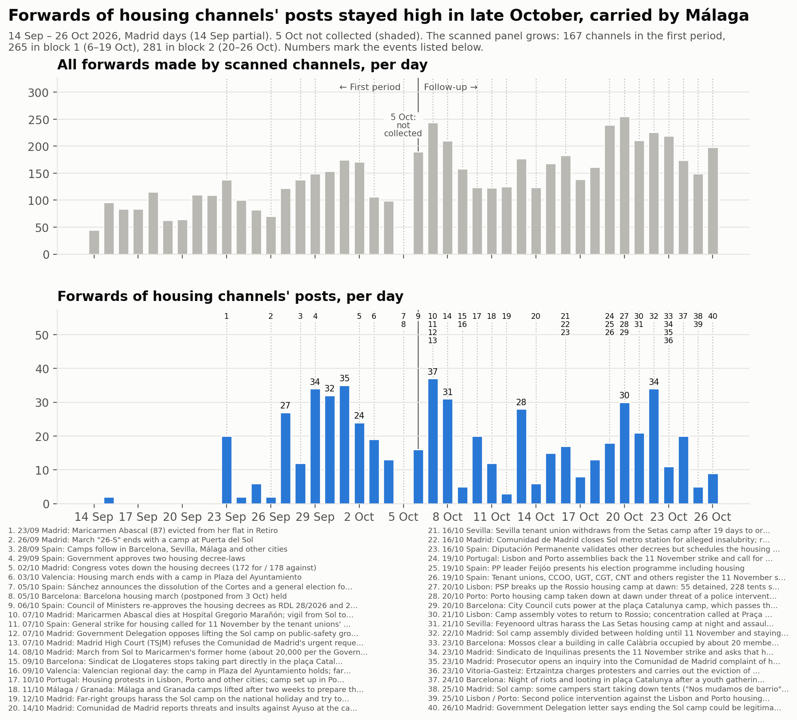
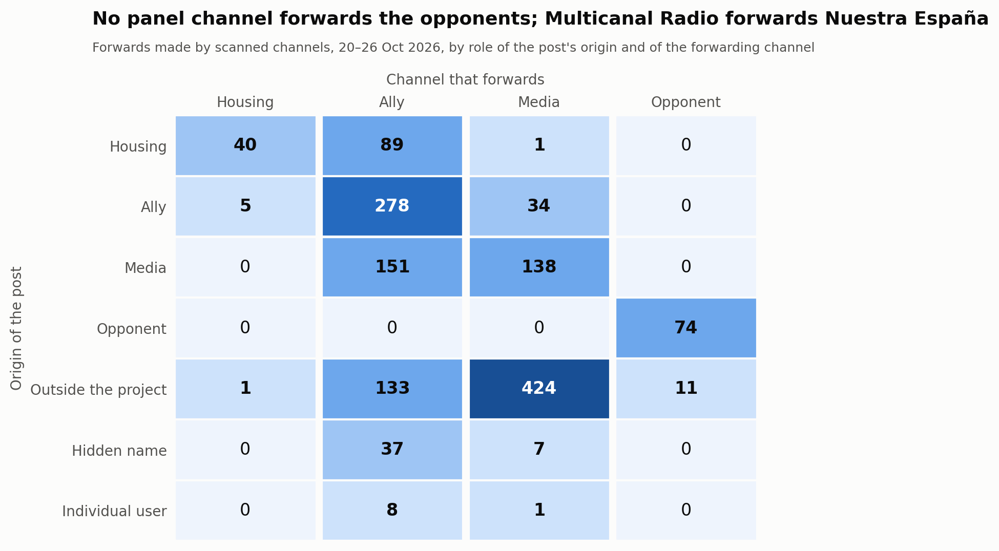
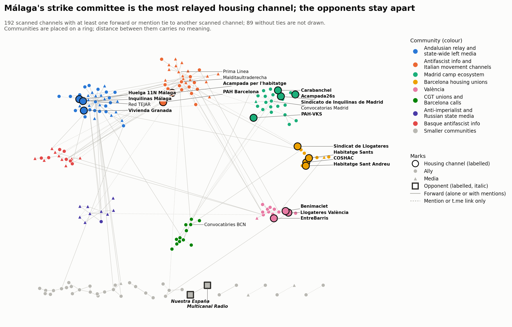

# Bloque 2: del 20 al 26 de octubre de 2026

<a href="../followup_block2.html">English</a> · <strong>Español</strong> · <a href="../ca/followup_block2.html">Català</a>

Forma parte del [seguimiento](followup.md) de la movilización por la vivienda en Telegram.
El bloque 2 cubre del 20 de octubre a las 00:00 al 26 de octubre a las 24:00, hora de
Madrid (2026-10-19T22:00Z a 2026-10-26T23:00Z). El horario de invierno empezó el 25 de
octubre, así que los dos últimos días del bloque tienen 25 y 24 horas.

- **Comparaciones:** con el bloque 1 (6–19 de octubre) y, cuando son comparables, con el
  primer periodo (14 de septiembre – 5 de octubre, el [primer periodo](acampadas_vivienda_technical_report.md)).
- **El hueco del 5 de octubre** sigue sin rellenarse y aparece sombreado en la línea
  temporal.
- **El bloque dura 7 días y el bloque 1, 14:** los totales se comparan por día.

*Traducción del original en inglés. Las figuras y el registro de revisión están en inglés.*

## 1. Qué pasó en el bloque

Hechos fechados, cada uno con al menos una fuente de prensa. En resumen:

- **20 oct, Portugal.** La policía (PSP) disolvió al amanecer la acampada del Rossio en
  Lisboa: 55 detenidos y 228 tiendas incautadas, según la PSP. La acampada de Oporto se
  desmontó esa misma mañana bajo la amenaza de una intervención. Los medios no coinciden
  en si la desmontó la PSP o los manifestantes.
  - El 21 de octubre la asamblea de Lisboa votó volver al Rossio.
  - teleSUR, citando a RTP, informa de una segunda intervención contra ambas acampadas el
    25 de octubre: 31 detenidos y 33 heridos. Su fecha y sus cifras son inciertas.
- **20 oct, Barcelona.** El Ayuntamiento cortó la luz a la acampada de plaça Catalunya,
  entonces en su cuarta semana y con unas 600 tiendas.
- **21 oct, Sevilla.** Ultras del Feyenoord hostigaron de noche la acampada de las Setas y
  agredieron a personas sin hogar en las inmediaciones antes de un partido de la
  Champions League.
- **22 oct, Madrid.** La asamblea de la acampada de Sol estaba dividida entre aguantar
  hasta el 11 de noviembre y quedarse indefinidamente. Muchos acampados estaban
  recogiendo.
- **23 oct.**
  - **Barcelona:** unas 20 personas de la acampada y de los sindicatos de vivienda
    ocuparon un edificio vacío en la calle Calàbria 177 («La Revolta»). Los Mossos lo
    desalojaron ese mismo día.
  - **Madrid:** el Sindicato de Inquilinas presentó la huelga y pidió que la vivienda
    fuera el eje de la campaña del 29 de noviembre. Dijo que ya no mantiene un punto
    permanente en Sol.
  - **Vitoria-Gasteiz:** la Ertzaintza cargó contra los manifestantes y ejecutó el
    desahucio de una familia con seis hijos en Sansomendi. Estudiantes de once centros
    pararon las clases para sumarse a la protesta.
- **24 oct, Barcelona.** Una noche de disturbios y saqueos en plaça Catalunya siguió a una
  concentración juvenil convocada en redes sociales: 128 detenidos, según los Mossos. Las
  autoridades la desvincularon de la acampada de la misma plaza.
- **25–26 oct, Madrid.** Algunos acampados empezaron a desmontar tiendas («Nos mudamos de
  barrio»). El 26 de octubre una carta de la Delegación del Gobierno decía que poner fin
  a la acampada podía ser legítimo pasado un tiempo razonable. El Español estimó la
  asistencia en unas 1.000 personas, frente a un máximo de 2.000.

Después del bloque: la acampada de Sol fue desalojada el 3 de noviembre (bloque 4).

## 2. La muestra

### Panel y revisión

El bloque 2 analizó los 265 canales del panel. Después, una ronda de revisión admitió
**16 de 262 candidatos leídos**:
- 202 canales y grupos del grafo del bloque;
- 57 usuarios no identificados que las páginas públicas de Telegram mostraron como
  canales o grupos públicos;
- 3 canales encontrados probando nombres de usuario de marca + ciudad para comités de
  huelga y acampadas locales (`huelga11n`, `huelgageneral11n`, `sindicathabsc`), todos sin
  contenido.

No se encontró ningún comité de huelga local con canal de Telegram: los comités que
aparecen en las publicaciones enlazan a la web de la huelga, a WhatsApp y a Instagram.

Todas las decisiones, se añadiera o no el canal, están en el [registro de
revisión](../followup_review_log.csv) (bloque 2).

**Admitidos**
- **de vivienda:** COSHAC (confederación catalana de sindicatos de vivienda); Grup
  d'Habitatge de Sants.
- **aliados:** Anticapitalistas Aragón; CGT Barcelona; CGT Baix Llobregat; CGT
  Socioeconómico; CA-AIT Sierra de Madrid; Comunismo Revolucionário Galego;
  Laintersección; Agenda del Henares; Fridays For Future Madrid.
- **medios:** ARAINFO, AhotsaInfo y Maldito Bulo (informativa); Wesh La Smala (de apoyo);
  Supernova (crítica desde dentro).
- Cuatro de ellos se habían rechazado en el bloque 1 y ahora pasan por sus publicaciones
  del bloque 2: CGT Baix Llobregat, CGT Socioeconómico, AhotsaInfo y Wesh La Smala.

**No admitidos**
- Siete candidatos eran privados.
- Ningún candidato era hostil.

**Panel tras el bloque 2 (281 canales), por papel y postura en el bloque 2**

| Papel | de apoyo | crítica desde dentro | informativa | hostil | ninguna | no legible | total |
|---|---|---|---|---|---|---|---|
| vivienda | 20 | 1 | 0 | 0 | 8 | 0 | 29 |
| aliado | 91 | 2 | 2 | 0 | 69 | 0 | 164 |
| medio | 18 | 2 | 17 | 0 | 48 | 1 | 86 |
| opositor | 0 | 0 | 0 | 2 | 0 | 0 | 2 |
| fuera de ámbito | 0 | 0 | 0 | 0 | 0 | 0 | 0 |

### Cambios de postura desde el bloque 1

**Ningún papel cambió.** Los dos opositores volvieron a ser hostiles.
- **Nuestra España**, en su propio titular: «Maricarmen: administradora única de una
  empresa de alquileres de 5,7M, el timo que se tragó la izquierda» (#2122).
- **Multicanal Radio:** «¿ESPAÑA ARDERÁ COMO FRANCIA? Huelga 11N de UGT y CCOO al
  descubierto» (#4403). También reenvió el #2122.

**La crítica desde dentro del movimiento aparece por primera vez entre los canales de
vivienda.** Cada uno de estos apoya la huelga mientras discute a sus coorganizadores.
- **El Sindicato de Vivienda de Granada (de vivienda)** publicó un comunicado conjunto
  (leído en la imagen de la vista previa web).
  - Su tesis: «las burocracias sindicales de CCOO y UGT» convocan «una huelga
    simbólica... en favor del Gobierno», una huelga al servicio de «los intereses
    electorales del PSOE».
  - Su rechazo: «No marcharemos con los cómplices de nuestra miseria. ¡Hacia la huelga
    general 11N!» (#588).
- **Liza Anarquista** difunde el mismo comunicado.
- **Diario Socialista** recoge la posición de la Coordinadora Juvenil Socialista (CJS):
  las direcciones de CCOO y UGT «convierten la huelga en un acto electoral para el PSOE».
- **Bultza EHM-L y Supernova** objetan el «réformisme» de la huelga.

**Muchos canales no tienen postura en este bloque.** 125 de los 265 canales del panel
tienen postura *ninguna* en el bloque 2. Entre ellos, los medios que pasaron la revisión
del bloque 1 por la muerte de Maricarmen: MT News, Los Sombreros Blancos y franceinfo.

### Bajas

Respecto al bloque 1.

- **En silencio:** 20 canales no publicaron nada en el bloque.
  - De vivienda: La PAH, PAH Catalanes, Sindicato de Vivienda de Carabanchel, Cuadernos
    de trabajo, ghlescorts.
- **Privado:** El Salto Madrid, todavía privado.
- **Renombrados:** un nombre de usuario, @airbnbcrepa → @lecitta. Tres títulos: el canal
  antifascista vasco añadió «/ FAK!»; los cambios de Málaga para Vivir y Acampada26s
  vienen del bloque 1.

## 3. Análisis

### Volumen

**Reenvíos.** Los canales analizados hicieron 1.432 reenvíos en el bloque, sin contar los
reenvíos de sí mismos: **204,6 al día**, frente a 167,4 en el bloque 1.

| Panel | Primer periodo | Bloque 1 | Bloque 2 |
|---|---|---|---|
| los 167 canales del primer periodo | 111,5 | 114,9 | **138,1** |
| el panel al final del bloque 1 (265) | – | 167,4 | 193,3 |
| todos los canales analizados | – | 167,4 | 204,6 |

Con el mismo panel, los reenvíos subieron cerca de un 20 % del bloque 1 al bloque 2.

**Reenvíos de publicaciones de canales de vivienda:** 130 en el bloque, 18,6 al día
(bloque 1: 16,3).
- Con solo el panel y la lista de canales de vivienda del primer periodo: 15,9 al día
  (bloque 1: 11,8; primer periodo: 11,4).
- Pico: 34 el 22 de octubre.
- **La mayoría de estos reenvíos vienen de un solo canal**: el Comité de Huelga 11N de
  Málaga, con 98 de los 130. Sus publicaciones las reenvían unas 33 veces cada uno los
  mismos tres canales: Inquilinas Málaga, Red TEJAR y La Invisible.

**Publicaciones sobre la movilización** (publicaciones que coinciden con los términos de
implicación; todos los canales descargados): 511, **73 al día** frente a 101 en el
bloque 1.
- Con el panel al final del bloque 1: 482, 69 al día.
- Por papel: 83 de vivienda, 300 de aliados, 119 de medios, 9 de opositores.
- Por postura: 449 de apoyo, 37 informativas, 12 críticas desde dentro, 9 hostiles, 4
  ninguna (estas últimas son falsos positivos en canales leídos como *ninguna*).
- Picos el 21 de octubre (113) y el 26 de octubre (110).

La conversación sobre la movilización se reduce mientras los reenvíos crecen. Los
reenvíos tratan de muchos temas, entre ellos Ceuta, Palestina, las protestas de Francia e
Italia y las elecciones.

**Con y sin los canales admitidos.** Ningún canal admitido hace más del 15 % de los
reenvíos del bloque (el mayor es Wesh La Smala, 59, 4,0 %). Ninguno aporta más de dos
candidatos a los que nada más hace referencia. Sin los 16 canales admitidos: 1.353
reenvíos (193,3 al día) y 482 publicaciones sobre la movilización.

**Concentración.** Los cinco mayores reenviadores hacen el 48,5 % de todos los reenvíos:

| Canal | Papel | Reenvíos | Parte |
|---|---|---|---|
| Red TEJAR | aliado | 230 | 16,1 % |
| Prima Linea | medio | 209 | 14,6 % |
| Los Sombreros Blancos | medio | 108 | 7,5 % |
| Multicanal Radio | opositor | 85 | 5,9 % |
| @nullaesrbu | medio | 63 | 4,4 % |

### Quién reenvía a quién

Reenvíos, según el papel del canal de origen de la publicación y del canal que la
reenvía; entre paréntesis, el bloque 1.

**Publicaciones de canales de vivienda**
- 89 reenviadas por aliados (169).
- 40 reenviadas por otros canales de vivienda (55).
- 1 reenviada por medios (4).

**Canales de vivienda que reenvían a otros**
- 5 reenvíos de aliados (7).
- 0 reenvíos de medios (20).
- 1 reenvío de un canal externo (13).

Los **medios** reenvían sobre todo canales externos: 424 de 605.

**Opositores.**
- Multicanal Radio reenvía a Nuestra España 74 veces, y un canal externo de prensa del
  corazón 11 veces.
- Ningún canal del panel reenvía ni menciona con @ a un opositor.

### Nodo central, difusores, territorios y acampadas

**El sindicato de Madrid ya no es el nodo central.**

| Sindicato de Inquilinas de Madrid | Canales que lo reenvían | Reenvíos | Publicaciones propias |
|---|---|---|---|
| Bloque 1 (14 días) | 10 | 39 | 33 |
| Bloque 2 (7 días) | 1 (Difusión urgente) | 3 | 5 |

Publicó mucho menos en su canal. Sus publicaciones del bloque 2 tratan de la huelga, el
«decreto Maricarmen» y un acto en Vistalegre.

**Los más difundidos por amplitud**

| Canal | Canales que lo reenvían | Reenvíos |
|---|---|---|
| Comité de Huelga 11N · Málaga | 3 | 98 |
| COSHAC | 3 | 5 |
| Sindicat de Llogateres · València | 3 | 4 |

16 de los 29 canales de vivienda no los reenvió ningún canal analizado.

**Los grupos territoriales siguen sin reenviarse entre sí.** Los cinco vínculos de
reenvío entre canales de vivienda quedan dentro de un territorio:
- Málaga: 33 reenvíos.
- Barcelona: COSHAC → Sant Andreu y → Sants, Acampada per l'habitatge → PAH Barcelona.
- València: Llogateres → Benimaclet.

**Canales de las acampadas.**
- **Acampada26s (Madrid):** 32 publicaciones, reenviada 7 veces, todas por Difusión
  urgente.
- **Acampada per l'habitatge (Barcelona):** 24 publicaciones, reenviada una vez, por PAH
  Barcelona.

Las dos acampadas siguen publicando. Las publicaciones de Sol son sobre todo asambleas,
talleres y desmentidos de bulos («BULO», «FALSO»).

### Vínculos que aparecieron y desaparecieron

La comparación abarca los 263 canales del panel analizados en ambos bloques.

| Vínculos entre ellos | Bloque 2 | Bloque 1 |
|---|---|---|
| Total | 254 | 428 |
| Mantenidos | 170 | 170 |
| Nuevos en el bloque 2 | 84 (64 de reenvío, 20 de enlace) | – |
| Desaparecidos desde el bloque 1 | – | 258 (189 de reenvío, 69 de enlace) |

El bloque 1 dura el doble, así que parte de la pérdida se debe a la ventana más corta.

Vínculos nuevos:
- Difusión urgente reenvía al sindicato de Madrid.
- El sindicato de Barcelona reenvía a Palestina SOS.
- CSOA l'Horta reenvía los canales de vivienda de València.
- Anticapitalistas reenvía a Red TEJAR.

### Contacto entre los opositores y el resto

Se leyeron todos los eventos que unen a un opositor con un canal que no lo es: 12.

- **11 reenvíos de prensa del corazón.** Multicanal Radio reenvía a @elmarujeo sobre
  actores, presentadores y cantantes.
- **1 mención con @.** Es la firma de un autor en un artículo de Nuestra España, «¿Quién
  está detrás de las manifestaciones en Europa?». La cuenta está seudonimizada.

Como en el bloque 1, **no hay ningún vínculo de cita hostil**, y los opositores son una
pareja cerrada. Su hostilidad está en sus propias 9 publicaciones sobre la movilización.
Multicanal Radio las amplifica reenviándolas.

### Comunidades

Grafo combinado de reenvíos y menciones: 192 canales analizados con vínculos, 278
aristas; 89 canales analizados sin vínculos.

**Louvain con 50 semillas**
- Etiquetas de consenso: 18 comunidades, modularidad 0,735 (partición por papel: 0,155).
- Estabilidad: 6 particiones distintas; la más frecuente aparece en el 50 % de las
  ejecuciones.
- Estabilidad media por nodo 0,98. Cinco nodos están en 0,79, todos en el borde de la
  comunidad 1: Canal Red, Irene Zugasti, Diario Red, Pablo Echenique, La Base.
- Esta partición es más estable que la del bloque 1 (16 particiones, 16 % de parte
  máxima).

| # | Nombre | Canales | Miembros de vivienda |
|---|---|---|---|
| 1 | Difusor andaluz y medios de izquierda estatales | 37 | Comité de Huelga 11N Málaga, Inquilinas Málaga, Vivienda Granada |
| 2 | Información antifascista y canales de movimientos italianos | 31 | Acampada per l'habitatge, PAH Barcelona |
| 3 | Ecosistema de la acampada de Madrid | 24 | Sindicato de Inquilinas de Madrid, Acampada26s, PAH-VKS, Carabanchel |
| 4 | Información antifascista vasca (con ARAINFO y Supernova) | 16 | — |
| 5 | València | 14 | Llogateres València, EntreBarris, Benimaclet |
| 6 | Sindicatos de la CGT y convocatorias de Barcelona | 12 | — |
| 7 | Medios antiimperialistas y estatales rusos | 10 | — |
| 8 | Sindicatos de vivienda de Barcelona | 10 | COSHAC, Grup d'Habitatge de Sants, Habitatge Sant Andreu, Sindicat de Llogateres |
| 9–18 | Podemos; Anticapitalistas; CCOO; CNT-AIT; Podem València; **opositores** (2); Marx21; tres parejas | 2–8 cada una | — |

**Coincidencia con el bloque 1.** En 169 canales compartidos, el índice de Rand ajustado
es **0,586**. Los grupos territoriales persisten: Madrid, València, Málaga con el difusor
andaluz, y los sindicatos de vivienda de Barcelona. Qué cambió:
- **CGT y convocatorias de Barcelona:** los sindicatos de la CGT y el canal de
  convocatorias de Barcelona forman su propia comunidad.
- **Canales italianos:** se unen a los canales de información antifascista.
- **La acampada de Barcelona:** su canal y PAH Barcelona están con los canales de
  información antifascista, no con los sindicatos de vivienda de Barcelona.

## 4. Listas de términos

Se mantuvieron las listas del bloque 1, se añadieron nueve términos de implicación y se
volvieron a probar las listas.

**Términos añadidos**
- **Hashtags:** hashtags del tipo #AcampadaSol y #HuelgaGeneral11N; los términos antiguos
  no los captaban por falta de límite de palabra.
- **Campaña:** la web de la huelga, la campaña catalana #EnsCostalaVida, la errata
  «hulega general».
- **Frases sobre la huelga:** «huelga de inquilinas / alquileres» y «organizando la
  huelga general».
- **Decreto:** «decret llei 29/2026».
- **La carencia conocida del bloque 1:** «a la huelga» a menos de 200 caracteres de una
  palabra relacionada con la vivienda.
- **Acampadas en otras lenguas:** «campement» en francés y «campamento» en la misma frase
  que Sol, Madrid, Barcelone, logement o vivienda.
- **Portugués:** «greve geral» con «habitação».

**Pruebas**
- 14 de 14 positivos conocidos coinciden.
- 0 coincidencias en los dos canales sin relación.
- Se leyeron 60 publicaciones que solo coincidían por contexto.

**Falsos positivos encontrados**
- «Comité de huelga» también capta el comité de huelga del profesorado de Madrid.
- El término de acampada captó una publicación sobre un campo de refugiados venezolano
  entre los candidatos a revisión.

Ninguno afecta a una decisión, ya que las decisiones se basan en la lectura.

**Omisiones aceptadas:** convocatorias a la marcha del 23 de octubre de la acampada de
Barcelona que no nombran ni la acampada ni la huelga.

## 5. Decisiones que podrían haber sido otras

**Postura**
- El sindicato de vivienda de Granada como crítica desde dentro, a partir del texto de
  una imagen; podría ser de apoyo, ya que sigue convocando la huelga.
- Diario Socialista como crítica desde dentro; podría ser de apoyo.
- Roto2bot sigue como informativa aunque sus títulos del foro tiran a hostiles
  («Maricarmen tuvo una empresa que explotaba viviendas en alquiler»); podría ser
  opositor.
- España en Guerra de apoyo pese a atacar el uso de Ticketmaster por parte del sindicato
  de Madrid.
- Grupo Ruptura como informativa (una noticia); en el bloque 1 era crítica desde dentro.
- Óscar Reina de apoyo por publicaciones «¡Huelga General!» que no nombran la huelga.

**Revisión**
- CA-AIT Sierra de Madrid y Fridays For Future Madrid admitidos por una publicación breve
  cada uno.
- Comunismo Revolucionário Galego admitido por la convocatoria de la huelga del 11N en
  Galicia con la CIG.
- Supernova admitido como crítica desde dentro por su propio artículo sobre la huelga de
  vivienda vasca.
- HispanTV rechazado de nuevo por la regla de más de 300 mensajes.
- CS El Ocho rechazado: no se pudo confirmar que su «Comité de Huelga en Villaverde» fuera
  el comité del 11N.

**Análisis**
- La referencia para los vínculos y el nodo central es el bloque 1.
- Las comparaciones con el mismo panel usan los 167 canales del primer periodo, o el
  panel al final del bloque 1.

## 6. Qué no se verificó

**Contexto**
- **Lisboa y Oporto, 25 de octubre:** la fecha y las cifras de la segunda intervención
  policial.
- **Núcleo Nacional en Sol, 25 de octubre:** la noticia de un canal sobre un nuevo
  ataque a la acampada de Sol (@fullblackAntifa #7636) no se encontró en la prensa.
- **Diligencias de la fiscalía por la denuncia de Ayuso:** la única fuente es Wikipedia.

**Contenido no leído**
- **Imágenes y vídeos:** no se leyeron, salvo @svgranada #588.
- **Enlaces:** no se siguieron los artículos enlazados.
- **Candidatos a revisión sin palabras clave:** solo se leyó el inicio de sus primeras
  publicaciones.

**Canales y cuentas no alcanzados**
- **Canales privados:** siete candidatos son privados, entre ellos un canal de
  pensionistas de Barcelona; El Salto Madrid, del panel, también es privado.
- **Búsqueda por hashtags:** ninguna en este bloque. La revisión del bloque usó solo el
  grafo y la prueba de nombres de usuario.

**No comprobado**
- **Mapas de la red:** su disposición varía ligeramente entre una generación y otra.

**Cómo citar esta página.**

DataPolitik (Heurística). <em>Bloque 2: del 20 al 26 de octubre de 2026</em>. En <em>Acampadas por la vivienda y redes de comunicación en Telegram en España, otoño de 2026</em>. Periodo de observación: 20–26 de octubre de 2026. Publicado el 7 de noviembre de 2026. <a href="https://datapolitik.github.io/acampadas-vivienda-report/es/followup_block2.html">https://datapolitik.github.io/acampadas-vivienda-report/es/followup_block2.html</a>

Texto y figuras originales: [CC BY 4.0](https://creativecommons.org/licenses/by/4.0/) · [Uso y citación](index.md#use-and-citation)

---

Un estudio de [DataPolitik](https://www.heuristica.barcelona/datapolitik/), de [Heurística](https://www.heuristica.barcelona/). · [Inicio](index.md) · [Presentación del seguimiento](followup.md)
