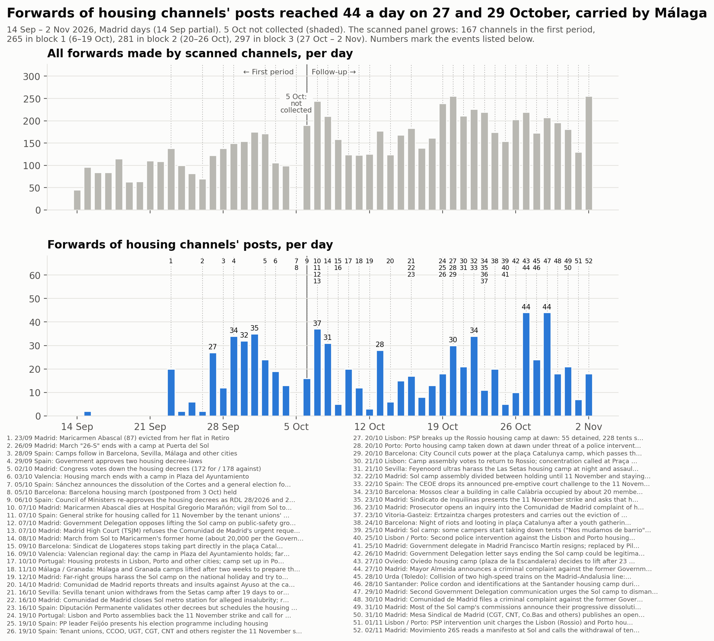
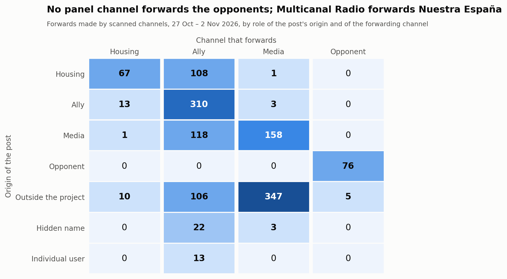
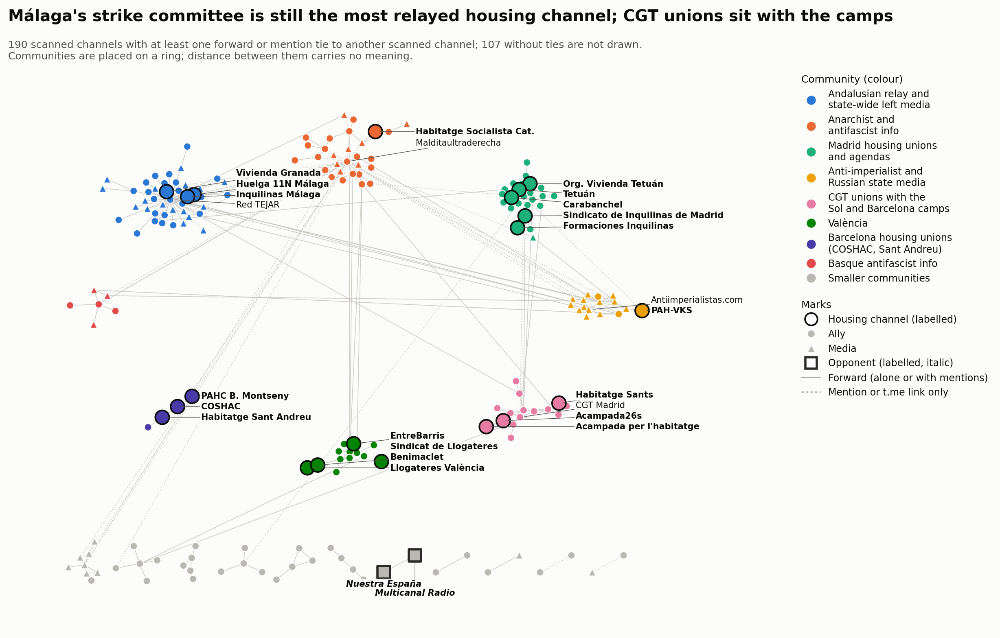

# Bloque 3: del 27 de octubre al 2 de noviembre de 2026

<a href="../followup_block3.html">English</a> · <strong>Español</strong> · <a href="../ca/followup_block3.html">Català</a>

Forma parte del [seguimiento](followup.md) de la movilización por la vivienda en Telegram.
El bloque 3 cubre del 27 de octubre a las 00:00 al 2 de noviembre a las 24:00, hora de
Madrid (2026-10-26T23:00Z a 2026-11-02T23:00Z, todo en horario de invierno).

- **Comparaciones:** con el bloque 2 (20–26 de octubre), que tiene la misma duración, y,
  cuando son comparables, con el bloque 1 (6–19 de octubre) y el primer periodo (14 de
  septiembre – 5 de octubre, el [primer periodo](acampadas_vivienda_technical_report.md)).
- **El hueco del 5 de octubre** sigue sin rellenarse y aparece sombreado en la línea
  temporal.

*Traducción del original en inglés. Las figuras y el registro de revisión están en inglés.*

## 1. Qué pasó en el bloque

Hechos fechados, cada uno con una fuente de prensa salvo que la nota diga otra cosa. En
resumen:

- **27 oct, Oviedo.** La acampada de la plaza de la Escandalera decidió levantarse tras 23
  días para concentrarse en la huelga.
- **27 oct, Madrid.** El alcalde Almeida anunció una querella contra el ex delegado del
  Gobierno por la acampada de Sol. El delegado había dimitido el 25 de octubre; los medios
  no coinciden en si el motivo fue la acampada o su exclusión de las listas del PSOE.
- **28 oct, Urda (Toledo).** Dos trenes de alta velocidad chocaron: 68–69 muertos, tres
  días de luto nacional (29–31 de octubre). La confederación de inquilinas paró sus redes
  sociales ese día, y COSHAC aplazó al 4 de noviembre sus acciones en sedes del PSC.
- **28 oct, Santander.** La policía acordonó la acampada por la vivienda e identificó a
  acampados durante un mitin de Vox (titular de eldiario.es; artículo no abierto).
- **29 oct, Madrid.** Una segunda carta de la Delegación del Gobierno instó a la acampada
  de Sol a desmontarse (titular de elPlural; Wikipedia).
- **30 oct, Madrid.** La Comunidad de Madrid presentó una querella contra el ex delegado
  (titulares).
- **31 oct, Madrid.**
  - La mayoría de las comisiones de la acampada de Sol anunciaron su disolución
    progresiva y su traslado a los barrios. El Español dice «la mayoría»; Wikipedia dice
    «siete de las diez».
  - La Mesa Sindical de Madrid (CGT, CNT, Co.bas y otros) publicó una carta abierta en la
    que advertía a CCOO y UGT de que no convirtieran la huelga en una precampaña
    electoral.
- **1 nov, Lisboa y Oporto.** La policía cargó contra las acampadas a las 04:30. El
  portavoz de la acampada habló de al menos 10 detenidos y seis heridos; la fiscalía se
  negó a validar seis detenciones. Los manifestantes volvieron a las plazas esa misma
  tarde (solo publicaciones de canales).
- **2 nov, Madrid.** Movimiento 26S leyó su manifiesto en Sol y llamó a la retirada de las
  tiendas una «reestructuración interna».

Después del bloque: la policía desalojó la acampada de Sol de madrugada el 3 de
noviembre (bloque 4).

## 2. La muestra

### Panel y revisión

El bloque 3 analizó los 281 canales del panel. Después, una ronda de revisión admitió
**16 de 231 candidatos leídos**:
- 175 canales y grupos del grafo del bloque;
- 53 usuarios no identificados que las páginas públicas de Telegram mostraron como
  canales públicos, y un grupo público;
- 2 grupos encontrados probando nombres de usuario de acampadas y comités citados en las
  publicaciones.

Todas las decisiones, se añadiera o no el canal, están en el [registro de
revisión](../followup_review_log.csv) (bloque 3).

**Admitidos**
- **de vivienda:**
  - Organización Vivienda Tetuán.
  - «DIFUSIÓ ACAMPAR PER HABITAR», el grupo público de la acampada de Mallorca,
    encontrado con la prueba de nombres de usuario.
- **aliados:**
  - UGT Comunicación, coconvocante de la huelga.
  - Barcelona: SAPB-CGT, SEGAP-CGT, Moviments Socials, Ateneu Llibertari de Gràcia.
  - Madrid: Agenda Tetuán, C.S.O. La Enredadera, Centro Social El Ocho, Agua de Mayo.
  - Otros: OMAL; REAS (coconvocante de la huelga de consumo); los comités de huelga
    juveniles de La Safor; la Coordinadora Anarquista Horizontal.
- **medios:** HispanTV, como *informativa*. Ahora tiene tres publicaciones propias sobre
  las protestas de Portugal y los desalojos de acampadas. Tenía dos en los bloques 1 y 2,
  y la regla pide tres.

**No admitidos:** nueve candidatos no se pudieron leer (ocho privados, entre ellos un
canal de la Asamblea de Vivienda de Sevilla y el grupo de la acampada de València).
Ningún candidato era hostil.

**Panel tras el bloque 3 (297 canales), por papel y postura en el bloque 3**

| Papel | de apoyo | crítica desde dentro | informativa | hostil | ninguna | no legible | total |
|---|---|---|---|---|---|---|---|
| vivienda | 21 | 1 | 0 | 0 | 9 | 0 | 31 |
| aliado | 91 | 7 | 0 | 0 | 79 | 0 | 177 |
| medio | 8 | 5 | 20 | 0 | 53 | 1 | 87 |
| opositor | 0 | 0 | 0 | 2 | 0 | 0 | 2 |
| fuera de ámbito | 0 | 0 | 0 | 0 | 0 | 0 | 0 |

### Cambios de postura desde el bloque 2

**Ningún papel cambió.** Los dos opositores volvieron a ser *hostiles*, con indicios más
débiles que en los bloques 1 y 2.
- **Nuestra España.** Sus propios titulares presentan la acampada como costosa y
  protegida, y la huelga como una maniobra:
  - «Lo que hay tras la dimisión del delegado de Gobierno en Madrid: 25M de perjuicio y
    amenaza de demanda de CEIM» (#2187);
  - «Todo sobre el plantón de CCOO y UGT a la CEOE ¿Cancelaron la reunión para convocar
    la huelga del 11-N?» (#2189);
  - «Vídeo: cuando no son en Sol, el Gobierno sí gasea manifestantes» (#2209).
- **Multicanal Radio** reenvía dos de estos titulares.
- **Juicio:** leídos como *informativos*, ambos canales volverían a ser *medios*.

**La crítica desde dentro del movimiento se extiende.** 13 de los 281 canales del panel
tienen postura *crítica desde dentro*, frente a 4 de 265 en el bloque 2 (5 contando los
canales admitidos en el bloque 2). Todos apoyan la huelga y discuten el papel de CCOO y
UGT o el alcance de la huelga:
- **La carta abierta de la Mesa Sindical**, publicada por CGT Madrid y difundida por dos
  canales de la CGT: «UNA HUELGA NO ES UN ACTO DE CAMPAÑA... ¿Es boicot o es desidia?»
- **IzquierdaDiario:** «CCOO y UGT están boicoteando la huelga del 11N: ¿Una huelga
  general activa o un desfile electoral?»
- **Grupo Ruptura:** «los sindicatos verticales vendidos a la patronal (CCOO, UGT y
  demás)... HUELGA SALVAJE E INDEFINIDA».
- **PRT Barcelona:** «superar els límits que imposen les cúpules sindicals».
- **mpr21:** «CCOO y UGT operan para que la huelga del 11 de noviembre sea un fracaso».
- **El sindicato de vivienda de Granada** convoca su propia marcha, «Ni capitalistas, ni
  rentistas, ni cómplices» (#600). Organizaciones de Granada, Zaragoza y Valladolid
  rompieron con CCOO y UGT para la huelga (El Salto Andalucía y Diario Socialista,
  difundidos por canales del panel).
- **También con postura *crítica desde dentro*:** Liza, Diario Socialista, Presos
  Revolucionarios, Revolución Comunista y La Idea.

**Las críticas dirigidas al gobierno siguen siendo *de apoyo*.** La campaña de COSHAC
«aquesta vaga també és contra el PSC» y sus acciones en sedes del PSC son un ejemplo.

**Rotación.** 91 canales cambiaron de postura: 36 pasaron de una postura activa a
*ninguna* y 27 al revés. Las publicaciones del bloque tratan casi todas de construir la
huelga: comités, carteles, talleres, una huelga de consumo cada miércoles hasta el 11N.

### Bajas

Respecto al bloque 2.

- **En silencio:** 29 canales no publicaron nada en el bloque.
  - De vivienda: La PAH, PAH Catalanes, Carabanchel, Cuadernos de trabajo, Les Corts,
    La Saïdia Comuna, València no està en venda.
- **Privado:** El Salto Madrid.
- **Renombrados:** ningún cambio nuevo de nombre de usuario (sigue @airbnbcrepa →
  @lecitta). El canal de la acampada de Sol se titula ahora «Acampada 26S».

## 3. Análisis

### Volumen

**Reenvíos.** Los canales analizados hicieron 1.361 reenvíos en el bloque, sin contar los
reenvíos de sí mismos: **194,4 al día**, frente a 204,6 en el bloque 2.

| Panel | Primer periodo | Bloque 1 | Bloque 2 | Bloque 3 |
|---|---|---|---|---|
| los 167 canales del primer periodo | 111,5 | 114,9 | 138,1 | **126,0** |
| el panel al final del bloque 1 (265) | – | 167,4 | 193,3 | **183,9** |
| el panel al final del bloque 2 (281) | – | – | – | 190,1 |
| todos los canales analizados | – | 167,4 | 204,6 | 194,4 |

Con el mismo panel, los reenvíos bajaron entre un 5 y un 9 % respecto al bloque 2. El
bloque incluye los tres días de luto tras el accidente ferroviario. El día más bajo es el
1 de noviembre (130).

**Reenvíos de publicaciones de canales de vivienda: 176, 25,1 al día** (bloque 2: 18,6).
- Con solo el panel y la lista de canales de vivienda del primer periodo: 21,1 al día
  (bloque 2: 15,9; bloque 1: 11,8; primer periodo: 11,4). Es el valor más alto del
  seguimiento.
- Picos de 44 el 27 y el 29 de octubre.
- **Málaga aporta la mayor parte:** el Comité de Huelga 11N · Málaga suma 128 de los 176,
  reenviados por Inquilinas Málaga (47), La Invisible (44), Red TEJAR (36) y Suburbia
  (1).

**Publicaciones sobre la movilización** (publicaciones que coinciden con los términos de
implicación; todos los canales descargados): 532, **76 al día** (bloque 2: 73).
- Con el panel al final del bloque 2: 474, 68 al día (bloque 2, con su propio panel: 69).
- Por papel: 104 de vivienda, 339 de aliados, 83 de medios, 6 de opositores.
- Por postura: 439 de apoyo, 42 informativas, 34 críticas desde dentro, 6 hostiles, 11
  ninguna (estas últimas son falsos positivos en canales leídos como *ninguna*).
- Picos el 27 de octubre (103) y el 2 de noviembre (101).

**Con y sin los canales admitidos.** Ningún canal admitido hace más del 15 % de los
reenvíos del bloque (el mayor es HispanTV, 8, 0,6 %), y ninguno aporta más de un nodo al
que nada más hace referencia. Sin los 16 canales admitidos: 1.331 reenvíos (190,1 al día)
y 474 publicaciones sobre la movilización.

**Concentración.** Los cinco mayores reenviadores hacen el 46,5 % de todos los reenvíos:

| Canal | Papel | Reenvíos | Parte |
|---|---|---|---|
| Red TEJAR | aliado | 199 | 14,6 % |
| Los Sombreros Blancos | medio | 142 | 10,4 % |
| Antiimperialistas.com (@nullaesrbu) | medio | 122 | 9,0 % |
| Prima Linea | medio | 89 | 6,5 % |
| Multicanal Radio | opositor | 81 | 6,0 % |

(Las partes son sobre los 1.361 reenvíos sin reenvíos de sí mismos, como en el bloque 2.)

### Quién reenvía a quién

Reenvíos, según el papel del canal de origen de la publicación y del canal que la
reenvía; entre paréntesis, el bloque 2.

**Publicaciones de canales de vivienda**
- 108 reenviadas por aliados (89).
- 67 reenviadas por otros canales de vivienda (40).
- 1 reenviada por medios (1).

**Canales de vivienda que reenvían a otros**
- 13 reenvíos de aliados (5).
- 1 de medios (0).
- 10 de canales externos (1).

Los **medios** reenvían sobre todo canales externos: 347 de 512.

**Opositores.**
- Multicanal Radio reenvía a Nuestra España 76 veces, y un canal externo del corazón 5
  veces.
- Ningún canal del panel reenvía ni menciona con @ a un opositor.

### Nodo central, difusores, territorios y acampadas

**El sindicato de Madrid sigue sin ser el nodo central.** Lo reenvían 2 canales
(Difusión urgente dos veces, FETAP una), frente a 1 en el bloque 2 y 10 en el bloque 1.
Es segundo por amplitud, empatado con otros.

**Los más difundidos por amplitud**

| Canal | Canales que lo reenvían | Reenvíos |
|---|---|---|
| Comité de Huelga 11N · Málaga | 4 | 128 |
| COSHAC | 2 | 12 |
| Sindicato de Inquilinas de Madrid | 2 | 3 |
| Acampada 26S (Sol) | 2 | 2 |

19 de los 31 canales de vivienda no los reenvió ningún canal analizado.

**El primer vínculo entre territorios entre canales de vivienda.** El canal de la
acampada de Barcelona publicó un comunicado conjunto de condolencia de «las acampadas
territoriales de todo el Estado» tras el accidente ferroviario, etiquetando a las
acampadas de Sol, València, Granada, Alicante y Barcelona (#271). Esa publicación es el
único vínculo entre canales de vivienda de territorios distintos en los bloques 2 y 3, y
es una mención, no un reenvío. Los cinco vínculos de reenvío quedan dentro de un
territorio:
- Málaga: 47 reenvíos.
- Cataluña: COSHAC → Sant Andreu (7) y → PAHC Baix Montseny (5).
- València: Llogateres → Benimaclet (7).
- Madrid: Formaciones → Sindicato de Inquilinas (1).

**Canales de las acampadas.**
- **Acampada 26S (Sol):** 11 publicaciones (bloque 2: 32), sobre las asambleas, los nodos
  territoriales y el manifiesto del 2 de noviembre. Reenviada dos veces (CGT Zona Sur y
  FETAP difundieron el manifiesto).
- **Acampada per l'habitatge (Barcelona):** 19 publicaciones, no reenviada. Anunció
  «cambios importantes en nuestra estrategia», pidió una mesa de negociación y dijo «no
  vamos a dar un paso atrás NI A DESACAMPAR».
- **Acampar per Habitar (Mallorca):** admitida en este bloque; 73 mensajes, sin vínculos.

### Vínculos que aparecieron y desaparecieron

La comparación abarca los 279 canales del panel analizados en ambos bloques.

| Vínculos entre ellos | Bloque 3 | Bloque 2 |
|---|---|---|
| Total | 242 | 294 |
| Mantenidos | 125 | 125 |
| Nuevos en el bloque 3 | 117 (81 de reenvío, 36 de enlace) | – |
| Desaparecidos desde el bloque 2 | – | 169 (121 de reenvío, 48 de enlace) |

Vínculos nuevos alrededor de los canales de vivienda:
- FETAP reenvía al sindicato de Madrid y el manifiesto de la acampada de Sol.
- CGT Zona Sur reenvía la acampada de Sol.
- Suburbia reenvía a Málaga.
- La acampada de Barcelona menciona a la acampada de Sol.

Vínculos desaparecidos:
- Acampada de Barcelona → PAH Barcelona.
- COSHAC → Sants.
- Acampada de Sol → Difusión urgente.

### Contacto entre los opositores y el resto

Se leyeron todos los eventos que unen a un opositor con un canal que no lo es: 8.
- **5 reenvíos de prensa del corazón:** Multicanal Radio reenvía a @elmarujeo.
- **3 menciones en publicaciones propias de Nuestra España:** el usuario de un
  eurodiputado de Vox, y dos cuentas seudonimizadas (la firma de un autor y una cuenta
  citada).

Como en los bloques 1 y 2, **no hay ningún vínculo de cita hostil**, y los opositores son
una pareja cerrada. Su hostilidad está en sus propias 6 publicaciones sobre la
movilización.

### Comunidades

Grafo combinado de reenvíos y menciones: 190 canales analizados con vínculos, 260
aristas; 107 canales analizados sin vínculos.

**Louvain con 50 semillas**
- Etiquetas de consenso: 19 comunidades, modularidad 0,736 (partición por papel: 0,199).
- Estabilidad: 14 particiones distintas; la más frecuente aparece en el 28 % de las
  ejecuciones.
- Estabilidad media por nodo 0,95; 16 nodos por debajo de 0,8, 3 por debajo de 0,6.
- Es menos estable que el bloque 2 (6 particiones, 50 %).

| # | Nombre | Canales | Miembros de vivienda |
|---|---|---|---|
| 1 | Difusor andaluz y medios de izquierda estatales | 43 | Huelga 11N Málaga, Inquilinas Málaga, Vivienda Granada |
| 2 | Información anarquista y antifascista | 29 | Habitatge Socialista de Catalunya |
| 3 | Sindicatos de vivienda y agendas de Madrid | 24 | Sindicato de Inquilinas de Madrid, Tetuán, Org. Vivienda Tetuán, Carabanchel, Formaciones |
| 4 | Medios antiimperialistas y estatales rusos | 16 | PAH-VKS (por un vínculo, con Sistema 161) |
| 5 | Sindicatos de la CGT con las acampadas de Sol y Barcelona | 15 | Acampada 26S, Acampada per l'habitatge, Habitatge Sants |
| 6 | València | 13 | Llogateres València, EntreBarris, Benimaclet, Sindicat de Llogateres |
| 7 | Canales de movimientos franceses e italianos | 8 | — |
| 8 | Información antifascista vasca | 6 | — |
| 9–19 | Convocatorias de Barcelona; Podemos; CCOO; sindicatos de vivienda de Barcelona (COSHAC, Sant Andreu, PAHC Baix Montseny); Anticapitalistas; Podem València; **opositores** (2); cuatro parejas | 2–5 cada una | — |

**Coincidencia con el bloque 2.** En 152 canales compartidos, el índice de Rand ajustado
es **0,587** (bloque 1 → 2: 0,586). Los grupos territoriales persisten: Málaga con el
difusor andaluz, Madrid, València y los sindicatos de vivienda de Barcelona.

Qué cambió:
- **Las acampadas se unen a los sindicatos de la CGT.** Las acampadas de Sol y Barcelona
  quedan en una misma comunidad con CGT Madrid, CGT Catalunya y CGT Zona Sur, los canales
  que difunden las publicaciones de las acampadas y la carta de la Mesa Sindical.
- **El sindicato de Madrid** está ahora con los sindicatos de Tetuán y Carabanchel y las
  agendas de barrio, no con la acampada de Sol.

**Diseño del mapa.** El anillo muestra las ocho comunidades mayores, salvo que los
sindicatos de vivienda de Barcelona (4 canales) sustituyen a los canales franceses e
italianos (8) para que los canales de vivienda de Barcelona queden bien etiquetados.

## 4. Listas de términos

Se mantuvieron las listas del bloque 2, con once términos de implicación añadidos o
ampliados y uno restringido, y se volvieron a probar las listas.

**Términos añadidos o ampliados**
- **Guiones en direcciones:** «11-de-noviembre» y «huelga-general» en URL.
- **Frases sobre construir la huelga:** «construir / construyendo la huelga general»;
  «huelga general del 11» seguido de un signo de puntuación.
- **La campaña contra el PSC:** «aquesta vaga / esta huelga» cerca de una palabra
  relacionada con la vivienda.
- **Hashtag:** #VagaPerLaVivenda.
- **Protestas:** «protestar / protestan… por la vivienda» (Portugal).
- **El decreto:** «RDL d'habitatge» y «el nou decret» cerca de una palabra relacionada
  con la vivienda.
- **Acampadas:** el plural italiano «acampade», encontrado al leer canales en lenguas
  extranjeras.

**Restringido**
- «comité de huelga» ya no capta los comités de huelga del profesorado y de los médicos.
  Era el falso positivo conocido del bloque 2.

**Pruebas**
- 20 de 22 positivos conocidos coinciden.
- Canales sin relación: 0 coincidencias en TASS, 1 en MT News, que es un verdadero
  positivo sobre Portugal. El canal negativo del bloque 2, Satélite Rojo, publica ahora
  sobre las acampadas portuguesas y se sustituyó.
- Se leyeron 90 publicaciones que solo coincidían por contexto.
- Se leyeron todas las publicaciones que los cambios ganaron (20) o perdieron (3).

**Omisiones aceptadas:** publicaciones que solo dicen «huelga general» o «vaga general»
sin ninguna palabra relacionada con la vivienda. «Huelga general» sola sigue siendo un
término de contexto porque la huelga general de Italia del 30 de octubre y la de Francia
del 5 de noviembre aparecen en los mismos canales.

## 5. Decisiones que podrían haber sido otras

**Postura**
- **Los opositores** son *hostiles* por titulares adversos sin un ataque explícito.
  Leídos como *informativos*, ambos volverían a ser *medios*.
- **La regla de la postura *crítica desde dentro*** se hace explícita en este bloque: la
  crítica es la posición propia del canal o la mayoría de sus publicaciones. Los canales
  que difunden críticas ajenas entre publicaciones de apoyo siguen siendo *de apoyo* (Red
  TEJAR, Malditaultraderecha, FETAP).
- **El sindicato de vivienda de Tetuán** *de apoyo*; podría ser *crítica desde dentro*.
- **Diario Socialista y mpr21** *crítica desde dentro* por titulares de noticias; podrían
  ser *informativa*.
- **Presos Revolucionarios** *crítica desde dentro*, aunque llama a la huelga «un
  montaje»; podría leerse como hostil.
- **USTEA** *de apoyo* por su huelga educativa del 11 de noviembre; podría ser *ninguna*.
- **elPlural** *informativa*, solo por titulares; era *de apoyo* en los bloques 1 y 2.
- **La Directa y Regeneración** *de apoyo* con pocos indicios.

**Revisión**
- **El grupo de la acampada de Mallorca** admitido como canal *de vivienda*, aunque sus
  publicaciones son mensajes de miembros.
- **Moviments Socials** admitido como canal de agenda; podría ser un agregador.
- **HispanTV y el ámbito de la movilización:** HispanTV se admitió porque las acampadas y
  protestas de Portugal cuentan; las de Italia, no.
- **SAPB-CGT** admitido por enlaces a convocatorias de su propio sindicato; se había
  rechazado en el bloque 2.
- **Minas Não** rechazado: organizó charlas en la acampada de Oporto.

**Análisis y figuras**
- **Referencias:** la referencia es el bloque 2. Las comparaciones con el mismo panel
  reproducen las medias publicadas del bloque 2.
- **Anillo del mapa:** los sindicatos de vivienda de Barcelona sustituyen en el anillo a
  una comunidad mayor.

## 6. Qué no se verificó

**Contexto**
- **Lisboa y Oporto, 1 de noviembre:** las cifras de detenidos y heridos (organizadores
  frente a fiscalía; no hay cifra policial).
- **Madrid:** la carta del 29 de octubre y la querella del 30 de octubre se basan en
  titulares y en Wikipedia. La proporción de comisiones («la mayoría» o «siete de diez»)
  está en disputa.
- **Santander, 28 de octubre:** el cordón policial se basa en un titular.

**Contenido no leído**
- **Imágenes y vídeos:** no se leyeron. Entre ellos, las imágenes de las «5 claves» de
  Granada y el manifiesto de Sol, publicado como imagen o vídeo.
- **Enlaces:** no se siguieron los artículos enlazados.
- **Candidatos a revisión sin palabras clave:** solo el inicio de sus primeras ocho
  publicaciones.

**Canales y cuentas no alcanzados**
- **Canales privados:** nueve candidatos son privados (entre ellos un canal de la
  Asamblea de Vivienda de Sevilla, el grupo de la acampada de València y las Feministes
  de Gràcia); El Salto Madrid, del panel, también es privado.
- **Búsqueda por hashtags:** ninguna en este bloque.

**No comprobado**
- **Mapas de la red:** su disposición varía ligeramente entre una generación y otra.

---

Un estudio de [DataPolitik](https://www.heuristica.barcelona/datapolitik/), de [Heurística](https://www.heuristica.barcelona/). · [Inicio](index.md) · [Presentación del seguimiento](followup.md)
