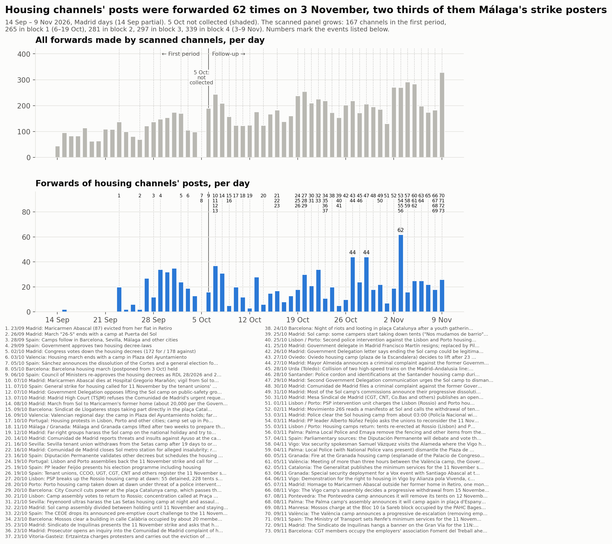
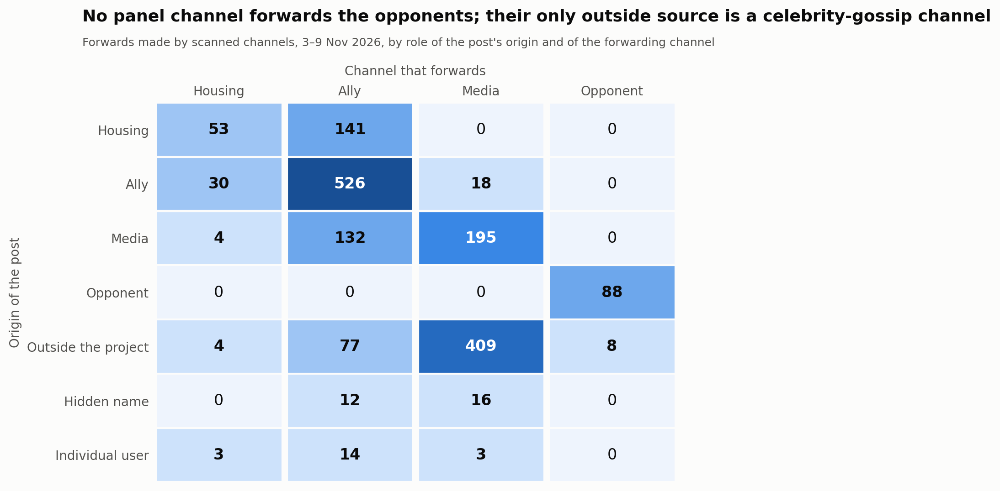
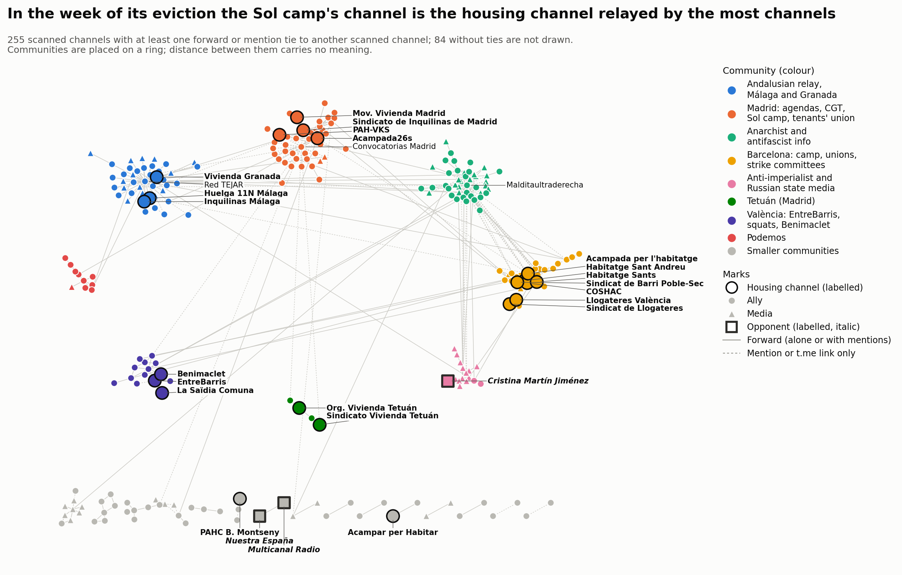

# Bloque 4: del 3 al 9 de noviembre de 2026

<a href="../followup_block4.html">English</a> · <strong>Español</strong> · <a href="../ca/followup_block4.html">Català</a>

Forma parte del [seguimiento](followup.md) de la movilización por la vivienda en Telegram.
El bloque 4 cubre del 3 de noviembre a las 00:00 al 9 de noviembre a las 24:00, hora de
Madrid (2026-11-02T23:00Z a 2026-11-09T23:00Z, todo en horario de invierno). Es la semana
anterior a la huelga general del 11 de noviembre.

- **Comparaciones:** con el bloque 3 (27 de octubre – 2 de noviembre), de la misma
  duración. Cuando son comparables, también con el [primer
  periodo](acampadas_vivienda_technical_report.md) (14 de septiembre – 5 de octubre).
- **El hueco del 5 de octubre** sigue sin rellenarse y aparece sombreado en la línea
  temporal.
- **Dos ejecuciones:** una primera ejecución, el 7 de noviembre, cubrió del 3 al 6 de
  noviembre. El 10 de noviembre el bloque se amplió hasta su final natural, el 9 de
  noviembre, y todos los pasos se repitieron sobre la semana completa. El bloque 5 va del
  10 al 16 de noviembre, la semana de la huelga.
- **Momento de la recogida:** el bloque terminó 2 horas y 38 minutos antes de las
  descargas y del análisis. No se incluyen las publicaciones ni las ediciones posteriores.

*Traducción del original en inglés. Las figuras y el registro de revisión están en inglés.*

## 1. Qué pasó en el bloque

Hechos fechados, cada uno con una fuente de prensa salvo que la nota diga otra cosa. En
resumen:

**Las acampadas**
- **3 nov, Madrid.** Desde las 03:00 aproximadamente, la Policía Nacional y la Policía
  Municipal desalojaron la acampada de Sol; dos personas fueron detenidas.
  - Tamaño: unas 300 personas dormían allí (fuentes policiales citadas por EFE), o más de
    330 desalojadas (Delegación del Gobierno).
  - Violencia: la Delegación afirma que la operación se hizo «sin violencia». Acampada 26S
    denuncia golpes, gas pimienta y personas heridas.
  - Esa misma tarde hubo una marcha de Sol a Cibeles y una sentada en Sol (canal de la
    acampada).
- **3–6 nov, Palma.**
  - 3 nov: el ayuntamiento retiró el vallado de la acampada.
  - 4 nov, por la tarde: la Policía Local desmontó la acampada (solo el grupo de la
    acampada y titulares compartidos).
  - 8 nov: la asamblea anunció que volverá a acampar después de la marcha del 11N (Última
    Hora).
- **3 nov, Lisboa y Oporto.** Las tiendas volvieron a montarse tras una resolución de un
  tribunal administrativo.
- **4–9 nov, Barcelona.** La acampada dijo que el ayuntamiento le había cortado la
  electricidad y que se queda: «Ens deixeu sense llum, però no sense lluita» (solo
  publicaciones del canal).
- **5 nov, Granada.** Un incendio en la acampada («al parecer provocado») y un ataque con
  palos (Europa Press). El 6 de noviembre se fijó un dispositivo de seguridad para un acto
  de Vox con Abascal junto a la acampada.
- **5 y 9 nov, València.** La acampada se reunió durante más de tres horas con la
  Delegación y el ayuntamiento. El 9 de noviembre anunció una desescalada progresiva, «No
  nos vamos». Ese día se celebró la reunión técnica entre la Delegación y el ayuntamiento;
  no se encontró ninguna información de prensa sobre su resultado.
- **8 nov, Vigo y Pontevedra.** Las dos acampadas decidieron retirarse después de la
  huelga: Vigo de forma progresiva desde el 15 de noviembre, Pontevedra el 12 de
  noviembre (EFE).
- **9 nov.** Las acampadas publicaron un manifiesto conjunto, difundido por el canal de la
  acampada de Barcelona con Sevilla, Granada y València (solo publicaciones de canales).

**La huelga y el movimiento por la vivienda**
- **3 nov.** El líder del PP, Feijóo, pidió a los sindicatos que reconsideraran la huelga.
- **4 nov.** Los dos decretos de vivienda irán a la Diputación Permanente el 12 de
  noviembre.
- **5 y 9 nov.** Se fijaron servicios mínimos: Cataluña y, después, Renfe (75 % de
  Cercanías en horas punta).
- **7 nov, Madrid.** Se celebró un homenaje a Maricarmen Abascal ante su antigua casa, un
  mes después de su muerte.
- **8 nov, Manresa.** Los Mossos cargaron en el Bloc 10, un edificio de la Sareb ocupado
  por la PAHC Bages el 7 de noviembre. El desalojo se detuvo cuando la Sareb aceptó ceder
  el edificio.
- **9 nov, Barcelona.** La CGT ocupó la patronal Foment del Treball.
- **9 nov, Madrid.** El sindicato de inquilinas colgó una pancarta en la Gran Vía (solo
  titular).
- **Vox y Granada:**
  - 4 nov: el portavoz de seguridad de Vox visitó la acampada de Vigo.
  - 6 nov: el acto de Abascal en Granada.

## 2. La muestra

### Panel y revisión

- **Panel:** 325 canales al inicio de la ampliación (297 al inicio del bloque, más 28
  admitidos el 3–6 de noviembre), analizados y descargados durante toda la semana.
- **No legibles:**
  - @elsaltomadrid (privado desde el bloque 1).
  - @mitxisantifascistas: se volvió privado entre el 6 y el 10 de noviembre. No publicó
    nada el 3–6 de noviembre; sus publicaciones del 7–9 de noviembre no se pueden leer.
- **Publicaciones:** 16.064 en el bloque.

La revisión se hizo dos veces:
- **Ejecución del 3–6 de noviembre:** 184 candidatos, **28 admitidos**.
- **Ejecución de la semana completa:** 229 candidatos, **14 admitidos**.
  - 7 no legibles; 5 ya estaban admitidos.
  - Una búsqueda de copias locales de canales conocidos (38 nombres) encontró un
    resultado, el centro de medios de la huelga de Mallorca @centredemitjans (30
    suscriptores). Su vista previa pública, leída a mano, muestra dos publicaciones del 5
    de noviembre sin texto, así que no se añadió.
- **Registro:** todas las decisiones de las dos ejecuciones, se añadiera o no el canal,
  están en el [registro de revisión](../followup_review_log.csv) (bloque 4, rondas
  *review* y *extension*).

El panel tiene ahora **339 canales**: 31 de vivienda, 211 aliados, 94 medios y 3
opositores.

Admitidos en la ronda de la semana completa:
- **aliados (11):**
  - Regularización Ya; Samidoun Barcelona; IAC (sindicato).
  - Ateneo La Maliciosa; AV La Unión de Hortaleza.
  - Asamblea Libertaria de Lorca; Quejío Andalú; Bizkaia E28 Koordinadora.
  - Teixint Patraix y Camins al Grau i Algirós (asambleas de barrio y comités de huelga de
    València); una agenda de carteles de Sevilla.
- **medios (2):** RadioTopo (de apoyo); RUSSPAIN, *informativa*, de la red de
  @rusmadrid.
- **opositor (1):** **Cristina Martín Jiménez**, el canal de una persona (una autora). El 9
  de noviembre se burló de la ministra de Trabajo por apoyar «una huelga general contra la
  cartera ministerial que ella misma ostenta... Si no existiera habría que inventarla».
  Juicio: podría leerse como dirigido solo a la ministra.

Cuatro de los 14 se habían rechazado el 3–6 de noviembre porque aún no habían publicado
sobre la movilización (IAC, Samidoun, Regularización Ya, La Maliciosa).

**Regla del 15 % y de los diez candidatos:** no se activó.
- El mayor reenviador admitido hace 13 reenvíos, el 0,8 % de 1.733 (Teixint Patraix).
- Como mucho, 7 nodos están referenciados solo por un canal admitido (RUSSPAIN).
- @rusmadrid hace 86 eventos de enlace (el 6,9 % de los enlaces), sobre todo a sus canales
  hermanos.

### Postura del panel

339 canales (los 14 canales admitidos en la ejecución de la semana completa llevan la
postura de su revisión):

| Papel | de apoyo | crítica desde dentro | informativa | hostil | ninguna | no legible |
|---|---|---|---|---|---|---|
| vivienda (31) | 19 | 1 | 0 | 0 | 11 | 0 |
| aliado (211) | 159 | 4 | 1 | 0 | 47 | 0 |
| medio (94) | 23 | 3 | 35 | 0 | 32 | 1 |
| opositor (3) | 0 | 0 | 0 | 3 | 0 | 0 |

- **Papeles:** ningún canal cambió de papel.
- **Cambios de postura:** 104 canales cambiaron de postura desde el bloque 3. 70 pasaron
  de *ninguna* a una postura activa; 19 al revés.
- **Los últimos días antes de la huelga** sumaron muchos canales que habían estado en
  silencio el 3–6 de noviembre: CNT Madrid, CA-AIT, grupos gallegos, andaluces y vascos,
  canales de Podemos, medios de movimientos italianos y franceses.
- **Opositores (3).**
  - Nuestra España: el desalojo de Sol; la «doble vara de medir con los desalojos» de
    Jupol; «las armas de Sol»; «CCOO enfría la huelga general» (9 nov).
  - Multicanal Radio: reenvía esas publicaciones y titula su propio vídeo «¿EN QUE
    MARISQUERIA ES LA HUELGA?» (9 nov).
  - La nueva opositora individual, arriba.
  - Los indicios son encuadres adversos y burla, no ataques explícitos.
- ***Crítica desde dentro* (8):**
  - El sindicato de vivienda de Granada.
  - Izquierda Diario y Liza: el bloque por la independencia de clase, «Las direcciones de
    CCOO y UGT quieren convertir la huelga en un acto de campaña».
  - CA-AIT Marina Alta; Bultza («11N pantomima general»); Malditaultraderecha.
  - DiarioOctubre («CCOO y UGT operan para que la huelga... sea un fracaso»).
  - Insurgente («UGT se pone muy nerviosa ante la posibilidad de que la Huelga General sea
    contra el gobierno»).
  - Todos apoyan la huelga y discuten el papel de CCOO y UGT.
- **Casos mantenidos como *informativos*:**
  - Un canal de noticias de Madrid (@cuidadmadrid) recoge la «acampada ilegal» de la
    Comunidad.
  - Un bot (@roto2botfc) republica publicaciones de X que amenazan a los piquetes
    («pueden salir escaldados»). Son publicaciones de otras personas, no la posición
    propia del bot.

### Bajas y nombres

- **En silencio:** 19 canales no publicaron nada en la semana, 9 de ellos de vivienda: La
  PAH, PAH Catalanes, La Saïdia Comuna, Carabanchel, Cuadernos de trabajo, Formaciones
  Inquilinas, Les Corts, Sindicat d'Habitatge Socialista, València no està en venda.
  Contando @mitxisantifascistas, que se volvió privado, son 20.
- **Privados:** @elsaltomadrid, @mitxisantifascistas.
- **Cambios de nombre:**
  - «Málaga para Vivir» → «Comité de Huelga 11N • Málaga».
  - «Acampada26s» → «Acampada 26S».
  - Kontrainfo Antifa añade «/ FAK!».
  - @airbnbcrepa → @lecitta.

## 3. Análisis

### Volumen

| Al día | Bloque 3 | Bloque 4 |
|---|---|---|
| Reenvíos hechos por los canales analizados (sin autorreenvíos) | 194,4 | **247,6** |
| Lo mismo, panel al final del bloque 2 (281 canales) | 190,1 | 228,9 |
| Lo mismo, los 167 canales del primer periodo | 126,0 | 143,0 |
| Reenvíos de publicaciones de canales de vivienda | 25,1 | 27,7 |
| Lo mismo, los 167 canales del primer periodo | 21,1 | 20,9 |
| Publicaciones sobre la movilización (términos de participación) | 76,0 | 166,1 |

- **Reenvíos:** con paneles iguales, subieron una quinta parte respecto al bloque 3. Los
  reenvíos de publicaciones de canales de vivienda apenas se movieron: 20,9 al día en los
  canales del primer periodo, frente a 21,1. La subida la llevan los canales aliados y
  los medios, no los canales de vivienda.
- **Picos:**
  - Publicaciones de vivienda: **62 reenvíos el 3 de noviembre**. El comité de huelga de
    Málaga suma 41 (álbumes de carteles); la acampada de Sol 8, COSHAC 7 y la acampada de
    Barcelona 3.
  - Todos los reenvíos: **329 el 9 de noviembre**, dos días antes de la huelga.
- **Publicaciones sobre la movilización:**
  - Por día: 200 el 3 de noviembre, 159–171 el 4–6, 95 el 7 (sábado), 120 el 8 y **253 el
    9 de noviembre**.
  - En total: 1.163, frente a 532 en el bloque 3; 1.034 sin los canales añadidos en este
    bloque.
  - Por papel: vivienda 153, aliados 808, medios 194, opositores 8.
  - Por postura: de apoyo 1.011, crítica desde dentro 48, informativa 93, hostil 8.
  - La lista de términos cambió (apartado 4), así que el recuento no es estrictamente
    comparable.
- **Mayores reenviadores:** Red TEJAR (197, 11,4 %), Prima Linea (151), Los Sombreros
  Blancos (146), ANTIIMPERIALISTAS.COM (140) y Multicanal Radio (96). Los cinco primeros
  hacen el 42,1 % (46,5 % en el bloque 3).

### Quién reenvía a quién

| Reenvío (origen → reenviador) | Bloque 3 | Bloque 4 |
|---|---|---|
| vivienda → vivienda | 67 | 53 |
| vivienda → aliado | 108 | 141 |
| aliado → vivienda | 13 | 30 |
| aliado → aliado | 310 | 526 |
| medio → aliado | 118 | 132 |
| fuera del panel → medio | 347 | 409 |
| opositor → opositor | 76 | 88 |
| fuera → opositor | 5 | 8 |

- **Bloques de la misma duración:** los totales se comparan directamente.
- **Aliado → aliado** creció un 70 %.
- **Los canales de vivienda** se reenviaron menos entre sí (67 → 53) y reenviaron a
  aliados más del doble de veces (13 → 30).
- **Opositores:** ningún canal del panel los reenvía, y ellos no reenvían a ningún canal
  del panel.

### Nodo central, difusores, territorios y acampadas

- **Difundido por más canales:** el **canal de la acampada de Sol**: reenviado por 7
  canales, 9 veces, 8 de ellas el día del desalojo (bloque 3: 2 y 2).
- **El sindicato de inquilinas de Madrid:** segundo por amplitud, reenviado por 5
  canales, 13 veces (bloque 3: 2 y 3), sobre todo por CGT Madrid y su zona sur y por
  Noticias FETAP. Su canal no publicó nada sobre el desalojo.
- **El canal de vivienda más reenviado:** el comité de huelga de Málaga, 132 reenvíos por
  4 canales (bloque 3: 128 por 4).
- **Otras acampadas:**
  - La acampada de Barcelona fue reenviada por 3 canales (ninguno en el bloque 3).
  - El grupo de Mallorca hizo 8 reenvíos y nadie lo reenvió.
- **Difusores:** 17 de los 31 canales de vivienda no fueron difundidos por ningún canal
  analizado.
- **Territorios:** diez vínculos entre canales de vivienda; dos cruzan territorios. El
  Sindicat de Llogateres (Barcelona) reenvía a Llogateres València, y la acampada de Sol
  enlaza la de Barcelona. Los grupos territoriales siguen sin reenviarse entre sí.

### Vínculos que aparecieron y desaparecieron

Hay 295 canales del panel analizados en los dos bloques:

- **mantenidos:** 145 vínculos;
- **nuevos:** 204 (141 de reenvío, 63 de enlace);
- **desaparecidos:** 122 (91 de reenvío, 31 de enlace).

El bloque tiene más vínculos que el bloque 3 (349 frente a 267).

### Contacto entre los opositores y el resto

Se leyeron todos los vínculos:
- Multicanal Radio reenvía 8 veces un canal de cotilleo de famosos (@elmarujeo).
- MT News enlaza dos veces a la nueva opositora, a su programa de tecnología en RT. Esas
  publicaciones no tratan de la movilización; no son ni difusión de ella ni citas hostiles.
- La nueva opositora enlaza 6 veces el canal de RT.
- **No hay contacto sobre la movilización** entre los opositores y el resto.

### Comunidades

- **Grafo combinado:** 255 nodos y 402 aristas; 84 canales analizados no tienen vínculos.
- **Partición:** consenso de 50 ejecuciones de Louvain, 23 comunidades, modularidad 0,744
  (0,163 por papel).
- **Estabilidad:** 11 particiones distintas; la más frecuente aparece en el 28 %. La
  estabilidad media de los nodos es 0,97; 7 nodos quedan por debajo de 0,8.
- **Coincidencia con el bloque 3:** índice de Rand ajustado **0,403** en 168 canales
  compartidos; 22 canales están solo en el bloque 3 y 87 solo en el bloque 4. El bloque 3
  tenía 0,587 con el bloque 2.
- **Qué cambia:** el panel creció, y muchos canales que estaban en silencio en el bloque 3
  ahora reenvían.

Las ocho comunidades mayores, con los nombres usados en la figura:

1. Información anarquista y antifascista, incluida la vasca (43).
2. Madrid: agendas, CGT, la acampada de Sol y el sindicato de inquilinas (43). Los dos
   grupos de Madrid del bloque 3 se fusionaron.
3. Difusor andaluz, Málaga y Granada (42).
4. Barcelona: la acampada, los sindicatos de vivienda y los comités de huelga (33).
5. Medios antiimperialistas y estatales rusos (16), con la nueva opositora.
6. València: EntreBarris, okupas, Benimaclet (14).
7. Podemos (10).
8. Los dos grupos de vivienda de Tetuán con su agenda y La Enredadera (4).

Aparte: los canales de CCOO forman su propio grupo (6), y también la red de noticias de
Madrid (5).

## 4. Listas de términos

La lista del bloque 4 añade:

- el desalojo de Sol nombrado sin una palabra de acampada;
- las protestas de Portugal («manifestantes por… la vivienda»);
- «el día/dia 11»;
- «hacia / cap a la huelga/vaga general»;
- «huelga general de clase»;
- el vasco «#Az11…»;
- «huelga general 11NOV»;
- añadidos con la ampliación: el francés y el italiano «grève générale / sciopero generale
  du/dell' 11 nov».

Las pruebas:

- **Positivos conocidos:** coinciden 16 de 18.
- **Canales ajenos:** ningún falso positivo.
- **Coincidencias nuevas:** se leyeron todas las publicaciones ganadas (24 en la primera
  ejecución, 5 en la ampliación).
- **Sigue siendo un falso positivo:** el «comité de huelga mixto» de la huelga educativa
  de Madrid.
- **Omisiones aceptadas:** «huelga general» sola (las huelgas de Francia llenan el
  bloque); publicaciones cortas sin palabra de huelga, como «¡ESTO ES SOLO EL PRINCIPIO!»
  de Liza.

Recuentos: 16.064 publicaciones; **1.163 coinciden con un término de participación** (910
publicaciones propias y 253 reenvíos, en 239 canales); 412 solo de contexto.

## 5. Decisiones que podrían haber sido otras

- **Fechas del bloque:** primero del 3 al 6 de noviembre, después la semana completa.
- **Opositores:**
  - Nuestra España y Multicanal Radio se mantienen como *hostiles* por encuadre y burla.
  - Cristina Martín Jiménez admitida como opositora por una publicación que se burla de
    la ministra.
- ***Crítica desde dentro*:** Bultza (podría ser hostil); Malditaultraderecha por un
  comentario; Insurgente y DiarioOctubre por titulares.
- ***Informativa*:**
  - Diario Socialista, por titulares.
  - @cuidadmadrid, que recoge la «acampada ilegal».
  - El bot @roto2botfc, que republica una amenaza a los piquetes.
  - Global Project e InfoAut, a pesar de un encuadre favorable.
- ***De apoyo* con indicios escasos:** ExWorkers, TodoAlTrece, CTXT, Supernova, CSOA CSN,
  Glob4lRevolution (la ocupación de Manresa), RadioTopo.
- **Admisiones:**
  - Primera ejecución: El Ojo Noticias y Osservatorio Repressione por una noticia cada
    uno; los canales de la red de noticias de Madrid, no rechazados como agregadores.
  - Comités de huelga y asambleas de barrio con el papel *aliado*, no de vivienda.
    Teixint Patraix podría ser de vivienda como asamblea de vivienda.
- **Rechazos:** el grupo de carteles MovimentsSocials; el chat de Malditaultraderecha;
  Rural foro (un grupo que republica una invitación de octubre a la acampada de Granada).
- **Contar las acampadas de Portugal** y el Bloc 10 de Manresa como parte de la
  movilización.

## 6. Qué no se verificó

- **Momento de la recogida:** faltan las publicaciones posteriores a las descargas (10 de
  noviembre, 01:38–02:20 UTC) y las ediciones posteriores. Los reenvíos tardíos de
  publicaciones del bloque 4 aparecerán en el análisis del bloque 5.
- **Contexto sin un artículo de prensa leído completo:**
  - El desmontaje de la acampada de Palma (4 de noviembre).
  - El corte de luz en Barcelona y la mesa de negociación.
  - El manifiesto conjunto de las acampadas.
  - El resultado de la reunión del 9 de noviembre en València.
  - La pancarta de la Gran Vía y las declaraciones de Ayuso y de un portavoz del PP (solo
    titulares).
- **Profundidad de lectura:**
  - **3–6 nov:** unas dos terceras partes de los canales con publicaciones coincidentes
    se leyeron hasta 700 caracteres por publicación, salvo que una publicación tuviera
    palabras de crítica. Los canales con 1–29 publicaciones no coincidentes se leyeron
    desde el comienzo de cada publicación.
  - **7–9 nov, canales ya activos el 3–6 de noviembre:** solo se leyeron completas las
    publicaciones con palabras de crítica u hostiles. Un cambio de postura expresado con
    otras palabras pasaría desapercibido.
  - **7–9 nov, todos los demás:** los canales de vivienda se leyeron completos, y todas
    las publicaciones coincidentes de los canales que estaban en *ninguna*.
  - **Enlaces:** no se abrieron las publicaciones que solo son enlaces a X.
- **Mapa de la red:** la disposición no es idéntica entre representaciones. Algunas
  líneas guía pasan cerca de etiquetas vecinas; ningún texto se superpone.
- **Paleta:** como en los bloques 1–3. Los pares adyacentes pasan la prueba. Todos los
  pares fallan para verde/naranja (lectores con daltonismo) y rojo/naranja (visión
  normal). Esos pares están separados en el anillo, y la leyenda los nombra.
- **No comprobado:** si los canales en silencio están inactivos o han sido eliminados.

**Cómo citar esta página.**

DataPolitik (Heurística). <em>Bloque 4: del 3 al 9 de noviembre de 2026</em>. En <em>Acampadas por la vivienda y redes de comunicación en Telegram en España, otoño de 2026</em>. Periodo de observación: 3–9 de noviembre de 2026. Publicado el 10 de noviembre de 2026. <a href="https://datapolitik.github.io/acampadas-vivienda-report/es/followup_block4.html">https://datapolitik.github.io/acampadas-vivienda-report/es/followup_block4.html</a>

Texto y figuras originales: [CC BY 4.0](https://creativecommons.org/licenses/by/4.0/) · [Uso y citación](index.md#use-and-citation)

---

Un estudio de [DataPolitik](https://www.heuristica.barcelona/datapolitik/), de [Heurística](https://www.heuristica.barcelona/). · [Inicio](index.md) · [Presentación del seguimiento](followup.md)
