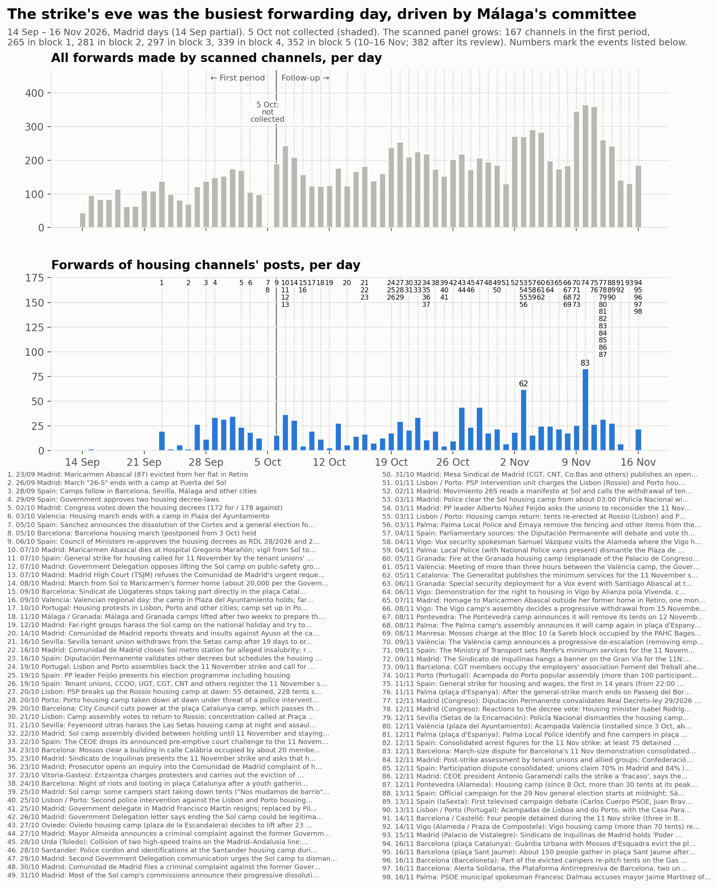
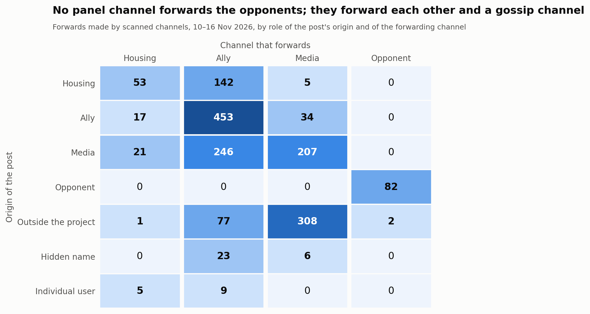
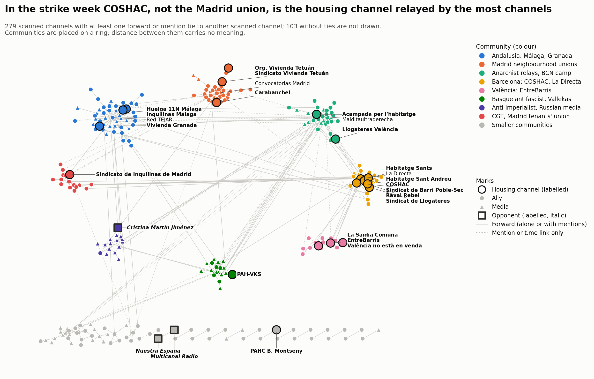
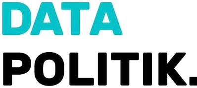

# Bloque 5: del 10 al 16 de noviembre de 2026

<a href="../followup_block5.html">English</a> · <strong>Español</strong> · <a href="../ca/followup_block5.html">Català</a>

Forma parte del [seguimiento](followup.md) de la movilización por la vivienda en Telegram.
El bloque 5 cubre del 10 de noviembre a las 00:00 al 16 de noviembre a las 24:00, hora de
Madrid (2026-11-09T23:00Z a 2026-11-16T23:00Z). Es la semana de la huelga general del 11 de
noviembre y el último bloque del seguimiento.

- **El día de la huelga** (del 10 nov a las 22:00 al 12 nov a las 03:00) se analizó por
  separado, hora a hora, en el [informe del día de la huelga](followup_strike_day.md). Esta
  página no lo repite. Cubre el bloque en su conjunto, día de la huelga incluido, y los días
  posteriores.
- **Comparaciones:** con el [bloque 4](followup_block4.md) (3–9 de noviembre), de la misma
  duración. Cuando son comparables, también con el [primer
  periodo](acampadas_vivienda_technical_report.md) (14 de septiembre – 5 de octubre).
- **El hueco del 5 de octubre** sigue sin rellenarse y aparece sombreado en la línea
  temporal.
- **Momento de la recogida:** recogido el 19 de noviembre, 2 días y medio después del final
  del bloque, con un día completo de margen. Las publicaciones borradas o editadas antes de
  la recogida aparecen como estaban entonces.

*Traducción del original en inglés. Las figuras y el registro de revisión están en inglés.*

## 1. Qué pasó en el bloque

Hechos fechados, cada uno con una fuente de prensa y una nota sobre cómo se confirmó. Los
hechos con hora del día de la huelga están en el [informe del día de la
huelga](followup_strike_day.md).

**La huelga (11 nov).** Las cifras consolidadas publicadas después no coinciden:
- **Detenciones:** al menos 75 detenidos y 1.044 incidentes (Demócrata, 12 nov); 39 por la
  Policía Nacional y la Guardia Civil (Interior); 52 por los Mossos en Barcelona; 16 por la
  Ertzaintza. Los totales no cuadran entre fuentes.
- **Manifestación de Barcelona:** unas 57.000 personas (Mossos), más de 50.000 (Collboni),
  unas 40.000 (Guàrdia Urbana), 400.000 (organizadores).
- **Manifestación de Madrid:** 120.000 (Delegación del Gobierno) frente a 400.000, 600.000
  o 750.000 según los organizadores, dependiendo del medio.
- **Seguimiento:** los sindicatos hablan del 70 % en Madrid y del 84 % en Cataluña. CEOE y
  Cepyme lo califican de «fracaso» (por debajo del 5 %), y Garamendi expresa «apoyo
  explícito» a la policía.

**Las acampadas se desmontan**
- **12 nov, Sevilla.** La Policía Nacional desmanteló de madrugada la acampada de las Setas,
  horas después de la huelga (El Salto).
- **12 nov, València.** La acampada retiró sus tiendas después de 40 días, alegando que de lo
  contrario la policía la desalojaría. La Delegación niega haber dado un plazo.
- **12–13 nov, Pontevedra.** La acampada retiró sus tiendas, como había anunciado.
- **11–16 nov, Palma.** La acampada volvió a montarse en la plaça d'Espanya después de la
  marcha (11 nov) y sus acampados fueron multados (12 nov). Mensajes del grupo de Telegram
  de la acampada hablaban de desacampar el 15 nov; ninguna información de prensa lo
  confirma. El 16 nov el PSOE acusó al alcalde de presionar a la policía.
- **14–15 nov, Vigo.** La acampada confirmó que se retiraría de forma progresiva desde el
  15 nov; ninguna fuente confirma que lo hiciera.
- **16 nov, Barcelona.** La Guàrdia Urbana y los Mossos desalojaron la acampada de la plaça
  Catalunya después de 47 días. Las cifras difieren: unos 465 agentes, 295 personas, 80
  identificadas, 0 o 3 detenciones. Unas 150 personas se concentraron en la plaça Sant
  Jaume, donde 5 o 6 iniciaron una huelga de hambre. Parte de los acampados volvió a acampar
  en la Barceloneta.
- **No se encontró:** nada sobre Sol después del 11 nov, ni sobre las acampadas de Granada,
  Málaga, Bilbao o Zaragoza.

**Decretos, elecciones, represión**
- **12 nov.** La Diputación Permanente convalidó el RDL 29/2026, el «decreto Maricarmen»
  (35–34), y rechazó el RDL 28/2026 sobre la prórroga automática de los alquileres, con el
  voto en contra del PNV.
- **13 nov.** Empezó la campaña electoral. Feijóo prometió derogar la ley de vivienda y
  aprobar una ley «antiocupas». La vivienda fue uno de los temas del primer debate
  televisado.
- **14 nov.** Cuatro personas detenidas durante la huelga ingresaron en prisión provisional:
  tres en Barcelona (miembros del comité de huelga de Sant Martí y del sindicato de vivienda
  de la Verneda, según COSHAC) y una en Castelló. Siguieron marchas de solidaridad el
  14–16 nov.
- **15 nov, Madrid.** El Sindicato de Inquilinas celebró su acto de Vistalegre (unas 8.000
  personas): «votar puede ser necesario pero no es suficiente». Convocó protestas europeas
  para el 20–22 nov y dijo que no formará un partido.
- **No se encontró:** ninguna nueva huelga general, indefinida o de alquileres convocada
  para una fecha; ninguna valoración de la huelga por parte del Gobierno.

## 2. La muestra

### Panel y revisión

- **Panel:** 352 canales, incluidos los 13 admitidos en la revisión del día de la huelga.
- **Descargas:** 347 descargados. Cinco son privados:
  - @elsaltomadrid, @mitxisantifascistas y Fullblack161, como antes;
  - nuevos en este bloque: @palestina_sos_bcn y el comité de huelga de La Marina Alta.
- **Publicaciones:** 15.509 en el bloque (16.667 con los canales admitidos abajo).
- **Ronda de revisión:** 204 candidatos, 3 excluidos por estar referenciados solo por
  opositores (RT, el canal de Abascal, un canal de cotilleo). Una búsqueda de 40 nombres de
  copias de acampadas, comités posteriores a la huelga y canales de la huelga de hambre no
  encontró nada. **30 admitidos**:
  - **vivienda (1):** Raval Rebel Difusió, la asamblea de vivienda del Raval (Barcelona).
  - **aliados (16):** CCOO Educación Madrid (convocante: CCOO), CGT Castelló (convocante:
    CGT), los pensionistas de COESPE, PCPE, CNT Gijón, Salamanca Antinuclear, Ecologistes en
    Acció, L'Alzina, Barris Sants, el casal Octubre, Antirepressiva de Ponent, IU Parla,
    Karmela, Ongi Etorri Errefuxiatuak, Local Anarquista Magdalena, Espacio La Atenea. Todos
    de apoyo.
  - **medios (13):** siete de apoyo (Carne Cruda, Contre Attaque, Radio Monotes, Irola
    Irratia, Deialdiak Nafarroa, StopBulos24, Global Youth Voice); seis informativos
    (InfoDefense Spain, Napoli Monitor, Incursioni, Bizi Baratzea y los canales de noticias
    en ruso de Alicante y Málaga).
  - **Corregido en la comprobación:**
    - Se volvió a proponer el centro de medios de la huelga de Mallorca, pero ya está en el
      panel desde la revisión del día de la huelga.
    - Lakshina Noticias se propuso por tres publicaciones «propias» sobre la huelga, todas
      copias literales de Satélite Rojo. Se rechazó como agregador, como en la revisión del
      día de la huelga.
  - Todas las decisiones están en el [registro de revisión](../followup_review_log.csv)
    (bloque 5, ronda «review»).
- **El panel tiene ahora 382 canales:** 32 de vivienda, 230 aliados, 117 medios y 3
  opositores.
- **Regla del 15 % y de los diez candidatos:** no se activó. Los canales admitidos hacen 96
  de 1.714 reenvíos (5,6 %); el mayor, CCOO Educación Madrid, hace 51 (3,0 %). Como mucho, 2
  nodos dependen de un único canal admitido.

### Postura del panel

352 canales antes de la revisión:

| Papel | de apoyo | crítica con la huelga | informativa | hostil | ninguna | no legible |
|---|---|---|---|---|---|---|
| vivienda (31) | 20 | 0 | 0 | 0 | 11 | 0 |
| aliado (214) | 161 | 0 | 4 | 0 | 47 | 2 |
| medio (104) | 38 | 0 | 42 | 0 | 22 | 2 |
| opositor (3) | 0 | 0 | 0 | 3 | 0 | 0 |

Con los 30 canales admitidos: vivienda, 21 de apoyo; aliados, 177; medios, 45 de apoyo y 48
informativos.

- **Ningún cambio de papel.** Los tres opositores siguen siendo *hostiles*:
  - Nuestra España: «El fracaso absoluto de la huelga general convierte el 11-N en un
    batacazo histórico» (#2382), además de piezas sobre las propiedades del líder de UGT y
    sobre las subvenciones de CCOO/UGT;
  - Multicanal Radio, que las reenvía;
  - Cristina Martín Jiménez, por una publicación del día de la huelga.
- **Ningún canal es *crítico con la huelga*.** Bultza, el único en el bloque 4, no tiene
  ninguna publicación sobre la huelga esta semana. Presos Revolucionarios escribe «11N
  pantomima general» sobre las «mafias sindicales», pero respalda la jornada como un paso
  hacia una huelga indefinida. Con la regla del 10 de noviembre es *de apoyo*, con tres
  etiquetas de crítica (decisión discutible).
- **Etiquetas de crítica en 54 canales del panel:**
  - **gobierno: 49** (38 propias, 11 por difusión). Las cargas policiales del día de la
    huelga y los cuatro huelguistas en prisión provisional, atribuidos a «el gobierno
    'progresista'» (PAH Vallekas, La Villana) o al Gobierno PSOE–Sumar («¡¡NO VOTES A QUIEN
    TE APALEA!!», Unidad COESPE). El PSC, por los detenidos y el desalojo de la plaça
    Catalunya («la repressió del govern del PSC»). El decreto («no soluciona», PAH
    Vallekas).
  - **grandes sindicatos: 13** (10 propias); **estrategia: 8** (5 propias); **movimiento:
    1** (por difusión).
  - En el bloque 4 la crítica iba sobre todo contra CCOO y UGT. En la semana de la huelga se
    dirige al Gobierno y al PSC.
- **Cambios de postura desde el bloque 4:** 34 canales pasaron de *de apoyo* a *ninguna*
  (en silencio sobre la movilización después de la huelga) y 34 al revés. 15 pasaron de
  *ninguna* a *informativa*.

### Bajas y nombres

- **En silencio:** 29 canales no publicaron nada en el bloque, 8 de ellos de vivienda: La
  PAH, PAH Catalanes, Carabanchel, Benimaclet, Cuadernos de trabajo, Formaciones Inquilinas
  (el canal de formación del sindicato de Madrid), Les Corts, Sindicat d'Habitatge
  Socialista. El canal principal del sindicato de Madrid, la acampada de Barcelona y la
  acampada de Sol sí publicaron.
- **Privados:** 5 (arriba).
- **Cambios de nombre:**
  - «Sindicato de Vivienda de Carabanchel» → «…de Carabanchel y Latina»;
  - «Málaga para Vivir» → «Comité de Huelga 11N • Málaga»;
  - Acampada26s → «Acampada 26S»;
  - Kontrainfo Antifa añade «/ FAK!»;
  - @airbnbcrepa → @lecitta.

## 3. Análisis

### Volumen

| Al día | Bloque 4 | Bloque 5 | Bloque 5 sin el 11 nov | 12–16 nov |
|---|---|---|---|---|
| Reenvíos hechos por los canales analizados (sin autorreenvíos) | 247,6 | **241,6** | 221,7 | **192,8** |
| Lo mismo, panel al final del bloque 4 (352 canales) | — | 228,1 | | |
| Lo mismo, los 167 canales del primer periodo | 143,0 | 133,3 | | |
| Reenvíos de publicaciones de canales de vivienda | 27,7 | 28,6 | 28,8 | **18,0** |
| Lo mismo, los 167 canales del primer periodo | 20,9 | 19,6 | | |
| Publicaciones sobre la movilización (términos del bloque 5) | 196,3 | **306,4** | 206,2 | **142,0** |

- **La semana de la huelga en su conjunto** reenvió tanto como la semana previa. Los dos
  días con más reenvíos del seguimiento son la víspera (10 nov, 366) y el día de la huelga
  (11 nov, 361).
- **Las publicaciones sobre la movilización** aumentaron en la mitad: 2.145 frente a 1.374
  en el bloque 4. El bloque 4 se recuenta con la lista de términos más amplia del bloque 5;
  con su propia lista tenía 1.163. Solo el 11 de noviembre tiene 908. El pico de
  publicaciones, a diferencia del de reenvíos, cae en el día de la huelga.
- **Después de la huelga** todo baja:
  - del 12 al 16 de noviembre el panel reenvió un 22 % menos al día que en el bloque 4;
  - reenvió publicaciones de canales de vivienda un tercio menos;
  - publicó sobre la movilización un 28 % menos;
  - el 15 de noviembre, domingo, tiene 132 reenvíos, la cifra más baja desde el 1 de
    noviembre (130), y 49 publicaciones sobre la movilización.
- **Picos de publicaciones de vivienda reenviadas:** **83 el 10 de noviembre**, el máximo
  del seguimiento. 64 son del comité de huelga de Málaga (carteles y el inicio nocturno),
  difundidas por La Invisible (19), el sindicato de Málaga (19), Red TEJAR (15) y Suburbia
  (11). Solo 27 el propio día de la huelga.
- **Por papel:** vivienda 162, aliados 1.129, medios 825, opositores 29.
- **Por postura:** de apoyo 1.828, informativa 283, hostil 29, crítica con la huelga 0.
  - Las publicaciones de medios sobre la movilización se cuadruplicaron (194 en el bloque
    4): los medios cubrieron la huelga.
  - Las publicaciones de los opositores pasaron de 8 a 29.
  - Los recuentos por papel y postura del bloque 4 usan su propia lista, más estrecha, así
    que estas subidas están algo sobrestimadas.
- **Sensibilidad:**
  - Sin los 13 canales admitidos en la revisión del día de la huelga: 145 publicaciones
    menos (Horitzó 63, el centro de medios de Mallorca 30) y 4 reenvíos menos.
  - Sin los 30 admitidos en la revisión de este bloque: 133 publicaciones menos y 94
    reenvíos menos.
  - Sin ambos: 1.593 reenvíos y 1.867 publicaciones.
- **Mayores reenviadores:** Red TEJAR (206, 12,2 %), Los Sombreros Blancos (113),
  ANTIIMPERIALISTAS.COM (105), Prima Linea (86), Multicanal Radio (84). Los cinco primeros
  hacen el 35,1 % (42,1 % en el bloque 4).

### La vida posterior del día de la huelga

Reenvíos hechos del 12 al 16 de noviembre de publicaciones publicadas dentro de la ventana
del día de la huelga:
- **41 reenvíos, el 4,2 % de los 984 reenvíos de esos días.**
- 13 se hicieron entre las 00:00 y las 03:00 del 12 de noviembre, todavía dentro de la
  ventana. La mayoría son difusiones en lote de agregadores, no sobre la movilización.
- 25 se hicieron la mañana del 12 de noviembre: los recuentos de detenciones de Alerta
  Solidària, el «LLIBERTAT DETINGUDES» de COSHAC, las fotos de ARGIA, la crónica de la
  manifestación de EntreBarris, la Antirepressiva de Barcelona.
- 3 se hicieron después del 12 de noviembre.
- **Por papel del reenviador:** medios 23, aliados 17, vivienda 1 (el sindicato de Sant
  Andreu, que reenvía a Alerta Solidària).
- **Por origen:** fuera del panel 18, medios 13, aliados 8, vivienda 2 (COSHAC #41,
  EntreBarris #1946).

Las publicaciones propias de la jornada apenas se difundieron después. Lo que el panel
reenvió desde el 12 de noviembre es material nuevo: las detenciones, los llamamientos de
solidaridad, los desalojos de las acampadas.

### Quién reenvía a quién

| Reenvío (origen → reenviador) | Bloque 4 | Bloque 5 |
|---|---|---|
| vivienda → vivienda | 53 | 53 |
| vivienda → aliado | 141 | 142 |
| aliado → vivienda | 30 | 17 |
| aliado → aliado | 526 | 453 |
| medio → aliado | 132 | 246 |
| medio → medio | 195 | 207 |
| fuera del panel → medio | 409 | 308 |
| opositor → opositor | 88 | 82 |
| fuera → opositor | 8 | 2 |

- **Los aliados reenviaron a medios** casi el doble de veces (132 → 246): la cobertura de la
  huelga, las detenciones y los desalojos. Las fuentes principales son Kontrainfo Antifa
  (39), La Directa (37), Diario Socialista (22) y los dos canales de El Salto (24).
- **Los canales de vivienda** se reenviaron tanto como en el bloque 4, y reenviaron menos a
  aliados (30 → 17).
- **Opositores:** ningún canal del panel los reenvía, y ellos no reenvían a ningún canal del
  panel. Su única fuente externa es un canal de cotilleo de famosos (2 reenvíos).

### Nodo central, difusores, territorios y acampadas

- **Difundido por más canales:** **COSHAC**, reenviado por 10 canales, 30 veces (bloque 4:
  2 y 7). Los diez están en Barcelona: el sindicato de Sant Andreu (14), el comité de huelga
  de Sant Andreu, el sindicato de Sants, La Cinètika, Raval Rebel, Poble-Sec y los grupos
  antirrepresivos. Sus publicaciones son la convocatoria de huelga, el recuento de
  detenciones y «LLIBERTAT DETINGUDES».
- **EntreBarris (València):** segundo, 7 canales y 23 reenvíos, todos de canales de barrio
  de València (bloque 4: ninguno).
- **El sindicato de inquilinas de Madrid:** cuarto por amplitud, reenviado por 3 canales, 6
  veces (bloque 4: 5 y 13). **Ya no es el nodo central.** Publicó 14 veces: la huelga,
  «750.000 personas», «Si es necesario, las huelgas seguirán», Vistalegre.
- **El canal de vivienda más reenviado:** el comité de huelga de Málaga, 91 reenvíos por 5
  canales (bloque 4: 132 por 4).
- **Las acampadas no se reenviaron en absoluto.**
  - La acampada de Sol: 0 (bloque 4: 9 reenvíos por 7 canales).
  - La acampada de Barcelona: 0, aunque los medios y aliados del panel cubrieron su desalojo
    del 16 de noviembre con publicaciones propias.
  - El grupo de Mallorca hizo 5 reenvíos.
- **Difusores:** 17 de los 31 canales de vivienda no fueron difundidos por ningún canal
  analizado.
- **Territorios:** diez vínculos entre canales de vivienda, **ninguno entre territorios**
  (bloque 4: 2). Cada territorio difunde lo suyo: Barcelona (COSHAC y sus sindicatos),
  València (EntreBarris), Málaga.

### Vínculos que aparecieron y desaparecieron

Hay 336 canales del panel analizados en los dos bloques:

- **mantenidos:** 196 vínculos;
- **nuevos:** 183 (139 de reenvío, 44 de enlace);
- **desaparecidos:** 229 (154 de reenvío, 75 de enlace).

El bloque tiene menos vínculos que el bloque 4 (379 frente a 425).

### Contacto entre los opositores y el resto

Se leyeron todos los vínculos:
- Multicanal Radio reenvía dos veces un canal de cotilleo de famosos y enlaza una vez el
  canal de Abascal, para invitarlo a su programa.
- Cristina Martín Jiménez enlaza siete veces a RT, por su programa en RT.
- **MT News (medio) enlaza una vez a Cristina Martín Jiménez,** a su programa de RT sobre
  Ucrania (#75561). Es el único vínculo entre un canal del panel y un opositor: una
  difusión, sin relación con la movilización.
- **No hay contacto sobre la movilización** entre los opositores y el resto. Las
  publicaciones de los opositores sobre la huelga («fracaso absoluto», «huelga de los
  extremistas de Sánchez») no las recogió ningún canal del panel.

### Comunidades

- **Grafo combinado:** 279 nodos y 422 aristas; 103 canales analizados no tienen vínculos.
- **Partición:** consenso de 50 ejecuciones de Louvain, 27 comunidades, modularidad 0,750
  (0,170 por papel).
- **Estabilidad:** 25 particiones distintas; la más frecuente aparece en el 18 %. La
  estabilidad media de los nodos es 0,97; 9 nodos quedan por debajo de 0,8, ninguno por
  debajo de 0,6. Louvain intercambia algunos nodos periféricos entre ejecuciones; las
  comunidades en sí son estables.
- **Coincidencia con el bloque 4:** índice de Rand ajustado **0,498** en 212 canales
  compartidos; 43 canales están solo en el bloque 4 y 67 solo en el bloque 5.

Las comunidades mayores, con los nombres usados en la figura:

1. Andalucía: Red TEJAR con Málaga y Granada (47).
2. Sindicatos de barrio y agendas de Madrid: Tetuán, Carabanchel, Convocatorias Madrid (34).
3. Difusores anarquistas, con la acampada de Barcelona y el sindicato de inquilinas de
   València (33).
4. Barcelona: COSHAC, sus sindicatos, Raval Rebel, el Sindicat de Llogateres, La Directa,
   Alerta Solidària (32).
5. Canales antifascistas vascos con PAH Vallekas (19).
6. Medios de movimientos franceses e italianos (17; en gris en la figura: solo hay ocho
   colores).
7. Medios antiimperialistas y estatales rusos (16), con la opositora Cristina Martín
   Jiménez.
8. **Canales de CGT con el sindicato de inquilinas de Madrid** (16).
9. València: EntreBarris y sus barrios (14).

Respecto al bloque 4:
- **Madrid se divide.** El sindicato está ahora con los canales de CGT que lo difunden. Los
  sindicatos de barrio están con las agendas de Madrid. La acampada de Sol no tiene ningún
  vínculo en el bloque.
- **Barcelona se divide.** La acampada está con los difusores anarquistas, y los sindicatos
  con La Directa y los grupos antirrepresivos.
- **CCOO** mantiene su propio grupo (7).

## 4. Listas de términos

El bloque 5 parte de la lista del día de la huelga:

- **Los términos usados solo el día de la huelga se volvieron a probar con las 11.778
  publicaciones del bloque fuera de la ventana**:
  - «huelga general» sola: 28–29 de 30 sobre esta huelga. Se mantiene: después del 11 de
    noviembre, «la huelga general» en este panel es esta.
  - piquete: 23 de 27. Se mantiene.
  - Los lemas, las etiquetas y los términos de huelga cerca de vivienda: se mantienen.
  - **«seguimiento de la huelga» / «servicios mínimos»: eliminados.** Fuera de la ventana
    coinciden sobre todo con otras huelgas (docentes de Madrid, Renfe, limpieza de
    hospitales).
- **Añadidos:**
  - «desacamp…»; «pararlo todo / aturar-ho tot»;
  - «vaguist…» (los huelguistas en prisión);
  - «a la calle» cerca de vivienda («van sortir al carrer per reclamar un habitatge
    digne»);
  - el desalojo de la plaça Catalunya sin una palabra de acampada;
  - «N11» distinguiendo mayúsculas.
  - Se leyeron las 35 ganancias: todas correctas.
- **Positivos conocidos:** 13 de 13.
- **Canales ajenos:** Al Mayadeen, Cubadebate y Franceinfo solo coinciden con publicaciones
  sobre esta huelga.
- **Omisiones aceptadas:** publicaciones sobre los cuatro detenidos sin palabra de huelga;
  algunas publicaciones cortas en directo.

Recuentos: 15.509 publicaciones; **2.012 coinciden con un término de participación** (1.622
publicaciones propias y 390 reenvíos, en 269 canales); 264 solo de contexto.

## 5. Decisiones que podrían haber sido otras

- **Postura:**
  - Presos Revolucionarios *de apoyo* a pesar de «11N pantomima general».
  - DiarioOctubre *de apoyo* por un artículo («hay que considerarla un éxito»).
  - *De apoyo* por una publicación o una difusión: ahorapodemos (sobre Marlaska), Ateneo
    Palestino, CNT AIT, Ecologistas Madrid, EconomiaCGT, Gen Z, La Idea, El Viejo Topo,
    Cerveaux non disponibles.
  - Medios de izquierda mantenidos como *informativos* por titulares: El Salto,
    eldiario.es, Diario Socialista, Canal Red, Diario Red, La Protesta, La Otra Andalucía,
    InfoAgitación, Todo Al Trece; BERRIA (su plantilla se sumó a la huelga).
  - *Ninguna* cuando solo se publicaron enlaces o imágenes: PAH Barcelona (enlaces a X),
    Eskalera Karakola, CTXT.
  - Organización Vivienda Tetuán *ninguna* (organización por la vivienda, nada sobre la
    huelga ni las acampadas).
  - Palestina SOS BCN, privado desde el día de la huelga, se mantiene *de apoyo* por sus
    publicaciones de ese día.
- **Crítica:**
  - El genérico «gobierne quien gobierne» / «els governs» leído como gobierno (CGT Metal
    Madrid, CSOA Horta, CGT UCM).
  - El «impropia de un país que se hace llamar progresista» del sindicato de Madrid leído
    como gobierno, voz propia.
  - El PSC contado como gobierno (el ayuntamiento de Collboni, la Generalitat de Illa).
- **Admisiones:**
  - Una única publicación propia marginal: Bizi Baratzea, Global Youth Voice, Incursioni,
    IU Parla, Napoli Monitor, Espacio La Atenea.
  - La publicación de L'Alzina es la convocatoria de Ecologistes en Acció, copiada.
  - Deialdiak Nafarroa admitido por los pies de carteles.
  - InfoDefense Spain (una red prorrusa) admitido como medio informativo.
- **Rechazos:** los chats de Marx21 y de Malditaultraderecha (sus miembros apoyan la huelga;
  los chats se dejan fuera); Encuentro Madrid (la huelga es un tema más de un debate
  abstencionista).
- **La vida posterior se cuenta desde el 12 de noviembre a las 00:00,** aunque las
  00:00–03:00 están dentro de la ventana.
- **Comunidades:** la comunidad de medios franceses e italianos se dibuja en gris para dar
  un color a València.

## 6. Qué no se verificó

- **Contexto sin un artículo de prensa leído completo:** el desacampe de la acampada de
  Palma el 15 nov (solo mensajes del grupo); si Vigo empezó a desmontar; el estado de las
  acampadas de Granada, Málaga, Sol y Palma el 16 nov; la fecha del debate televisado
  (deducida); el recurso anunciado por Vox contra el decreto.
- **Profundidad de lectura:**
  - La ventana del día de la huelga no se volvió a leer: sus decisiones valen para las
    publicaciones de la ventana.
  - Fuera de la ventana, las publicaciones coincidentes se leyeron hasta 600 caracteres,
    ocho por canal, salvo que tuvieran una palabra de crítica u hostil. Una postura
    expresada con otras palabras en publicaciones posteriores pasaría desapercibida.
  - Los canales con 30 o más publicaciones no coincidentes solo se leyeron en torno a
    palabras clave amplias.
- **Codificación por lotes.** La codificación de postura y de revisión se dividió en lotes,
  cada uno codificado por un agente de IA con instrucciones escritas. Se comprobaron todas
  las filas hostiles, etiquetas de crítica y notas de decisión, y todas las admisiones; la
  mayoría de las filas *de apoyo* y *ninguna* no se volvieron a leer.
- **Enlaces:** no se abrieron las publicaciones que solo son enlaces a X o Instagram.
- **Mapa de la red:** la disposición no es idéntica entre representaciones. Las líneas guía
  del grupo de Barcelona son densas; ningún texto se superpone.
- **No comprobado:** si los canales en silencio están inactivos o han sido eliminados.

**Cómo citar esta página.**

DataPolitik (Heurística). <em>Bloque 5: del 10 al 16 de noviembre de 2026</em>. En <em>Acampadas por la vivienda y redes de comunicación en Telegram en España, otoño de 2026</em>. Periodo de observación: 10–16 de noviembre de 2026. Publicado el 20 de noviembre de 2026. <a href="https://datapolitik.github.io/acampadas-vivienda-report/es/followup_block5.html">https://datapolitik.github.io/acampadas-vivienda-report/es/followup_block5.html</a>

Texto y figuras originales: [CC BY 4.0](https://creativecommons.org/licenses/by/4.0/) · [Uso y citación](index.md#use-and-citation)

---

Un estudio de [DataPolitik](https://www.heuristica.barcelona/datapolitik/), de [Heurística](https://www.heuristica.barcelona/). · [Inicio](index.md) · [Presentación del seguimiento](followup.md)
