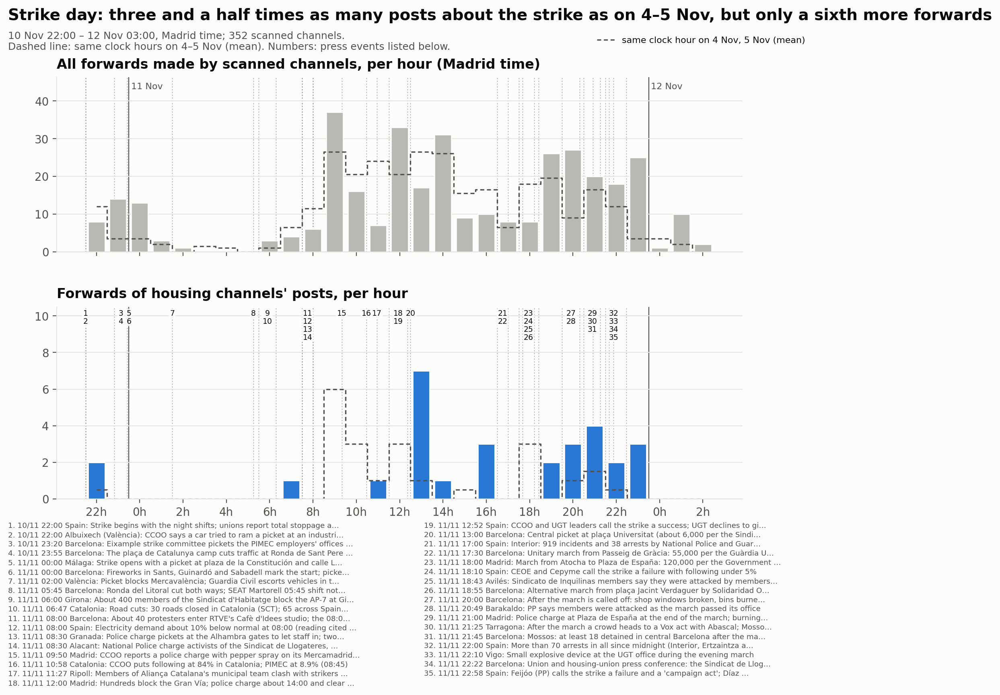
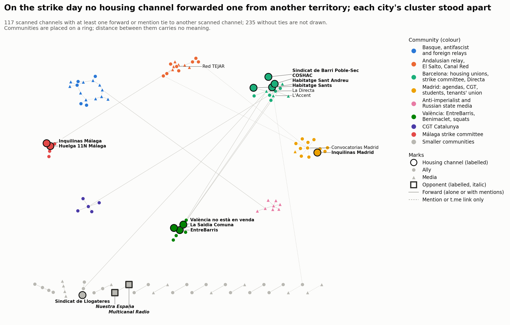
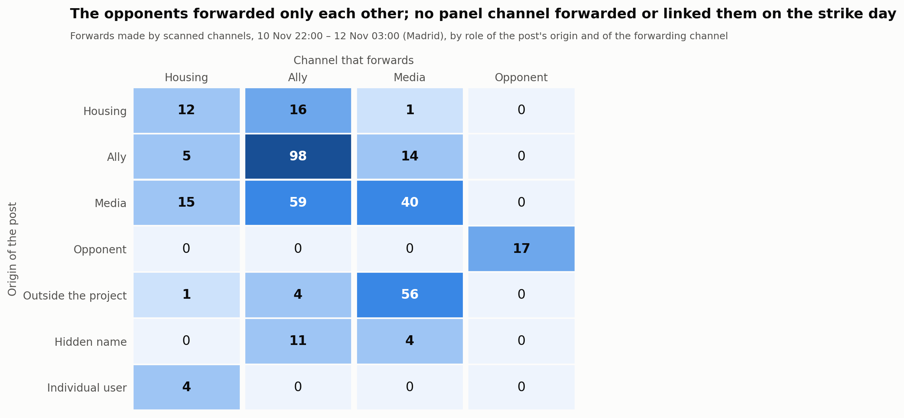

# Día de huelga: del 10 de noviembre a las 22:00 al 12 de noviembre a las 03:00

<a href="../followup_strike_day.html">English</a> · <strong>Español</strong> · <a href="../ca/followup_strike_day.html">Català</a>

Forma parte del [seguimiento](followup.md) de la movilización por la vivienda en Telegram. Esta
página cubre la huelga general del 11 de noviembre de 2026 como una **ventana** de 29 horas, hora
local de Madrid, final excluido (2026-11-10T21:00Z a 2026-11-12T02:00Z):
- Se abre a las 22:00 de la víspera, cuando empezaron los primeros turnos de noche y los piquetes.
- Se cierra a las 03:00 del día siguiente a la huelga, para que queden dentro las manifestaciones de
  la tarde y sus primeros relatos.

La ventana está dentro del bloque 5 (10–16 de noviembre). Sus hechos siguen perteneciendo al bloque
5, que se analizará entero después, ventana incluida.

- **Comparaciones:**
  - Las **mismas horas de reloj del miércoles 4 y el jueves 5 de noviembre** (media), dos días
    laborables corrientes del [bloque 4](followup_block4.md), sin ningún hecho importante marcado.
    Las horas de dentro de la ventana nunca cuentan como referencia.
  - El **bloque 4** (3–9 de noviembre) para la estructura: papeles, vínculos, comunidades.
- **Recogida:** hecha el 12 de noviembre desde las 15:07 UTC, trece horas después del cierre de la
  ventana. No se incluyen las publicaciones ni las ediciones posteriores.
- **Panel:** 339 canales al inicio; 352 tras la ronda de revisión (§6). 3 privados.

## 1. El día en Telegram, hora a hora, frente al relato de la prensa

El relato de la prensa tiene 36 hechos con hora, que se listan abajo; los 35 de dentro de la ventana
van numerados en la línea temporal. Fuentes:
- leídas literalmente: los directos de La Directa y de Nació Digital, Euronews, El Español y
  Demócrata;
- leídas en parte: los directos de eldiario.es y de The Objective, Infobae;
- solo resúmenes de búsqueda para algunos hechos, como indica la nota de cada uno.

<strong>Los 36 hechos del relato de la prensa (35 numerados en la línea temporal)</strong>

<table style="font-size:85%;border-collapse:collapse"><thead><tr><th style="border:1px solid #d0d7de;padding:4px 8px;vertical-align:top">N.º</th><th style="border:1px solid #d0d7de;padding:4px 8px;vertical-align:top">Hora de Madrid</th><th style="border:1px solid #d0d7de;padding:4px 8px;vertical-align:top">Lugar</th><th style="border:1px solid #d0d7de;padding:4px 8px;vertical-align:top">Hecho</th><th style="border:1px solid #d0d7de;padding:4px 8px;vertical-align:top">Fuentes</th><th style="border:1px solid #d0d7de;padding:4px 8px;vertical-align:top">Nota</th></tr></thead><tbody><tr><td style="border:1px solid #d0d7de;padding:4px 8px;vertical-align:top">– <small>antes de la ventana</small></td><td style="border:1px solid #d0d7de;padding:4px 8px;vertical-align:top">10&nbsp;nov&nbsp;20:00</td><td style="border:1px solid #d0d7de;padding:4px 8px;vertical-align:top">Martorell</td><td style="border:1px solid #d0d7de;padding:4px 8px;vertical-align:top">Primeros piquetes del turno de noche en la planta de la SEAT (CCOO, CGT, UGT)</td><td style="border:1px solid #d0d7de;padding:4px 8px;vertical-align:top"><a href="https://directa.cat/minut-a-minut-11n-vaga-general/">La Directa</a></td><td style="border:1px solid #d0d7de;padding:4px 8px;vertical-align:top">Publicación de Directa a las 20:38 (hora del hecho &quot;a partir de les 20h&quot;); antes de la ventana. También lo recoge Diario Socialista</td></tr><tr><td style="border:1px solid #d0d7de;padding:4px 8px;vertical-align:top">1</td><td style="border:1px solid #d0d7de;padding:4px 8px;vertical-align:top">10&nbsp;nov&nbsp;22:00</td><td style="border:1px solid #d0d7de;padding:4px 8px;vertical-align:top">España</td><td style="border:1px solid #d0d7de;padding:4px 8px;vertical-align:top">La huelga empieza con los turnos de noche; los sindicatos hablan de paro total en la SEAT de Martorell</td><td style="border:1px solid #d0d7de;padding:4px 8px;vertical-align:top"><a href="https://directa.cat/minut-a-minut-11n-vaga-general/">La Directa</a>, <a href="https://www.eldiario.es/economia/huelga-general-11-noviembre-ultima-hora-directo-arranca-gran-paro-vivienda_133_13653845.html">eldiario.es</a></td><td style="border:1px solid #d0d7de;padding:4px 8px;vertical-align:top">Publicación de Directa a las 22:00: 327 personas dentro con servicios mínimos, de una plantilla de más de 13.000 (cifra sindical). Interior cuenta incidentes desde las 22:00 del martes (eldiario.es)</td></tr><tr><td style="border:1px solid #d0d7de;padding:4px 8px;vertical-align:top">2</td><td style="border:1px solid #d0d7de;padding:4px 8px;vertical-align:top">10&nbsp;nov&nbsp;22:00</td><td style="border:1px solid #d0d7de;padding:4px 8px;vertical-align:top">Albuixech (València)</td><td style="border:1px solid #d0d7de;padding:4px 8px;vertical-align:top">CCOO denuncia que un coche intentó embestir un piquete en un polígono</td><td style="border:1px solid #d0d7de;padding:4px 8px;vertical-align:top"><a href="https://www.eldiario.es/economia/huelga-general-11-noviembre-ultima-hora-directo-arranca-gran-paro-vivienda_133_13653845.html">eldiario.es</a></td><td style="border:1px solid #d0d7de;padding:4px 8px;vertical-align:top">Publicación de eldiario.es a las 21:59 del 11 de noviembre; hecho &quot;hacia las 22:00 del martes&quot;. Versión de CCOO, sin confirmación policial</td></tr><tr><td style="border:1px solid #d0d7de;padding:4px 8px;vertical-align:top">3</td><td style="border:1px solid #d0d7de;padding:4px 8px;vertical-align:top">10&nbsp;nov&nbsp;23:20</td><td style="border:1px solid #d0d7de;padding:4px 8px;vertical-align:top">Barcelona</td><td style="border:1px solid #d0d7de;padding:4px 8px;vertical-align:top">El comité de huelga del Eixample hace un piquete con bengalas ante la sede de la patronal PIMEC</td><td style="border:1px solid #d0d7de;padding:4px 8px;vertical-align:top"><a href="https://directa.cat/minut-a-minut-11n-vaga-general/">La Directa</a></td><td style="border:1px solid #d0d7de;padding:4px 8px;vertical-align:top">Publicación de Directa a las 23:20; también lo recoge Diario Socialista (resumen de búsqueda)</td></tr><tr><td style="border:1px solid #d0d7de;padding:4px 8px;vertical-align:top">4</td><td style="border:1px solid #d0d7de;padding:4px 8px;vertical-align:top">10&nbsp;nov&nbsp;23:55</td><td style="border:1px solid #d0d7de;padding:4px 8px;vertical-align:top">Barcelona</td><td style="border:1px solid #d0d7de;padding:4px 8px;vertical-align:top">La acampada de la plaça de Catalunya corta el tráfico en Ronda de Sant Pere / Passeig de Gràcia</td><td style="border:1px solid #d0d7de;padding:4px 8px;vertical-align:top"><a href="https://directa.cat/minut-a-minut-11n-vaga-general/">La Directa</a></td><td style="border:1px solid #d0d7de;padding:4px 8px;vertical-align:top">&quot;Poc abans de mitjanit&quot; (publicación de Directa a las 00:05); el directo de un medio barcelonés lo sitúa a las 00:10 (resumen de búsqueda). Es lo único sobre las acampadas que se encontró en la prensa de esa noche</td></tr><tr><td style="border:1px solid #d0d7de;padding:4px 8px;vertical-align:top">5</td><td style="border:1px solid #d0d7de;padding:4px 8px;vertical-align:top">11&nbsp;nov&nbsp;00:00</td><td style="border:1px solid #d0d7de;padding:4px 8px;vertical-align:top">Málaga</td><td style="border:1px solid #d0d7de;padding:4px 8px;vertical-align:top">La huelga arranca con un piquete en la plaza de la Constitución y la calle Larios; piquetes de CCOO en Mercamálaga y en cocheras</td><td style="border:1px solid #d0d7de;padding:4px 8px;vertical-align:top"><a href="https://www.andaluciainformacion.es/articulo/malaga-sociedad/huelga-general-arranca-malaga-reivindicaciones-vivienda-salarios-servicios-publicos/202611110950183533271.html">Andalucía Información</a></td><td style="border:1px solid #d0d7de;padding:4px 8px;vertical-align:top">De un resumen de búsqueda de Andalucía Información y El Español Málaga, no leído entero. Después la policía cargó contra piquetes en Mercamálaga y en las cocheras de la EMT (titular de El Español Málaga); CCOO: &quot;todos nuestros piquetes han sido informativos y pacíficos&quot;</td></tr><tr><td style="border:1px solid #d0d7de;padding:4px 8px;vertical-align:top">6</td><td style="border:1px solid #d0d7de;padding:4px 8px;vertical-align:top">11&nbsp;nov&nbsp;00:00</td><td style="border:1px solid #d0d7de;padding:4px 8px;vertical-align:top">Barcelona</td><td style="border:1px solid #d0d7de;padding:4px 8px;vertical-align:top">Petardos en Sants, el Guinardó y Sabadell marcan el inicio; piquetes por las calles</td><td style="border:1px solid #d0d7de;padding:4px 8px;vertical-align:top"><a href="https://directa.cat/minut-a-minut-11n-vaga-general/">La Directa</a></td><td style="border:1px solid #d0d7de;padding:4px 8px;vertical-align:top">Publicación de Directa a las 00:00</td></tr><tr><td style="border:1px solid #d0d7de;padding:4px 8px;vertical-align:top">7</td><td style="border:1px solid #d0d7de;padding:4px 8px;vertical-align:top">11&nbsp;nov&nbsp;02:00</td><td style="border:1px solid #d0d7de;padding:4px 8px;vertical-align:top">València</td><td style="border:1px solid #d0d7de;padding:4px 8px;vertical-align:top">Un piquete bloquea Mercavalència; la Guardia Civil escolta la entrada de vehículos dos horas después</td><td style="border:1px solid #d0d7de;padding:4px 8px;vertical-align:top"><a href="https://directa.cat/minut-a-minut-11n-vaga-general/">La Directa</a></td><td style="border:1px solid #d0d7de;padding:4px 8px;vertical-align:top">Publicación de Directa a las 02:00; pie de foto de eldiario.es de los piquetes de Mercavalència &#x27;en la madrugada&#x27;</td></tr><tr><td style="border:1px solid #d0d7de;padding:4px 8px;vertical-align:top">8</td><td style="border:1px solid #d0d7de;padding:4px 8px;vertical-align:top">11&nbsp;nov&nbsp;05:45</td><td style="border:1px solid #d0d7de;padding:4px 8px;vertical-align:top">Barcelona</td><td style="border:1px solid #d0d7de;padding:4px 8px;vertical-align:top">Ronda del Litoral cortada en los dos sentidos; no se deja entrar al turno de las 05:45 en la SEAT de Martorell</td><td style="border:1px solid #d0d7de;padding:4px 8px;vertical-align:top"><a href="https://directa.cat/minut-a-minut-11n-vaga-general/">La Directa</a>, <a href="https://naciodigital.cat/societat/la-vaga-general-de-l11-n-en-directe-talls-a-les-carreteres-manifestacions-i-reaccions-politiques.html">Nació Digital</a></td><td style="border:1px solid #d0d7de;padding:4px 8px;vertical-align:top">Publicación de Directa a las 05:45; Nació a las 07:20 (puerta de la SEAT, acceso a la A-2 cortado, neumáticos quemados)</td></tr><tr><td style="border:1px solid #d0d7de;padding:4px 8px;vertical-align:top">9</td><td style="border:1px solid #d0d7de;padding:4px 8px;vertical-align:top">11&nbsp;nov&nbsp;06:00</td><td style="border:1px solid #d0d7de;padding:4px 8px;vertical-align:top">Girona</td><td style="border:1px solid #d0d7de;padding:4px 8px;vertical-align:top">Unas 400 personas del Sindicat d&#x27;Habitatge bloquean la AP-7 en Girona Oest</td><td style="border:1px solid #d0d7de;padding:4px 8px;vertical-align:top"><a href="https://naciodigital.cat/societat/la-vaga-general-de-l11-n-en-directe-talls-a-les-carreteres-manifestacions-i-reaccions-politiques.html">Nació Digital</a></td><td style="border:1px solid #d0d7de;padding:4px 8px;vertical-align:top">Publicación de Nació a las 07:49; entraron hacia las 06:00 tras un piquete en la planta de Nestlé</td></tr><tr><td style="border:1px solid #d0d7de;padding:4px 8px;vertical-align:top">10</td><td style="border:1px solid #d0d7de;padding:4px 8px;vertical-align:top">11&nbsp;nov&nbsp;06:47</td><td style="border:1px solid #d0d7de;padding:4px 8px;vertical-align:top">Cataluña</td><td style="border:1px solid #d0d7de;padding:4px 8px;vertical-align:top">Cortes de carretera: 30 vías cerradas en Cataluña (SCT); 65 en toda España a las 08:34</td><td style="border:1px solid #d0d7de;padding:4px 8px;vertical-align:top"><a href="https://directa.cat/minut-a-minut-11n-vaga-general/">La Directa</a></td><td style="border:1px solid #d0d7de;padding:4px 8px;vertical-align:top">Publicaciones de Directa a las 06:47 y 08:34 (Servei Català de Trànsit). Nació: un máximo de unas 50 en Cataluña, cinco a las 15:15. Las cifras varían según la fuente y la hora</td></tr><tr><td style="border:1px solid #d0d7de;padding:4px 8px;vertical-align:top">11</td><td style="border:1px solid #d0d7de;padding:4px 8px;vertical-align:top">11&nbsp;nov&nbsp;08:00</td><td style="border:1px solid #d0d7de;padding:4px 8px;vertical-align:top">Barcelona</td><td style="border:1px solid #d0d7de;padding:4px 8px;vertical-align:top">Unas 40 personas entran en el plató del Cafè d&#x27;Idees de RTVE; se interrumpe el programa de las 08:00</td><td style="border:1px solid #d0d7de;padding:4px 8px;vertical-align:top"><a href="https://directa.cat/minut-a-minut-11n-vaga-general/">La Directa</a>, <a href="https://es.euronews.com/2026/11/12/fuerza-en-la-calle-pero-seguimiento-escaso-en-el-trabajo-la-huelga-general-del-11n">Euronews</a></td><td style="border:1px solid #d0d7de;padding:4px 8px;vertical-align:top">Publicación de Directa a las 08:12; The Objective (resumen de página, no literal) habla de unas 50 personas encapuchadas</td></tr><tr><td style="border:1px solid #d0d7de;padding:4px 8px;vertical-align:top">12</td><td style="border:1px solid #d0d7de;padding:4px 8px;vertical-align:top">11&nbsp;nov&nbsp;08:00</td><td style="border:1px solid #d0d7de;padding:4px 8px;vertical-align:top">España</td><td style="border:1px solid #d0d7de;padding:4px 8px;vertical-align:top">La demanda eléctrica, un 10 % por debajo de lo normal a las 08:00 (lectura que citan los sindicatos)</td><td style="border:1px solid #d0d7de;padding:4px 8px;vertical-align:top"><a href="https://naciodigital.cat/societat/la-vaga-general-de-l11-n-en-directe-talls-a-les-carreteres-manifestacions-i-reaccions-politiques.html">Nació Digital</a></td><td style="border:1px solid #d0d7de;padding:4px 8px;vertical-align:top">Publicación de Nació a las 08:20 (Cadena SER); no se indica la referencia. Otras lecturas: −6,64 % a las 10:00 respecto al martes (Nació 11:13); −15,49 % entre las 10 y las 11 respecto a la previsión de REE (eldiario.es, resumen de página); −3,4 % en todo el día respecto al 10 de noviembre (Euronews); −4,7 % respecto a la previsión a las 17:00 (El Español). No son comparables tal como se dan</td></tr><tr><td style="border:1px solid #d0d7de;padding:4px 8px;vertical-align:top">13</td><td style="border:1px solid #d0d7de;padding:4px 8px;vertical-align:top">11&nbsp;nov&nbsp;08:30</td><td style="border:1px solid #d0d7de;padding:4px 8px;vertical-align:top">Granada</td><td style="border:1px solid #d0d7de;padding:4px 8px;vertical-align:top">La policía carga contra los piquetes en las puertas de la Alhambra para dejar entrar a la plantilla; dos personas del piquete detenidas</td><td style="border:1px solid #d0d7de;padding:4px 8px;vertical-align:top"><a href="https://www.cope.es/actualidad/espana/al-minuto/huelga-general-11-noviembre-sigue-directo-jornada-paro-espana-20261111_3472630.html">COPE</a></td><td style="border:1px solid #d0d7de;padding:4px 8px;vertical-align:top">COPE (resumen de búsqueda) y The Objective (resumen de página, 11:49): piquetes desde las 06:30; la Alhambra abrió hacia las 11:00. No leído literalmente</td></tr><tr><td style="border:1px solid #d0d7de;padding:4px 8px;vertical-align:top">14</td><td style="border:1px solid #d0d7de;padding:4px 8px;vertical-align:top">11&nbsp;nov&nbsp;08:30</td><td style="border:1px solid #d0d7de;padding:4px 8px;vertical-align:top">Alacant</td><td style="border:1px solid #d0d7de;padding:4px 8px;vertical-align:top">La Policía Nacional carga contra activistas del Sindicat de Llogateres, el Sindicat de Vivenda de Carolines y OJS</td><td style="border:1px solid #d0d7de;padding:4px 8px;vertical-align:top"><a href="https://directa.cat/minut-a-minut-11n-vaga-general/">La Directa</a></td><td style="border:1px solid #d0d7de;padding:4px 8px;vertical-align:top">Publicación de Directa a las 08:30; solo la versión de Directa</td></tr><tr><td style="border:1px solid #d0d7de;padding:4px 8px;vertical-align:top">15</td><td style="border:1px solid #d0d7de;padding:4px 8px;vertical-align:top">11&nbsp;nov&nbsp;09:50</td><td style="border:1px solid #d0d7de;padding:4px 8px;vertical-align:top">Madrid</td><td style="border:1px solid #d0d7de;padding:4px 8px;vertical-align:top">CCOO denuncia una carga policial con gas pimienta contra su piquete de Mercamadrid de madrugada y presenta una denuncia penal</td><td style="border:1px solid #d0d7de;padding:4px 8px;vertical-align:top"><a href="https://www.elespanol.com/invertia/economia/empleo/20261111/ceoe-cifra-seguimiento-huelga-ugt-descarta-dar-nuevos-datos-aburrido/1003744454617_0.html">El Español</a></td><td style="border:1px solid #d0d7de;padding:4px 8px;vertical-align:top">Hecho &#x27;la pasada madrugada&#x27; (El Español); 09:50 y 10:30 son horas de publicación de The Objective (resumen de página). CCOO: 1 detención y 13 heridos (según el sindicato). El alcalde de Madrid admitió incidentes en Mercamadrid y en cocheras de la EMT (The Objective 12:04, resumen)</td></tr><tr><td style="border:1px solid #d0d7de;padding:4px 8px;vertical-align:top">16</td><td style="border:1px solid #d0d7de;padding:4px 8px;vertical-align:top">11&nbsp;nov&nbsp;10:58</td><td style="border:1px solid #d0d7de;padding:4px 8px;vertical-align:top">Cataluña</td><td style="border:1px solid #d0d7de;padding:4px 8px;vertical-align:top">CCOO cifra el seguimiento en el 84 % en Cataluña; PIMEC, en el 8,9 % (08:45)</td><td style="border:1px solid #d0d7de;padding:4px 8px;vertical-align:top"><a href="https://naciodigital.cat/societat/la-vaga-general-de-l11-n-en-directe-talls-a-les-carreteres-manifestacions-i-reaccions-politiques.html">Nació Digital</a></td><td style="border:1px solid #d0d7de;padding:4px 8px;vertical-align:top">Publicaciones de Nació a las 10:13 y 10:58; PIMEC 8,3 % a las 11:42; sector público de la Generalitat 12,8 % (16:25)</td></tr><tr><td style="border:1px solid #d0d7de;padding:4px 8px;vertical-align:top">17</td><td style="border:1px solid #d0d7de;padding:4px 8px;vertical-align:top">11&nbsp;nov&nbsp;11:27</td><td style="border:1px solid #d0d7de;padding:4px 8px;vertical-align:top">Ripoll</td><td style="border:1px solid #d0d7de;padding:4px 8px;vertical-align:top">Miembros del equipo municipal de Aliança Catalana se enfrentan a huelguistas en un piquete ante un supermercado</td><td style="border:1px solid #d0d7de;padding:4px 8px;vertical-align:top"><a href="https://naciodigital.cat/societat/la-vaga-general-de-l11-n-en-directe-talls-a-les-carreteres-manifestacions-i-reaccions-politiques.html">Nació Digital</a>, <a href="https://directa.cat/minut-a-minut-11n-vaga-general/">La Directa</a></td><td style="border:1px solid #d0d7de;padding:4px 8px;vertical-align:top">Publicación de Nació a las 11:27 (empujones, patadas); Directa 15:41: la policía separa a la alcaldesa de los manifestantes</td></tr><tr><td style="border:1px solid #d0d7de;padding:4px 8px;vertical-align:top">18</td><td style="border:1px solid #d0d7de;padding:4px 8px;vertical-align:top">11&nbsp;nov&nbsp;12:00</td><td style="border:1px solid #d0d7de;padding:4px 8px;vertical-align:top">Madrid</td><td style="border:1px solid #d0d7de;padding:4px 8px;vertical-align:top">Cientos de personas bloquean la Gran Vía; la policía carga hacia las 14:00 y la despeja hacia las 14:30</td><td style="border:1px solid #d0d7de;padding:4px 8px;vertical-align:top"><a href="https://es.euronews.com/2026/11/12/fuerza-en-la-calle-pero-seguimiento-escaso-en-el-trabajo-la-huelga-general-del-11n">Euronews</a>, <a href="https://naciodigital.cat/societat/la-vaga-general-de-l11-n-en-directe-talls-a-les-carreteres-manifestacions-i-reaccions-politiques.html">Nació Digital</a></td><td style="border:1px solid #d0d7de;padding:4px 8px;vertical-align:top">Euronews (cargas hacia las 14:00, denuncias de gas pimienta); publicación de Nació a las 14:40; The Objective (resumen): unas dos horas de bloqueo, 2 detenciones</td></tr><tr><td style="border:1px solid #d0d7de;padding:4px 8px;vertical-align:top">19</td><td style="border:1px solid #d0d7de;padding:4px 8px;vertical-align:top">11&nbsp;nov&nbsp;12:52</td><td style="border:1px solid #d0d7de;padding:4px 8px;vertical-align:top">España</td><td style="border:1px solid #d0d7de;padding:4px 8px;vertical-align:top">Los líderes de CCOO y UGT dan la huelga por un éxito; UGT no da cifra estatal</td><td style="border:1px solid #d0d7de;padding:4px 8px;vertical-align:top"><a href="https://www.elespanol.com/invertia/economia/empleo/20261111/ceoe-cifra-seguimiento-huelga-ugt-descarta-dar-nuevos-datos-aburrido/1003744454617_0.html">El Español</a></td><td style="border:1px solid #d0d7de;padding:4px 8px;vertical-align:top">Hora de eldiario.es (resumen de página). Cifras sindicales por comunidad: 84 % Cataluña; 70 % Andalucía, Madrid, Aragón; 60 % Valencia, Castilla-La Mancha (Euronews); 41 % Extremadura y Castilla-La Mancha (cabecera de eldiario.es). Desacuerdo: véase 18:10</td></tr><tr><td style="border:1px solid #d0d7de;padding:4px 8px;vertical-align:top">20</td><td style="border:1px solid #d0d7de;padding:4px 8px;vertical-align:top">11&nbsp;nov&nbsp;13:00</td><td style="border:1px solid #d0d7de;padding:4px 8px;vertical-align:top">Barcelona</td><td style="border:1px solid #d0d7de;padding:4px 8px;vertical-align:top">El piquete central de la plaça Universitat (unas 6.000 personas según el Sindicat de Llogateres) avanza hacia la plaça Catalunya</td><td style="border:1px solid #d0d7de;padding:4px 8px;vertical-align:top"><a href="https://directa.cat/minut-a-minut-11n-vaga-general/">La Directa</a>, <a href="https://naciodigital.cat/societat/la-vaga-general-de-l11-n-en-directe-talls-a-les-carreteres-manifestacions-i-reaccions-politiques.html">Nació Digital</a></td><td style="border:1px solid #d0d7de;padding:4px 8px;vertical-align:top">Publicación de Directa a las 15:30 (disuelto hacia las 14:00); Nació a las 13:09. Guàrdia Urbana: unas 3.000 personas en los piquetes centrales (resumen de búsqueda)</td></tr><tr><td style="border:1px solid #d0d7de;padding:4px 8px;vertical-align:top">21</td><td style="border:1px solid #d0d7de;padding:4px 8px;vertical-align:top">11&nbsp;nov&nbsp;17:00</td><td style="border:1px solid #d0d7de;padding:4px 8px;vertical-align:top">España</td><td style="border:1px solid #d0d7de;padding:4px 8px;vertical-align:top">Interior: 919 incidentes y 38 detenciones de Policía Nacional y Guardia Civil desde las 22:00 del martes</td><td style="border:1px solid #d0d7de;padding:4px 8px;vertical-align:top"><a href="https://www.eldiario.es/economia/huelga-general-11-noviembre-ultima-hora-directo-arranca-gran-paro-vivienda_133_13653845.html">eldiario.es</a></td><td style="border:1px solid #d0d7de;padding:4px 8px;vertical-align:top">Publicación de eldiario.es a las 23:57 (literal); Madrid, 15. Euronews da 1.144 incidentes para el mismo intervalo; Demócrata, 1.044. Excluye Mossos y Ertzaintza</td></tr><tr><td style="border:1px solid #d0d7de;padding:4px 8px;vertical-align:top">22</td><td style="border:1px solid #d0d7de;padding:4px 8px;vertical-align:top">11&nbsp;nov&nbsp;17:30</td><td style="border:1px solid #d0d7de;padding:4px 8px;vertical-align:top">Barcelona</td><td style="border:1px solid #d0d7de;padding:4px 8px;vertical-align:top">Manifestación unitaria desde el Passeig de Gràcia: 55.000 personas según la Guàrdia Urbana; 400.000 según los convocantes</td><td style="border:1px solid #d0d7de;padding:4px 8px;vertical-align:top"><a href="https://naciodigital.cat/societat/la-vaga-general-de-l11-n-en-directe-talls-a-les-carreteres-manifestacions-i-reaccions-politiques.html">Nació Digital</a>, <a href="https://www.infobae.com/espana/2026/11/11/huelga-general-en-espana-en-directo-piquetes-incidencia-en-transportes-y-empresas-reacciones-y-ultima-hora-de-las-elecciones-generales/">Infobae</a></td><td style="border:1px solid #d0d7de;padding:4px 8px;vertical-align:top">Salida a las 17:30 (guía de betevé, resumen de búsqueda); Nació 18:55 (55.000) y 20:14 (400.000, Sindicat de Llogateres); un resumen da 50.000</td></tr><tr><td style="border:1px solid #d0d7de;padding:4px 8px;vertical-align:top">23</td><td style="border:1px solid #d0d7de;padding:4px 8px;vertical-align:top">11&nbsp;nov&nbsp;18:00</td><td style="border:1px solid #d0d7de;padding:4px 8px;vertical-align:top">Madrid</td><td style="border:1px solid #d0d7de;padding:4px 8px;vertical-align:top">Manifestación de Atocha a Plaza de España: 120.000 personas según la Delegación del Gobierno; 400.000 según el Sindicato de Inquilinas</td><td style="border:1px solid #d0d7de;padding:4px 8px;vertical-align:top"><a href="https://www.eldiario.es/economia/huelga-general-11-noviembre-ultima-hora-directo-arranca-gran-paro-vivienda_133_13653845.html">eldiario.es</a>, <a href="https://www.infobae.com/espana/2026/11/11/huelga-general-en-espana-en-directo-piquetes-incidencia-en-transportes-y-empresas-reacciones-y-ultima-hora-de-las-elecciones-generales/">Infobae</a></td><td style="border:1px solid #d0d7de;padding:4px 8px;vertical-align:top">eldiario.es 23:27; Infobae 19:21; The Objective 20:21 da 600.000 según el Sindicato de Inquilinas. Bajo la lluvia</td></tr><tr><td style="border:1px solid #d0d7de;padding:4px 8px;vertical-align:top">24</td><td style="border:1px solid #d0d7de;padding:4px 8px;vertical-align:top">11&nbsp;nov&nbsp;18:10</td><td style="border:1px solid #d0d7de;padding:4px 8px;vertical-align:top">España</td><td style="border:1px solid #d0d7de;padding:4px 8px;vertical-align:top">CEOE y Cepyme dan la huelga por fracasada, con un seguimiento por debajo del 5 %</td><td style="border:1px solid #d0d7de;padding:4px 8px;vertical-align:top"><a href="https://www.elespanol.com/invertia/economia/empleo/20261111/ceoe-cifra-seguimiento-huelga-ugt-descarta-dar-nuevos-datos-aburrido/1003744454617_0.html">El Español</a></td><td style="border:1px solid #d0d7de;padding:4px 8px;vertical-align:top">El Español lo publicó a las 18:10 (el resumen de eldiario.es lo sitúa a las 18:46). Electricidad −4,7 % respecto a la previsión de REE; los sindicatos discuten la medida</td></tr><tr><td style="border:1px solid #d0d7de;padding:4px 8px;vertical-align:top">25</td><td style="border:1px solid #d0d7de;padding:4px 8px;vertical-align:top">11&nbsp;nov&nbsp;18:43</td><td style="border:1px solid #d0d7de;padding:4px 8px;vertical-align:top">Avilés</td><td style="border:1px solid #d0d7de;padding:4px 8px;vertical-align:top">Miembros del Sindicato de Inquilinas denuncian que miembros de Núcleo Nacional les agredieron mientras llamaban a la huelga</td><td style="border:1px solid #d0d7de;padding:4px 8px;vertical-align:top"><a href="https://www.eldiario.es/economia/huelga-general-11-noviembre-ultima-hora-directo-arranca-gran-paro-vivienda_133_13653845.html">eldiario.es</a></td><td style="border:1px solid #d0d7de;padding:4px 8px;vertical-align:top">Hora de publicación de eldiario.es, de un resumen de página (no literal); solo la versión del sindicato</td></tr><tr><td style="border:1px solid #d0d7de;padding:4px 8px;vertical-align:top">26</td><td style="border:1px solid #d0d7de;padding:4px 8px;vertical-align:top">11&nbsp;nov&nbsp;18:55</td><td style="border:1px solid #d0d7de;padding:4px 8px;vertical-align:top">Barcelona</td><td style="border:1px solid #d0d7de;padding:4px 8px;vertical-align:top">Manifestación alternativa desde la plaça Jacint Verdaguer de Solidaridad Obrera y el Sindicat d&#x27;Habitatge Socialista: 10.000 personas según los convocantes</td><td style="border:1px solid #d0d7de;padding:4px 8px;vertical-align:top"><a href="https://directa.cat/minut-a-minut-11n-vaga-general/">La Directa</a>, <a href="https://www.infobae.com/espana/2026/11/11/huelga-general-en-espana-en-directo-piquetes-incidencia-en-transportes-y-empresas-reacciones-y-ultima-hora-de-las-elecciones-generales/">Infobae</a></td><td style="border:1px solid #d0d7de;padding:4px 8px;vertical-align:top">Publicación de Directa a las 18:55; Infobae 19:19 (unas 10.000 personas según los convocantes; sin cifra oficial)</td></tr><tr><td style="border:1px solid #d0d7de;padding:4px 8px;vertical-align:top">27</td><td style="border:1px solid #d0d7de;padding:4px 8px;vertical-align:top">11&nbsp;nov&nbsp;20:00</td><td style="border:1px solid #d0d7de;padding:4px 8px;vertical-align:top">Barcelona</td><td style="border:1px solid #d0d7de;padding:4px 8px;vertical-align:top">Tras darse por terminada la manifestación: escaparates rotos, contenedores quemados, petardos contra los Mossos; cargas de los antidisturbios</td><td style="border:1px solid #d0d7de;padding:4px 8px;vertical-align:top"><a href="https://naciodigital.cat/societat/la-vaga-general-de-l11-n-en-directe-talls-a-les-carreteres-manifestacions-i-reaccions-politiques.html">Nació Digital</a>, <a href="https://directa.cat/minut-a-minut-11n-vaga-general/">La Directa</a></td><td style="border:1px solid #d0d7de;padding:4px 8px;vertical-align:top">Directa 19:59 (primeras cargas); Nació 20:05 y 20:54 (fuego en la tienda de Apple del Passeig de Gràcia; contenedores alrededor de la plaça Catalunya)</td></tr><tr><td style="border:1px solid #d0d7de;padding:4px 8px;vertical-align:top">28</td><td style="border:1px solid #d0d7de;padding:4px 8px;vertical-align:top">11&nbsp;nov&nbsp;20:49</td><td style="border:1px solid #d0d7de;padding:4px 8px;vertical-align:top">Barakaldo</td><td style="border:1px solid #d0d7de;padding:4px 8px;vertical-align:top">El PP denuncia que agredieron a afiliados al pasar la manifestación ante su sede</td><td style="border:1px solid #d0d7de;padding:4px 8px;vertical-align:top"><a href="https://theobjective.com/sociedad/2026-11-11/ultima-hora-huelga-general-11-n/directo/">The Objective</a></td><td style="border:1px solid #d0d7de;padding:4px 8px;vertical-align:top">Publicaciones de The Objective a las 20:49 y 21:55; eldiario.es (resumen, 21:40): dos afiliados hospitalizados tras el lanzamiento de un objeto. Versión del PP</td></tr><tr><td style="border:1px solid #d0d7de;padding:4px 8px;vertical-align:top">29</td><td style="border:1px solid #d0d7de;padding:4px 8px;vertical-align:top">11&nbsp;nov&nbsp;21:00</td><td style="border:1px solid #d0d7de;padding:4px 8px;vertical-align:top">Madrid</td><td style="border:1px solid #d0d7de;padding:4px 8px;vertical-align:top">Carga policial en la Plaza de España al final de la manifestación; contenedores ardiendo en las calles cercanas</td><td style="border:1px solid #d0d7de;padding:4px 8px;vertical-align:top"><a href="https://www.eldiario.es/economia/huelga-general-11-noviembre-ultima-hora-directo-arranca-gran-paro-vivienda_133_13653845.html">eldiario.es</a>, <a href="https://theobjective.com/sociedad/2026-11-11/ultima-hora-huelga-general-11-n/directo/">The Objective</a></td><td style="border:1px solid #d0d7de;padding:4px 8px;vertical-align:top">Hecho hacia las 21:00 (eldiario.es 23:01); detenciones: 4 (eldiario.es 23:27), 2 (The Objective 23:10) o 1 (21:38). El País, vía Infobae, ya informa a las 20:07 de cargas y gas pimienta</td></tr><tr><td style="border:1px solid #d0d7de;padding:4px 8px;vertical-align:top">30</td><td style="border:1px solid #d0d7de;padding:4px 8px;vertical-align:top">11&nbsp;nov&nbsp;21:25</td><td style="border:1px solid #d0d7de;padding:4px 8px;vertical-align:top">Tarragona</td><td style="border:1px solid #d0d7de;padding:4px 8px;vertical-align:top">Tras la manifestación, un grupo se dirige a un acto de Vox con Abascal; los Mossos disparan balas de foam</td><td style="border:1px solid #d0d7de;padding:4px 8px;vertical-align:top"><a href="https://directa.cat/minut-a-minut-11n-vaga-general/">La Directa</a>, <a href="https://naciodigital.cat/societat/la-vaga-general-de-l11-n-en-directe-talls-a-les-carreteres-manifestacions-i-reaccions-politiques.html">Nació Digital</a></td><td style="border:1px solid #d0d7de;padding:4px 8px;vertical-align:top">Directa 21:25; Nació 21:28 (lanzamiento de piedras contra el cordón policial)</td></tr><tr><td style="border:1px solid #d0d7de;padding:4px 8px;vertical-align:top">31</td><td style="border:1px solid #d0d7de;padding:4px 8px;vertical-align:top">11&nbsp;nov&nbsp;21:45</td><td style="border:1px solid #d0d7de;padding:4px 8px;vertical-align:top">Barcelona</td><td style="border:1px solid #d0d7de;padding:4px 8px;vertical-align:top">Mossos: al menos 18 detenidos en el centro de Barcelona tras la manifestación</td><td style="border:1px solid #d0d7de;padding:4px 8px;vertical-align:top"><a href="https://directa.cat/minut-a-minut-11n-vaga-general/">La Directa</a>, <a href="https://theobjective.com/sociedad/2026-11-11/ultima-hora-huelga-general-11-n/directo/">The Objective</a></td><td style="border:1px solid #d0d7de;padding:4px 8px;vertical-align:top">Directa 21:59 (recuento a las 21:45); The Objective 22:03. El alcalde de Barcelona habló de 50 (The Objective 23:29); los Mossos, de 52 el 12 de noviembre (Directa, 12 nov 11:40, fuera de la ventana)</td></tr><tr><td style="border:1px solid #d0d7de;padding:4px 8px;vertical-align:top">32</td><td style="border:1px solid #d0d7de;padding:4px 8px;vertical-align:top">11&nbsp;nov&nbsp;22:00</td><td style="border:1px solid #d0d7de;padding:4px 8px;vertical-align:top">España</td><td style="border:1px solid #d0d7de;padding:4px 8px;vertical-align:top">Más de 70 detenciones en total desde medianoche (Interior, Ertzaintza y Mossos)</td><td style="border:1px solid #d0d7de;padding:4px 8px;vertical-align:top"><a href="https://www.eldiario.es/economia/huelga-general-11-noviembre-ultima-hora-directo-arranca-gran-paro-vivienda_133_13653845.html">eldiario.es</a></td><td style="border:1px solid #d0d7de;padding:4px 8px;vertical-align:top">Publicación de eldiario.es a las 23:57 (literal). Ertzaintza 16; Mossos 18. Demócrata (12 nov 05:31): al menos 75. COPE: más de 50 a las 20:00. Las cifras varían según la fuente y la hora de corte</td></tr><tr><td style="border:1px solid #d0d7de;padding:4px 8px;vertical-align:top">33</td><td style="border:1px solid #d0d7de;padding:4px 8px;vertical-align:top">11&nbsp;nov&nbsp;22:10</td><td style="border:1px solid #d0d7de;padding:4px 8px;vertical-align:top">Vigo</td><td style="border:1px solid #d0d7de;padding:4px 8px;vertical-align:top">Un pequeño artefacto explosivo en la sede de UGT durante la manifestación de la tarde</td><td style="border:1px solid #d0d7de;padding:4px 8px;vertical-align:top"><a href="https://www.eldiario.es/economia/huelga-general-11-noviembre-ultima-hora-directo-arranca-gran-paro-vivienda_133_13653845.html">eldiario.es</a>, <a href="https://theobjective.com/sociedad/2026-11-11/ultima-hora-huelga-general-11-n/directo/">The Objective</a></td><td style="border:1px solid #d0d7de;padding:4px 8px;vertical-align:top">Horas de publicación (eldiario.es 22:10; The Objective 22:24); el subdelegado del Gobierno lo condenó; la policía investiga</td></tr><tr><td style="border:1px solid #d0d7de;padding:4px 8px;vertical-align:top">34</td><td style="border:1px solid #d0d7de;padding:4px 8px;vertical-align:top">11&nbsp;nov&nbsp;22:22</td><td style="border:1px solid #d0d7de;padding:4px 8px;vertical-align:top">Barcelona</td><td style="border:1px solid #d0d7de;padding:4px 8px;vertical-align:top">Rueda de prensa sindical y de los sindicatos de vivienda: el Sindicat de Llogateres dice &#x27;les vagues seguiran&#x27;</td><td style="border:1px solid #d0d7de;padding:4px 8px;vertical-align:top"><a href="https://directa.cat/minut-a-minut-11n-vaga-general/">La Directa</a></td><td style="border:1px solid #d0d7de;padding:4px 8px;vertical-align:top">Publicación de Directa a las 22:22 (también intervienen CGT, COSHAC, IAC)</td></tr><tr><td style="border:1px solid #d0d7de;padding:4px 8px;vertical-align:top">35</td><td style="border:1px solid #d0d7de;padding:4px 8px;vertical-align:top">11&nbsp;nov&nbsp;22:58</td><td style="border:1px solid #d0d7de;padding:4px 8px;vertical-align:top">España</td><td style="border:1px solid #d0d7de;padding:4px 8px;vertical-align:top">Feijóo (PP) da la huelga por fracasada y la llama &#x27;acto de campaña&#x27;; Díaz (Gobierno) la había dado por un éxito a las 21:50</td><td style="border:1px solid #d0d7de;padding:4px 8px;vertical-align:top"><a href="https://theobjective.com/sociedad/2026-11-11/ultima-hora-huelga-general-11-n/directo/">The Objective</a></td><td style="border:1px solid #d0d7de;padding:4px 8px;vertical-align:top">Publicaciones de The Objective a las 21:50 y 22:58; Vox: Abascal, &#x27;vergüenza&#x27; (21:10)</td></tr></tbody></table>

Las cifras en disputa:

| | Sindicatos / convocantes | Patronal / policía / gobierno |
|---|---|---|
| Seguimiento | CCOO, 84 % en Cataluña; 60–70 % en otros lugares; alrededor del 41 % en Extremadura y Castilla-La Mancha; UGT no dio cifra estatal | CEOE, "por debajo del 5 %", "fracaso"; PIMEC, 8,3–8,9 %; sector público de la Generalitat, 12,8 % |
| Electricidad | "más propios de un domingo" | cinco lecturas, no comparables: −10 % a las 08:00; −6,6 % a las 10:00 respecto al martes; −3,4 % en todo el día respecto al 10 de noviembre |
| Manifestación de Madrid | 400.000 (Sindicato de Inquilinas) | 120.000 (Delegación del Gobierno) |
| Manifestación de Barcelona | 400.000 (convocantes) | 55.000 (Guàrdia Urbana) |
| Detenciones | "una cinquantena" en Barcelona (COSHAC, 23:04) | 38 de Policía Nacional y Guardia Civil hasta las 17:00; más de 70 en total a las 22:00; al menos 18 de los Mossos en Barcelona a las 21:45 |

**En la ventana, el panel publicó 802 veces sobre la movilización, frente a 225 en las mismas horas
del 4 y el 5 de noviembre: 3,6 veces más.** Esto cuenta los canales que ya estaban en el panel antes
de la ventana, los únicos con publicaciones de referencia. Con los 13 canales admitidos en el §6, la
cifra es 923.

**Los reenvíos apenas subieron:** 355 frente a 309, un 15 % más (357 con los canales admitidos).
Reenvíos de publicaciones de canales de vivienda: 29 frente a 21.

La lista de términos de la ventana se aplicó también a los días de referencia. Es más amplia que la
del bloque 4 (§7), así que, si acaso, la referencia está sobrestimada.

| Parte del día (Madrid) | Reenvíos | Referencia | Publicaciones de vivienda reenviadas | Referencia | Publicaciones sobre la movilización | Referencia |
|---|---|---|---|---|---|---|
| Previa, 10 nov 22:00–24:00 | 22 | 15,5 | 2 | 0,5 | 36 | 15 |
| Noche, 00:00–06:00 | 17 | 8 | 0 | 0 | 80 | 3 |
| Mañana, 06:00–12:00 | 73 | 90 | 2 | 10 | 301 | 66 |
| Tarde, 12:00–18:00 | 108 | 111,5 | 11 | 4,5 | 264 | 70,5 |
| Noche de la huelga, 18:00–24:00 | 124 | 78,5 | 14 | 6 | 228 | 68,5 |
| Madrugada, 12 nov 00:00–03:00 | 13 | 5,5 | 0 | 0 | 14 | 1,5 |

Las publicaciones de esta tabla incluyen los canales admitidos.

**Previa (22:00–24:00).** En la prensa: piquetes del turno de noche en la SEAT de Martorell; el
comité de huelga del Eixample en la sede de PIMEC; sindicalistas a las puertas de Mercabarna; un
coche que, según CCOO, intentó embestir un piquete cerca de València. La acampada de la plaça de
Catalunya cortó el tráfico poco antes de medianoche.

En Telegram:
- El comité de huelga de Málaga publicó "El Comité de Huelga se concentra en la Plaza de la
  Constitución" (22:49). El grupo de vivienda de Sants reenvió la publicación de La Directa sobre
  Mercabarna (22:52).
- El canal de CCOO: "¡EMPIEZA LA JORNADA DE HUELGA GENERAL!" (22:55). El de UGT: Pepe Álvarez "en el
  piquete de salida" en la Puerta del Sol (22:27).
- El canal de la acampada de Barcelona publicó por última vez en la ventana a las 23:05: "L'ACAMPADA
  CONTINUA!" y dos entrevistas. **No publicó el propio día de huelga.**

**Noche (00:00–06:00).** Las publicaciones sobre la movilización llegaron desde el principio: 80,
frente a 3 en las mismas horas de un día corriente. Hubo pocos reenvíos (17).
- Inicio de la huelga: "COMENÇA LA VAGA GENERAL!" (sindicato del Poble-Sec, 00:02; Sindicat de
  Llogateres de Barcelona, 01:02); "Paramos todo. Estamos en huelga general" (CNT Madrid, 00:11).
- Piquetes nocturnos: CCOO del Hábitat publicó fotos de piquetes de Asturias, Zaragoza, Madrid,
  València y Castellón durante toda la noche.
- Los primeros relatos de actuación policial, antes de cualquier noticia de prensa leída:
  - EntreBarris: "Piquet a Mercavalència" (03:09);
  - Horitzó: un vehículo que "envesteix el piquet de Mercavalencia i és protegit per la policia"
    (04:12);
  - La Villana de Vallekas, justo después de la noche: "La policía progresista ha cargado y echado
    gas pimienta, también en Mercamadrid" (06:14);
  - UGT: "Máxima tensión en Mercamadrid" (02:14).
- La prensa recoge la carga de Mercamadrid solo a partir de una denuncia de CCOO publicada a las 09:50
  (hecho 15).

**Mañana (06:00–12:00): cortes de carretera y piquetes, publicados, no reenviados.** Las cinco horas
con más publicaciones sobre la movilización son las 09:00 (66), las 12:00 (63), las 13:00 (62), las
11:00 (58) y las 10:00 (56).

De qué trataban esas publicaciones:
- sobre todo de piquetes (palabras de piquete en 20–33 publicaciones coincidentes por hora) y de
  cortes de carretera (15 a las 09:00);
- de cargas policiales y detenciones (11 a las 09:00, 10 a las 12:00);
- de las convocatorias de manifestación, desde las 12:00.

Venían sobre todo de canales de cobertura en directo: L'Accent, La Directa, el Centre de mitjans 11N,
Horitzó, los canales de CCOO y Arainfo.

Los reenvíos quedaron por debajo de una mañana corriente: 73 frente a 90. Las publicaciones de
vivienda se reenviaron dos veces, frente a 10. El pico de reenvíos de las 09:00 (37) son sobre todo
dos reenvíos en bloque: CGT Madrid reenvió 11 publicaciones de CGT Zona Sur, y Alerta Solidària 8 de
la COS.

Los hechos de la mañana recogidos por la prensa aparecen todos en Telegram a la misma hora o antes:
los cortes de la AP-7 y de la Ronda Litoral, el plató de RTVE, la carga de la Alhambra, Alacant,
Ripoll. El Sindicat de Llogateres de Barcelona publicó "Hem tallat més de 60 carreteres a tot
Catalunya... EL PAÍS S'HA ATURAT" a las 09:54. El Servei Català de Trànsit contaba 65 carreteras
cortadas en toda España a las 08:34.

**Tarde (12:00–18:00).** Los reenvíos estuvieron en el nivel corriente (108 frente a 111,5). Dos
reenvíos en bloque más: CCOO Eiffage Madrid reenvió 16 publicaciones de CCOO Industria a las 12:00,
entre ellas "ÉXITO ROTUNDO DE LA HUELGA GENERAL DEL 11N".

**Las publicaciones de vivienda se reenviaron más a las 13:00 (7).** "SEGUIMOS EN HUELGA" y "LO
PARAMOS TODO", del comité de huelga de Málaga, las reenviaron el Sindicato de Inquilinas de Málaga y
La Invisible (6), y la COSHAC la reenvió el sindicato de vivienda de Sant Andreu.

El Sindicato de Inquilinas de Madrid publicó "LO HEMOS PARADO TODO" (11:52) y una actualización con
cifras de seguimiento y cortes de carretera (12:02). CGT Madrid y CGT Zona Sur reenviaron la primera a
las 16:22.

La disputa sobre el seguimiento llegó al panel como las cifras de cada parte:
- los porcentajes por sector de CCOO (desde las 07:20);
- el titular de El Español "Fracasa la huelga general", reenviado para rebatirlo ("La realidad es que
  ha habido más del 80% de seguimiento", Revolución Comunista, 18:15).

**Noche de la huelga (18:00–24:00): las manifestaciones, y reenvíos por encima de una tarde
corriente** (124 frente a 78,5; publicaciones de vivienda, 14 frente a 6).
- Manifestaciones: las de Barcelona y Madrid (hechos 22–23) se cubrieron en directo. La de València
  se reenvió desde EntreBarris ("la vaga de l'11N, han sigut un èxit", 20:10) en cuatro canales de
  València. Horitzó informó de la manifestación separada del Sindicat d'Habitatge Socialista y
  Solidaritat Obrera ("10.000 persones", 21:58).
- Tras la manifestación de Barcelona (hechos 27, 31): las cifras de detenciones de La Directa las
  reenviaron el comité y el sindicato de vivienda de Sant Andreu y Palestina SOS. Las balas de foam
  de los Mossos en Tarragona (hecho 30) salieron a las 21:41.
- Acampadas:
  - El centro de medios de la huelga de Mallorca publicó a las 23:16: "L'acampada a la plaça torna a
    ser una realitat!" (@centredemitjans #134). La acampada de Palma se vuelve a montar tras la
    manifestación. La prensa no recogió nada sobre la acampada de Palma ese día.
  - Un canal de València reenvió a las 20:02 que la acampada de València estaba amenazada de desalojo
    ("Esta nit, tots a la plaça", @valldignaanarquista #5381). Según resúmenes de búsqueda, la
    acampada empezó a desmontarse el 12 de noviembre, fuera de la ventana.
- Publicaciones de cierre del día: "LLIBERTAT DETINGUDES", de la COSHAC (23:04); la llamada de la
  acampada de Sol a subir vídeos de "la represión policial... durante la jornada de Huelga General
  como en la manifestación" (22:51).

**Madrugada (00:00–03:00).** Poco: 13 reenvíos, 10 de ellos de canales prorrusos sobre otros temas.

**Lo que no está en Telegram, o no se encontró:**
- El final de la manifestación de Madrid y la carga de la Plaza de España (hecho 29) solo aparecen
  reenviados (TASS, MT News, la llamada de la acampada de Sol).
- Ningún canal del panel publicó el artefacto en la sede de UGT en Vigo (hecho 33).
- La denuncia del PP en Barakaldo (hecho 28) no aparece en ninguna publicación del panel.

## 2. Quién lo difundió

**Cobertura en directo.** 19 canales publicaron sobre la movilización en ocho horas distintas o más:
- Horitzó (21 horas; admitido en esta ventana);
- La Directa (20);
- L'Accent, Canal CCOO y CCOO del Hábitat (18 cada uno);
- elPlural (14), Arainfo (13), MT News (12);
- el comité de huelga de Sant Andreu, Crític y UGT (11 cada uno);
- el Centre de mitjans 11N (10; admitido) y teleSUR (10);
- CGT Catalunya (9);
- el sindicato de vivienda de Sant Andreu (9), AhotsaInfo (8), EntreBarris (8), Satélite Rojo (8) y
  TASS (8).

Dos de ellos son canales de vivienda (Sant Andreu, EntreBarris). La mayoría son medios o canales de
los sindicatos convocantes.

**Los más reenviados:**
- La Directa (31 reenvíos);
- CCOO Industria (25);
- Nuestra España (17, todos de Multicanal Radio);
- la COS (16);
- MT News, CGT Zona Sur y el comité de huelga de Málaga (11 cada uno).

Los cinco canales que más reenviaron hicieron el 37,5 % de los reenvíos de la ventana.

**El nodo central.** El Sindicato de Inquilinas de Madrid, convocante y nodo central de los bloques
anteriores:
- publicó 4 veces;
- fue reenviado dos veces, por CGT Madrid y CGT Zona Sur. En la semana del bloque 4: 13 veces, por 5
  canales;
- es tercero por amplitud, detrás de EntreBarris (6 canales, 6 reenvíos) y del comité de huelga de
  Málaga (4 canales, 11 reenvíos).

El Sindicat de Llogateres de Barcelona (11 publicaciones) fue reenviado dos veces, por un canal.

**Las acampadas.** Los canales de las acampadas de Sol y de Barcelona no se reenviaron ni una vez en
la ventana; en el bloque 4 se reenviaron 9 y 3 veces. El grupo de la acampada de Palma hizo 4
reenvíos. Las noticias de las acampadas el día de huelga llegaron al panel a través de otros canales
(el Centre de mitjans, valldignaanarquista).

**Los convocantes:**
- Los canales de CCOO (Canal CCOO, CCOO del Hábitat, CCOO Industria y sus reenviadores) y los de UGT
  cubrieron el día hora a hora.
- Las federaciones de CGT cubrieron sus piquetes.
- Los sindicatos de inquilinas publicaron poco (Madrid 4, Barcelona 11, Málaga 4), y sobre todo
  convocatorias, consignas y balances.

**Territorios.** **Ningún reenvío entre canales de vivienda cruzó de territorio.** Los cinco
vínculos entre canales de vivienda quedan dentro de un mismo territorio:
- COSHAC → Sant Andreu (5);
- comité de Málaga → Sindicato de Inquilinas de Málaga (4);
- Poble-Sec → Sant Andreu;
- EntreBarris → La Saïdia y València no està en venda.

El mapa muestra el grupo de cada ciudad por separado: Barcelona (sindicatos
de vivienda, el comité de Sant Andreu, La Directa, L'Accent), Madrid (agendas, CGT, estudiantes, el
Sindicato de Inquilinas), València y Málaga.

## 3. Postura y crítica durante el día

La postura sigue la regla del 10 de noviembre (véase la [presentación del seguimiento](followup.md)),
y se decide solo con las publicaciones de la ventana.

| Papel (339 antes de la revisión) | de apoyo | crítica con la huelga | informativa | hostil | ninguna | no legible |
|---|---|---|---|---|---|---|
| vivienda | 15 | 0 | 0 | 0 | 16 | 0 |
| aliado | 89 | 0 | 3 | 0 | 118 | 1 |
| medio | 23 | 0 | 30 | 0 | 39 | 2 |
| opositor | 0 | 0 | 0 | 3 | 0 | 0 |

Publicaciones sobre la movilización por postura: de apoyo 783, informativa 123, hostil 16. Los 13
canales admitidos añaden 8 canales de apoyo y 5 informativos.

**Nadie menospreció la huelga desde dentro ese día: ningún canal es *crítico con la huelga*.**
Bultza, crítico con la huelga en el bloque 4, no publicó nada sobre la huelga en la ventana. Presos
Revolucionarios:
- llamó a "UNA HUELGA DE GUERRA GENERAL INDEFINIDA... Sin mafias sindicales del estado";
- defendió a los huelguistas frente a la policía;
- está codificado como de apoyo, con críticas.

**La crítica pasó al gobierno.** Se registraron críticas en 18 canales (17 del panel y OUTSIDERS.ESP,
admitido). El gobierno, un objeto que se registra desde esta ventana, suma 11 en publicaciones propias
y 5 en reenvíos; las direcciones de CCOO y UGT, 4 en publicaciones propias y 1 en un reenvío; la
estrategia de la huelga, 3 en publicaciones propias y 1 en un reenvío.

Casi todas las críticas al gobierno culpan al gobierno PSOE–Sumar o a sus Delegaciones del Gobierno de
las cargas policiales:
- "La policía progresista ha cargado" (La Villana de Vallekas);
- "la policía del gobierno PSOE - SUMAR" (Unidad COESPE);
- "desautoritzats per la Subdelegació del Govern del Psoe i fortament reprimits per la policia"
  (L'Accent);
- "El gobierno progresista gaseando al pueblo de Madrid" (OUTSIDERS.ESP).

Los canales de Podemos añaden "la inacción del gobierno de PSOE y Sumar".

La crítica a CCOO y UGT es más rara que en los bloques 3 y 4:
- Satélite Rojo: "desbordando a las cúpulas sindicales de CC.OO y UGT";
- Carmen Parejo: "A esta huelga no se llega porque lo imponga CCOO y UGT, sino porque el pueblo
  organizado se lo impone a ellos";
- Izquierda Diario: la huelga "impuesta desde abajo".

**Cambios de postura respecto al bloque 4** (semana completa, códigos anteriores a la revisión del 10
de noviembre):
- 21 canales pasaron de *ninguna* a una postura activa;
- 88, de *de apoyo* a *ninguna* (ninguna publicación en la ventana);
- los medios cambiaron en los dos sentidos.

## 4. Opositores

Los tres opositores siguieron siendo *hostiles*. Ningún papel cambió; una ventana nunca devuelve un
papel.

- **Nuestra España:** "Huelga salvaje: pocos piquetes muy violentos y bulos para simular seguimiento"
  (#2367); el Sindicato de Inquilinas "ocupó por la fuerza sede de Alquiler Seguro" (#2369); "El coste
  de los liberados sindicales llega a 1.900 millones" (#2368).
- **Multicanal Radio:** reenvía esas publicaciones (17 reenvíos). Sus propios programas: "11N: LA
  HUELGA DE LOS EXTREMISTAS DE SÁNCHEZ" (#4730), "Huelga FRACASADA y VANDALISMO" (#4732).
- **Cristina Martín Jiménez:** "El único objetivo de hoy era incrementar más si cabe la división entre
  todos para el beneficio de los títeres políticos. El pueblo contra el pueblo" (#19616).

Sus 16 publicaciones sobre la movilización se concentran en dos tandas: 09:00–11:00 (10) y
18:00–23:00 (6).

**Contacto con el resto: ninguno.** Ningún canal del panel reenvió ni enlazó a un opositor, y ningún
opositor reenvió a un canal del panel. Los tres enlaces de opositores de la ventana son todos
publicaciones propias que apuntan fuera del panel:
- Cristina Martín Jiménez, al programa de RT;
- Multicanal Radio, al canal de Santiago Abascal y a un usuario sin identificar, en una publicación
  que invita a Abascal a su programa.

Esos dos canales externos no se revisan, porque se dejan fuera los canales a los que solo citan
opositores. Los opositores solo se reenviaron entre ellos.

La hostilidad de la que informó la prensa no está en el panel: el ataque a miembros del Sindicato de
Inquilinas en Avilés, la botella en Murcia, el enfrentamiento de Ripoll. Canales prorrusos del panel
reenviaron el día de huelga mensajes que se atribuían ataques DDoS contra ministerios y puertos
españoles (@ophiucu). No mencionan la huelga.

## 5. La ventana frente al bloque 4 y las horas de referencia

- **Volumen.**
  - Los 357 reenvíos de la ventana en 29 horas son unos 295 cada 24 horas, frente a 253 al día en el
    bloque 4.
  - Sus 923 publicaciones sobre la movilización, 802 sin los canales admitidos, se comparan con 1.163
    en toda la semana del bloque 4. Esa cifra usaba la lista más estrecha del bloque 4, así que no es
    directamente comparable.
  - Frente a las horas de referencia: publicaciones ×3,6 con el mismo panel; reenvíos, un 15 % más;
    publicaciones de vivienda reenviadas, 29 frente a 21.
- **Matriz de papeles:**
  - El flujo mayor es aliado → aliado (98), y después publicaciones de medios reenviadas por aliados
    (59), fuentes externas reenviadas por medios (56, sobre todo RT y medios rusos) y medio → medio
    (40).
  - Las publicaciones de vivienda se reenviaron 29 veces (12 por canales de vivienda, 16 por aliados,
    1 por un medio). En la semana del bloque 4: 194 por canales de vivienda y aliados.
- **Vínculos** entre canales del panel: 106 en la ventana frente a 425 en la semana del bloque 4 (62
  se mantienen, 44 nuevos). Es una ventana de 29 horas frente a una semana; la cifra de vínculos
  "desaparecidos" (363) dice poco.
- **Bajas:**
  - 127 canales del panel no publicaron en la ventana, 14 de ellos de vivienda: La PAH, PAH
    Catalanes, PAH Vallekas, el sindicato de vivienda de Granada y los dos de Tetuán, el Sindicat de
    Llogateres de València y otros.
  - @fullblackAntifa pasó a ser privado.
  - El canal de la acampada de Sol cambió su título a "Acampada 26S"; @airbnbcrepa cambió su nombre de
    usuario a @lecitta.
- **Comunidades** del grafo combinado de la ventana:
  - 117 canales con vínculos, 118 aristas; 235 de los 352 canales analizados no tienen ningún
    vínculo;
  - 23 comunidades, modularidad 0,832 (por papel, 0,200);
  - 7 particiones distintas en 50 ejecuciones (la más frecuente, en el 58 %); estabilidad media de
    los nodos, 1,0;
  - **índice de Rand ajustado con el bloque 4: 0,505**, sobre 97 canales compartidos (158 solo en el
    bloque 4, 20 solo en la ventana).
  - **Un grafo de 29 horas es escaso.** Sus comunidades son pequeñas y se apoyan en pocas aristas, así
    que son menos estables que las de un bloque. El ARI compara un día con una semana.
  - Las comunidades son territoriales y organizativas: sindicatos de vivienda de Barcelona con La
    Directa y L'Accent; Madrid; València; Málaga; CGT Catalunya; los canales de CCOO; medios
    antiimperialistas y medios estatales rusos; reenviadores andaluces con El Salto; reenviadores
    vascos, antifascistas y extranjeros.

## 6. Canales admitidos (ronda de revisión ligera)

Candidatos:
- 45 canales y grupos del grafo (2 excluidos, citados solo por opositores: @rtnoticias y el canal de
  Santiago Abascal);
- 5 usuarios públicos;
- 3 resultados de una búsqueda de comités de huelga y copias locales de canales conocidos: el comité
  de huelga del valle de Aiara @grebabatzordea, @huelga11n y @vagageneral11n. Ninguno de los tres
  publicó en la ventana.

**13 admitidos** (todas las decisiones están en el [registro de
revisión](../followup_review_log.csv), bloque *sd*):
- aliado: el **Centre de mitjans 11N** (el centro de medios de la huelga de Mallorca y Menorca); CGT
  Aragón - La Rioja (convocante de la huelga, CGT); Anarchist Stickers Archive;
- medio: Horitzó; La Veïnal (la Agència 11N); Ekinklik; Radio Blackout; OUTSIDERS.ESP (todos de
  apoyo); BERRIA; ORAIN; CND; La Poderío; noticias de Valencia en ruso (todos informativos).

Se incorporan al panel desde el bloque 5. Hicieron 2 de los 358 reenvíos de la ventana y añaden 121
publicaciones sobre la movilización. Ningún canal admitido hace más del 15 % de los reenvíos de la
ventana.

No admitidos:
- un agregador que copia a RT y a Satélite Rojo;
- el chat de Malditaultraderecha;
- La Marina Plaza (solo enlaces);
- 34 canales sin publicaciones propias, o sin ninguna sobre la huelga;
- 3 canales privados.

## 7. Decisiones que podrían haber sido otras

- **Días de referencia** 4 y 5 de noviembre: el calendario de hechos del proyecto no marca ningún día
  importante. Los dos días tienen hechos locales (el desmontaje de la acampada de Palma, el incendio
  de la acampada de Granada).
- **"huelga general" sola como término que marca una publicación como relativa a la movilización,
  dentro de la ventana.** Las 154 publicaciones que añade por sí sola tratan de esta huelga, salvo dos
  o tres referencias históricas. Lo mismo vale para "piquete" y los hashtags. Estos términos no
  sirven para días corrientes (el bloque 5 debe volver a probarlos).
- **Cristina Martín Jiménez, *hostil*,** por una publicación propia (podría leerse como crítica con
  la huelga).
- **Presos Revolucionarios, *de apoyo*,** con tres críticas (podría ser crítico con la huelga, como
  en el bloque 3).
- Medios codificados *de apoyo* por una publicación propia: elPlural ("ElPlural, con la Huelga
  General"), Diari La Veu (editorial "una vaga justa i necessària"), ARGIA, Traficantes.
- El Salto codificado como *informativo* (de apoyo en el bloque 4), porque sus publicaciones de la
  ventana son noticias.
- *De apoyo* por un reenvío o una publicación: BelicaS, CCOO EMT Madrid, CA-AIT Marina Alta, Irene
  Zugasti, Marx21 Andalucía, XR Barcelona, Presos.org.es.
- Críticas que podrían ir en un sentido u otro:
  - CGT Catalunya, estrategia, publicación propia ("desbordarà a tots els sindicats");
  - Izquierda Diario, CCOO y UGT, publicación propia ("impuesta desde abajo");
  - ExWorkers, estrategia, publicación propia ("walking out of work is not enough").
  - El relato de Horitzó sobre un "bloc de classe independent" se dejó sin crítica.
- **Revisión:**
  - el chat de Malditaultraderecha se dejó fuera por ser un chat, aunque cumplía el umbral de
    admisión;
  - La Poderío, admitido por una publicación;
  - OUTSIDERS.ESP, admitido sin coincidencia con los términos de búsqueda;
  - el Centre de mitjans, codificado como *aliado* (un centro de medios del movimiento) y no como
    *medio*.

## 8. Qué no se verificó

- **Prensa:**
  - Los directos de eldiario.es y de The Objective se leyeron literalmente solo para la tarde. Sus
    entradas anteriores vienen de resúmenes de página, y las de la noche no se leyeron.
  - El inicio de la huelga a medianoche en Málaga, el desmontaje de la acampada de València y la hora
    de salida de la manifestación de Barcelona se basan en resúmenes de búsqueda.
  - No se encontró ninguna fuente de prensa sobre las acampadas de Sol, Palma o Granada durante el
    día.
  - Las cifras de detenciones varían según la fuente y la hora de corte; no se encontró el balance
    final de Interior.
- **Lectura de la postura:**
  - Las publicaciones coincidentes se leyeron hasta los 300 caracteres, y solo se imprimieron cuatro
    por canal, salvo las que tenían palabras de crítica u hostiles, que se leyeron enteras. Puede que
    se haya escapado alguna crítica sin esas palabras en las publicaciones no impresas de canales muy
    activos.
  - No se abrieron los enlaces a X, Instagram y YouTube (las once publicaciones de PAH Barcelona,
    Pablo Iglesias).
  - No se abrieron las imágenes.
- **Recogida:**
  - Las descargas se hicieron trece horas después de la ventana. No se ven las publicaciones borradas
    antes ni las ediciones posteriores.
  - Las publicaciones de los días de referencia vienen del panel del bloque 4, sin los 13 canales
    admitidos aquí.
- **Sin más comprobación:** las vistas previas web de los resultados de la búsqueda no mostraban
  ninguna publicación en la ventana. No se comprobó si el comité de Aiara solo publica imágenes y
  vídeos.

**Cómo citar esta página.**

DataPolitik (Heurística). <em>Día de huelga: del 10 de noviembre a las 22:00 al 12 de noviembre a las 03:00</em>. En <em>Acampadas por la vivienda y redes de comunicación en Telegram en España, otoño de 2026</em>. Periodo de observación: 10–12 de noviembre de 2026. Publicado el 13 de noviembre de 2026. <a href="https://datapolitik.github.io/acampadas-vivienda-report/es/followup_strike_day.html">https://datapolitik.github.io/acampadas-vivienda-report/es/followup_strike_day.html</a>

Texto y figuras originales: [CC BY 4.0](https://creativecommons.org/licenses/by/4.0/) · [Uso y citación](index.md#use-and-citation)

---

Un estudio de [DataPolitik](https://www.heuristica.barcelona/datapolitik/), de [Heurística](https://www.heuristica.barcelona/). · [Inicio](index.md) · [Presentación del seguimiento](followup.md)
