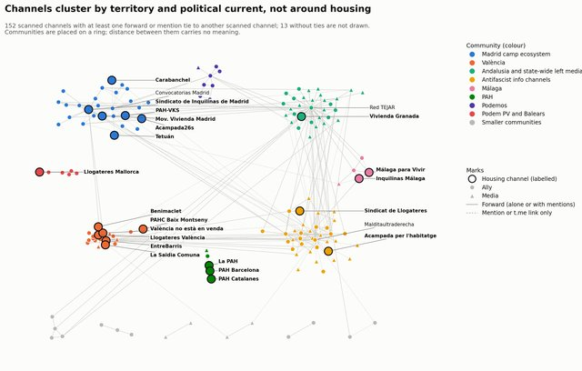
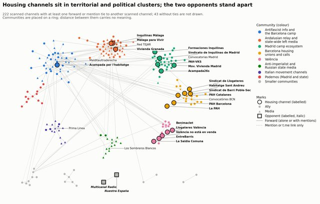
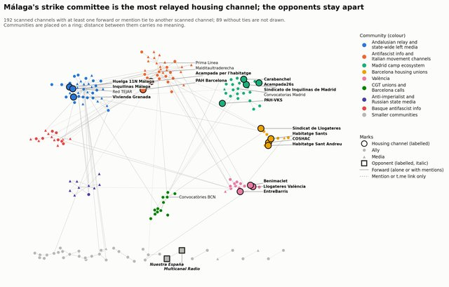
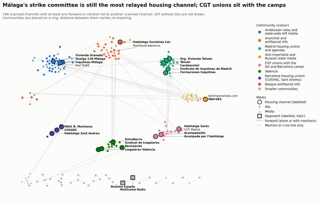
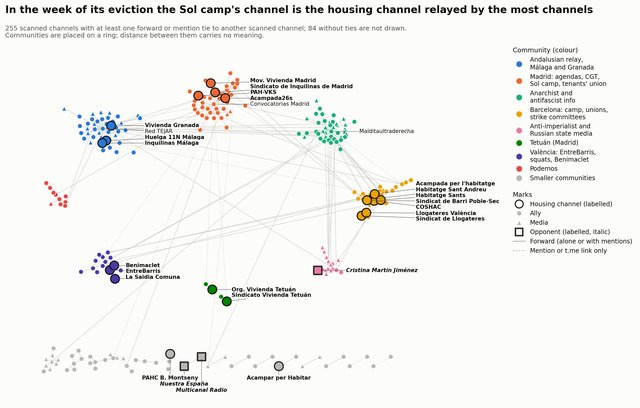
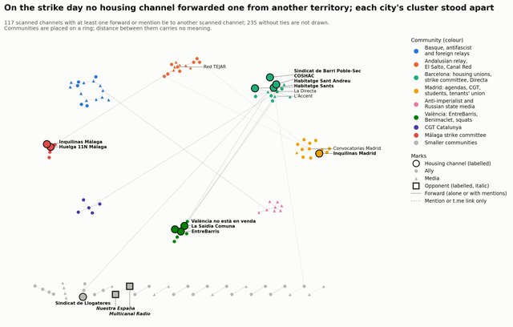

# Acampadas por la vivienda en Telegram, España, otoño de 2026

Un repositorio abierto y documentado de una investigación en curso.

<a href="../index.html">English</a> · <strong>Español</strong> · <a href="../ca/index.html">Català</a>

Un estudio de [DataPolitik](https://www.heuristica.barcelona/datapolitik/), de [Heurística](https://www.heuristica.barcelona/), Barcelona.

Un estudio de los canales públicos de Telegram del movimiento por la vivienda en España
y de sus aliados durante las acampadas que siguieron al desahucio de Maricarmen Abascal
en Madrid, y durante la preparación de la huelga general por la vivienda convocada para
el 11 de noviembre: cómo se
seleccionaron y clasificaron los canales, y qué muestran sus redes de reenvíos y
menciones.

## Periodos

| Periodo | Días (2026) | Canales al final | Informe |
|---|---|---|---|
| Primer estudio | 14 de septiembre – 5 de octubre | 167 | [Informe técnico](acampadas_vivienda_technical_report.md) · [Análisis de comunidades](community_analysis.md) · [Revisión externa](external_review.md) · [Evidencias (CSV, en inglés)](../external_review_log.csv) |
| Bloque 1 | 6–19 de octubre | 265 | [Bloque 1](followup_block1.md) |
| Bloque 2 | 20–26 de octubre | 281 | [Bloque 2](followup_block2.md) |
| Bloque 3 | 27 de octubre – 2 de noviembre | 297 | [Bloque 3](followup_block3.md) |
| Bloque 4 | 3–9 de noviembre | 339 | [Bloque 4](followup_block4.md) |
| Día de huelga | 10 de noviembre 22:00 – 12 de noviembre 03:00 | 352 | [Día de huelga](followup_strike_day.md) |
| Bloque 5 | 10–16 de noviembre, con la huelga del 11 de noviembre | | en curso |

A partir del bloque 1, el primer estudio se extiende en bloques semanales: en cada bloque
se analizan los mismos canales y se añaden los que entran en la conversación. Cómo
funcionan y cómo se comparan se explica en la [presentación del seguimiento](followup.md);
sus decisiones de revisión están en el [registro de revisión del seguimiento (CSV, en
inglés)](../followup_review_log.csv).

Cada periodo de observación aporta nuevos datos y análisis. Los informes anteriores
siguen disponibles para documentar la evolución de la investigación, incluidas las
revisiones y los cambios de interpretación.

## A lo largo de los periodos

*Las figuras están en inglés.*

1. **El sindicato de Madrid deja de ser el nodo central.** El Sindicato de Inquilinas de
   Madrid es reenviado por 14 canales en el primer estudio y por 10 en el bloque 1, tras
   la muerte de Maricarmen; después, por 1, 2 y 5 en los bloques 2 a 4.
2. **El canal del comité de huelga de Málaga concentra los reenvíos de contenido de
   vivienda** desde el bloque 2, pero a través de los mismos tres o cuatro canales:
   volumen sin amplitud.
3. **La movilización pasa de las acampadas a la huelga del 11 de noviembre,** y quienes
   la apoyan discuten quién la dirige: los canales que critican a las direcciones de CCOO
   y UGT pasan de 5 a 19 en una semana y son 11 en el bloque 4, la semana anterior a la
   huelga, casi todos a favor de la huelga. El rechazo de la propia huelga sigue siendo
   marginal.
4. **Los grupos territoriales se conectan por debajo de sus canales de vivienda.** Los
   canales de vivienda apenas se reenvían entre territorios: el primer vínculo, en el
   bloque 3, es un comunicado conjunto de las acampadas tras el accidente ferroviario de
   Urda. Pero entre el 7 y el 11 % de los vínculos entre canales de territorio conocido
   cruzan territorios, sostenidos por colectivos anarquistas, antirrepresivos y de
   solidaridad con Palestina, medios en catalán y organizaciones presentes en varios
   territorios como CGT, cuyos canales de Madrid y de Cataluña se conectan a través de sus
   canales estatales.
5. **Los canales de las propias acampadas apenas se difunden**, salvo el de Sol el día
   de su desalojo, en el bloque 4.
6. **Los opositores siguen aislados:** dos medios hostiles que ningún otro canal reenvía
   ni cita, a los que se suma en el bloque 4 el canal de una autora (registrado desde el
   bloque 1, cuando se introdujo la categoría de opositor).

**El día de huelga.** El 11 de noviembre el panel publicó 3,6 veces más sobre la
movilización que en un día laborable corriente, pero reenvió solo un 15 % más. Los
medios y los sindicatos convocantes cubrieron el día en directo; los canales de vivienda
apenas se reenviaron, y ningún vínculo entre ellos cruzó de territorio. La crítica pasó
al gobierno por las cargas policiales. Véase la [página del día de
huelga](followup_strike_day.md).

## La red en cada periodo

Redes de reenvíos y menciones de los canales analizados, un mapa por periodo; cada mapa
lleva a su informe. Las comunidades se detectan por separado en cada periodo, así que
los colores y las posiciones no son comparables entre mapas.

<a href="community_analysis.html#combinado" style="display:block;text-decoration:none">Primer estudio 14 sep – 5 oct</a><a href="followup_block1.html#comunidades" style="display:block;text-decoration:none">Bloque 1 6–19 oct</a><a href="followup_block2.html#comunidades" style="display:block;text-decoration:none">Bloque 2 20–26 oct</a><a href="followup_block3.html#comunidades" style="display:block;text-decoration:none">Bloque 3 27 oct – 2 nov</a><a href="followup_block4.html#comunidades" style="display:block;text-decoration:none">Bloque 4 3–9 nov</a><a href="followup_strike_day.html#comunidades" style="display:block;text-decoration:none">Día de huelga 10–12 nov</a>

## Sobre este sitio

Este repositorio reúne los resultados sucesivos de una investigación en curso sobre
las redes de comunicación en Telegram en torno a las movilizaciones por la vivienda
en España. Publica informes, visualizaciones, documentación metodológica, decisiones
de clasificación y las evidencias procesadas en las que se basan los análisis, para
que el proceso de investigación pueda seguirse, los resultados puedan examinarse
críticamente y quede documentado cómo evolucionan las interpretaciones a medida que
llegan nuevas observaciones.

Los resultados son provisionales, están sujetos a revisión y no pretenden ofrecer una
representación exhaustiva del movimiento.

- Solo se leyeron canales y grupos públicos de Telegram, sin unirse a ellos.
- La recogida, la clasificación y el análisis los llevó a cabo un agente de IA siguiendo
  un protocolo escrito; el equipo fijó el protocolo, tomó las decisiones que cambiaban la
  muestra o la clasificación y revisó los resultados.
- El código y los datos en bruto no se publican.
- En los ficheros de evidencias, las cuentas de usuarios individuales y los orígenes de
  reenvíos con nombre oculto están seudonimizados, y se ha eliminado el texto de los
  mensajes de miembros de chats de grupo. Los canales se identifican por su nombre de
  usuario público.
- La muestra es una bola de nieve a partir de una semilla de nueve canales, no un censo.
  Conviene leer los apartados de limitaciones antes de sacar conclusiones.
- Los informes de los bloques y del primer estudio son traducciones del original en
  inglés; las figuras y los ficheros CSV están en inglés.

## Uso y citación de los resultados

Este repositorio está abierto a la lectura crítica, la discusión y la reutilización de
sus resultados, y animamos activamente a distintos públicos a utilizarlos.

- **Colectivos, sindicatos y activistas.** Apropiaos de los análisis: reinterpretad y
  adaptad los resultados, y utilizadlos en asambleas, debates, materiales de comunicación
  y vuestros propios análisis. Para los usos que cubre la licencia no hace falta pedir
  permiso, y nos interesa conversar sobre vuestras interpretaciones y experiencias.
- **Periodistas y medios.** Los resultados y las visualizaciones pueden reproducirse
  citando la fuente. Os pedimos que la identifiquéis como «DataPolitik, un programa de
  Heurística», preferiblemente con un enlace al informe concreto, que indiquéis el
  periodo de observación y que distingáis los resultados empíricos de las
  interpretaciones y las hipótesis.
- **Investigadores y analistas.** Son bienvenidas la revisión crítica, la comparación y
  la investigación posterior. Recomendamos citar el informe concreto, su periodo de
  observación, su fecha de publicación y la URL del repositorio; cada informe termina con
  una cita sugerida.

Son recomendaciones y no añaden condiciones a la licencia.

**Licencia.** Los textos, análisis y figuras originales que DataPolitik (Heurística)
publica aquí se distribuyen con la licencia
[Creative Commons Atribución 4.0 Internacional (CC BY 4.0)](https://creativecommons.org/licenses/by/4.0/). Pueden
compartirse, reproducirse, adaptarse y reutilizarse, también con fines comerciales, sin
pedir permiso, siempre que se reconozca la autoría: citando la fuente, enlazando la
licencia e indicando si se han hecho cambios. La licencia solo cubre el material sobre el
que el proyecto tiene los derechos. No se extiende al contenido de terceros, como los
mensajes de Telegram citados o referenciados en los informes y en los ficheros de
evidencias, las fotografías, las capturas de pantalla u otro material de procedencia
externa, ni a los logotipos de DataPolitik y Heurística. En los ficheros de evidencias
cubre las clasificaciones, decisiones y notas, no el contenido de Telegram citado.

**Cómo citar.**

DataPolitik (Heurística). <em>Acampadas por la vivienda y redes de comunicación en Telegram en España, otoño de 2026</em>. Repositorio de investigación en curso. <a href="https://datapolitik.github.io/acampadas-vivienda-report/es/">https://datapolitik.github.io/acampadas-vivienda-report/es/</a>

**Advertencias.**

- La investigación está en curso y los resultados pueden revisarse a medida que haya
  nuevas observaciones. El repositorio no pretende cubrir de forma exhaustiva el
  movimiento ni sus redes de comunicación.
- Reutilizar no implica aval: las interpretaciones o adaptaciones de terceros no deben
  presentarse como conclusiones respaldadas por DataPolitik o Heurística.
- La licencia CC BY 4.0 solo se aplica a los materiales originales sobre los que el
  proyecto tiene los derechos necesarios.
- Cualquier reutilización de información sobre personas identificables sigue sujeta a
  las obligaciones de privacidad y protección de datos aplicables.

Si queréis plantear preguntas, discutir interpretaciones, señalar errores o compartir
otros usos y perspectivas, estaremos encantados de conversar: podéis abrir una
[incidencia (*issue*) en el repositorio](https://github.com/DataPolitik/acampadas-vivienda-report/issues) o escribir a través de la
[página de contacto de Heurística](https://www.heuristica.barcelona/contactheu/).

---

Un estudio de [DataPolitik](https://www.heuristica.barcelona/datapolitik/), de [Heurística](https://www.heuristica.barcelona/). · [Inicio](index.md) · [Presentación del seguimiento](followup.md)
