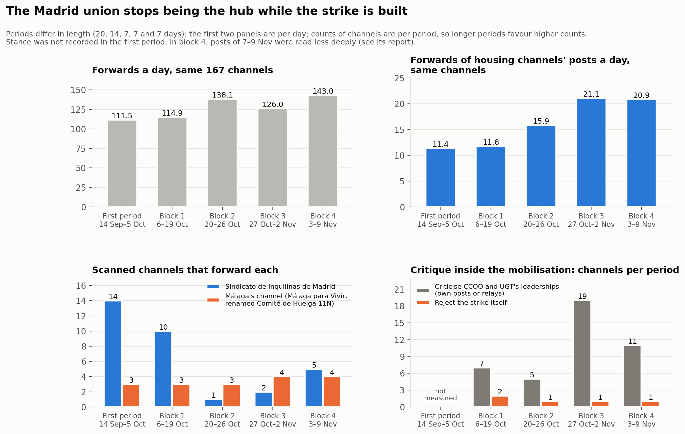
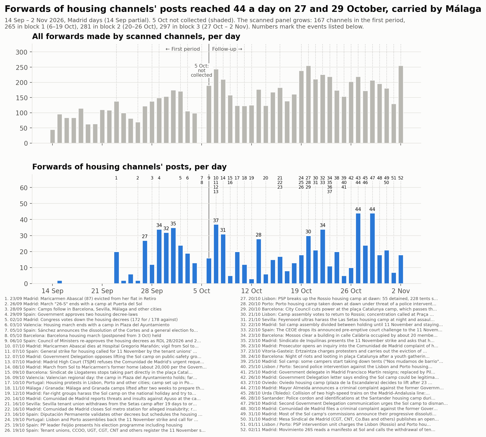

# Follow-up: 6 October to 2 November 2026

The [first study](acampadas_vivienda_technical_report.md) covered 14 September to
5 October 2026. The mobilisation went on: Maricarmen Abascal died on 7 October, the
tenant unions called a general strike for housing for 11 November, and the camps
started to lift. This follow-up extends the study in time, in weekly blocks, up to the
strike.

**Status:** blocks 1 to 3 (6 October – 2 November) are published here. Block 4
(3–9 November, which includes the clearing of the Sol camp on 3 November) and block 5
(10–16 November, the strike) will be added when they are complete.

| Block | Days (Madrid time) | Report |
|---|---|---|
| 1 | 6–19 October | [Block 1](followup_block1.md) |
| 2 | 20–26 October | [Block 2](followup_block2.md) |
| 3 | 27 October – 2 November | [Block 3](followup_block3.md) |

Every review decision, added or not, is in the [follow-up review log](followup_review_log.csv).

## How the follow-up works

- **A panel.** The first study's 167 channels are scanned in every block, and channels
  admitted in a block join the panel from the next one. No channel is removed: if a
  channel stops posting, that is a result. This lets blocks be compared with the same
  channels.
- **One review round per block.** Channels and groups that appear in a block's
  forwarding or mention graph, and handles that Telegram's public pages show to be
  public channels, are read. A candidate is admitted if it has at least one post of its
  own about the mobilisation in the block (three if it posts more than 300 times in the
  block). Block 1 had an additional round of forward expansion and hashtag discovery.
- **Stance, block by block.** Every channel gets a stance for each block, from the full
  text of its posts: supportive; critical from within (backs the mobilisation but
  disputes its organisers or strategy); hostile; reporting; or none.
- **Opponents.** A channel whose posts about the mobilisation are hostile is tagged
  *opponent*, whatever kind of channel it is. Opponents are scanned, so their ties to the
  rest are seen, but the channels they forward are not reviewed unless someone else also
  forwards them. The first study had no such category.
- **Fixed days.** Blocks run from midnight to midnight, Madrid time. **5 October is a
  gap:** the first study's collection ended on 5 October at 10:54 UTC and the follow-up
  starts on 6 October.
- **Agent-assisted work.** Collection, classification and analysis were carried out by
  an AI agent following a written protocol, with the team setting the protocol, taking
  the decisions that changed the sample or the classification, and reviewing the
  results.
- **Search terms per block.** The words that mark a post as being about the mobilisation
  are revised and tested in every block, because the vocabulary moves: from the camps to
  Maricarmen's death, the decrees and the strike.

## The trajectory

| | First period | Block 1 | Block 2 | Block 3 |
|---|---|---|---|---|
| Days | 14 Sep – 5 Oct (20) | 6–19 Oct (14) | 20–26 Oct (7) | 27 Oct – 2 Nov (7) |
| Channels in the panel at the end | 167 | 265 | 281 | 297 |
| Forwards a day, the first study's 167 channels | 111.5 | 114.9 | 138.1 | 126.0 |
| Forwards of housing channels' posts a day, same channels | 11.4 | 11.8 | 15.9 | 21.1 |
| Posts about the mobilisation a day, all channels | — | 101 | 73 | 76 |
| Channels forwarding the Sindicato de Inquilinas de Madrid | 14 | 10 | 1 | 2 |
| Channels forwarding Málaga's strike committee channel | 3 | 3 | 3 | 4 |
| Channels critical from within | — | 4 | 5 | 13 |
| Opponent channels | — | 2 | 2 | 2 |
| Share of forwards by the top five forwarders | 60 % | 51.1 % | 48.5 % | 46.5 % |
| Communities (modularity) | 14 (0.60) | 13 (0.698) | 18 (0.735) | 19 (0.736) |
| Agreement with the previous period's communities (adjusted Rand index) | — | 0.512 | 0.586 | 0.587 |

"—": not measured in that period. Posts about the mobilisation were not downloaded for
the whole sample in the first study, and stance was not recorded.

## Main findings so far

1. **The Madrid union stops being the hub.** In the first study the Sindicato de
   Inquilinas de Madrid was forwarded by 14 channels, more than any other housing
   channel. In block 1, after Maricarmen's death, by 10; in blocks 2 and 3, by 1 and 2.
   It posts much less on its channel and, by its own account, no longer keeps a
   permanent post in Sol.
2. **Málaga's channel carries the forwarding of housing content.** Málaga para Vivir,
   renamed "Comité de Huelga 11N · Málaga", accounts for 98 of the 130 forwards of
   housing channels' posts in block 2 and 128 of 176 in block 3. Its posts are forwarded
   by the same three or four channels many times each: volume without breadth.
3. **The mobilisation turns from the camps to the strike, and dissent grows inside it.**
   Posts in blocks 2 and 3 are almost all about building the 11 November strike. Channels
   that back the strike while disputing the role of CCOO and UGT, or the strike's scope,
   go from 5 in block 2 to 13 in block 3, among them Granada's housing union and an open
   letter of Madrid's alternative unions.
4. **Territorial clusters still do not forward each other.** Every forward between
   housing channels stays within Madrid, Barcelona, València or Málaga. The first tie
   across territories appears in block 3, and it is a mention: a joint statement by the
   camps of several cities after the Urda rail crash.
5. **The camps' own channels stay almost unrelayed.** The Sol camp's channel posted 50,
   32 and 11 times in the three blocks and was forwarded 3, 7 and 2 times; the Barcelona
   camp's channel posted 103, 24 and 19 times and was forwarded once, once and not at all.
6. **Barcelona's housing unions emerge as a cluster of their own**, and in block 3 the
   Sol and Barcelona camps sit in one community with the CGT unions that relay their
   posts. The other territorial clusters (Madrid, València, Málaga with the Andalusian
   relay) persist from the first study.
7. **The opponents are a closed pair.** Two media channels are hostile in every block:
   **Nuestra España Noticias** and **Multicanal Radio**. Multicanal Radio forwards
   Nuestra España (149, 74 and 76 times) and celebrity gossip; no other channel forwards
   or quotes either. Their hostility is in their own posts, for example Nuestra España's
   headline "La ridícula huelga general que llega ocho años tarde" and Multicanal Radio's
   "Sindicato de Inquilinas, la mano de la Revolución de la Ultra-izquierda". In block 3
   their stance rests on weaker evidence (adversarial headlines without an explicit
   attack); read as reporting, both would return to media. In the first study
   Multicanal Radio was the second-largest forwarder, tagged media, because there was no
   opponent category.

## The continuous timeline

## Limits

- **The sample grows by design.** Comparisons between periods are made on the same
  channels where it matters (the "same channels" rows above); totals over all channels
  are not comparable.
- **Block lengths differ.** Counts of channels per period favour the longer periods.
- **Text only.** Images, videos and linked articles were mostly not read.
- **Private channels and groups are invisible,** among them several camps' and housing
  assemblies' channels (see each block's report).
- **Stance and opponents are judgements**, listed in each block's report with the
  alternatives.
- **Context** comes from the press, with disagreements between sources noted in each
  block.

---

A [DataPolitik](https://www.heuristica.barcelona/datapolitik/) study by [Heurística](https://www.heuristica.barcelona/). · [Home](index.md) · [Follow-up overview](followup.md)
