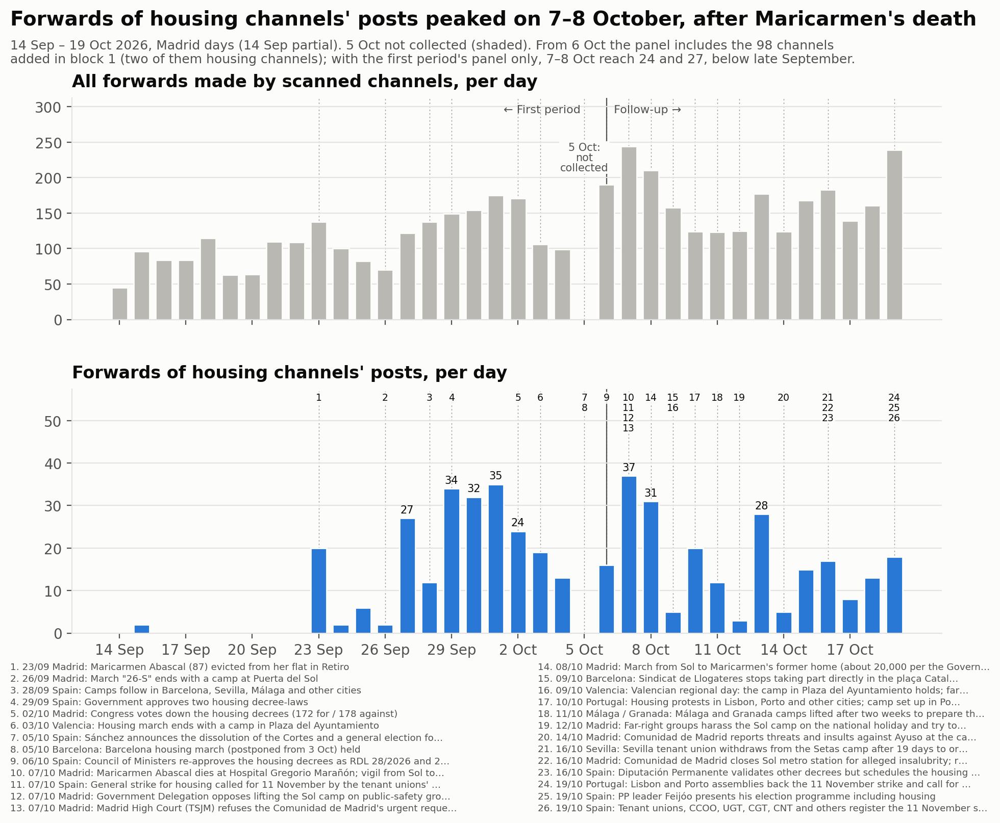
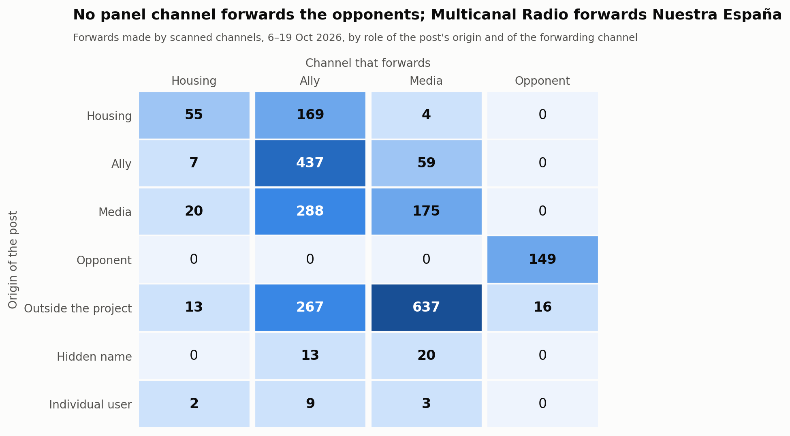
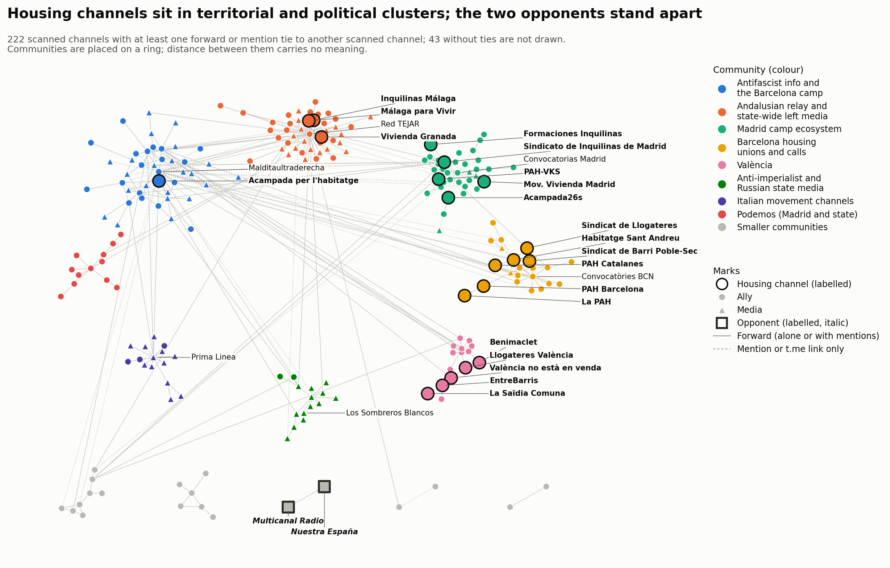

# Block 1 — 6 to 19 October 2026

<strong>English</strong> · <a href="es/followup_block1.html">Español</a> · <a href="ca/followup_block1.html">Català</a>

Part of the [follow-up](followup.md) of the housing mobilisation on Telegram.
Block 1 covers 6 October 00:00 to 19 October 24:00, Madrid time (2026-10-05T22:00Z to
2026-10-19T22:00Z). The baseline is the [first period](acampadas_vivienda_technical_report.md)
(14 September to 5 October). **5 October is a gap:** the first period's
collection ended on 5 October at 10:54 UTC and the follow-up starts on 6 October; the gap
was not filled and is shaded in the timeline.

## 1. What happened in the block

Dated events, each with at least one press source. In short:

- **6 Oct.** The Council of Ministers re-approved the two housing decrees that Congress
  had voted down on 2 October. On 5 October a general election had been called.
- **7 Oct.** Maricarmen Abascal (87), whose eviction on 23 September started the
  protests, died in hospital, and a vigil went from Sol to the Congress. The tenant
  unions called a **general strike for housing for 11 November**. The Madrid High Court
  (TSJM) refused again to order the Sol camp cleared. Sources date this refusal to
  5 or 7 October; it is recorded on 7 October with a note.
- **8 Oct.** About 20,000 people marched from Sol to Maricarmen's former home (the
  Government Delegation's figure).
- **9–11 Oct.** The Sindicat de Llogateres stopped taking part directly in the plaça
  Catalunya camp. Valencia's camp held on the regional day. A camp was set up in Porto.
  The Málaga and Granada camps were lifted to prepare the strike, according to the press. Posts by CAT-AIT Granada, admitted in the second round,
  disagree: they relay the Granada camp's assemblies on 13 and 14 October and hold a
  talk "en la Acampada de Granada" on 16–17 October. Not resolved.
- **12 Oct.** Far-right groups harassed the Sol camp on the national holiday. Reports
  give either two or five arrests.
- **14–16 Oct.** The Comunidad de Madrid reported threats against Ayuso to the
  prosecutor and closed the Sol metro station. The Sevilla tenant union left the Setas
  camp. The Diputación Permanente scheduled the vote on the decrees for 12 November.
- **19 Oct.** Assemblies in Lisbon and Porto backed the 11 November strike. Feijóo (PP)
  presented his programme, which includes housing.

## 2. The sample

### Panel and review

The follow-up started with the first period's 167 channels: 24 in-scope, 91 ally, 50 media,
2 out-of-scope. No channel was removed. The two out-of-scope channels were kept in the
panel and given a role after reading (below). Two rounds added **98 channels**. Every
decision, added or not, is in the [review log](followup_review_log.csv) (block 1, column
`round`).

- **Review round:** 78 channels (49 ally, 28 media, 1 in-scope) out of 296 candidates
  read.
- **Second round (forward expansion and hashtag discovery)**, an additional round run after the
  review: 20 channels (15 ally, 3 media, 2 in-scope) out of 72 candidates read.
  - **Hashtag discovery:** Telegram's hashtag search on 13 of the block's campaign hashtags
    returned 26 channels. 15 were already in the panel, **both opponents among them**;
    one had already been rejected; 10 were new.
  - **Forward expansion:** the forward origins not yet in the panel or reviewed, taken from the
    collected forward events. All 63 were forwarded only by channels admitted in the review round.
  - No candidate of either kind was hostile.
  - The design asks for one review round per block. This round is an addition and is
    kept apart in the log and in the sensitivity check below.

**Panel after block 1 (265 channels), by role and block-1 stance.** Numbers in brackets
are the channels added in block 1 (review round + second round).

| Role | supportive | critical-within | reporting | hostile | none | not readable | total |
|---|---|---|---|---|---|---|---|
| in-scope | 25 (1+2) | 0 | 0 | 0 | 2 | 0 | 27 (1+2) |
| ally | 134 (46+14) | 3 (1+1) | 2 (2+0) | 0 | 16 | 0 | 155 (49+15) |
| media | 47 (16+0) | 1 | 26 (12+3) | 0 | 6 | 1 | 81 (28+3) |
| opponent | 0 | 0 | 0 | 2 | 0 | 0 | 2 |
| out-of-scope | 0 | 0 | 0 | 0 | 0 | 0 | 0 |

The two in-scope channels of the second round:
- **Sindicat de Barri del Poble-Sec**, a neighbourhood union that stops evictions. It set
  up the Poble-Sec strike committee "per l'habitatge #11N" (#2179).
- **Sindicat d'Habitatge de Sant Andreu**, a housing union: "11N VAGA GENERAL… Salaris
  pels terres i lloguers pels núvols" (#1511).

### Role changes

- **Nuestra España Noticias** (@nuestraespana): media → **opponent** (kind: media). Its
  own headlines included "La ridícula huelga general que llega ocho años tarde"
  (#1947), "jóvenes patriotas se enfrentaron a los izquierdistas de la Puerta del Sol"
  (#2039) and "varias agresiones en plena calle por acampados de Sol" (#2040).
- **Multicanal Radio** (@multicanalr): media → **opponent** (kind: media). Its own posts
  included "LOS COME GAMBAS CONVOCAN HUELGA GENERAL" (#4198) and "Sindicato de
  Inquilinas, la mano de la Revolución de la Ultra-izquierda" (#4302). It also forwards
  Nuestra España. In the first period it was the second-largest forwarder (11 % of
  forwards), tagged media, because that period had no opponent category.
- **Roto2bot** (@roto2botfc): out-of-scope → **media** (an aggregator), stance
  reporting. It is a bot that reposts the titles of the most-answered threads on the
  Forocoches forum. About 25 titles were about the mobilisation: some hostile, some
  supportive, some neutral.
- **MEME_CCC** (@meme_ccc): out-of-scope → **media**, stance critical-within. Its one
  image post on the strike mocks UGT's leader (#VendeObreros).

### Attrition

- **Silent:** six channels posted nothing in the block.
  - Ally: @CJSocialista, @CanadaSeQueda, @convocatoriascadiz, @mitxisantifascistas.
  - In-scope: @cuadernosdetrabajo, @ghlescorts.
- **Private:** @elsaltomadrid (El Salto Madrid, media) is private and has no stance.
- **Renamed:** no username changed. Two titles changed.
  - @malagaparavivir: "Málaga para Vivir" became "**Comité de Huelga 11N • Málaga**".
  - @acampada26s: "Acampada26s" became "Acampada 26S".

## 3. Analysis

### Volume

**Forwards.** Scanned channels made 2,343 forwards in the block, not counting
self-forwards: 167.4 a day on average.

- That figure includes the 98 channels added in this block. The first period's panel
  alone made 114.9 a day, against 111.5 a day in the first period (15 September –
  4 October).
- At equal panel, the volume of forwards hardly changed.

**Forwards of in-scope channels' posts.** 228 in the block, 16.3 a day, against 11.4 a
day in the first period. The block figure counts the two new in-scope channels' posts
and the new channels' forwards.

- On the first period's panel and in-scope list alone: 11.8 a day, with 24 on
  7 October and 27 on 8 October.
- With the whole panel the block's peaks follow Maricarmen's death: 37 on 7 October and
  31 on 8 October, and 28 on 13 October.
- So the peaks above the first period's highs (34–35 on 29 September – 1 October) come
  from the larger sample, not from more forwarding by the same channels.

**Posts about the mobilisation** (posts that match the engagement terms, all downloaded
channels): 1,409.

- By role: 204 core, 670 ally, 484 media, 51 opponent.
- By stance: 1,259 supportive, 93 reporting, 51 hostile, 6 critical-within.
- They peaked on 8 October (299) and 7 October (215) and fell to 30–105 a day in the
  second week.
- No baseline exists for this measure: posts were not downloaded for the whole panel in
  the first period.

**With and without added channels.** Four added channels each bring in more than ten
graph nodes that nothing else references:
- review round: @MTnews_Espanol (20) and @ophiucu (13);
- second round: ANRed (24) and Conflict News (14).

Their evidence was re-read and all four decisions stand. No added channel makes more
than 15 % of the block's forwards; the largest is @ophiucu with 9.9 %.

| | forwards | per day | mobilisation posts |
|---|---|---|---|
| all scanned channels | 2,343 | 167.4 | 1,409 |
| without MT News (RT relay) | 2,343 | 167.4 | 1,404 |
| without Los Sombreros Blancos [Z] | 2,111 | 150.8 | 1,403 |
| without ANRed | 2,343 | 167.4 | 1,407 |
| without Conflict News | 2,325 | 166.1 | 1,407 |
| without the 20 second-round channels | 2,167 | 154.8 | 1,315 |
| without the 78 review-round channels | 1,785 | 127.5 | 1,134 |
| without all 98 added channels | 1,609 | 114.9 | 1,040 |

MT News and ANRed make no forwards; they post links. Without Los Sombreros Blancos the
media column shrinks from 898 to 666 forwards. None of the conclusions below depends on
any one of these channels.

**Concentration.** The top five forwarders make 51.1 % of all forwards:

| Channel | Role | Forwards | Share |
|---|---|---|---|
| Red TEJAR | ally | 382 | 16.3 % |
| Prima Linea | media | 297 | 12.7 % |
| Los Sombreros Blancos | media | 232 | 9.9 % |
| Multicanal Radio | opponent | 165 | 7.0 % |
| @nullaesrbu | media | 122 | 5.2 % |

### Who forwards whom

Forwards, by role of the post's origin and of the forwarding channel. The first period's
figures are in brackets.

**Posts by housing channels**
- 169 forwarded by allies (156).
- 55 forwarded by other housing channels (76).
- 4 forwarded by media (4).

**Housing channels forwarding others**
- 7 forwards of allies (12).
- 20 forwards of media.
- 13 forwards of outside channels.

The pattern of the first period holds: **allies relay the housing channels; the housing
channels relay little.** The rise in housing channels forwarding media and outside
channels comes from the two new Barcelona unions; Sant Andreu alone makes 40 forwards.
Media forward mostly outside channels: 637 of the media column's 898.

**Opponents.** The opponent row and column contain only two flows:
- Multicanal Radio forwarding Nuestra España, 149 times.
- Multicanal Radio forwarding an outside celebrity-news channel, 16 times.

No panel channel forwards or @-mentions an opponent, and the opponents do not forward
or mention panel channels.

### Hub, relays, territories and camps

**The Madrid union.** The Sindicato de Inquilinas de Madrid stays the hub by breadth.
- Block: forwarded by 10 scanned channels, 39 forwards.
- First period (20 days): forwarded by 14 channels, 31 forwards.
- Next by breadth is a new channel: Sindicat de Barri del Poble-Sec, forwarded by 4
  channels (18 forwards).

**Breadth versus volume.** The Málaga channels are forwarded more often but by fewer
channels.

| Channel | Forwards | Channels that forward it |
|---|---|---|
| Inquilinas Málaga | 66 | 4 |
| Málaga para Vivir | 53 | 3 |

36 of those forwards are the two Málaga channels forwarding each other.

**Smaller relays**

| Channel | Channels that forward it | Forwards |
|---|---|---|
| Vivienda Granada | 2 | 18 |
| València no està en venda | 3 | 10 |
| EntreBarris | 3 | 3 |
| Llogateres València | 3 | 3 |

**Unrelayed channels.** 11 of the 27 in-scope channels were forwarded by no scanned
channel.

**Territorial clusters still do not forward each other.** There are twelve forward ties
between in-scope channels.
- **Across territories:** one, within one organisation: La PAH → PAH Barcelona (1).
- **Within territories:**
  - Málaga: 36 forwards between its two channels.
  - Barcelona: 4 ties. Poble-Sec → Sant Andreu (8), Sindicat de Llogateres → Poble-Sec
    and → Sant Andreu, PAH Catalanes → Sant Andreu.
  - València: 4 ties.
  - Madrid: Formaciones → Sindicato de Inquilinas de Madrid.
- **New since the first period:** the second round adds a Barcelona cluster of housing
  channels that forward each other.

**Camp channels are barely relayed.**
- Acampada26s (Madrid): 50 posts in the block, forwarded 3 times by one channel
  (Difusión urgente, added in the second round), @-mentioned by two.
- Acampada per l'habitatge (Barcelona): 103 posts, forwarded once (by @antifascistas),
  mentioned by two.

In the first period neither camp channel was forwarded.

### Ties that appeared and disappeared

The comparison covers the 165 panel channels scanned in both periods, so the added
channels do not change it.

| Ties between them | Block 1 | First period |
|---|---|---|
| Total | 221 | 365 |
| Kept | 154 | 154 |
| New in block 1 | 67 (50 forward, 17 link) | – |
| Gone since the first period | – | 211 (148 forward, 63 link) |

The first period is 20 days and the block 14, so part of the loss is the shorter window.

New ties:
- Podemos channels forward each other: @ahorapodemos → PodemVLC, PodemPV, Pablo
  Echenique and others.
- Sare Antifaxista (Basque antifascist info) now forwards the Sindicato de Inquilinas de
  Madrid (2 forwards).
- La Directa is now forwarded by PAH Barcelona and PAH Catalanes.
- València no està en venda is forwarded by EntreBarris.

### Contact between opponents and the rest

Every event that joins an opponent and a non-opponent was read: 17.

- **16 relays of celebrity gossip.** Multicanal Radio forwards posts by @elmarujeo about
  actors, singers and influencers. None concerns the mobilisation. @elmarujeo was not a
  review candidate, because only an opponent references it.
- **1 @-mention.** It is the byline handle of the author of a Nuestra España article
  about the PSOE ("Historia del 'gang' del PSOE - TERCERA PARTE", #2010). It is not
  about the mobilisation, and the account is pseudonymised.

There is **no hostile-quote tie**: no panel channel forwards or links an opponent's post
to quote it. The opponents' hostility shows in their own posts: 51 posts about the
mobilisation, all by these two channels. The opponents form a closed pair; the network
map draws them apart.

### Communities

Combined forward-and-mention graph of the scanned channels: 222 nodes, 385 edges, 43
scanned channels without ties.

**Louvain over 50 seeds.**
- Consensus labels: 13 communities, modularity 0.698. The partition by role scores
  0.121.
- Stability:
  - 16 distinct partitions; the most frequent occurs in 16 % of runs.
  - Mean node stability 0.95.
  - Eleven nodes are below 0.8; ten of them, at the borders of communities 1–3, at 0.55:
    - @XRMadrid, @xrebellion_esp, @Rebelioncientifica and @madconvocala;
    - @SevillaAnticarcelaria, @gruporuptura and @ZaragozaCNT;
    - @anticapimadrid, @liberarmadrid and @anticapitalistasmov.
  - The eleventh is @PabloEchenique (0.75).
- The first period had 14 communities, modularity 0.60, 31 distinct partitions with an
  8 % top share, and mean node stability 0.96.

The communities, named by their main channels:

| # | Name | Channels | Core members |
|---|---|---|---|
| 1 | Andalusian relay and state-wide left media | 45 | Inquilinas Málaga, Málaga para Vivir, Vivienda Granada |
| 2 | Antifascist info and the Barcelona camp | 42 | Acampada per l'habitatge (also Sare Antifaxista and the Basque channels) |
| 3 | Madrid camp ecosystem | 36 | Sindicato de Inquilinas de Madrid, Acampada26s, PAH-VKS, Formaciones, Mov. Vivienda Madrid |
| 4 | Barcelona housing unions and calls | 22 | Habitatge Sant Andreu, Poble-Sec, PAH Barcelona, Sindicat de Llogateres, PAH Catalanes, La PAH |
| 5 | Anti-imperialist and Russian state media | 15 | — (TASS, Los Sombreros Blancos, MT News, ANRed, Cubadebate, Al Mayadeen) |
| 6 | Italian movement channels | 15 | — (Prima Linea, Radio Onda d'Urto, C.S.O.A. Ex Snia, Infoaut, Conflict News) |
| 7 | València | 15 | València no està en venda, EntreBarris, Llogateres València, Benimaclet |
| 8 | Podemos (Madrid and state) | 12 | — |
| 9–13 | CNT-AIT and Palestine solidarity (8); CCOO (6); **opponents** (2); Marx21 (2); Sevilla calls (2) | | — |

**Agreement with the first period.** On the 131 channels present in both combined
partitions, the adjusted Rand index is **0.512**: 21 channels appear only in the first
period's graph and 91 only in this block's. The territorial structure persists: Madrid,
València, and Málaga with the Andalusian relay.

The main change in this block is Barcelona. With the second round's channels, the
Barcelona housing organisations form a community of their own. In the first period and
in the review-round version of this block, they sat with the antifascist info channels.
The other change is new channels forming their own communities: Italian movement
channels, and Russian state and anti-imperialist media.

## 4. Term lists

The block-1 lists were derived from scratch and tested. The vocabulary moved
from the first period's camp terms to new ones:
- the 11 November strike, written as 11N with a case-sensitive rule and a
  date-plus-strike proximity rule;
- Maricarmen;
- the decrees;
- the tenant unions' names;
- the campaign hashtags;
- Basque, Galician and Portuguese forms.

Two false positives led to the proximity rules: the Pope's visit of "8 to 11 November",
and the Basque date "urriaren 11n". Known gaps, to fix in block 2:
- "a la huelga" without "general";
- image-only posts.

The Madrid education strike (from 14 October) is a separate dispute and is not in the
lists.

## 5. Judgement calls that could have gone the other way

**Stance and roles**
- Roto2bot as media/reporting; it could be an opponent (kind: aggregator).
- MEME_CCC as critical-within; it could be hostile.
- @gruporuptura as critical-within; it could be supportive.
- @bultzaka (Bultza EHM-L) as ally/critical-within. Its article calls the one-day
  strike "oportunista y electoralista"; it could be out of scope for the housing
  mobilisation.
- Media: supportive when the channel takes a position in its own words, reporting when
  it carries only headlines. Borderline: Al Mayadeen, eldiario.es, Diari La Veu, Crític.
- Passing mentions and bare X links were read as stance *none*. The links were not
  followed.
- Several supportive stances rest on one short post: MovimientoAntirrepreMad,
  oscarreinasat, podemosparla, reinonis_vlc, sentitcritic, azadijinvalencia,
  convocatoriasevilla.
- Posts about the housing decrees count as posts about the mobilisation.

**Review**
- The rule that a channel with more than 300 messages needs three posts about the
  mobilisation, in its own words, rejected nine channels with one or two such posts.
  They include HispanTV, Data Urgente, Entre Guerras and DD Geopolitics.
- Formaciones Sindicato de Inquilinas admitted as in-scope; it could be ally.
- Contropiano admitted on a link to its own article whose address names the 11 November
  strike. The article was not opened.
- ALUCHE.RED admitted because the event page it links ties its youth strike committee to
  the 11 November strike.
- Ecologistas Indignadas rejected: its "la ciudad efímera de Sol" link (10 Oct) could not
  be verified.
- Radical Graffiti admitted as ally/reporting; C.S.O.A. Ex Snia admitted on one Italian
  post that no term matched.
- Group chats rejected as open chatter.
- Housing activism not tied to the mobilisation rejected (Avlaunionhtz, colabbikestein).
- Education-strike posts not counted as the mobilisation.

**Second round (forward expansion and hashtag discovery)**
- Running it at all: the design has one review round per block. Its effect is shown
  separately in the sensitivity table.
- Sindicat de Barri del Poble-Sec as in-scope (a neighbourhood union that stops
  evictions); it could be ally.
- Kursant as ally/critical-within: its document says the strike call "quedará en una
  estrategia electoralista de CCOO, UGT y PSOE".
- Descontrol Editorial and Difusión urgente admitted on one post each: a reading list
  framed by the strike, and campaign hashtags in an electoral post.
- CA-AIT Marina Alta admitted on a support statement "al moviment per la vivenda" whose
  linked text was not opened.
- elintrusoAVE rejected: its "respeto y admiración por #laacampadadeSol" is a passing
  phrase in an electoral post.
- AV La Unión de Hortaleza's rejection kept. Its #NosQuedamos post is about the UVA de
  Hortaleza estate.
- Hashtags searched: only those used by at least two in-scope channels; generic tags
  left out.

**Analysis**
- Unidentified handles that are not verified public channels or groups are pseudonymised
  in the graph and analysis files. Some may be organisations.
- Community names are interpretations of each community's main channels.

## 6. What was not verified

**Content not read**
- **Images, videos and audio:** not read, except two image posts read on the public web
  preview (MEME_CCC #1008, Sistema 161 #3509).
- **Links:** linked articles and X links were not followed, except a few named above.
- **Large review candidates:** for candidates with 30 or more own posts and no term
  match, only a broad keyword check was run. For the smaller ones, every post's opening
  was read, and the full text only where it could concern the mobilisation.

**Channels and accounts not reached**
- **Private channels:** seven candidates could not be read, including three camp or
  housing channels (Acampada Plaça Ajuntament, València; ACAMPADA CONSTITUCIÓN, Málaga;
  Difusión Asamblea de Vivienda Sevilla). El Salto Madrid in the panel could not be read
  either.
- **Unidentified handles:** 160 handles with no public account were not checked further.
  27 handles of users or bots were not candidates.
- **Hashtag search coverage:** Telegram's hashtag search returns public broadcast
  channels only, not groups. The search does not record which tag found which channel.
- **Second-round links:** the second round's forward expansion covers forward origins only. The new
  channels' link targets were not reviewed.

**Gaps in the data**
- **5 October:** not collected, by design.
- **Dates:** the TSJM refusal date and the number of arrests on 12 October differ
  between sources.

**Not checked**
- **Colours:** the network map relies on ring position and the legend where colour pairs
  fail the all-pairs colour check.

**Cite this page.**

DataPolitik (Heurística). <em>Block 1 — 6 to 19 October 2026</em>. In <em>Housing camps and Telegram communication networks in Spain, autumn 2026</em>. Observation period: 6–19 October 2026. Published 7 November 2026. <a href="https://datapolitik.github.io/acampadas-vivienda-report/followup_block1.html">https://datapolitik.github.io/acampadas-vivienda-report/followup_block1.html</a>

Original text and figures: [CC BY 4.0](https://creativecommons.org/licenses/by/4.0/) · [Use and citation](index.md#use-and-citation)

---

A [DataPolitik](https://www.heuristica.barcelona/datapolitik/) study by [Heurística](https://www.heuristica.barcelona/). · [Home](index.md) · [Follow-up overview](followup.md)
