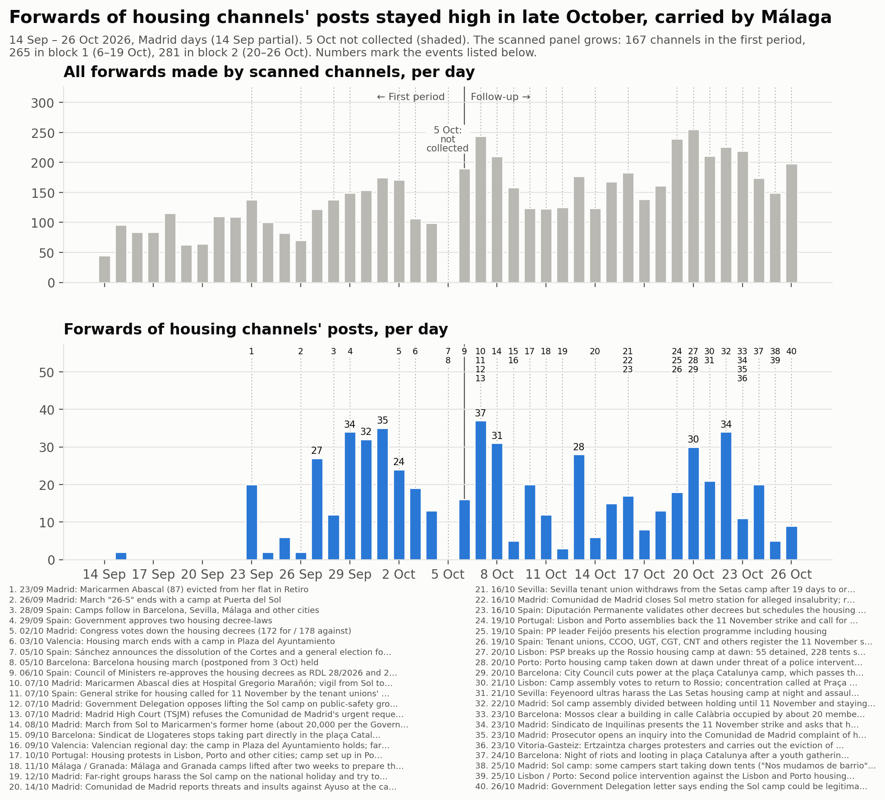
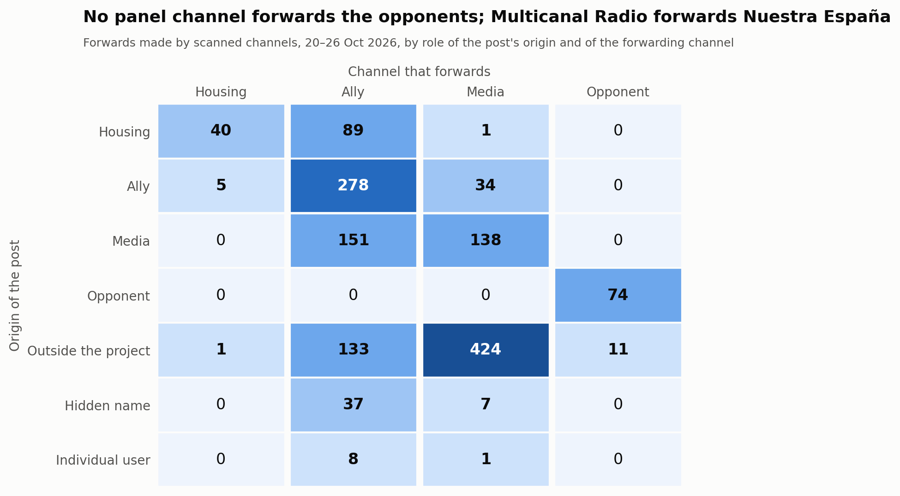
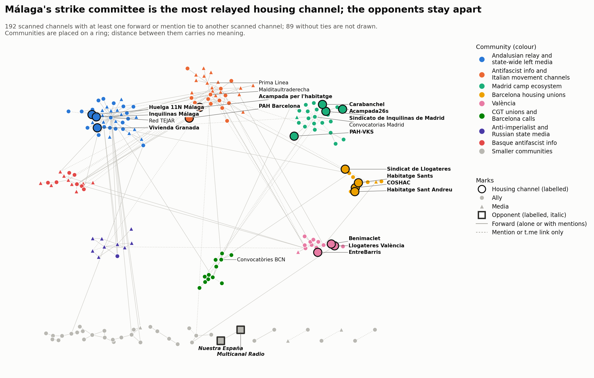

# Block 2 — 20 to 26 October 2026

Part of the [follow-up](followup.md) of the housing mobilisation on Telegram.
Block 2 covers 20 October 00:00 to 26 October 24:00, Madrid time (2026-10-19T22:00Z to
2026-10-26T23:00Z). Winter time began on 25 October, so the block's last two days have
25 and 24 hours.

- **Comparisons:** with block 1 (6–19 October) and, where comparable, with the first
  period (14 September – 5 October, the [first period](acampadas_vivienda_technical_report.md)).
- **The 5 October gap** is still not filled and is shaded in the timeline.
- **The block is 7 days long, block 1 14 days:** totals are compared per day.

## 1. What happened in the block

Dated events, each with at least one press source. In short:

- **20 Oct, Portugal.** The police (PSP) broke up the Rossio camp in Lisbon at dawn: 55
  detained and 228 tents seized, per the PSP. The Porto camp was taken down the same
  morning under threat of an intervention. Outlets disagree on whether the PSP or the
  protesters dismantled it.
  - On 21 Oct the Lisbon assembly voted to return to the Rossio.
  - A second intervention against both camps is reported for 25 Oct, by teleSUR citing
    RTP: 31 detained and 33 injured. Its date and figures are uncertain.
- **20 Oct, Barcelona.** The City Council cut the power at the plaça Catalunya camp, then
  in its fourth week with about 600 tents.
- **21 Oct, Sevilla.** Feyenoord ultras harassed the Las Setas camp at night and
  assaulted homeless people nearby before a Champions League match.
- **22 Oct, Madrid.** The Sol camp's assembly was divided between holding until
  11 November and staying indefinitely. Many campers were packing up.
- **23 Oct.**
  - **Barcelona:** about 20 members of the camp and the housing unions occupied a vacant
    building at calle Calàbria 177 ("La Revolta"). The Mossos cleared it the same day.
  - **Madrid:** the Sindicato de Inquilinas presented the strike and asked that housing
    be the axis of the 29 November campaign. It said it no longer keeps a permanent post
    in Sol.
  - **Vitoria-Gasteiz:** the Ertzaintza charged protesters and carried out the eviction
    of a family with six children in Sansomendi. Students from eleven schools stopped
    classes to join the protest.
- **24 Oct, Barcelona.** A night of riots and looting in plaça Catalunya followed a youth
  gathering called on social media: 128 detained, per the Mossos. Authorities distanced
  it from the camp in the same square.
- **25–26 Oct, Madrid.** Some campers began taking down tents ("Nos mudamos de barrio").
  On 26 Oct a Government Delegation letter said ending the camp could be legitimate
  after a reasonable time. El Español estimated attendance at about 1,000, down from a
  peak of 2,000.

After the block: the Sol camp was cleared on 3 November (block 4).

## 2. The sample

### Panel and review

Block 2 scanned the 265 channels of the panel. One review round then admitted **16 of
262 candidates read**:
- 202 channels and groups from the block's graph;
- 57 unidentified handles that Telegram's public pages showed to be public channels or
  groups;
- 3 channels found by probing brand + city usernames for local strike committees and
  camps (`huelga11n`, `huelgageneral11n`, `sindicathabsc`), all without content.

No local strike committee was found with a Telegram channel: the committees in the posts
link to the strike's website, WhatsApp and Instagram.

Every decision, added or not, is in the [review log](followup_review_log.csv) (block 2).

**Admitted**
- **in-scope:** COSHAC (Catalan confederation of housing unions); Grup d'Habitatge de
  Sants.
- **ally:** Anticapitalistas Aragón; CGT Barcelona; CGT Baix Llobregat; CGT
  Socioeconómico; CA-AIT Sierra de Madrid; Comunismo Revolucionário Galego; Laintersección;
  Agenda del Henares; Fridays For Future Madrid.
- **media:** ARAINFO, AhotsaInfo and Maldito Bulo (reporting); Wesh La Smala (supportive);
  Supernova (critical-within).
- Four of them had been rejected in block 1 and now pass on their block-2 posts: CGT Baix
  Llobregat, CGT Socioeconómico, AhotsaInfo and Wesh La Smala.

**Not admitted**
- Seven candidates were private.
- No candidate was hostile.

**Panel after block 2 (281 channels), by role and block-2 stance**

| Role | supportive | critical-within | reporting | hostile | none | not readable | total |
|---|---|---|---|---|---|---|---|
| in-scope | 20 | 1 | 0 | 0 | 8 | 0 | 29 |
| ally | 91 | 2 | 2 | 0 | 69 | 0 | 164 |
| media | 18 | 2 | 17 | 0 | 48 | 1 | 86 |
| opponent | 0 | 0 | 0 | 2 | 0 | 0 | 2 |
| out-of-scope | 0 | 0 | 0 | 0 | 0 | 0 | 0 |

### Stance changes since block 1

**No role changed.** Both opponents were hostile again.
- **Nuestra España**, in its own headline: "Maricarmen: administradora única de una
  empresa de alquileres de 5,7M, el timo que se tragó la izquierda" (#2122).
- **Multicanal Radio:** "¿ESPAÑA ARDERÁ COMO FRANCIA? Huelga 11N de UGT y CCOO al
  descubierto" (#4403). It also forwarded #2122.

**Critique within the movement appears for the first time among the core channels.** Each
of these backs the strike while disputing its co-organisers.
- **Sindicato de Vivienda de Granada (in-scope)** published a joint communiqué (read in
  the image on the web preview).
  - Its claim: "las burocracias sindicales de CCOO y UGT" call "una huelga simbólica... en
    favor del Gobierno", a strike at the service of "los intereses electorales del PSOE".
  - Its refusal: "No marcharemos con los cómplices de nuestra miseria. ¡Hacia la huelga
    general 11N!" (#588).
- **Liza Anarquista** relays the same communiqué.
- **Diario Socialista** carries the position of the Coordinadora Juvenil Socialista
  (CJS): the leaderships of CCOO and UGT "convierten la huelga en un acto electoral para
  el PSOE".
- **Bultza EHM-L and Supernova** object to the strike's "réformisme".

**Many channels have no stance this block.** 125 of the 265 panel channels have stance
*none* in block 2. They include the media that passed block 1's review on Maricarmen's
death: MT News, Los Sombreros Blancos and franceinfo.

### Attrition

Against block 1.

- **Silent:** 20 channels posted nothing in the block.
  - In-scope: La PAH, PAH Catalanes, Sindicato de Vivienda de Carabanchel, Cuadernos de
    trabajo, ghlescorts.
- **Private:** El Salto Madrid, still private.
- **Renamed:** one username, @airbnbcrepa → @lecitta. Three titles: the Basque antifa
  channel added "/ FAK!"; the renames of Málaga para Vivir and Acampada26s carry over from
  block 1.

## 3. Analysis

### Volume

**Forwards.** Scanned channels made 1,432 forwards in the block, not counting
self-forwards: **204.6 a day**, against 167.4 in block 1.

| Panel | First period | Block 1 | Block 2 |
|---|---|---|---|
| the first period's 167 channels | 111.5 | 114.9 | **138.1** |
| the panel at the end of block 1 (265) | – | 167.4 | 193.3 |
| all scanned channels | – | 167.4 | 204.6 |

At equal panel, forwarding rose about 20 % from block 1 to block 2.

**Forwards of in-scope channels' posts:** 130 in the block, 18.6 a day (block 1: 16.3).
- On the first period's panel and in-scope list alone: 15.9 a day (block 1: 11.8; first
  period: 11.4).
- Peak: 34 on 22 October.
- **Most of these forwards come from one channel**: Málaga's Comité de Huelga 11N, with
  98 of the 130. Its posts are forwarded about 33 times each by the same three channels:
  Inquilinas Málaga, Red TEJAR and La Invisible.

**Posts about the mobilisation** (posts that match the engagement terms; all downloaded
channels): 511, **73 a day** against 101 in block 1.
- On the panel at the end of block 1: 482, 69 a day.
- By role: 83 core, 300 ally, 119 media, 9 opponent.
- By stance: 449 supportive, 37 reporting, 12 critical-within, 9 hostile, 4 none (the
  last are false positives in channels read as *none*).
- Peaks on 21 October (113) and 26 October (110).

The talk about the mobilisation thins while forwarding grows. Forwards are about many
topics, among them Ceuta, Palestine, France's and Italy's protests and the election.

**With and without the admitted channels.** No admitted channel makes more than 15 % of
the block's forwards (the largest is Wesh La Smala, 59, 4.0 %). None brings in more than
two candidates that nothing else references. Without the 16 admitted channels: 1,353
forwards (193.3 a day) and 482 posts about the mobilisation.

**Concentration.** The top five forwarders make 48.5 % of all forwards:

| Channel | Role | Forwards | Share |
|---|---|---|---|
| Red TEJAR | ally | 230 | 16.1 % |
| Prima Linea | media | 209 | 14.6 % |
| Los Sombreros Blancos | media | 108 | 7.5 % |
| Multicanal Radio | opponent | 85 | 5.9 % |
| @nullaesrbu | media | 63 | 4.4 % |

### Who forwards whom

Forwards, by role of the post's origin and of the forwarding channel; block 1 in
brackets.

**Posts by housing channels**
- 89 forwarded by allies (169).
- 40 forwarded by other housing channels (55).
- 1 forwarded by media (4).

**Housing channels forwarding others**
- 5 forwards of allies (7).
- 0 forwards of media (20).
- 1 forward of an outside channel (13).

**Media** forward mostly outside channels: 424 of 605.

**Opponents.**
- Multicanal Radio forwards Nuestra España 74 times, and an outside celebrity-news
  channel 11 times.
- No panel channel forwards or @-mentions an opponent.

### Hub, relays, territories and camps

**The Madrid union is no longer the hub.**

| Sindicato de Inquilinas de Madrid | Channels that forward it | Forwards | Own posts |
|---|---|---|---|
| Block 1 (14 days) | 10 | 39 | 33 |
| Block 2 (7 days) | 1 (Difusión urgente) | 3 | 5 |

It posted much less on its channel. Its block-2 posts are about the strike, the "decreto
Maricarmen" and a Vistalegre event.

**Most relayed by breadth**

| Channel | Channels that forward it | Forwards |
|---|---|---|
| Comité de Huelga 11N · Málaga | 3 | 98 |
| COSHAC | 3 | 5 |
| Sindicat de Llogateres · València | 3 | 4 |

16 of the 29 in-scope channels were forwarded by no scanned channel.

**Territorial clusters still do not forward each other.** All five forward ties between
in-scope channels stay inside a territory:
- Málaga: 33 forwards.
- Barcelona: COSHAC → Sant Andreu and → Sants, Acampada per l'habitatge → PAH Barcelona.
- València: Llogateres → Benimaclet.

**Camp channels.**
- **Acampada26s (Madrid):** 32 posts, forwarded 7 times, all by Difusión urgente.
- **Acampada per l'habitatge (Barcelona):** 24 posts, forwarded once, by PAH Barcelona.

Both camps still post. Sol's posts are mostly assemblies, workshops and denials of hoaxes
("BULO", "FALSO").

### Ties that appeared and disappeared

The comparison covers the 263 panel channels scanned in both blocks.

| Ties between them | Block 2 | Block 1 |
|---|---|---|
| Total | 254 | 428 |
| Kept | 170 | 170 |
| New in block 2 | 84 (64 forward, 20 link) | – |
| Gone since block 1 | – | 258 (189 forward, 69 link) |

Block 1 is twice as long, so part of the loss is the shorter window.

New ties:
- The Madrid union is forwarded by Difusión urgente.
- The Barcelona union forwards Palestina SOS.
- CSOA l'Horta forwards València's housing channels.
- Anticapitalistas forward Red TEJAR.

### Contact between opponents and the rest

Every event that joins an opponent and a non-opponent was read: 12.

- **11 relays of celebrity gossip.** Multicanal Radio forwards @elmarujeo on actors,
  presenters and singers.
- **1 @-mention.** It is an author's byline in a Nuestra España article, "¿Quién está
  detrás de las manifestaciones en Europa?". The account is pseudonymised.

As in block 1 there is **no hostile-quote tie**, and the opponents are a closed pair.
Their hostility is in their own 9 posts about the mobilisation. Multicanal Radio
amplifies them by forwarding.

### Communities

Combined forward-and-mention graph: 192 scanned channels with ties, 278 edges; 89
scanned channels without ties.

**Louvain over 50 seeds**
- Consensus labels: 18 communities, modularity 0.735 (partition by role: 0.155).
- Stability: 6 distinct partitions; the most frequent occurs in 50 % of runs.
- Mean node stability 0.98. Five nodes are at 0.79, all at the edge of community 1:
  Canal Red, Irene Zugasti, Diario Red, Pablo Echenique, La Base.
- This partition is more stable than block 1's (16 partitions, 16 % top share).

| # | Name | Channels | Core members |
|---|---|---|---|
| 1 | Andalusian relay and state-wide left media | 37 | Comité de Huelga 11N Málaga, Inquilinas Málaga, Vivienda Granada |
| 2 | Antifascist info and Italian movement channels | 31 | Acampada per l'habitatge, PAH Barcelona |
| 3 | Madrid camp ecosystem | 24 | Sindicato de Inquilinas de Madrid, Acampada26s, PAH-VKS, Carabanchel |
| 4 | Basque antifascist info (with ARAINFO and Supernova) | 16 | — |
| 5 | València | 14 | Llogateres València, EntreBarris, Benimaclet |
| 6 | CGT unions and Barcelona calls | 12 | — |
| 7 | Anti-imperialist and Russian state media | 10 | — |
| 8 | Barcelona housing unions | 10 | COSHAC, Grup d'Habitatge de Sants, Habitatge Sant Andreu, Sindicat de Llogateres |
| 9–18 | Podemos; Anticapitalistas; CCOO; CNT-AIT; Podem València; **opponents** (2); Marx21; three pairs | 2–8 each | — |

**Agreement with block 1.** On 169 shared channels the adjusted Rand index is **0.586**.
The territorial clusters persist: Madrid, València, Málaga with the Andalusian relay,
and Barcelona's housing unions. What changed:
- **CGT and Barcelona calls:** the CGT unions and the Barcelona calls channel form their
  own community.
- **Italian channels:** they join the antifascist info channels.
- **The Barcelona camp:** its channel and PAH Barcelona sit with the antifascist info
  channels, not with the Barcelona housing unions.

## 4. Term lists

The block-1 lists were kept and nine engagement terms added, and the lists were tested
again.

**Terms added**
- **Hashtags:** #AcampadaSol and #HuelgaGeneral11N-style hashtags; the old terms missed
  them for lack of a word boundary.
- **Campaign:** the strike's website, the Catalan campaign #EnsCostalaVida, the typo
  "hulega general".
- **Strike phrases:** "huelga de inquilinas / alquileres" and "organizando la huelga
  general".
- **Decree:** "decret llei 29/2026".
- **Block 1's known gap:** "a la huelga" within 200 characters of a housing word.
- **Camps in other languages:** French "campement" and "campamento" in the same sentence
  as Sol, Madrid, Barcelone, logement or vivienda.
- **Portuguese:** "greve geral" with "habitação".

**Tests**
- 14 of 14 known positives match.
- 0 matches in the two unrelated channels.
- 60 context-only posts read.

**False positives found**
- "Comité de huelga" also catches the Madrid teachers' strike committee.
- The camp term caught a Venezuelan refugee-camp post among the review candidates.

Neither affects a decision, since decisions rest on reading.

**Accepted misses:** calls to the Barcelona camp's 23 October march that name neither
the camp nor the strike.

## 5. Judgement calls that could have gone the other way

**Stance**
- Granada's housing union as critical-within, from an image's text; it could be
  supportive, since it keeps calling the strike.
- Diario Socialista as critical-within; it could be supportive.
- Roto2bot stays reporting although its forum titles lean hostile ("Maricarmen tuvo una
  empresa que explotaba viviendas en alquiler"); it could be an opponent.
- España en Guerra supportive despite attacking the Madrid union's use of Ticketmaster.
- Grupo Ruptura as reporting (one news item); it was critical-within in block 1.
- Óscar Reina supportive on "¡Huelga General!" posts that do not name the strike.

**Review**
- CA-AIT Sierra de Madrid and Fridays For Future Madrid admitted on one short post each.
- Comunismo Revolucionário Galego admitted on Galicia's 11N strike call with the CIG.
- Supernova admitted as critical-within on its own article about the Basque housing
  strike.
- HispanTV rejected again by the >300-messages rule.
- CS El Ocho rejected: its "Comité de Huelga en Villaverde" could not be confirmed as the
  11N committee.

**Analysis**
- The baseline for ties and the hub is block 1.
- Equal-panel comparisons use the first period's 167 channels, or the panel at the end of
  block 1.

## 6. What was not verified

**Context**
- **Lisbon and Porto, 25 Oct:** the second police intervention's date and figures.
- **Núcleo Nacional at Sol, 25 Oct:** a channel's report of a new attack on the Sol camp
  (@fullblackAntifa #7636) was not found in the press.
- **Prosecutor's inquiry into the Ayuso complaint:** sourced from Wikipedia only.

**Content not read**
- **Images and videos:** not read, except @svgranada #588.
- **Links:** linked articles not followed.
- **Review candidates without keywords:** only the openings of their first posts were
  read.

**Channels and accounts not reached**
- **Private channels:** seven candidates are private, among them a pensioners' channel
  in Barcelona; El Salto Madrid in the panel is private too.
- **Hashtag search:** none this block. The block's review used the graph and handle
  probing only.

**Not checked**
- **Network maps:** their layout varies slightly between renders.

---

A [DataPolitik](https://www.heuristica.barcelona/datapolitik/) study by
[Heurística](https://www.heuristica.barcelona/). · [Home](index.md) · [Follow-up overview](followup.md)
