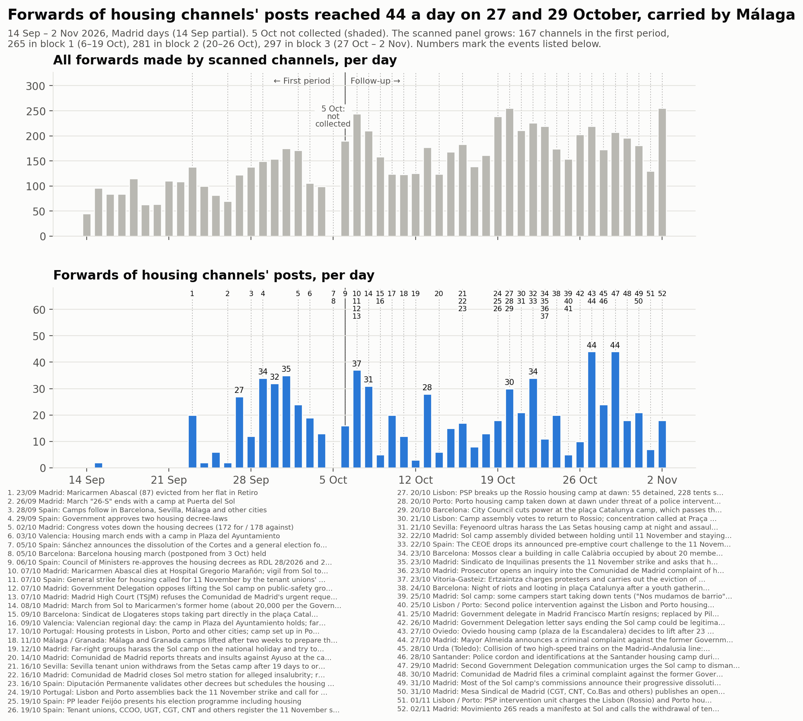
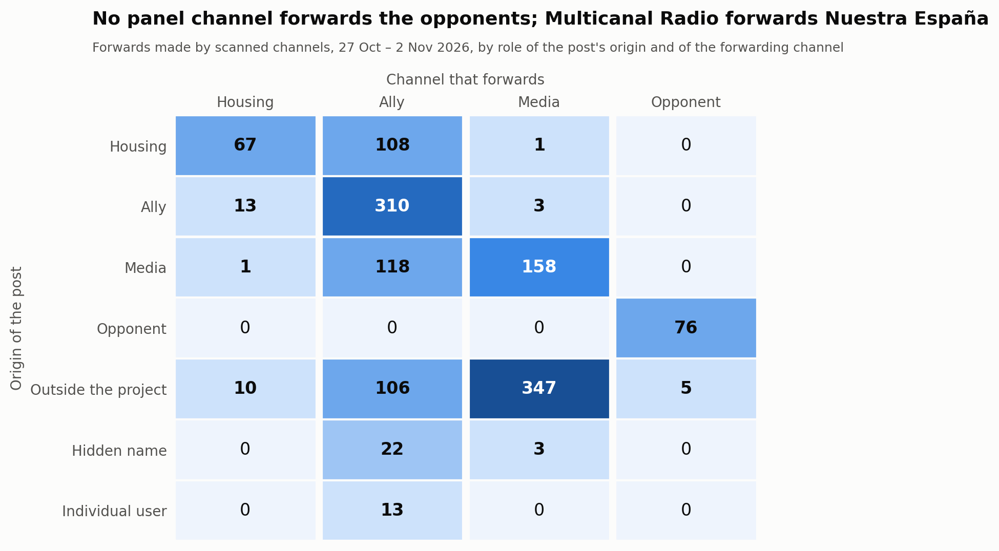
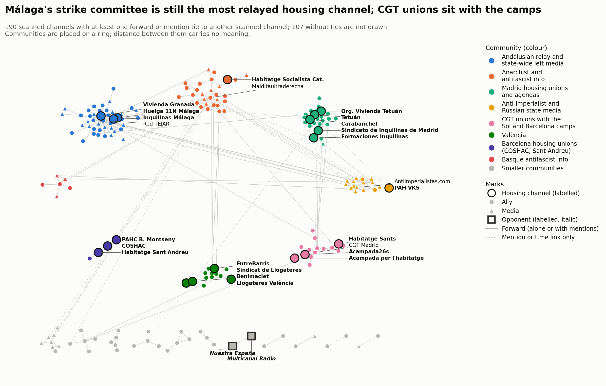

# Block 3 — 27 October to 2 November 2026

Part of the [follow-up](followup.md) of the housing mobilisation on Telegram.
Block 3 covers 27 October 00:00 to 2 November 24:00, Madrid time (2026-10-26T23:00Z to
2026-11-02T23:00Z, winter time throughout).

- **Comparisons:** with block 2 (20–26 October), which is the same length, and, where
  comparable, with block 1 (6–19 October) and the first period (14 September – 5 October,
  the [first period](acampadas_vivienda_technical_report.md)).
- **The 5 October gap** is still not filled and is shaded in the timeline.

## 1. What happened in the block

Dated events, each with a press source unless the note says otherwise. In short:

- **27 Oct, Oviedo.** The camp in the plaza de la Escandalera decided to lift after 23
  days to concentrate on the strike.
- **27 Oct, Madrid.** Mayor Almeida announced a criminal complaint against the former
  Government delegate over the Sol camp. The delegate had resigned on 25 Oct; outlets
  disagree on whether the camp or his exclusion from the PSOE lists was the reason.
- **28 Oct, Urda (Toledo).** Two high-speed trains collided: 68–69 dead, three days of
  national mourning (29–31 Oct). The tenants' confederation stopped its social media for
  the day, and COSHAC postponed its actions at PSC offices to 4 November.
- **28 Oct, Santander.** Police cordoned the housing camp and identified campers during a
  Vox rally (eldiario.es headline; article not opened).
- **29 Oct, Madrid.** A second Government Delegation letter urged the Sol camp to
  dismantle (elPlural headline; Wikipedia).
- **30 Oct, Madrid.** The Comunidad de Madrid filed a criminal complaint against the
  former delegate (headlines).
- **31 Oct, Madrid.**
  - Most of the Sol camp's commissions announced their progressive dissolution and a move
    to the neighbourhoods. El Español says "la mayoría"; Wikipedia says "siete de las
    diez".
  - The Mesa Sindical de Madrid (CGT, CNT, Co.bas and others) published an open letter
    warning CCOO and UGT not to turn the strike into an electoral pre-campaign.
- **1 Nov, Lisbon and Porto.** The police charged the camps at 04:30. The camp's spokesman
  gave at least 10 detained and six injured; the prosecutor refused to validate six
  detentions. Protesters returned to the squares the same evening (channel posts only).
- **2 Nov, Madrid.** Movimiento 26S read its manifesto at Sol and called the withdrawal of
  tents an "internal restructuring".

After the block: police cleared the Sol camp in the early hours of 3 November (block 4).

## 2. The sample

### Panel and review

Block 3 scanned the 281 channels of the panel. One review round then admitted **16 of 231
candidates read**:
- 175 channels and groups from the block's graph;
- 53 unidentified handles that Telegram's public pages showed to be public channels, and
  one public group;
- 2 groups found by probing usernames of camps and committees named in the posts.

Every decision, added or not, is in the [review log](followup_review_log.csv) (block 3).

**Admitted**
- **in-scope:**
  - Organización Vivienda Tetuán.
  - "DIFUSIÓ ACAMPAR PER HABITAR", the Mallorca camp's public group, found by the probe.
- **ally:**
  - UGT Comunicación, co-convener of the strike.
  - Barcelona: SAPB-CGT, SEGAP-CGT, Moviments Socials, Ateneu Llibertari de Gràcia.
  - Madrid: Agenda Tetuán, C.S.O. La Enredadera, Centro Social El Ocho, Agua de Mayo.
  - Others: OMAL; REAS (co-convener of the consumer strike); the youth strike committees
    of La Safor; the Coordinadora Anarquista Horizontal.
- **media:** HispanTV, as *reporting*. It now has three own posts on Portugal's protests
  and camp evictions. It had two in blocks 1 and 2, and the rule asks for three.

**Not admitted:** nine candidates were unreadable (eight private, among them a channel of
the Asamblea de Vivienda de Sevilla and the València camp's group). No candidate was
hostile.

**Panel after block 3 (297 channels), by role and block-3 stance**

| Role | supportive | critical-within | reporting | hostile | none | not readable | total |
|---|---|---|---|---|---|---|---|
| in-scope | 21 | 1 | 0 | 0 | 9 | 0 | 31 |
| ally | 91 | 7 | 0 | 0 | 79 | 0 | 177 |
| media | 8 | 5 | 20 | 0 | 53 | 1 | 87 |
| opponent | 0 | 0 | 0 | 2 | 0 | 0 | 2 |
| out-of-scope | 0 | 0 | 0 | 0 | 0 | 0 | 0 |

### Stance changes since block 2

**No role changed.** Both opponents were *hostile* again, on weaker evidence than in
blocks 1 and 2.
- **Nuestra España.** Its own headlines frame the camp as costly and protected, and the
  strike as a manoeuvre:
  - "Lo que hay tras la dimisión del delegado de Gobierno en Madrid: 25M de perjuicio y
    amenaza de demanda de CEIM" (#2187);
  - "Todo sobre el plantón de CCOO y UGT a la CEOE ¿Cancelaron la reunión para convocar
    la huelga del 11-N?" (#2189);
  - "Vídeo: cuando no son en Sol, el Gobierno sí gasea manifestantes" (#2209).
- **Multicanal Radio** forwards two of these headlines.
- **Judgement:** read as *reporting*, both channels would return to *media*.

**Critique within the movement spreads.** 13 of the 281 panel channels are
*critical from within*, against 4 of 265 in block 2 (5 counting block 2's admitted channels).
All back the strike and dispute CCOO and UGT's role or the
strike's scope:
- **The Mesa Sindical's open letter**, posted by CGT Madrid and relayed by two CGT
  channels: "UNA HUELGA NO ES UN ACTO DE CAMPAÑA... ¿Es boicot o es desidia?"
- **IzquierdaDiario:** "CCOO y UGT están boicoteando la huelga del 11N: ¿Una huelga
  general activa o un desfile electoral?"
- **Grupo Ruptura:** "los sindicatos verticales vendidos a la patronal (CCOO, UGT y
  demás)... HUELGA SALVAJE E INDEFINIDA".
- **PRT Barcelona:** "superar els límits que imposen les cúpules sindicals".
- **mpr21:** "CCOO y UGT operan para que la huelga del 11 de noviembre sea un fracaso".
- **Granada's housing union** calls its own march, "Ni capitalistas, ni rentistas, ni
  cómplices" (#600). Organisations in Granada, Zaragoza and Valladolid broke with CCOO
  and UGT for the strike (El Salto Andalucía and Diario Socialista, relayed by panel
  channels).
- **Also *critical from within*:** Liza, Diario Socialista, Presos Revolucionarios,
  Revolución Comunista and La Idea.

**Criticism aimed at the government stays *supportive*.** COSHAC's campaign "aquesta vaga
també és contra el PSC" and its actions at PSC offices are an example.

**Turnover.** 91 channels changed stance: 36 went from an active stance to *none* and 27
the other way. The block's posts are almost all about building the strike: committees,
posters, workshops, a consumer strike every Wednesday until 11N.

### Attrition

Against block 2.

- **Silent:** 29 channels posted nothing in the block.
  - In-scope: La PAH, PAH Catalanes, Carabanchel, Cuadernos de trabajo, Les Corts,
    La Saïdia Comuna, València no està en venda.
- **Private:** El Salto Madrid.
- **Renamed:** no new username change (@airbnbcrepa → @lecitta carries over). The Sol
  camp's channel is now titled "Acampada 26S".

## 3. Analysis

### Volume

**Forwards.** Scanned channels made 1,361 forwards in the block, not counting
self-forwards: **194.4 a day**, against 204.6 in block 2.

| Panel | First period | Block 1 | Block 2 | Block 3 |
|---|---|---|---|---|
| the first period's 167 channels | 111.5 | 114.9 | 138.1 | **126.0** |
| the panel at the end of block 1 (265) | – | 167.4 | 193.3 | **183.9** |
| the panel at the end of block 2 (281) | – | – | – | 190.1 |
| all scanned channels | – | 167.4 | 204.6 | 194.4 |

At equal panel, forwarding fell about 5–9 % from block 2. The block includes the three
days of mourning after the rail crash. The low day is 1 November (130).

**Forwards of in-scope channels' posts: 176, 25.1 a day** (block 2: 18.6).
- On the first period's panel and in-scope list alone: 21.1 a day (block 2: 15.9; block
  1: 11.8; first period: 11.4). This is the highest of the follow-up.
- Peaks of 44 on 27 and 29 October.
- **Málaga carries most of it:** the Comité de Huelga 11N · Málaga accounts for 128 of
  the 176, forwarded by Inquilinas Málaga (47), La Invisible (44), Red TEJAR (36) and
  Suburbia (1).

**Posts about the mobilisation** (posts matching the engagement terms; all downloaded
channels): 532, **76 a day** (block 2: 73).
- On the panel at the end of block 2: 474, 68 a day (block 2, on its own panel: 69).
- By role: 104 core, 339 ally, 83 media, 6 opponent.
- By stance: 439 supportive, 42 reporting, 34 critical-within, 6 hostile, 11 none (the
  last are false positives in channels read as *none*).
- Peaks on 27 October (103) and 2 November (101).

**With and without the admitted channels.** No admitted channel makes more than 15 % of
the block's forwards (the largest is HispanTV, 8, 0.6 %), and none brings in more than one
node that nothing else references. Without the 16 admitted channels: 1,331 forwards
(190.1 a day) and 474 posts about the mobilisation.

**Concentration.** The top five forwarders make 46.5 % of all forwards:

| Channel | Role | Forwards | Share |
|---|---|---|---|
| Red TEJAR | ally | 199 | 14.6 % |
| Los Sombreros Blancos | media | 142 | 10.4 % |
| Antiimperialistas.com (@nullaesrbu) | media | 122 | 9.0 % |
| Prima Linea | media | 89 | 6.5 % |
| Multicanal Radio | opponent | 81 | 6.0 % |

(Shares are of the 1,361 forwards without self-forwards, as in block 2.)

### Who forwards whom

Forwards, by role of the post's origin and of the forwarding channel; block 2 in
brackets.

**Posts by housing channels**
- 108 forwarded by allies (89).
- 67 forwarded by other housing channels (40).
- 1 forwarded by media (1).

**Housing channels forwarding others**
- 13 forwards of allies (5).
- 1 of media (0).
- 10 of outside channels (1).

**Media** forward mostly outside channels: 347 of 512.

**Opponents.**
- Multicanal Radio forwards Nuestra España 76 times, and an outside celebrity channel 5
  times.
- No panel channel forwards or @-mentions an opponent.

### Hub, relays, territories and camps

**The Madrid union is still not the hub.** It is forwarded by 2 channels (Difusión urgente
twice, FETAP once), against 1 in block 2 and 10 in block 1. It ranks second by breadth,
tied with others.

**Most relayed by breadth**

| Channel | Channels that forward it | Forwards |
|---|---|---|
| Comité de Huelga 11N · Málaga | 4 | 128 |
| COSHAC | 2 | 12 |
| Sindicato de Inquilinas de Madrid | 2 | 3 |
| Acampada 26S (Sol) | 2 | 2 |

19 of the 31 in-scope channels were forwarded by no scanned channel.

**The first cross-territory tie between housing channels.** The Barcelona camp's channel
published a joint condolence statement of "las acampadas territoriales de todo el
Estado" after the rail crash, tagging the Sol, València, Granada, Alicante and Barcelona
camps (#271). That post is the only tie between in-scope channels of different
territories in blocks 2 and 3, and it is a mention, not a forward. The five forward ties
stay inside a territory:
- Málaga: 47 forwards.
- Catalonia: COSHAC → Sant Andreu (7) and → PAHC Baix Montseny (5).
- València: Llogateres → Benimaclet (7).
- Madrid: Formaciones → Sindicato de Inquilinas (1).

**Camp channels.**
- **Acampada 26S (Sol):** 11 posts (block 2: 32), on the assemblies, the territorial
  nodes and the 2 November manifesto. Forwarded twice (CGT Zona Sur and FETAP relayed the
  manifesto).
- **Acampada per l'habitatge (Barcelona):** 19 posts, not forwarded. It announced "cambios
  importantes en nuestra estrategia", asked for a negotiating table and said "no vamos a
  dar un paso atrás NI A DESACAMPAR".
- **Acampar per Habitar (Mallorca):** admitted this block; 73 messages, no ties.

### Ties that appeared and disappeared

The comparison covers the 279 panel channels scanned in both blocks.

| Ties between them | Block 3 | Block 2 |
|---|---|---|
| Total | 242 | 294 |
| Kept | 125 | 125 |
| New in block 3 | 117 (81 forward, 36 link) | – |
| Gone since block 2 | – | 169 (121 forward, 48 link) |

New ties around the core channels:
- FETAP forwards the Madrid union and the Sol camp's manifesto.
- CGT Zona Sur forwards the Sol camp.
- Suburbia forwards Málaga.
- The Barcelona camp mentions the Sol camp.

Gone ties:
- Barcelona camp → PAH Barcelona.
- COSHAC → Sants.
- Sol camp → Difusión urgente.

### Contact between opponents and the rest

Every event that joins an opponent and a non-opponent was read: 8.
- **5 relays of celebrity gossip:** Multicanal Radio forwards @elmarujeo.
- **3 mentions in Nuestra España's own posts:** a Vox MEP's handle, and two pseudonymised
  accounts (an author's byline and a cited account).

As in blocks 1 and 2 there is **no hostile-quote tie**, and the opponents are a closed
pair. Their hostility is in their own 6 posts about the mobilisation.

### Communities

Combined forward-and-mention graph: 190 scanned channels with ties, 260 edges; 107
scanned channels without ties.

**Louvain over 50 seeds**
- Consensus labels: 19 communities, modularity 0.736 (partition by role: 0.199).
- Stability: 14 distinct partitions; the most frequent occurs in 28 % of runs.
- Mean node stability 0.95; 16 nodes below 0.8, 3 below 0.6.
- This is less stable than block 2 (6 partitions, 50 %).

| # | Name | Channels | Core members |
|---|---|---|---|
| 1 | Andalusian relay and state-wide left media | 43 | Huelga 11N Málaga, Inquilinas Málaga, Vivienda Granada |
| 2 | Anarchist and antifascist info | 29 | Habitatge Socialista de Catalunya |
| 3 | Madrid housing unions and agendas | 24 | Sindicato de Inquilinas de Madrid, Tetuán, Org. Vivienda Tetuán, Carabanchel, Formaciones |
| 4 | Anti-imperialist and Russian state media | 16 | PAH-VKS (on one tie, to Sistema 161) |
| 5 | CGT unions with the Sol and Barcelona camps | 15 | Acampada 26S, Acampada per l'habitatge, Habitatge Sants |
| 6 | València | 13 | Llogateres València, EntreBarris, Benimaclet, Sindicat de Llogateres |
| 7 | French and Italian movement channels | 8 | — |
| 8 | Basque antifascist info | 6 | — |
| 9–19 | Barcelona calls; Podemos; CCOO; Barcelona housing unions (COSHAC, Sant Andreu, PAHC Baix Montseny); Anticapitalistas; Podem València; **opponents** (2); four pairs | 2–5 each | — |

**Agreement with block 2.** On 152 shared channels the adjusted Rand index is **0.587**
(block 1 → 2: 0.586). The territorial clusters persist: Málaga with the Andalusian relay,
Madrid, València, and Barcelona's housing unions.

What changed:
- **The camps join the CGT unions.** The Sol and Barcelona camps sit in one community
  with CGT Madrid, CGT Catalunya and CGT Zona Sur, the channels that relay the camps'
  posts and the Mesa Sindical's letter.
- **The Madrid union** now sits with the Tetuán and Carabanchel unions and the
  neighbourhood agendas, not with the Sol camp.

**Map design.** The ring shows the eight largest communities, except that the Barcelona
housing unions (4 channels) replace the French and Italian channels (8) so that the
Barcelona housing channels are labelled clearly.

## 4. Term lists

The block-2 lists were kept, with eleven engagement terms added or widened and one
narrowed, and the lists were tested again.

**Terms added or widened**
- **Hyphens in addresses:** "11-de-noviembre" and "huelga-general" in URLs.
- **Strike-building phrases:** "construir / construyendo la huelga general"; "huelga
  general del 11" followed by punctuation.
- **The PSC campaign:** "aquesta vaga / esta huelga" near a housing word.
- **Hashtag:** #VagaPerLaVivenda.
- **Protests:** "protestar / protestan… por la vivienda" (Portugal).
- **The decree:** "RDL d'habitatge" and "el nou decret" near a housing word.
- **Camps:** the Italian plural "acampade", found while reading foreign-language
  channels.

**Narrowed**
- "comité de huelga" no longer matches the teachers' and doctors' strike committees. This
  was block 2's known false positive.

**Tests**
- 20 of 22 known positives match.
- Unrelated channels: 0 matches in TASS, 1 in MT News, which is a true positive on
  Portugal. Block 2's negative channel, Satélite Rojo, now posts about the Portuguese
  camps and was replaced.
- 90 context-only posts read.
- Every post that the changes gained (20) or lost (3) was read.

**Accepted misses:** posts that say only "huelga general" or "vaga general" with no
housing word. "Huelga general" alone stays a context term because Italy's general strike
of 30 October and France's of 5 November appear in the same channels.

## 5. Judgement calls that could have gone the other way

**Stance**
- **The opponents** are *hostile* on adversarial headlines without an explicit attack.
  Read as *reporting*, both would return to *media*.
- **The rule for *critical from within*** is made explicit this block: the critique is the
  channel's own position or most of its posts. Relays of others' critiques among
  supportive posts stay *supportive* (Red TEJAR, Malditaultraderecha, FETAP).
- **Tetuán's housing union** *supportive*; it could be *critical from within*.
- **Diario Socialista and mpr21** *critical from within* on news headlines; they could be
  *reporting*.
- **Presos Revolucionarios** *critical from within*, although it calls the strike "un
  montaje"; it could be read as hostile.
- **USTEA** *supportive* on its education strike for 11 November; it could be *none*.
- **elPlural** *reporting*, on headlines only; it was *supportive* in blocks 1 and 2.
- **La Directa and Regeneración** *supportive* on thin evidence.

**Review**
- **The Mallorca camp's group** admitted as *in-scope*, although its posts are members'
  messages.
- **Moviments Socials** admitted as an agenda channel; it could be an aggregator.
- **HispanTV and the scope of the mobilisation:** HispanTV was admitted because
  Portugal's camps and protests count; Italy's do not.
- **SAPB-CGT** admitted on links to its own union's calls; it was rejected in block 2.
- **Minas Não** rejected: it held talks at the Porto camp.

**Analysis and figures**
- **Baselines:** block 2 is the baseline. The equal-panel comparisons reproduce block
  2's published means.
- **Map ring:** the Barcelona housing unions replace a larger community on the ring.

## 6. What was not verified

**Context**
- **Lisbon and Porto, 1 Nov:** detention and injury figures (organisers against the
  prosecutor; no police figure).
- **Madrid:** the 29 Oct letter and the 30 Oct complaint rest on headlines and Wikipedia.
  The commissions' share ("most" or "seven of ten") is disputed.
- **Santander, 28 Oct:** the police cordon rests on a headline.

**Content not read**
- **Images and videos:** not read. Among them are Granada's "5 claves" images and the Sol
  manifesto, posted as an image or video.
- **Links:** linked articles not followed.
- **Review candidates without keywords:** only the openings of their first eight posts.

**Channels and accounts not reached**
- **Private channels:** nine candidates are private (among them a channel of the
  Asamblea de Vivienda de Sevilla, the València camp's group and the Feministes de
  Gràcia); El Salto Madrid in the panel is private too.
- **Hashtag search:** none this block.

**Not checked**
- **Network maps:** their layout varies slightly between renders.

---

A [DataPolitik](https://www.heuristica.barcelona/datapolitik/) study by [Heurística](https://www.heuristica.barcelona/). · [Home](index.md) · [Follow-up overview](followup.md)
