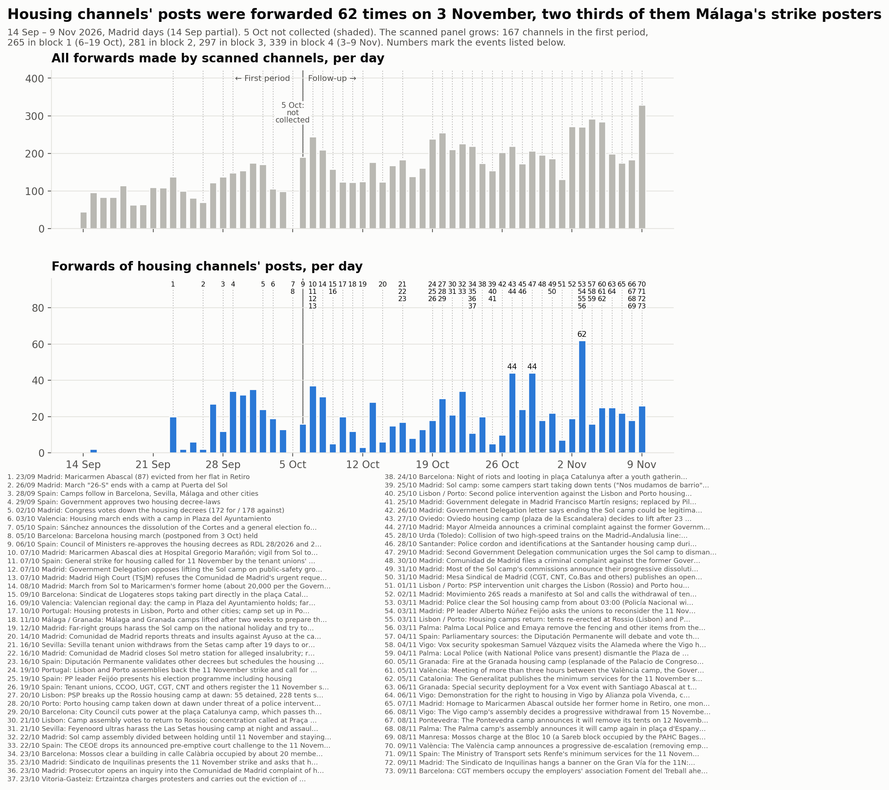
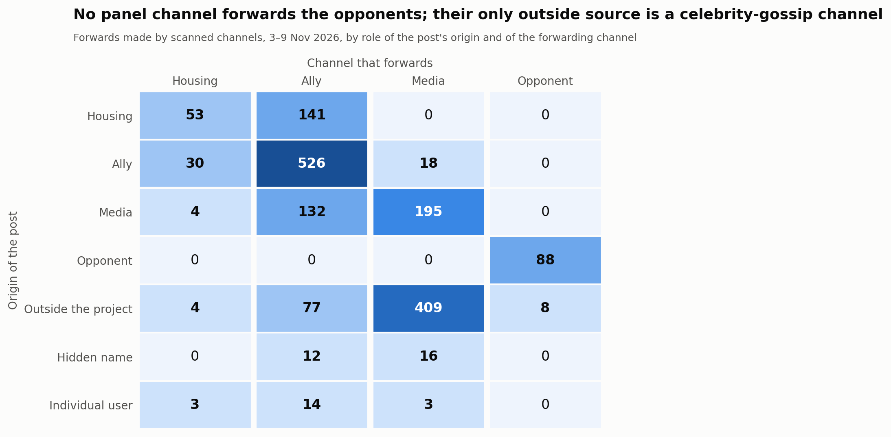
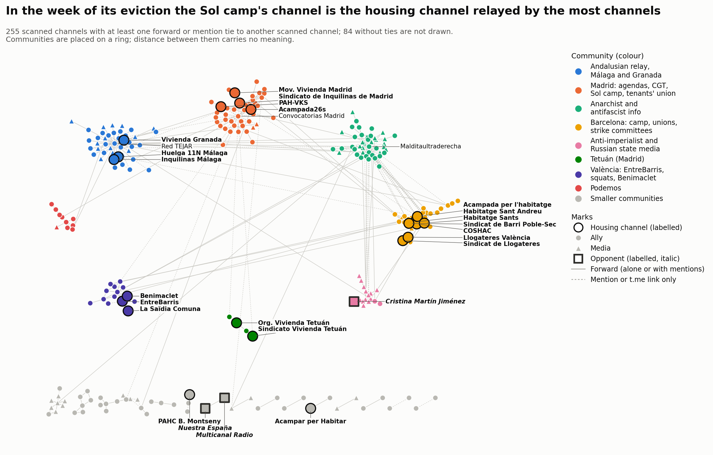

# Block 4 — 3 to 9 November 2026

<strong>English</strong> · <a href="es/followup_block4.html">Español</a> · <a href="ca/followup_block4.html">Català</a>

Part of the [follow-up](followup.md) of the housing mobilisation on Telegram.
Block 4 covers 3 November 00:00 to 9 November 24:00, Madrid time
(2026-11-02T23:00Z to 2026-11-09T23:00Z, winter time throughout). It is the week before the
general strike of 11 November.

- **Comparisons:** with block 3 (27 October – 2 November), the same length. Where
  comparable, also with the [first period](acampadas_vivienda_technical_report.md)
  (14 September – 5 October).
- **The 5 October gap** is still not filled and is shaded in the timeline.
- **Two runs:** a first run on 7 November covered 3–6 November. On 10 November the block
  was extended to its natural end, 9 November, and every step was run again over the full
  week. Block 5 is 10–16 November, the week of the strike.
- **Collection timing:** the block ended 2 hours 38 minutes before the downloads and the
  scan. Posts and edits made later are not included.

## 1. What happened in the block

Dated events, each with a press source unless the note says otherwise. In short:

**The camps**
- **3 Nov, Madrid.** From about 03:00 the Policía Nacional and the Policía Municipal
  cleared the Sol camp; two people were detained.
  - Size: about 300 people sleeping there (police sources via EFE), or more than 330
    evicted (Government Delegation).
  - Violence: the Delegation says the operation ran "sin violencia". Acampada 26S reports
    blows, pepper spray and injured people.
  - The same evening there was a march from Sol to Cibeles and a sit-in at Sol (camp
    channel).
- **3–6 Nov, Palma.**
  - 3 Nov: the council removed the camp's fencing.
  - 4 Nov, evening: the Local Police took the camp down (camp group and shared headlines
    only).
  - 8 Nov: the assembly announced it will camp again after the 11N march (Última Hora).
- **3 Nov, Lisbon and Porto.** Tents went back up after an administrative court ruling.
- **4–9 Nov, Barcelona.** The camp said the city council had cut its electricity and that
  it stays: "Ens deixeu sense llum, però no sense lluita" (channel posts only).
- **5 Nov, Granada.** A fire at the camp ("al parecer provocado") and an attack with
  sticks (Europa Press). On 6 Nov a security deployment was set for a Vox event with
  Abascal next to the camp.
- **5 and 9 Nov, València.** The camp met the Delegation and the council for more than
  three hours. On 9 Nov it announced a progressive de-escalation, "No nos vamos". The
  technical meeting between the Delegation and the council was held that day; no press
  report of its outcome was found.
- **8 Nov, Vigo and Pontevedra.** Both camps decided to withdraw after the strike: Vigo
  progressively from 15 Nov, Pontevedra on 12 Nov (EFE).
- **9 Nov.** The camps published a joint manifesto, posted by the Barcelona camp's
  channel with Sevilla, Granada and València (channel posts only).

**The strike and the housing movement**
- **3 Nov.** PP leader Feijóo asked the unions to reconsider the strike.
- **4 Nov.** The two housing decrees go to the Diputación Permanente on 12 Nov.
- **5 and 9 Nov.** Minimum services were set: Catalonia, then Renfe (75 % of Cercanías at
  peak hours).
- **7 Nov, Madrid.** An homage to Maricarmen Abascal was held outside her former home, one
  month after her death.
- **8 Nov, Manresa.** The Mossos charged at the Bloc 10, a Sareb building occupied by the
  PAHC Bages on 7 Nov. The eviction was stopped when Sareb agreed to cede the building.
- **9 Nov, Barcelona.** CGT occupied the employers' association Foment del Treball.
- **9 Nov, Madrid.** The tenants' union hung a banner on the Gran Vía (headline only).
- **Vox and Granada:**
  - 4 Nov: Vox's security spokesman visited the Vigo camp.
  - 6 Nov: the Abascal event in Granada.

## 2. The sample

### Panel and review

- **Panel:** 325 channels at the start of the extension (297 at the start of the block,
  plus 28 admitted on 3–6 Nov), scanned and downloaded over the whole week.
- **Not readable:**
  - @elsaltomadrid (private since block 1).
  - @mitxisantifascistas: became private between 6 and 10 November. No post on 3–6 Nov;
    its 7–9 Nov posts cannot be read.
- **Posts:** 16,064 in the block.

The review ran twice:
- **3–6 Nov run:** 184 candidates, **28 admitted**.
- **Full-week run:** 229 candidates, **14 admitted**.
  - 7 unreadable; 5 were already admitted.
  - A search for local copies of known channels (38 names) found one hit, the Mallorca strike media centre
    @centredemitjans (30 subscribers). Its public preview, read by hand, shows two posts
    of 5 Nov without text, so it was not added.
- **Log:** every decision of both runs, added or not, is in the
  [review log](followup_review_log.csv) (block 4, rounds *review* and *extension*).

The panel now has **339 channels**: 31 in-scope, 211 ally, 94 media, 3 opponent.

Admitted in the full-week round:
- **ally (11):**
  - Regularización Ya; Samidoun Barcelona; IAC (union).
  - Ateneo La Maliciosa; AV La Unión de Hortaleza.
  - Asamblea Libertaria de Lorca; Quejío Andalú; Bizkaia E28 Koordinadora.
  - Teixint Patraix and Camins al Grau i Algirós (València neighbourhood assemblies and
    strike committees); a Sevilla poster agenda.
- **media (2):** RadioTopo (supportive); RUSSPAIN, *reporting*, from the network of
  @rusmadrid.
- **opponent (1):** **Cristina Martín Jiménez**, an individual's channel (an author). On
  9 Nov she mocked the minister of Labour for backing "una huelga general contra la
  cartera ministerial que ella misma ostenta... Si no existiera habría que inventarla".
  Judgement: it could be read as aimed at the minister only.

Four of the 14 had been rejected on 3–6 Nov because they had not yet posted about the
mobilisation (IAC, Samidoun, Regularización Ya, La Maliciosa).

**15 % / ten-candidates rule:** not triggered.
- The largest admitted forwarder makes 13 forwards, 0.8 % of 1,733 (Teixint Patraix).
- At most 7 nodes are referenced only by one admitted channel (RUSSPAIN).
- @rusmadrid makes 86 link events (6.9 % of links), mostly to its sister channels.

### Stance of the panel

> **Revised rule (10 November 2026).** Here *critical-within* covers channels that back
> the strike while disputing CCOO and UGT or its strategy. The rule was later revised:
> such channels count as supportive, with the critique recorded separately, and only
> channels that reject the strike itself are *critical of the strike*. See the
> [follow-up overview](followup.md). This report is kept as published.

339 channels (the 14 channels admitted in the full-week run carry their review stance):

| Role | supportive | critical-within | reporting | hostile | none | not readable |
|---|---|---|---|---|---|---|
| in-scope (31) | 19 | 1 | 0 | 0 | 11 | 0 |
| ally (211) | 159 | 4 | 1 | 0 | 47 | 0 |
| media (94) | 23 | 3 | 35 | 0 | 32 | 1 |
| opponent (3) | 0 | 0 | 0 | 3 | 0 | 0 |

- **Roles:** no channel changed role.
- **Stance changes:** 104 channels changed stance since block 3. 70 went from *none* to an
  active stance; 19 went the other way.
- **Last days before the strike:** they brought in many channels that had been silent on
  3–6 November: CNT Madrid, CA-AIT, Galician, Andalusian and Basque groups, Podemos
  channels, Italian and French movement media.
- **Opponents (3).**
  - Nuestra España: the Sol eviction; Jupol's "doble vara de medir con los desalojos"; "las
    armas de Sol"; "CCOO enfría la huelga general" (9 Nov).
  - Multicanal Radio: forwards those posts and titles its own video "¿EN QUE MARISQUERIA ES
    LA HUELGA?" (9 Nov).
  - The new individual opponent, above.
  - The evidence is adversarial framing and mockery, not explicit attacks.
- ***critical from within* (8):**
  - Granada's housing union.
  - Izquierda Diario and Liza: the class-independence bloc, "Las direcciones de CCOO y UGT
    quieren convertir la huelga en un acto de campaña".
  - CA-AIT Marina Alta; Bultza ("11N pantomima general"); Malditaultraderecha.
  - DiarioOctubre ("CCOO y UGT operan para que la huelga... sea un fracaso").
  - Insurgente ("UGT se pone muy nerviosa ante la posibilidad de que la Huelga General sea
    contra el gobierno").
  - All back the strike and dispute CCOO and UGT.
- **Calls kept at *reporting*:**
  - A Madrid news channel (@cuidadmadrid) takes up the Comunidad's "acampada ilegal".
  - A bot (@roto2botfc) reposts X posts that threaten pickets ("pueden salir
    escaldados"). These are other people's posts, not the bot's own position.

### Attrition and names

- **Silent:** 19 channels posted nothing in the week, 9 of them in-scope: La PAH, PAH
  Catalanes, La Saïdia Comuna, Carabanchel, Cuadernos de trabajo, Formaciones Inquilinas,
  Les Corts, Sindicat d'Habitatge Socialista, València no està en venda.
  Counting @mitxisantifascistas, which became private, there are 20.
- **Private:** @elsaltomadrid, @mitxisantifascistas.
- **Renamed:**
  - "Málaga para Vivir" → "Comité de Huelga 11N • Málaga".
  - "Acampada26s" → "Acampada 26S".
  - Kontrainfo Antifa adds "/ FAK!".
  - @airbnbcrepa → @lecitta.

## 3. Analysis

### Volume

| Per day | Block 3 | Block 4 |
|---|---|---|
| Forwards made by scanned channels (no self-forwards) | 194.4 | **247.6** |
| Same, panel at the end of block 2 (281 channels) | 190.1 | 228.9 |
| Same, the first period's 167 channels | 126.0 | 143.0 |
| Forwards of housing channels' posts | 25.1 | 27.7 |
| Same, the first period's 167 channels | 21.1 | 20.9 |
| Posts about the mobilisation (engagement terms) | 76.0 | 166.1 |

- **Forwards:** on equal panels they rose by a fifth over block 3. Forwards of housing
  channels' posts barely moved: 20.9 a day on the first period's channels, against 21.1.
  The rise is carried by ally and media channels, not by the housing channels.
- **Peaks:**
  - Housing posts: **62 forwards on 3 November**. Málaga's strike committee accounts for
    41 (poster albums); the Sol camp for 8, COSHAC 7, the Barcelona camp 3.
  - All forwards: **329 on 9 November**, two days before the strike.
- **Posts about the mobilisation:**
  - By day: 200 on 3 Nov, 159–171 on 4–6 Nov, 95 on 7 Nov (a Saturday), 120 on 8 Nov and
    **253 on 9 Nov**.
  - In all: 1,163, against 532 in block 3; 1,034 without the channels added this block.
  - By role: housing 153, ally 808, media 194, opponent 8.
  - By stance: supportive 1,011, critical-within 48, reporting 93, hostile 8.
  - The term list changed (section 4), so the count is not strictly comparable.
- **Top forwarders:** Red TEJAR (197, 11.4 %), Prima Linea (151), Los Sombreros Blancos
  (146), ANTIIMPERIALISTAS.COM (140) and Multicanal Radio (96). The top five make 42.1 %
  (46.5 % in block 3).

### Who forwards whom

| Forward (origin → forwarder) | Block 3 | Block 4 |
|---|---|---|
| housing → housing | 67 | 53 |
| housing → ally | 108 | 141 |
| ally → housing | 13 | 30 |
| ally → ally | 310 | 526 |
| media → ally | 118 | 132 |
| outside the panel → media | 347 | 409 |
| opponent → opponent | 76 | 88 |
| outside → opponent | 5 | 8 |

- **Same-length blocks:** the totals compare directly.
- **Ally → ally** grew by 70 %.
- **Housing channels** forwarded each other less (67 → 53) and forwarded allies more than
  twice as often (13 → 30).
- **Opponents:** no panel channel forwards them, and they forward no panel channel.

### Hub, relays, territories and camps

- **Relayed by the most channels:** the **Sol camp's channel**: forwarded by 7 channels,
  9 times, 8 of them on the day of the eviction (block 3: 2 and 2).
- **The Madrid tenants' union:** second by breadth, forwarded by 5 channels, 13 times
  (block 3: 2 and 3), mostly by CGT Madrid and its southern zone and Noticias FETAP. Its
  channel posted nothing about the eviction.
- **The most forwarded housing channel:** Málaga's strike committee, 132 forwards by
  4 channels (block 3: 128 by 4).
- **Other camps:**
  - Barcelona's camp was forwarded by 3 channels (none in block 3).
  - The Mallorca group made 8 forwards and was forwarded by none.
- **Relays:** 17 of 31 housing channels were relayed by no scanned channel.
- **Territories:** ten ties between housing channels; two cross territories. The Barcelona
  tenants' union forwards the València one, and the Sol camp links the Barcelona camp. The
  territorial clusters still do not forward each other.

### Ties that appeared and disappeared

There are 295 panel channels scanned in both blocks:

- **kept:** 145 ties;
- **new:** 204 (141 forward, 63 link);
- **gone:** 122 (91 forward, 31 link).

The block has more ties than block 3 (349 against 267).

### Contact between opponents and the rest

Every tie was read:
- Multicanal Radio forwards a celebrity-gossip channel (@elmarujeo) 8 times.
- MT News links the new opponent twice, to her technology programme on RT. These posts are
  not about the mobilisation; they are neither relays of it nor hostile quotes.
- The new opponent links RT's channel 6 times.
- There is **no contact about the mobilisation** between the opponents and the rest.

### Communities

- **Combined graph:** 255 nodes and 402 edges; 84 scanned channels have no ties.
- **Partition:** consensus of 50 Louvain runs, 23 communities, modularity 0.744 (0.163 by
  role).
- **Stability:** 11 distinct partitions; the most frequent occurs in 28 %. Mean node
  stability is 0.97; 7 nodes fall below 0.8.
- **Agreement with block 3:** adjusted Rand index **0.403** on 168 shared channels; 22
  channels are only in block 3 and 87 only in block 4. Block 3 had 0.587 with block 2.
- **What changes:** the panel grew, and many channels that were silent in block 3 now
  forward.

The eight largest communities, with the names used in the figure:

1. Anarchist and antifascist info, Basque included (43).
2. Madrid: agendas, CGT, the Sol camp and the tenants' union (43). Block 3's two Madrid
   groups merged.
3. Andalusian relay, Málaga and Granada (42).
4. Barcelona: the camp, the housing unions and the strike committees (33).
5. Anti-imperialist and Russian state media (16), with the new opponent.
6. València: EntreBarris, squats, Benimaclet (14).
7. Podemos (10).
8. The two Tetuán housing groups with their agenda and La Enredadera (4).

Elsewhere: the CCOO channels form their own group (6), and so do the Madrid news network
(5).

## 4. Term lists

Block 4's list adds:

- the Sol eviction named without a camp word;
- Portugal's protests ("manifestantes por… la vivienda");
- "el día/dia 11";
- "hacia / cap a la huelga/vaga general";
- "huelga general de clase";
- Basque "#Az11…";
- "huelga general 11NOV";
- added with the extension: French and Italian "grève générale / sciopero generale du/dell'
  11 nov".

The tests:

- **Known positives:** 16 of 18 match.
- **Unrelated channels:** no false positive.
- **New matches:** every gained post was read (24 in the first run, 5 in the extension).
- **Still a false positive:** the Madrid education strike's "comité de huelga mixto".
- **Accepted misses:** "huelga general" alone (France's strikes fill the block); short posts
  with no strike word, such as Liza's "¡ESTO ES SOLO EL PRINCIPIO!".

Counts: 16,064 posts; **1,163 match an engagement term** (910 own posts, 253 forwards, in
239 channels); 412 context-only.

## 5. Judgement calls that could reasonably have gone the other way

- **Block dates:** 3–6 November first, then the full week.
- **Opponents:**
  - Nuestra España and Multicanal Radio kept *hostile* on framing and mockery.
  - Cristina Martín Jiménez admitted as an opponent on one post mocking the minister.
- ***critical from within*:** Bultza (could be hostile); Malditaultraderecha on one comment;
  Insurgente and DiarioOctubre on headlines.
- ***reporting*:**
  - Diario Socialista, on headlines.
  - @cuidadmadrid, which takes up "acampada ilegal".
  - The @roto2botfc bot, which reposts a threat to pickets.
  - Global Project and InfoAut, despite sympathetic framing.
- ***supportive* on thin evidence:** ExWorkers, TodoAlTrece, CTXT, Supernova, CSOA CSN,
  Glob4lRevolution (the Manresa occupation), RadioTopo.
- **Admissions:**
  - First run: El Ojo Noticias and Osservatorio Repressione on one report each; the Madrid
    news network's channels, not rejected as aggregators.
  - Strike committees and neighbourhood assemblies given the role *ally*, not in-scope.
    Teixint Patraix could be in-scope as a housing assembly.
- **Rejections:** the MovimentsSocials poster group; the Malditaultraderecha chat; Rural
  foro (a group re-posting an October invitation to the Granada camp).
- **Counting Portugal's camps** and the Manresa Bloc 10 as the mobilisation.

## 6. What was not verified

- **Timing:** posts after the downloads (10 Nov, 01:38–02:20 UTC) and later edits are
  missing. Late forwards of block-4 posts will appear in block 5's scan.
- **Context without a press article read in full:**
  - The Palma camp's removal (4 Nov).
  - The Barcelona power cut and negotiating table.
  - The camps' joint manifesto.
  - The outcome of the 9 November València meeting.
  - The Gran Vía banner, and Ayuso's and a PP spokesperson's statements (headlines only).
- **Reading depth:**
  - **3–6 Nov:** about two thirds of the channels with matching posts were read to 700
    characters a post, unless a post had critique words. Channels with 1–29 unmatched
    posts were read from the opening of each post.
  - **7–9 Nov, channels already active on 3–6 Nov:** only posts with critique or hostile
    words were read in full. A change of stance carried by other wording would be missed.
  - **7–9 Nov, all others:** the in-scope channels were read in full, and every matching
    post of channels that were *none*.
  - **Links:** posts that are only links to X were not opened.
- **Network map:** the layout is not identical between renders. Some leader lines pass
  close to neighbouring labels; no text overlaps.
- **Palette:** as in blocks 1–3. Adjacent pairs pass. All pairs fail for green/orange
  (colour-blind readers) and red/orange (normal vision). Those pairs sit apart on the ring,
  and the legend names them.
- **Not checked:** whether silent channels are dormant or deleted.

**Cite this page.**

DataPolitik (Heurística). <em>Block 4 — 3 to 9 November 2026</em>. In <em>Housing camps and Telegram communication networks in Spain, autumn 2026</em>. Observation period: 3–9 November 2026. Published 10 November 2026. <a href="https://datapolitik.github.io/acampadas-vivienda-report/followup_block4.html">https://datapolitik.github.io/acampadas-vivienda-report/followup_block4.html</a>

Original text and figures: [CC BY 4.0](https://creativecommons.org/licenses/by/4.0/) · [Use and citation](index.md#use-and-citation)

---

A [DataPolitik](https://www.heuristica.barcelona/datapolitik/) study by [Heurística](https://www.heuristica.barcelona/). · [Home](index.md) · [Follow-up overview](followup.md)
