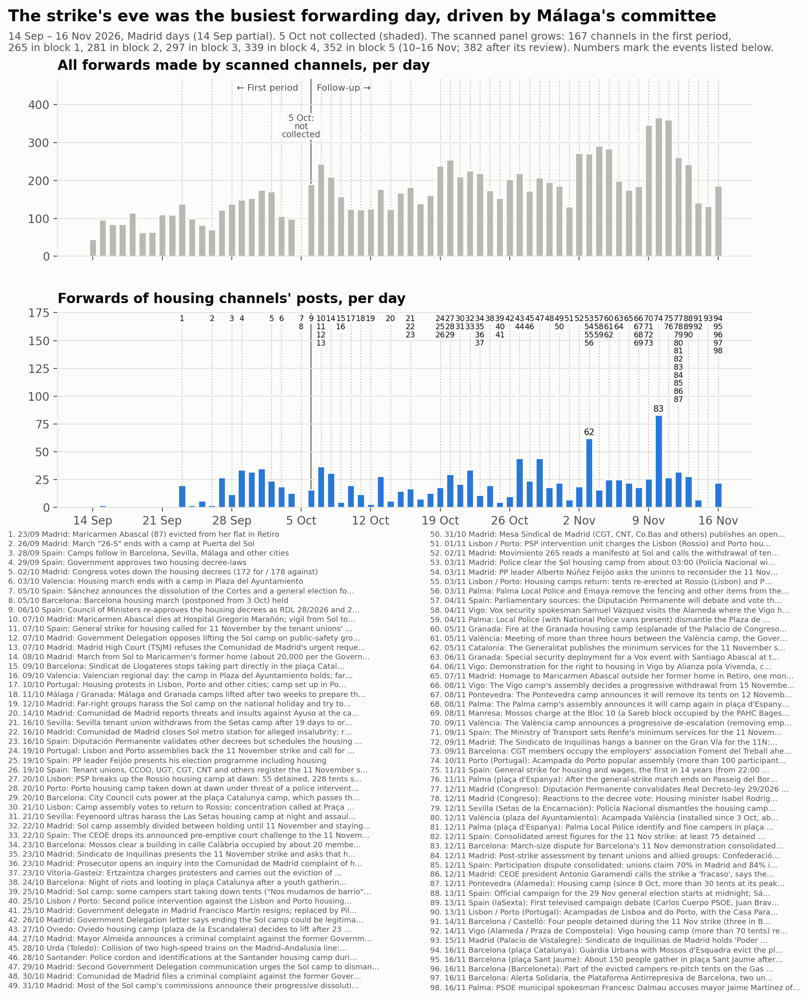
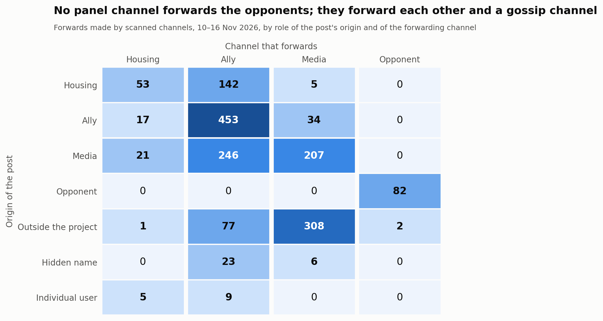
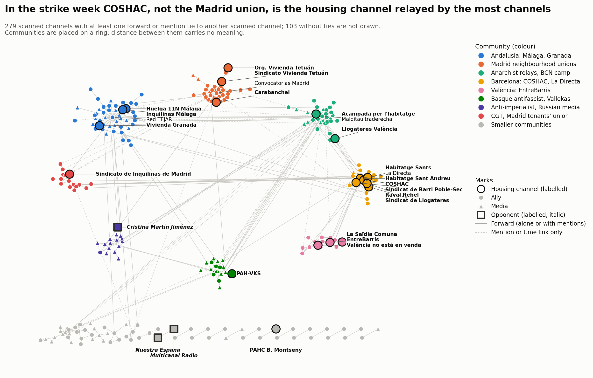
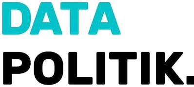

# Block 5 — 10 to 16 November 2026

<strong>English</strong> · <a href="es/followup_block5.html">Español</a> · <a href="ca/followup_block5.html">Català</a>

Part of the [follow-up](followup.md) of the housing mobilisation on Telegram.
Block 5 covers 10 November 00:00 to 16 November 24:00, Madrid time (2026-11-09T23:00Z to
2026-11-16T23:00Z). It is the week of the general strike of 11 November, and the last block of the
follow-up.

- **The strike day** (10 Nov 22:00 to 12 Nov 03:00) was analysed on its own, hour by hour, in the
  [strike-day report](followup_strike_day.md). This page does not repeat it. It covers the block as a
  whole, strike day included, and the days after it.
- **Comparisons:** with [block 4](followup_block4.md) (3–9 November), the same length; where comparable,
  with the [first period](acampadas_vivienda_technical_report.md) (14 September – 5 October).
- **The 5 October gap** is still not filled and is shaded in the timeline.
- **Collection timing:** collected on 19 November, 2½ days after the block ended, with a full day of margin
  after it. Posts deleted or edited before collection are as they were then.

## 1. What happened in the block

Dated events, each with a press source and a note on how it was confirmed. The strike day's timed events
are in the [strike-day report](followup_strike_day.md).

**The strike (11 Nov).** Consolidated figures published afterwards disagree:
- **Arrests:** at least 75 detained and 1,044 incidents (Demócrata, 12 Nov); 39 by Policía Nacional
  and Guardia Civil (Interior); 52 by the Mossos in Barcelona; 16 by the Ertzaintza. The totals do not
  add up across sources.
- **Barcelona march:** about 57,000 (Mossos), more than 50,000 (Collboni), about 40,000 (Guàrdia
  Urbana), 400,000 (organisers).
- **Madrid march:** 120,000 (Government Delegation) against 400,000, 600,000 or 750,000 from the
  organisers' side, depending on the outlet.
- **Following:** the unions claim 70 % in Madrid and 84 % in Catalonia. CEOE and Cepyme call it a
  "fracaso" (below 5 %), and Garamendi expresses "apoyo explícito" to the police.

**The camps come down**
- **12 Nov, Sevilla.** The Policía Nacional dismantled the Setas camp at dawn, hours after the strike
  (El Salto).
- **12 Nov, València.** The camp took down its tents after 40 days, saying the police would otherwise
  evict it. The Delegation denies giving a deadline.
- **12–13 Nov, Pontevedra.** The camp removed its tents, as announced.
- **11–16 Nov, Palma.** The camp re-pitched in plaça d'Espanya after the march (11 Nov) and its
  campers were fined (12 Nov). Messages in the camp's Telegram group spoke of de-camping on 15 Nov; no
  press report confirms it. On 16 Nov the PSOE accused the mayor of pressuring the police.
- **14–15 Nov, Vigo.** The camp confirmed it would withdraw progressively from 15 Nov; no source
  confirms that it did.
- **16 Nov, Barcelona.** The Guàrdia Urbana and the Mossos evicted the plaça Catalunya camp after
  47 days. Figures differ: about 465 officers, 295 people, 80 identified, 0 or 3 arrests. About 150
  people gathered at plaça Sant Jaume, where 5 or 6 began a hunger strike. Part of the campers
  re-pitched at the Barceloneta.
- **Not found:** anything on Sol after 11 Nov, or on the Granada, Málaga, Bilbao or Zaragoza camps.

**Decrees, election, repression**
- **12 Nov.** The Diputación Permanente convalidated RDL 29/2026, the "decreto Maricarmen" (35–34),
  and rejected RDL 28/2026 on automatic rent renewal, with the PNV voting against.
- **13 Nov.** The election campaign opened. Feijóo promised to repeal the housing law and pass an
  "antiocupas" law. Housing was a topic of the first TV debate.
- **14 Nov.** Four people detained during the strike were sent to pretrial detention: three in
  Barcelona (members of the Sant Martí strike committee and the Verneda housing union, per COSHAC)
  and one in Castelló. Solidarity marches followed on 14–16 Nov.
- **15 Nov, Madrid.** The Sindicato de Inquilinas held its Vistalegre event (about 8,000): "votar puede
  ser necesario pero no es suficiente". It called European protests for 20–22 Nov and said it would
  not form a party.
- **Not found:** any new general, indefinite or rent strike called for a date; a government assessment
  of the strike.

## 2. The sample

### Panel and review

- **Panel:** 352 channels, including the 13 admitted in the strike-day review.
- **Downloads:** 347 downloaded. Five are private:
  - @elsaltomadrid, @mitxisantifascistas and Fullblack161, as before;
  - new in this block: @palestina_sos_bcn and the La Marina Alta strike committee.
- **Posts:** 15,509 in the block (16,667 with the channels admitted below).
- **Review round:** 204 candidates, 3 excluded as referenced only by opponents (RT, Abascal's
  channel, a gossip channel). A probe of 40 names for camp copies, post-strike committees and
  hunger-strike channels found nothing. **30 admitted**:
  - **in-scope (1):** Raval Rebel Difusió, the Raval housing assembly (Barcelona).
  - **ally (16):** CCOO Educación Madrid (convener: CCOO), CGT Castelló (convener: CGT), COESPE
    pensioners, PCPE, CNT Gijón, Salamanca Antinuclear, Ecologistes en Acció, L'Alzina, Barris Sants,
    Octubre casal, Antirepressiva de Ponent, IU Parla, Karmela, Ongi Etorri Errefuxiatuak, Local
    Anarquista Magdalena, Espacio La Atenea. All supportive.
  - **media (13):** seven supportive (Carne Cruda, Contre Attaque, Radio Monotes, Irola Irratia,
    Deialdiak Nafarroa, StopBulos24, Global Youth Voice); six reporting (InfoDefense Spain, Napoli
    Monitor, Incursioni, Bizi Baratzea, and the Russian-language Alicante and Málaga news channels).
  - **Corrected in checking:**
    - The Mallorca strike media centre was proposed again, but it is already in the panel since the
      strike-day review.
    - Lakshina Noticias was proposed on three "own" strike posts, all word-for-word copies of
      Satélite Rojo. It was rejected as an aggregator, as in the strike-day review.
  - Every decision is in the [review log](followup_review_log.csv) (block 5, round "review").
- **The panel now has 382 channels:** 32 in-scope, 230 ally, 117 media, 3 opponent.
- **15 % / ten-candidates rule:** not triggered. The admitted channels make 96 of 1,714 forwards
  (5.6 %); the largest, CCOO Educación Madrid, makes 51 (3.0 %). At most 2 nodes depend on a single
  admitted channel.

### Stance of the panel

352 channels before the review:

| Role | supportive | critical of the strike | reporting | hostile | none | not readable |
|---|---|---|---|---|---|---|
| in-scope (31) | 20 | 0 | 0 | 0 | 11 | 0 |
| ally (214) | 161 | 0 | 4 | 0 | 47 | 2 |
| media (104) | 38 | 0 | 42 | 0 | 22 | 2 |
| opponent (3) | 0 | 0 | 0 | 3 | 0 | 0 |

With the 30 admitted channels: in-scope 21 supportive; ally 177; media 45 supportive and 48 reporting.

- **No role change.** The three opponents stay *hostile*:
  - Nuestra España: "El fracaso absoluto de la huelga general convierte el 11-N en un batacazo
    histórico" (#2382), plus pieces on UGT's leader's property and on CCOO/UGT subsidies;
  - Multicanal Radio, which forwards those;
  - Cristina Martín Jiménez, on one strike-day post.
- **No channel is *critical of the strike*.** Bultza, the only one in block 4, has no post on the strike
  this week. Presos Revolucionarios writes "11N pantomima general" about the "mafias sindicales" but backs
  the day as a step towards an indefinite strike. Under the rule of 10 November it is *supportive*, with
  three critique tags (judgement call).
- **Critique tags on 54 panel channels:**
  - **government: 49** (38 own, 11 relay). The police charges on the strike day and the four
    strikers in pretrial detention, blamed on "el gobierno 'progresista'" (PAH Vallekas, La Villana) or
    on the PSOE–Sumar government ("¡¡NO VOTES A QUIEN TE APALEA!!", Unidad COESPE). The PSC, for the
    detainees and the plaça Catalunya eviction ("la repressió del govern del PSC"). The decree ("no
    soluciona", PAH Vallekas).
  - **major unions: 13** (10 own); **strategy: 8** (5 own); **movement: 1** (relay).
  - In block 4 the critique was mostly of CCOO and UGT. In the strike week it turns to the government
    and the PSC.
- **Stance changes since block 4:** 34 channels went from *supportive* to *none* (silent on the
  mobilisation after the strike) and 34 the other way. 15 went from *none* to *reporting*.

### Attrition and names

- **Silent:** 29 channels posted nothing in the block, 8 of them in-scope: La PAH, PAH Catalanes,
  Carabanchel, Benimaclet, Cuadernos de trabajo, Formaciones Inquilinas (the Madrid union's training
  channel), Les Corts, Sindicat d'Habitatge Socialista. The Madrid union's main channel, the Barcelona
  camp and the Sol camp all posted.
- **Private:** 5 (above).
- **Renamed:**
  - "Sindicato de Vivienda de Carabanchel" → "…de Carabanchel y Latina";
  - "Málaga para Vivir" → "Comité de Huelga 11N • Málaga";
  - Acampada26s → "Acampada 26S";
  - Kontrainfo Antifa adds "/ FAK!";
  - @airbnbcrepa → @lecitta.

## 3. Analysis

### Volume

| Per day | Block 4 | Block 5 | Block 5 without 11 Nov | 12–16 Nov |
|---|---|---|---|---|
| Forwards made by scanned channels (no self-forwards) | 247.6 | **241.6** | 221.7 | **192.8** |
| Same, panel at the end of block 4 (352 channels) | — | 228.1 | | |
| Same, the first period's 167 channels | 143.0 | 133.3 | | |
| Forwards of housing channels' posts | 27.7 | 28.6 | 28.8 | **18.0** |
| Same, the first period's 167 channels | 20.9 | 19.6 | | |
| Posts about the mobilisation (block 5's terms) | 196.3 | **306.4** | 206.2 | **142.0** |

- **The strike week as a whole** forwarded as much as the run-up week. The two busiest forwarding
  days of the follow-up are the eve (10 Nov, 366) and the strike day (11 Nov, 361).
- **Posts about the mobilisation** rose by half: 2,145 against 1,374 in block 4. Block 4 is recounted
  with block 5's wider term list; with its own list it had 1,163. The 11 November alone has 908. The
  peak in posts, unlike forwards, is on the strike day.
- **After the strike** everything falls:
  - from 12 to 16 November the panel forwarded 22 % less per day than in block 4;
  - it forwarded housing channels' posts a third less often;
  - it posted about the mobilisation 28 % less;
  - 15 November, a Sunday, has 132 forwards, the fewest since 1 November (130), and 49 posts about
    the mobilisation.
- **Peaks of forwarded housing posts:** **83 on 10 November**, the highest of the follow-up. 64 of them
  are Málaga's strike committee (posters and the night start), relayed by La Invisible (19), the Málaga
  union (19), Red TEJAR (15) and Suburbia (11). Only 27 on the strike day itself.
- **By role:** housing 162, ally 1,129, media 825, opponent 29.
- **By stance:** supportive 1,828, reporting 283, hostile 29, critical of the strike 0.
  - Media posts about the mobilisation quadrupled (194 in block 4): outlets covered the strike.
  - The opponents' posts rose from 8 to 29.
  - Block 4's counts by role and stance use its own, narrower list, so these rises are overstated
    somewhat.
- **Sensitivity:**
  - Without the 13 channels admitted in the strike-day review: 145 fewer posts (Horitzó 63, the Mallorca
    media centre 30) and 4 fewer forwards.
  - Without the 30 admitted in this block's review: 133 fewer posts and 94 fewer forwards.
  - Without both: 1,593 forwards and 1,867 posts.
- **Top forwarders:** Red TEJAR (206, 12.2 %), Los Sombreros Blancos (113), ANTIIMPERIALISTAS.COM (105),
  Prima Linea (86), Multicanal Radio (84). The top five make 35.1 % (42.1 % in block 4).

### The strike day's afterlife

Forwards made from 12 to 16 November of posts published inside the strike-day window:
- **41 forwards, 4.2 % of the 984 forwards of those days.**
- 13 were made between 00:00 and 03:00 on 12 November, still inside the window. Most are aggregators'
  batch relays, not about the mobilisation.
- 25 were made on the morning of 12 November: Alerta Solidària's detention counts, COSHAC's "LLIBERTAT
  DETINGUDES", ARGIA's photos, EntreBarris's march report, the Antirepressiva de Barcelona.
- 3 were made after 12 November.
- **By forwarder role:** media 23, ally 17, housing 1 (the Sant Andreu union, forwarding Alerta
  Solidària).
- **By origin:** outside the panel 18, media 13, ally 8, housing 2 (COSHAC #41, EntreBarris #1946).

The day's own posts were hardly relayed afterwards. What the panel forwarded from 12 November on is new
material: the detentions, the solidarity calls, the camps' evictions.

### Who forwards whom

| Forward (origin → forwarder) | Block 4 | Block 5 |
|---|---|---|
| housing → housing | 53 | 53 |
| housing → ally | 141 | 142 |
| ally → housing | 30 | 17 |
| ally → ally | 526 | 453 |
| media → ally | 132 | 246 |
| media → media | 195 | 207 |
| outside the panel → media | 409 | 308 |
| opponent → opponent | 88 | 82 |
| outside → opponent | 8 | 2 |

- **Allies forwarded media** almost twice as often (132 → 246): the coverage of the strike, the
  arrests and the evictions. The main sources are Kontrainfo Antifa (39), La Directa (37), Diario
  Socialista (22) and El Salto's two channels (24).
- **Housing channels** were forwarded as often as in block 4, and forwarded allies less (30 → 17).
- **Opponents:** no panel channel forwards them, and they forward no panel channel. Their only outside
  source is a celebrity-gossip channel (2 forwards).

### Hub, relays, territories and camps

- **Relayed by the most channels:** **COSHAC**, forwarded by 10 channels, 30 times (block 4: 2 and 7).
  All ten are in Barcelona: the Sant Andreu union (14), the Sant Andreu strike committee, the Sants
  union, La Cinètika, Raval Rebel, Poble-Sec and the antirepression groups. Its posts are the strike
  call, the arrest count and "LLIBERTAT DETINGUDES".
- **EntreBarris (València):** second, 7 channels and 23 forwards, all from València neighbourhood
  channels (block 4: none).
- **The Madrid tenants' union:** fourth by breadth, forwarded by 3 channels, 6 times (block 4: 5 and 13).
  **It is no longer the hub.** It posted 14 times: the strike, "750.000 personas", "Si es necesario, las
  huelgas seguirán", Vistalegre.
- **The most forwarded housing channel:** Málaga's strike committee, 91 forwards by 5 channels (block 4:
  132 by 4).
- **The camps were not forwarded at all.**
  - The Sol camp: 0 (block 4: 9 forwards by 7 channels).
  - The Barcelona camp: 0, although its eviction on 16 November was covered by the panel's media and
    allies under their own posts.
  - The Mallorca group made 5 forwards.
- **Relays:** 17 of 31 housing channels were relayed by no scanned channel.
- **Territories:** ten ties between housing channels, **none across territories** (block 4: 2). Each
  territory relays its own: Barcelona (COSHAC and its unions), València (EntreBarris), Málaga.

### Ties that appeared and disappeared

There are 336 panel channels scanned in both blocks:

- **kept:** 196 ties;
- **new:** 183 (139 forward, 44 link);
- **gone:** 229 (154 forward, 75 link).

The block has fewer ties than block 4 (379 against 425).

### Contact between opponents and the rest

Every tie was read:
- Multicanal Radio forwards a celebrity-gossip channel twice and links Abascal's channel once, to invite
  him to its programme.
- Cristina Martín Jiménez links RT seven times, for her RT programme.
- **MT News (media) links Cristina Martín Jiménez once,** to her RT programme on Ukraine (#75561). This
  is the only tie between a panel channel and an opponent: a relay, unrelated to the mobilisation.
- There is **no contact about the mobilisation** between the opponents and the rest. The opponents'
  posts on the strike ("fracaso absoluto", "huelga de los extremistas de Sánchez") were not taken up by
  any panel channel.

### Communities

- **Combined graph:** 279 nodes and 422 edges; 103 scanned channels have no ties.
- **Partition:** consensus of 50 Louvain runs, 27 communities, modularity 0.750 (0.170 by role).
- **Stability:** 25 distinct partitions; the most frequent occurs in 18 %. Mean node stability is 0.97;
  9 nodes fall below 0.8, none below 0.6. Louvain swaps a few peripheral nodes between runs; the
  communities themselves are stable.
- **Agreement with block 4:** adjusted Rand index **0.498** on 212 shared channels; 43 channels are only
  in block 4 and 67 only in block 5.

The largest communities, with the names used in the figure:

1. Andalusia: Red TEJAR with Málaga and Granada (47).
2. Madrid neighbourhood unions and agendas: Tetuán, Carabanchel, Convocatorias Madrid (34).
3. Anarchist relays, with the Barcelona camp and the València tenants' union (33).
4. Barcelona: COSHAC, its unions, Raval Rebel, the Sindicat de Llogateres, La Directa, Alerta
   Solidària (32).
5. Basque antifascist channels with PAH Vallekas (19).
6. French and Italian movement media (17; grey in the figure: eight colours only).
7. Anti-imperialist and Russian state media (16), with the opponent Cristina Martín Jiménez.
8. **CGT channels with the Madrid tenants' union** (16).
9. València: EntreBarris and its neighbourhoods (14).

Compared with block 4:
- **Madrid split.** The union now sits with the CGT channels that relay it. The neighbourhood unions
  sit with the Madrid agendas. The Sol camp has no tie in the block.
- **Barcelona split.** The camp sits with the anarchist relays, and the unions with La Directa and the
  antirepression groups.
- **CCOO** keeps its own group (7).

## 4. Term lists

Block 5 starts from the strike-day list:

- **The terms used only on the strike day were re-tested on the 11,778 block posts outside the window**:
  - "huelga general" alone: 28–29 of 30 about this strike. Kept: after 11 November "the general
    strike" in this panel is this one.
  - piquete: 23 of 27. Kept.
  - The slogans, hashtags and strike-near-housing terms: kept.
  - **"seguimiento de la huelga" / "servicios mínimos": removed.** Outside the window they mostly
    match other strikes (Madrid teachers, Renfe, hospital cleaners).
- **Added:**
  - "desacamp…"; "pararlo todo / aturar-ho tot";
  - "vaguist…" (the strikers in prison);
  - "to the street" near housing ("van sortir al carrer per reclamar un habitatge digne");
  - the plaça Catalunya eviction without a camp word;
  - case-sensitive "N11".
  - All 35 gains were read: all true.
- **Known positives:** 13 of 13.
- **Unrelated channels:** Al Mayadeen, Cubadebate and Franceinfo match only posts about this strike.
- **Accepted misses:** posts on the four detainees with no strike word; a few short live posts.

Counts: 15,509 posts; **2,012 match an engagement term** (1,622 own posts, 390 forwards, in 269
channels); 264 context-only.

## 5. Judgement calls that could reasonably have gone the other way

- **Stance:**
  - Presos Revolucionarios *supportive* despite "11N pantomima general".
  - DiarioOctubre *supportive* on one article ("hay que considerarla un éxito").
  - *supportive* on one post or one relay: ahorapodemos (on Marlaska), Ateneo Palestino, CNT AIT,
    Ecologistas Madrid, EconomiaCGT, Gen Z, La Idea, El Viejo Topo, Cerveaux non disponibles.
  - Left-leaning outlets kept at *reporting* on headlines: El Salto, eldiario.es, Diario Socialista,
    Canal Red, Diario Red, La Protesta, La Otra Andalucía, InfoAgitación, Todo Al Trece; BERRIA (its
    staff joined the strike).
  - *none* where only links or images were posted: PAH Barcelona (X links), Eskalera Karakola, CTXT.
  - Organización Vivienda Tetuán *none* (housing organising, nothing on the strike or camps).
  - Palestina SOS BCN, private since the strike day, kept *supportive* from its strike-day posts.
- **Critique:**
  - Generic "gobierne quien gobierne" / "els governs" read as government (CGT Metal Madrid, CSOA
    Horta, CGT UCM).
  - The Madrid union's "impropia de un país que se hace llamar progresista" read as government, own
    voice.
  - The PSC counted under government (Collboni's council, Illa's Generalitat).
- **Admissions:**
  - One marginal own post: Bizi Baratzea, Global Youth Voice, Incursioni, IU Parla, Napoli Monitor,
    Espacio La Atenea.
  - L'Alzina's post is Ecologistes en Acció's call, copied.
  - Deialdiak Nafarroa admitted on poster captions.
  - InfoDefense Spain (a pro-Russian network) admitted as reporting media.
- **Rejections:** the Marx21 and Malditaultraderecha chats (members back the strike; chats are left out);
  Encuentro Madrid (the strike one topic of an abstentionist debate).
- **Afterlife counted from 12 November 00:00,** although 00:00–03:00 is inside the window.
- **Communities:** the French and Italian media community drawn grey to give València a colour.

## 6. What was not verified

- **Context without a press article read in full:** the Palma camp's de-camping on 15 Nov (group
  messages only); whether Vigo began to dismantle; the camp status in Granada, Málaga, Sol and Palma on
  16 Nov; the date of the TV debate (inferred); Vox's announced appeal against the decree.
- **Reading depth:**
  - The strike-day window was not re-read: its decisions stand for the window's posts.
  - Outside the window, matching posts were read to 600 characters, eight per channel, unless they had
    a critique or hostile word. A stance carried by other wording in later posts would be missed.
  - Channels with 30 or more unmatched posts were read only around broad keywords.
- **Coding in batches.** The stance and review coding was split into batches, each coded by an AI agent
  under a written brief. Every hostile row, critique tag and judgement note, and every admission, was
  checked; most *supportive* and *none* rows were not re-read.
- **Links:** posts that are only links to X or Instagram were not opened.
- **Network map:** the layout is not identical between renders. Leader lines in the Barcelona cluster
  are dense; no text overlaps.
- **Not checked:** whether silent channels are dormant or deleted.

**Cite this page.**

DataPolitik (Heurística). <em>Block 5 — 10 to 16 November 2026</em>. In <em>Housing camps and Telegram communication networks in Spain, autumn 2026</em>. Observation period: 10–16 November 2026. Published 20 November 2026. <a href="https://datapolitik.github.io/acampadas-vivienda-report/followup_block5.html">https://datapolitik.github.io/acampadas-vivienda-report/followup_block5.html</a>

Original text and figures: [CC BY 4.0](https://creativecommons.org/licenses/by/4.0/) · [Use and citation](index.md#use-and-citation)

---

A [DataPolitik](https://www.heuristica.barcelona/datapolitik/) study by [Heurística](https://www.heuristica.barcelona/). · [Home](index.md) · [Follow-up overview](followup.md)
