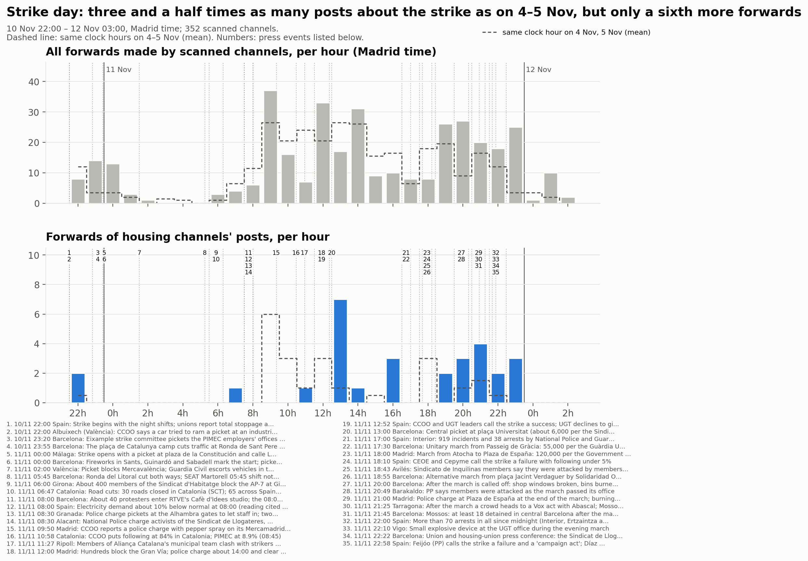
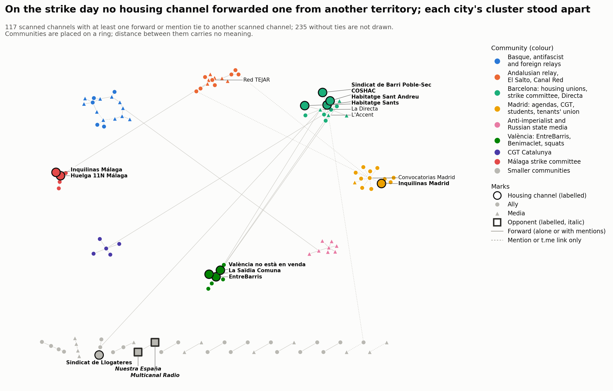
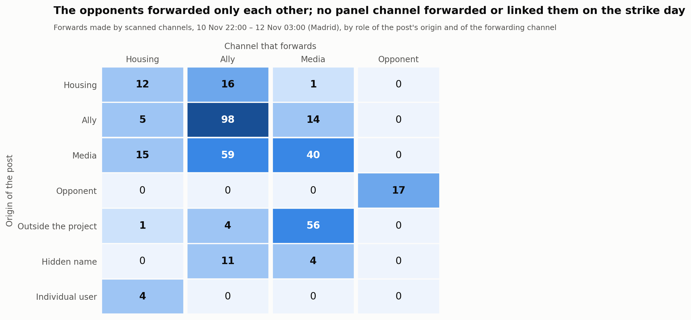

# Strike day — 10 November 22:00 to 12 November 03:00

<strong>English</strong> · <a href="es/followup_strike_day.html">Español</a> · <a href="ca/followup_strike_day.html">Català</a>

Part of the [follow-up](followup.md) of the housing mobilisation on Telegram. This page
covers the general strike of 11 November 2026 as a **window** of 29 hours, Madrid local time,
end exclusive (2026-11-10T21:00Z to 2026-11-12T02:00Z):
- It opens at 22:00 on the eve, when the first night shifts and pickets began.
- It closes at 03:00 after the strike day, so that the evening marches and their first accounts are
  inside.

The window lies inside block 5 (10–16 November). Its events still belong to block 5, which will be
analysed in full afterwards, this window included.

- **Comparisons:**
  - The **same clock hours on Wednesday 4 and Thursday 5 November** (mean), two ordinary weekdays of
    [block 4](followup_block4.md), with no major event marked on either. Hours inside the window
    never count as baseline.
  - **Block 4** (3–9 November) for structure: roles, ties, communities.
- **Collection:** run on 12 November from 15:07 UTC, thirteen hours after the window closed. Posts
  and edits made later are not included.
- **Panel:** 339 channels at the start; 352 after the review round (§6). 3 private.

## 1. The day on Telegram, hour by hour, against the press account

The press account has 36 timed events, listed below; the 35 inside the window are numbered in the
timeline. Sources:
- read verbatim: La Directa's and Nació Digital's live blogs, Euronews, El Español and Demócrata;
- read partly: the eldiario.es and The Objective live blogs, Infobae;
- search summaries only for some items, as each event's note says.

<strong>The 36 events of the press account (35 numbered in the timeline)</strong>

<table style="font-size:85%;border-collapse:collapse"><thead><tr><th style="border:1px solid #d0d7de;padding:4px 8px;vertical-align:top">No.</th><th style="border:1px solid #d0d7de;padding:4px 8px;vertical-align:top">Madrid time</th><th style="border:1px solid #d0d7de;padding:4px 8px;vertical-align:top">Place</th><th style="border:1px solid #d0d7de;padding:4px 8px;vertical-align:top">Event</th><th style="border:1px solid #d0d7de;padding:4px 8px;vertical-align:top">Sources</th><th style="border:1px solid #d0d7de;padding:4px 8px;vertical-align:top">Note</th></tr></thead><tbody><tr><td style="border:1px solid #d0d7de;padding:4px 8px;vertical-align:top">– <small>before the window</small></td><td style="border:1px solid #d0d7de;padding:4px 8px;vertical-align:top">10&nbsp;Nov&nbsp;20:00</td><td style="border:1px solid #d0d7de;padding:4px 8px;vertical-align:top">Martorell</td><td style="border:1px solid #d0d7de;padding:4px 8px;vertical-align:top">First night-shift pickets at the SEAT plant (CCOO, CGT, UGT)</td><td style="border:1px solid #d0d7de;padding:4px 8px;vertical-align:top"><a href="https://directa.cat/minut-a-minut-11n-vaga-general/">La Directa</a></td><td style="border:1px solid #d0d7de;padding:4px 8px;vertical-align:top">Directa post 20:38 (event time &quot;a partir de les 20h&quot;); before the window. Diario Socialista also reports it</td></tr><tr><td style="border:1px solid #d0d7de;padding:4px 8px;vertical-align:top">1</td><td style="border:1px solid #d0d7de;padding:4px 8px;vertical-align:top">10&nbsp;Nov&nbsp;22:00</td><td style="border:1px solid #d0d7de;padding:4px 8px;vertical-align:top">Spain</td><td style="border:1px solid #d0d7de;padding:4px 8px;vertical-align:top">Strike begins with the night shifts; unions report total stoppage at SEAT Martorell</td><td style="border:1px solid #d0d7de;padding:4px 8px;vertical-align:top"><a href="https://directa.cat/minut-a-minut-11n-vaga-general/">La Directa</a>, <a href="https://www.eldiario.es/economia/huelga-general-11-noviembre-ultima-hora-directo-arranca-gran-paro-vivienda_133_13653845.html">eldiario.es</a></td><td style="border:1px solid #d0d7de;padding:4px 8px;vertical-align:top">Directa post 22:00: 327 people inside under minimum services out of 13,000+ staff (union figure). Interior counts incidents from 22:00 Tuesday (eldiario.es)</td></tr><tr><td style="border:1px solid #d0d7de;padding:4px 8px;vertical-align:top">2</td><td style="border:1px solid #d0d7de;padding:4px 8px;vertical-align:top">10&nbsp;Nov&nbsp;22:00</td><td style="border:1px solid #d0d7de;padding:4px 8px;vertical-align:top">Albuixech (València)</td><td style="border:1px solid #d0d7de;padding:4px 8px;vertical-align:top">CCOO says a car tried to ram a picket at an industrial estate</td><td style="border:1px solid #d0d7de;padding:4px 8px;vertical-align:top"><a href="https://www.eldiario.es/economia/huelga-general-11-noviembre-ultima-hora-directo-arranca-gran-paro-vivienda_133_13653845.html">eldiario.es</a></td><td style="border:1px solid #d0d7de;padding:4px 8px;vertical-align:top">eldiario.es post 21:59 of 11 Nov, event &quot;about 22:00 Tuesday&quot;; CCOO&#x27;s account, not confirmed by police</td></tr><tr><td style="border:1px solid #d0d7de;padding:4px 8px;vertical-align:top">3</td><td style="border:1px solid #d0d7de;padding:4px 8px;vertical-align:top">10&nbsp;Nov&nbsp;23:20</td><td style="border:1px solid #d0d7de;padding:4px 8px;vertical-align:top">Barcelona</td><td style="border:1px solid #d0d7de;padding:4px 8px;vertical-align:top">Eixample strike committee pickets the PIMEC employers&#x27; offices with flares</td><td style="border:1px solid #d0d7de;padding:4px 8px;vertical-align:top"><a href="https://directa.cat/minut-a-minut-11n-vaga-general/">La Directa</a></td><td style="border:1px solid #d0d7de;padding:4px 8px;vertical-align:top">Directa post 23:20; Diario Socialista also reports it (search summary)</td></tr><tr><td style="border:1px solid #d0d7de;padding:4px 8px;vertical-align:top">4</td><td style="border:1px solid #d0d7de;padding:4px 8px;vertical-align:top">10&nbsp;Nov&nbsp;23:55</td><td style="border:1px solid #d0d7de;padding:4px 8px;vertical-align:top">Barcelona</td><td style="border:1px solid #d0d7de;padding:4px 8px;vertical-align:top">The plaça de Catalunya camp cuts traffic at Ronda de Sant Pere / Passeig de Gràcia</td><td style="border:1px solid #d0d7de;padding:4px 8px;vertical-align:top"><a href="https://directa.cat/minut-a-minut-11n-vaga-general/">La Directa</a></td><td style="border:1px solid #d0d7de;padding:4px 8px;vertical-align:top">&quot;Poc abans de mitjanit&quot; (Directa post 00:05); a Barcelona outlet&#x27;s live blog has it at 00:10 (search summary). The only housing-camp item found in the press for the night</td></tr><tr><td style="border:1px solid #d0d7de;padding:4px 8px;vertical-align:top">5</td><td style="border:1px solid #d0d7de;padding:4px 8px;vertical-align:top">11&nbsp;Nov&nbsp;00:00</td><td style="border:1px solid #d0d7de;padding:4px 8px;vertical-align:top">Málaga</td><td style="border:1px solid #d0d7de;padding:4px 8px;vertical-align:top">Strike opens with a picket at plaza de la Constitución and calle Larios; CCOO pickets at Mercamálaga and transport depots</td><td style="border:1px solid #d0d7de;padding:4px 8px;vertical-align:top"><a href="https://www.andaluciainformacion.es/articulo/malaga-sociedad/huelga-general-arranca-malaga-reivindicaciones-vivienda-salarios-servicios-publicos/202611110950183533271.html">Andalucía Información</a></td><td style="border:1px solid #d0d7de;padding:4px 8px;vertical-align:top">From a search summary of Andalucía Información and El Español Málaga, not read in full. Police later charged pickets at Mercamálaga and the EMT depots (El Español Málaga headline); CCOO: &quot;todos nuestros piquetes han sido informativos y pacíficos&quot;</td></tr><tr><td style="border:1px solid #d0d7de;padding:4px 8px;vertical-align:top">6</td><td style="border:1px solid #d0d7de;padding:4px 8px;vertical-align:top">11&nbsp;Nov&nbsp;00:00</td><td style="border:1px solid #d0d7de;padding:4px 8px;vertical-align:top">Barcelona</td><td style="border:1px solid #d0d7de;padding:4px 8px;vertical-align:top">Fireworks in Sants, Guinardó and Sabadell mark the start; pickets walk the streets</td><td style="border:1px solid #d0d7de;padding:4px 8px;vertical-align:top"><a href="https://directa.cat/minut-a-minut-11n-vaga-general/">La Directa</a></td><td style="border:1px solid #d0d7de;padding:4px 8px;vertical-align:top">Directa post 00:00</td></tr><tr><td style="border:1px solid #d0d7de;padding:4px 8px;vertical-align:top">7</td><td style="border:1px solid #d0d7de;padding:4px 8px;vertical-align:top">11&nbsp;Nov&nbsp;02:00</td><td style="border:1px solid #d0d7de;padding:4px 8px;vertical-align:top">València</td><td style="border:1px solid #d0d7de;padding:4px 8px;vertical-align:top">Picket blocks Mercavalència; Guardia Civil escorts vehicles in two hours later</td><td style="border:1px solid #d0d7de;padding:4px 8px;vertical-align:top"><a href="https://directa.cat/minut-a-minut-11n-vaga-general/">La Directa</a></td><td style="border:1px solid #d0d7de;padding:4px 8px;vertical-align:top">Directa post 02:00; eldiario.es photo caption of Mercavalència pickets &#x27;en la madrugada&#x27;</td></tr><tr><td style="border:1px solid #d0d7de;padding:4px 8px;vertical-align:top">8</td><td style="border:1px solid #d0d7de;padding:4px 8px;vertical-align:top">11&nbsp;Nov&nbsp;05:45</td><td style="border:1px solid #d0d7de;padding:4px 8px;vertical-align:top">Barcelona</td><td style="border:1px solid #d0d7de;padding:4px 8px;vertical-align:top">Ronda del Litoral cut both ways; SEAT Martorell 05:45 shift not let in</td><td style="border:1px solid #d0d7de;padding:4px 8px;vertical-align:top"><a href="https://directa.cat/minut-a-minut-11n-vaga-general/">La Directa</a>, <a href="https://naciodigital.cat/societat/la-vaga-general-de-l11-n-en-directe-talls-a-les-carreteres-manifestacions-i-reaccions-politiques.html">Nació Digital</a></td><td style="border:1px solid #d0d7de;padding:4px 8px;vertical-align:top">Directa post 05:45; Nació post 07:20 (SEAT gate, A-2 access cut, tyres burned)</td></tr><tr><td style="border:1px solid #d0d7de;padding:4px 8px;vertical-align:top">9</td><td style="border:1px solid #d0d7de;padding:4px 8px;vertical-align:top">11&nbsp;Nov&nbsp;06:00</td><td style="border:1px solid #d0d7de;padding:4px 8px;vertical-align:top">Girona</td><td style="border:1px solid #d0d7de;padding:4px 8px;vertical-align:top">About 400 members of the Sindicat d&#x27;Habitatge block the AP-7 at Girona Oest</td><td style="border:1px solid #d0d7de;padding:4px 8px;vertical-align:top"><a href="https://naciodigital.cat/societat/la-vaga-general-de-l11-n-en-directe-talls-a-les-carreteres-manifestacions-i-reaccions-politiques.html">Nació Digital</a></td><td style="border:1px solid #d0d7de;padding:4px 8px;vertical-align:top">Nació post 07:49; entered about 06:00 after a picket at the Nestlé plant</td></tr><tr><td style="border:1px solid #d0d7de;padding:4px 8px;vertical-align:top">10</td><td style="border:1px solid #d0d7de;padding:4px 8px;vertical-align:top">11&nbsp;Nov&nbsp;06:47</td><td style="border:1px solid #d0d7de;padding:4px 8px;vertical-align:top">Catalonia</td><td style="border:1px solid #d0d7de;padding:4px 8px;vertical-align:top">Road cuts: 30 roads closed in Catalonia (SCT); 65 across Spain at 08:34</td><td style="border:1px solid #d0d7de;padding:4px 8px;vertical-align:top"><a href="https://directa.cat/minut-a-minut-11n-vaga-general/">La Directa</a></td><td style="border:1px solid #d0d7de;padding:4px 8px;vertical-align:top">Directa posts 06:47 and 08:34 (Servei Català de Trànsit). Nació: peak about 50 in Catalonia, five left at 15:15. Counts differ by source and time</td></tr><tr><td style="border:1px solid #d0d7de;padding:4px 8px;vertical-align:top">11</td><td style="border:1px solid #d0d7de;padding:4px 8px;vertical-align:top">11&nbsp;Nov&nbsp;08:00</td><td style="border:1px solid #d0d7de;padding:4px 8px;vertical-align:top">Barcelona</td><td style="border:1px solid #d0d7de;padding:4px 8px;vertical-align:top">About 40 protesters enter RTVE&#x27;s Cafè d&#x27;Idees studio; the 08:00 programme is halted</td><td style="border:1px solid #d0d7de;padding:4px 8px;vertical-align:top"><a href="https://directa.cat/minut-a-minut-11n-vaga-general/">La Directa</a>, <a href="https://es.euronews.com/2026/11/12/fuerza-en-la-calle-pero-seguimiento-escaso-en-el-trabajo-la-huelga-general-del-11n">Euronews</a></td><td style="border:1px solid #d0d7de;padding:4px 8px;vertical-align:top">Directa post 08:12; The Objective (page summary, not verbatim) says about 50 hooded people</td></tr><tr><td style="border:1px solid #d0d7de;padding:4px 8px;vertical-align:top">12</td><td style="border:1px solid #d0d7de;padding:4px 8px;vertical-align:top">11&nbsp;Nov&nbsp;08:00</td><td style="border:1px solid #d0d7de;padding:4px 8px;vertical-align:top">Spain</td><td style="border:1px solid #d0d7de;padding:4px 8px;vertical-align:top">Electricity demand about 10% below normal at 08:00 (reading cited by unions)</td><td style="border:1px solid #d0d7de;padding:4px 8px;vertical-align:top"><a href="https://naciodigital.cat/societat/la-vaga-general-de-l11-n-en-directe-talls-a-les-carreteres-manifestacions-i-reaccions-politiques.html">Nació Digital</a></td><td style="border:1px solid #d0d7de;padding:4px 8px;vertical-align:top">Nació post 08:20 (Cadena SER); reference not stated. Other readings: -6.64% at 10:00 against Tuesday (Nació 11:13); -15.49% at 10-11 h against REE&#x27;s forecast (eldiario.es, page summary); -3.4% over the whole day against 10 Nov (Euronews); -4.7% against forecast at 17:00 (El Español). Not comparable as given</td></tr><tr><td style="border:1px solid #d0d7de;padding:4px 8px;vertical-align:top">13</td><td style="border:1px solid #d0d7de;padding:4px 8px;vertical-align:top">11&nbsp;Nov&nbsp;08:30</td><td style="border:1px solid #d0d7de;padding:4px 8px;vertical-align:top">Granada</td><td style="border:1px solid #d0d7de;padding:4px 8px;vertical-align:top">Police charge pickets at the Alhambra gates to let staff in; two picket members detained</td><td style="border:1px solid #d0d7de;padding:4px 8px;vertical-align:top"><a href="https://www.cope.es/actualidad/espana/al-minuto/huelga-general-11-noviembre-sigue-directo-jornada-paro-espana-20261111_3472630.html">COPE</a></td><td style="border:1px solid #d0d7de;padding:4px 8px;vertical-align:top">COPE (search summary) and The Objective (page summary, 11:49): pickets from 06:30; Alhambra opened about 11:00. Not read verbatim</td></tr><tr><td style="border:1px solid #d0d7de;padding:4px 8px;vertical-align:top">14</td><td style="border:1px solid #d0d7de;padding:4px 8px;vertical-align:top">11&nbsp;Nov&nbsp;08:30</td><td style="border:1px solid #d0d7de;padding:4px 8px;vertical-align:top">Alacant</td><td style="border:1px solid #d0d7de;padding:4px 8px;vertical-align:top">National Police charge activists of the Sindicat de Llogateres, Sindicat de Vivenda de Carolines and OJS</td><td style="border:1px solid #d0d7de;padding:4px 8px;vertical-align:top"><a href="https://directa.cat/minut-a-minut-11n-vaga-general/">La Directa</a></td><td style="border:1px solid #d0d7de;padding:4px 8px;vertical-align:top">Directa post 08:30; Directa&#x27;s account only</td></tr><tr><td style="border:1px solid #d0d7de;padding:4px 8px;vertical-align:top">15</td><td style="border:1px solid #d0d7de;padding:4px 8px;vertical-align:top">11&nbsp;Nov&nbsp;09:50</td><td style="border:1px solid #d0d7de;padding:4px 8px;vertical-align:top">Madrid</td><td style="border:1px solid #d0d7de;padding:4px 8px;vertical-align:top">CCOO reports a police charge with pepper spray on its Mercamadrid picket overnight and files a criminal complaint</td><td style="border:1px solid #d0d7de;padding:4px 8px;vertical-align:top"><a href="https://www.elespanol.com/invertia/economia/empleo/20261111/ceoe-cifra-seguimiento-huelga-ugt-descarta-dar-nuevos-datos-aburrido/1003744454617_0.html">El Español</a></td><td style="border:1px solid #d0d7de;padding:4px 8px;vertical-align:top">Event &#x27;la pasada madrugada&#x27; (El Español); 09:50 and 10:30 are The Objective&#x27;s post times (page summary). CCOO: 1 arrest and 13 injured (claim). Madrid&#x27;s mayor admitted incidents at Mercamadrid and EMT depots (The Objective 12:04, summary)</td></tr><tr><td style="border:1px solid #d0d7de;padding:4px 8px;vertical-align:top">16</td><td style="border:1px solid #d0d7de;padding:4px 8px;vertical-align:top">11&nbsp;Nov&nbsp;10:58</td><td style="border:1px solid #d0d7de;padding:4px 8px;vertical-align:top">Catalonia</td><td style="border:1px solid #d0d7de;padding:4px 8px;vertical-align:top">CCOO puts following at 84% in Catalonia; PIMEC at 8.9% (08:45)</td><td style="border:1px solid #d0d7de;padding:4px 8px;vertical-align:top"><a href="https://naciodigital.cat/societat/la-vaga-general-de-l11-n-en-directe-talls-a-les-carreteres-manifestacions-i-reaccions-politiques.html">Nació Digital</a></td><td style="border:1px solid #d0d7de;padding:4px 8px;vertical-align:top">Nació posts 10:13 and 10:58; PIMEC 8.3% at 11:42; Generalitat public sector 12.8% (16:25)</td></tr><tr><td style="border:1px solid #d0d7de;padding:4px 8px;vertical-align:top">17</td><td style="border:1px solid #d0d7de;padding:4px 8px;vertical-align:top">11&nbsp;Nov&nbsp;11:27</td><td style="border:1px solid #d0d7de;padding:4px 8px;vertical-align:top">Ripoll</td><td style="border:1px solid #d0d7de;padding:4px 8px;vertical-align:top">Members of Aliança Catalana&#x27;s municipal team clash with strikers at a supermarket picket</td><td style="border:1px solid #d0d7de;padding:4px 8px;vertical-align:top"><a href="https://naciodigital.cat/societat/la-vaga-general-de-l11-n-en-directe-talls-a-les-carreteres-manifestacions-i-reaccions-politiques.html">Nació Digital</a>, <a href="https://directa.cat/minut-a-minut-11n-vaga-general/">La Directa</a></td><td style="border:1px solid #d0d7de;padding:4px 8px;vertical-align:top">Nació post 11:27 (pushes, kicks); Directa 15:41: police separate the mayor from protesters</td></tr><tr><td style="border:1px solid #d0d7de;padding:4px 8px;vertical-align:top">18</td><td style="border:1px solid #d0d7de;padding:4px 8px;vertical-align:top">11&nbsp;Nov&nbsp;12:00</td><td style="border:1px solid #d0d7de;padding:4px 8px;vertical-align:top">Madrid</td><td style="border:1px solid #d0d7de;padding:4px 8px;vertical-align:top">Hundreds block the Gran Vía; police charge about 14:00 and clear it about 14:30</td><td style="border:1px solid #d0d7de;padding:4px 8px;vertical-align:top"><a href="https://es.euronews.com/2026/11/12/fuerza-en-la-calle-pero-seguimiento-escaso-en-el-trabajo-la-huelga-general-del-11n">Euronews</a>, <a href="https://naciodigital.cat/societat/la-vaga-general-de-l11-n-en-directe-talls-a-les-carreteres-manifestacions-i-reaccions-politiques.html">Nació Digital</a></td><td style="border:1px solid #d0d7de;padding:4px 8px;vertical-align:top">Euronews (charges around 14:00, pepper-spray claims); Nació post 14:40; The Objective (summary): blocked about two hours, 2 arrests</td></tr><tr><td style="border:1px solid #d0d7de;padding:4px 8px;vertical-align:top">19</td><td style="border:1px solid #d0d7de;padding:4px 8px;vertical-align:top">11&nbsp;Nov&nbsp;12:52</td><td style="border:1px solid #d0d7de;padding:4px 8px;vertical-align:top">Spain</td><td style="border:1px solid #d0d7de;padding:4px 8px;vertical-align:top">CCOO and UGT leaders call the strike a success; UGT declines to give a national figure</td><td style="border:1px solid #d0d7de;padding:4px 8px;vertical-align:top"><a href="https://www.elespanol.com/invertia/economia/empleo/20261111/ceoe-cifra-seguimiento-huelga-ugt-descarta-dar-nuevos-datos-aburrido/1003744454617_0.html">El Español</a></td><td style="border:1px solid #d0d7de;padding:4px 8px;vertical-align:top">Time from eldiario.es (page summary). Union regional figures: 84% Catalonia; 70% Andalusia, Madrid, Aragón; 60% Valencia, Castilla-La Mancha (Euronews); 41% Extremadura and Castilla-La Mancha (eldiario.es header). Disagreement: see 18:10</td></tr><tr><td style="border:1px solid #d0d7de;padding:4px 8px;vertical-align:top">20</td><td style="border:1px solid #d0d7de;padding:4px 8px;vertical-align:top">11&nbsp;Nov&nbsp;13:00</td><td style="border:1px solid #d0d7de;padding:4px 8px;vertical-align:top">Barcelona</td><td style="border:1px solid #d0d7de;padding:4px 8px;vertical-align:top">Central picket at plaça Universitat (about 6,000 per the Sindicat de Llogateres) moves toward plaça Catalunya</td><td style="border:1px solid #d0d7de;padding:4px 8px;vertical-align:top"><a href="https://directa.cat/minut-a-minut-11n-vaga-general/">La Directa</a>, <a href="https://naciodigital.cat/societat/la-vaga-general-de-l11-n-en-directe-talls-a-les-carreteres-manifestacions-i-reaccions-politiques.html">Nació Digital</a></td><td style="border:1px solid #d0d7de;padding:4px 8px;vertical-align:top">Directa post 15:30 (dissolved about 14:00); Nació post 13:09. Guàrdia Urbana: about 3,000 in the central pickets (search summary)</td></tr><tr><td style="border:1px solid #d0d7de;padding:4px 8px;vertical-align:top">21</td><td style="border:1px solid #d0d7de;padding:4px 8px;vertical-align:top">11&nbsp;Nov&nbsp;17:00</td><td style="border:1px solid #d0d7de;padding:4px 8px;vertical-align:top">Spain</td><td style="border:1px solid #d0d7de;padding:4px 8px;vertical-align:top">Interior: 919 incidents and 38 arrests by National Police and Guardia Civil since 22:00 Tuesday</td><td style="border:1px solid #d0d7de;padding:4px 8px;vertical-align:top"><a href="https://www.eldiario.es/economia/huelga-general-11-noviembre-ultima-hora-directo-arranca-gran-paro-vivienda_133_13653845.html">eldiario.es</a></td><td style="border:1px solid #d0d7de;padding:4px 8px;vertical-align:top">eldiario.es post 23:57 (verbatim); Madrid 15. Euronews gives 1,144 incidents for the same interval; Demócrata 1,044. Excludes Mossos and Ertzaintza</td></tr><tr><td style="border:1px solid #d0d7de;padding:4px 8px;vertical-align:top">22</td><td style="border:1px solid #d0d7de;padding:4px 8px;vertical-align:top">11&nbsp;Nov&nbsp;17:30</td><td style="border:1px solid #d0d7de;padding:4px 8px;vertical-align:top">Barcelona</td><td style="border:1px solid #d0d7de;padding:4px 8px;vertical-align:top">Unitary march from Passeig de Gràcia: 55,000 per the Guàrdia Urbana; 400,000 per the organisers</td><td style="border:1px solid #d0d7de;padding:4px 8px;vertical-align:top"><a href="https://naciodigital.cat/societat/la-vaga-general-de-l11-n-en-directe-talls-a-les-carreteres-manifestacions-i-reaccions-politiques.html">Nació Digital</a>, <a href="https://www.infobae.com/espana/2026/11/11/huelga-general-en-espana-en-directo-piquetes-incidencia-en-transportes-y-empresas-reacciones-y-ultima-hora-de-las-elecciones-generales/">Infobae</a></td><td style="border:1px solid #d0d7de;padding:4px 8px;vertical-align:top">Start 17:30 (beteve guide, search summary); Nació 18:55 (55,000) and 20:14 (400,000, Sindicat de Llogateres); one summary gives 50,000</td></tr><tr><td style="border:1px solid #d0d7de;padding:4px 8px;vertical-align:top">23</td><td style="border:1px solid #d0d7de;padding:4px 8px;vertical-align:top">11&nbsp;Nov&nbsp;18:00</td><td style="border:1px solid #d0d7de;padding:4px 8px;vertical-align:top">Madrid</td><td style="border:1px solid #d0d7de;padding:4px 8px;vertical-align:top">March from Atocha to Plaza de España: 120,000 per the Government Delegation; 400,000 per the Sindicato de Inquilinas</td><td style="border:1px solid #d0d7de;padding:4px 8px;vertical-align:top"><a href="https://www.eldiario.es/economia/huelga-general-11-noviembre-ultima-hora-directo-arranca-gran-paro-vivienda_133_13653845.html">eldiario.es</a>, <a href="https://www.infobae.com/espana/2026/11/11/huelga-general-en-espana-en-directo-piquetes-incidencia-en-transportes-y-empresas-reacciones-y-ultima-hora-de-las-elecciones-generales/">Infobae</a></td><td style="border:1px solid #d0d7de;padding:4px 8px;vertical-align:top">eldiario.es 23:27; Infobae 19:21; The Objective 20:21 gives 600,000 for the Sindicato de Inquilinas. In the rain</td></tr><tr><td style="border:1px solid #d0d7de;padding:4px 8px;vertical-align:top">24</td><td style="border:1px solid #d0d7de;padding:4px 8px;vertical-align:top">11&nbsp;Nov&nbsp;18:10</td><td style="border:1px solid #d0d7de;padding:4px 8px;vertical-align:top">Spain</td><td style="border:1px solid #d0d7de;padding:4px 8px;vertical-align:top">CEOE and Cepyme call the strike a failure with following under 5%</td><td style="border:1px solid #d0d7de;padding:4px 8px;vertical-align:top"><a href="https://www.elespanol.com/invertia/economia/empleo/20261111/ceoe-cifra-seguimiento-huelga-ugt-descarta-dar-nuevos-datos-aburrido/1003744454617_0.html">El Español</a></td><td style="border:1px solid #d0d7de;padding:4px 8px;vertical-align:top">El Español published 18:10 (eldiario.es summary has it at 18:46). Electricity -4.7% against REE&#x27;s forecast; unions dispute the measure</td></tr><tr><td style="border:1px solid #d0d7de;padding:4px 8px;vertical-align:top">25</td><td style="border:1px solid #d0d7de;padding:4px 8px;vertical-align:top">11&nbsp;Nov&nbsp;18:43</td><td style="border:1px solid #d0d7de;padding:4px 8px;vertical-align:top">Avilés</td><td style="border:1px solid #d0d7de;padding:4px 8px;vertical-align:top">Sindicato de Inquilinas members say they were attacked by members of Núcleo Nacional while calling to the strike</td><td style="border:1px solid #d0d7de;padding:4px 8px;vertical-align:top"><a href="https://www.eldiario.es/economia/huelga-general-11-noviembre-ultima-hora-directo-arranca-gran-paro-vivienda_133_13653845.html">eldiario.es</a></td><td style="border:1px solid #d0d7de;padding:4px 8px;vertical-align:top">eldiario.es post time, from a page summary (not verbatim); the union&#x27;s account only</td></tr><tr><td style="border:1px solid #d0d7de;padding:4px 8px;vertical-align:top">26</td><td style="border:1px solid #d0d7de;padding:4px 8px;vertical-align:top">11&nbsp;Nov&nbsp;18:55</td><td style="border:1px solid #d0d7de;padding:4px 8px;vertical-align:top">Barcelona</td><td style="border:1px solid #d0d7de;padding:4px 8px;vertical-align:top">Alternative march from plaça Jacint Verdaguer by Solidaridad Obrera and the Sindicat d&#x27;Habitatge Socialista: 10,000 per organisers</td><td style="border:1px solid #d0d7de;padding:4px 8px;vertical-align:top"><a href="https://directa.cat/minut-a-minut-11n-vaga-general/">La Directa</a>, <a href="https://www.infobae.com/espana/2026/11/11/huelga-general-en-espana-en-directo-piquetes-incidencia-en-transportes-y-empresas-reacciones-y-ultima-hora-de-las-elecciones-generales/">Infobae</a></td><td style="border:1px solid #d0d7de;padding:4px 8px;vertical-align:top">Directa post 18:55; Infobae 19:19 (about 10,000 per organisers; no official count)</td></tr><tr><td style="border:1px solid #d0d7de;padding:4px 8px;vertical-align:top">27</td><td style="border:1px solid #d0d7de;padding:4px 8px;vertical-align:top">11&nbsp;Nov&nbsp;20:00</td><td style="border:1px solid #d0d7de;padding:4px 8px;vertical-align:top">Barcelona</td><td style="border:1px solid #d0d7de;padding:4px 8px;vertical-align:top">After the march is called off: shop windows broken, bins burned, fireworks at the Mossos; riot-unit charges</td><td style="border:1px solid #d0d7de;padding:4px 8px;vertical-align:top"><a href="https://naciodigital.cat/societat/la-vaga-general-de-l11-n-en-directe-talls-a-les-carreteres-manifestacions-i-reaccions-politiques.html">Nació Digital</a>, <a href="https://directa.cat/minut-a-minut-11n-vaga-general/">La Directa</a></td><td style="border:1px solid #d0d7de;padding:4px 8px;vertical-align:top">Directa 19:59 (first charges); Nació 20:05 and 20:54 (Apple store on Passeig de Gràcia set on fire; containers around plaça Catalunya)</td></tr><tr><td style="border:1px solid #d0d7de;padding:4px 8px;vertical-align:top">28</td><td style="border:1px solid #d0d7de;padding:4px 8px;vertical-align:top">11&nbsp;Nov&nbsp;20:49</td><td style="border:1px solid #d0d7de;padding:4px 8px;vertical-align:top">Barakaldo</td><td style="border:1px solid #d0d7de;padding:4px 8px;vertical-align:top">PP says members were attacked as the march passed its office</td><td style="border:1px solid #d0d7de;padding:4px 8px;vertical-align:top"><a href="https://theobjective.com/sociedad/2026-11-11/ultima-hora-huelga-general-11-n/directo/">The Objective</a></td><td style="border:1px solid #d0d7de;padding:4px 8px;vertical-align:top">The Objective posts 20:49 and 21:55; eldiario.es (summary, 21:40): two members hospitalised after an object was thrown. PP&#x27;s account</td></tr><tr><td style="border:1px solid #d0d7de;padding:4px 8px;vertical-align:top">29</td><td style="border:1px solid #d0d7de;padding:4px 8px;vertical-align:top">11&nbsp;Nov&nbsp;21:00</td><td style="border:1px solid #d0d7de;padding:4px 8px;vertical-align:top">Madrid</td><td style="border:1px solid #d0d7de;padding:4px 8px;vertical-align:top">Police charge at Plaza de España at the end of the march; burning bins on nearby streets</td><td style="border:1px solid #d0d7de;padding:4px 8px;vertical-align:top"><a href="https://www.eldiario.es/economia/huelga-general-11-noviembre-ultima-hora-directo-arranca-gran-paro-vivienda_133_13653845.html">eldiario.es</a>, <a href="https://theobjective.com/sociedad/2026-11-11/ultima-hora-huelga-general-11-n/directo/">The Objective</a></td><td style="border:1px solid #d0d7de;padding:4px 8px;vertical-align:top">Event about 21:00 (eldiario.es 23:01); arrests 4 (eldiario.es 23:27), 2 (The Objective 23:10) or 1 (21:38). El País via Infobae 20:07 already reports charges and pepper spray</td></tr><tr><td style="border:1px solid #d0d7de;padding:4px 8px;vertical-align:top">30</td><td style="border:1px solid #d0d7de;padding:4px 8px;vertical-align:top">11&nbsp;Nov&nbsp;21:25</td><td style="border:1px solid #d0d7de;padding:4px 8px;vertical-align:top">Tarragona</td><td style="border:1px solid #d0d7de;padding:4px 8px;vertical-align:top">After the march a crowd heads to a Vox act with Abascal; Mossos fire foam rounds</td><td style="border:1px solid #d0d7de;padding:4px 8px;vertical-align:top"><a href="https://directa.cat/minut-a-minut-11n-vaga-general/">La Directa</a>, <a href="https://naciodigital.cat/societat/la-vaga-general-de-l11-n-en-directe-talls-a-les-carreteres-manifestacions-i-reaccions-politiques.html">Nació Digital</a></td><td style="border:1px solid #d0d7de;padding:4px 8px;vertical-align:top">Directa 21:25; Nació 21:28 (stones thrown at the police cordon)</td></tr><tr><td style="border:1px solid #d0d7de;padding:4px 8px;vertical-align:top">31</td><td style="border:1px solid #d0d7de;padding:4px 8px;vertical-align:top">11&nbsp;Nov&nbsp;21:45</td><td style="border:1px solid #d0d7de;padding:4px 8px;vertical-align:top">Barcelona</td><td style="border:1px solid #d0d7de;padding:4px 8px;vertical-align:top">Mossos: at least 18 detained in central Barcelona after the march</td><td style="border:1px solid #d0d7de;padding:4px 8px;vertical-align:top"><a href="https://directa.cat/minut-a-minut-11n-vaga-general/">La Directa</a>, <a href="https://theobjective.com/sociedad/2026-11-11/ultima-hora-huelga-general-11-n/directo/">The Objective</a></td><td style="border:1px solid #d0d7de;padding:4px 8px;vertical-align:top">Directa 21:59 (count at 21:45); The Objective 22:03. Barcelona&#x27;s mayor said 50 (The Objective 23:29); Mossos 52 on 12 Nov (Directa 12 Nov 11:40, outside the window)</td></tr><tr><td style="border:1px solid #d0d7de;padding:4px 8px;vertical-align:top">32</td><td style="border:1px solid #d0d7de;padding:4px 8px;vertical-align:top">11&nbsp;Nov&nbsp;22:00</td><td style="border:1px solid #d0d7de;padding:4px 8px;vertical-align:top">Spain</td><td style="border:1px solid #d0d7de;padding:4px 8px;vertical-align:top">More than 70 arrests in all since midnight (Interior, Ertzaintza and Mossos)</td><td style="border:1px solid #d0d7de;padding:4px 8px;vertical-align:top"><a href="https://www.eldiario.es/economia/huelga-general-11-noviembre-ultima-hora-directo-arranca-gran-paro-vivienda_133_13653845.html">eldiario.es</a></td><td style="border:1px solid #d0d7de;padding:4px 8px;vertical-align:top">eldiario.es post 23:57 (verbatim). Ertzaintza 16; Mossos 18. Demócrata (12 Nov 05:31): at least 75. COPE: more than 50 at 20:00. Counts differ by source and cut-off</td></tr><tr><td style="border:1px solid #d0d7de;padding:4px 8px;vertical-align:top">33</td><td style="border:1px solid #d0d7de;padding:4px 8px;vertical-align:top">11&nbsp;Nov&nbsp;22:10</td><td style="border:1px solid #d0d7de;padding:4px 8px;vertical-align:top">Vigo</td><td style="border:1px solid #d0d7de;padding:4px 8px;vertical-align:top">Small explosive device at the UGT office during the evening march</td><td style="border:1px solid #d0d7de;padding:4px 8px;vertical-align:top"><a href="https://www.eldiario.es/economia/huelga-general-11-noviembre-ultima-hora-directo-arranca-gran-paro-vivienda_133_13653845.html">eldiario.es</a>, <a href="https://theobjective.com/sociedad/2026-11-11/ultima-hora-huelga-general-11-n/directo/">The Objective</a></td><td style="border:1px solid #d0d7de;padding:4px 8px;vertical-align:top">Post times (eldiario.es 22:10; The Objective 22:24); the government sub-delegate condemned it; police investigating</td></tr><tr><td style="border:1px solid #d0d7de;padding:4px 8px;vertical-align:top">34</td><td style="border:1px solid #d0d7de;padding:4px 8px;vertical-align:top">11&nbsp;Nov&nbsp;22:22</td><td style="border:1px solid #d0d7de;padding:4px 8px;vertical-align:top">Barcelona</td><td style="border:1px solid #d0d7de;padding:4px 8px;vertical-align:top">Union and housing-union press conference: the Sindicat de Llogateres says &#x27;les vagues seguiran&#x27;</td><td style="border:1px solid #d0d7de;padding:4px 8px;vertical-align:top"><a href="https://directa.cat/minut-a-minut-11n-vaga-general/">La Directa</a></td><td style="border:1px solid #d0d7de;padding:4px 8px;vertical-align:top">Directa post 22:22 (CGT, COSHAC, IAC also speak)</td></tr><tr><td style="border:1px solid #d0d7de;padding:4px 8px;vertical-align:top">35</td><td style="border:1px solid #d0d7de;padding:4px 8px;vertical-align:top">11&nbsp;Nov&nbsp;22:58</td><td style="border:1px solid #d0d7de;padding:4px 8px;vertical-align:top">Spain</td><td style="border:1px solid #d0d7de;padding:4px 8px;vertical-align:top">Feijóo (PP) calls the strike a failure and a &#x27;campaign act&#x27;; Díaz (government) called it a success at 21:50</td><td style="border:1px solid #d0d7de;padding:4px 8px;vertical-align:top"><a href="https://theobjective.com/sociedad/2026-11-11/ultima-hora-huelga-general-11-n/directo/">The Objective</a></td><td style="border:1px solid #d0d7de;padding:4px 8px;vertical-align:top">The Objective posts 21:50 and 22:58; Vox: Abascal &#x27;vergüenza&#x27; (21:10)</td></tr></tbody></table>

The figures in dispute:

| | Unions / organisers | Employers / police / government |
|---|---|---|
| Following | CCOO 84 % in Catalonia; 60–70 % elsewhere; about 41 % in Extremadura and Castilla-La Mancha; UGT gave no national figure | CEOE "under 5 %", "fracaso"; PIMEC 8.3–8.9 %; Generalitat public sector 12.8 % |
| Electricity | "más propios de un domingo" | five readings, not comparable: −10 % at 08:00; −6.6 % at 10:00 against Tuesday; −3.4 % over the day against 10 Nov |
| Madrid march | 400,000 (Sindicato de Inquilinas) | 120,000 (Government Delegation) |
| Barcelona march | 400,000 (organisers) | 55,000 (Guàrdia Urbana) |
| Arrests | "una cinquantena" in Barcelona (COSHAC, 23:04) | 38 by National Police and Guardia Civil to 17:00; more than 70 in all by 22:00; at least 18 by the Mossos in Barcelona at 21:45 |

**In the window, the panel posted 802 times about the mobilisation, against 225 in the same clock
hours on 4–5 November: 3.6 times as many.** This counts the channels that were in the panel before
the window, the only ones with baseline posts. With the 13 channels admitted in §6 the count is 923.

**Forwarding barely rose:** 355 forwards against 309, +15 % (357 with the admitted channels).
Forwards of housing channels' posts: 29 against 21.

The window's term list was also applied to the baseline days. It is wider than block 4's list
(§7), so the baseline is if anything overstated.

| Part of the day (Madrid) | Forwards | Baseline | Housing posts forwarded | Baseline | Posts about the mobilisation | Baseline |
|---|---|---|---|---|---|---|
| Lead-in, 10 Nov 22:00–24:00 | 22 | 15.5 | 2 | 0.5 | 36 | 15 |
| Night, 00:00–06:00 | 17 | 8 | 0 | 0 | 80 | 3 |
| Morning, 06:00–12:00 | 73 | 90 | 2 | 10 | 301 | 66 |
| Afternoon, 12:00–18:00 | 108 | 111.5 | 11 | 4.5 | 264 | 70.5 |
| Evening, 18:00–24:00 | 124 | 78.5 | 14 | 6 | 228 | 68.5 |
| After midnight, 12 Nov 00:00–03:00 | 13 | 5.5 | 0 | 0 | 14 | 1.5 |

Posts in this table include the admitted channels.

**Lead-in (22:00–24:00).** In the press: night-shift pickets at SEAT Martorell; the Eixample strike
committee at PIMEC; unionists at the gates of Mercabarna; a car that CCOO says tried to ram a picket
near València. The plaça de Catalunya camp cut traffic just before midnight.

On Telegram:
- Málaga's strike committee posted "El Comité de Huelga se concentra en la Plaza de la Constitución"
  (22:49). The Sants housing group relayed La Directa's Mercabarna post (22:52).
- CCOO's channel: "¡EMPIEZA LA JORNADA DE HUELGA GENERAL!" (22:55). UGT's: Pepe Álvarez "en el
  piquete de salida" in Puerta del Sol (22:27).
- The Barcelona camp's channel posted for the last time in the window at 23:05: "L'ACAMPADA CONTINUA!"
  and two interviews. **It did not post on the strike day itself.**

**Night (00:00–06:00).** Posts about the mobilisation came from the start: 80, against 3 in the same
hours on ordinary days. Forwarding was light (17).
- Strike starts: "COMENÇA LA VAGA GENERAL!" (Poble-Sec union, 00:02; Barcelona tenants' union, 01:02);
  "Paramos todo. Estamos en huelga general" (CNT Madrid, 00:11).
- Night pickets: CCOO del Hábitat posted picket photos from Asturias, Zaragoza, Madrid, València and
  Castellón through the night.
- The first police accounts, before any press report was read:
  - EntreBarris: "Piquet a Mercavalència" (03:09);
  - Horitzó: a vehicle that "envesteix el piquet de Mercavalencia i és protegit per la policia" (04:12);
  - La Villana de Vallekas, just after the night: "La policía progresista ha cargado y echado gas
    pimienta, también en Mercamadrid" (06:14);
  - UGT: "Máxima tensión en Mercamadrid" (02:14).
- The press has the Mercamadrid charge only from a CCOO complaint posted at 09:50 (event 15).

**Morning (06:00–12:00): road cuts and pickets, posted, not forwarded.** The five busiest hours by
posts about the mobilisation are 09:00 (66), 12:00 (63), 13:00 (62), 11:00 (58) and 10:00 (56).

What those posts were about:
- mostly pickets (picket words in 20–33 matching posts an hour) and road cuts (15 at 09:00);
- police charges and arrests (11 at 09:00, 10 at 12:00);
- the march calls, from 12:00 on.

They came above all from live-coverage channels: L'Accent, La Directa, the Centre de mitjans 11N,
Horitzó, CCOO's channels and Arainfo.

Forwarding fell below an ordinary morning: 73 against 90. Housing posts were forwarded twice, against
10. The 09:00 forwarding peak (37) is mostly two batch relays: CGT Madrid forwarded 11 posts of CGT Zona Sur,
and Alerta Solidària 8 of the COS.

The press events of the morning all appear on Telegram the same hour or earlier: the AP-7 and Ronda
Litoral cuts, the RTVE studio, the Alhambra charge, Alacant, Ripoll. The Barcelona tenants' union
posted "Hem tallat més de 60 carreteres a tot Catalunya... EL PAÍS S'HA ATURAT" at 09:54. The Servei
Català de Trànsit counted 65 roads cut across Spain at 08:34.

**Afternoon (12:00–18:00).** Forwards were at the ordinary level (108 against 111.5). Two more batch
relays: CCOO Eiffage Madrid forwarded 16 posts of CCOO Industria at 12:00, among them "ÉXITO ROTUNDO DE
LA HUELGA GENERAL DEL 11N".

**Housing posts were most forwarded at 13:00 (7).** Málaga's strike committee's "SEGUIMOS EN HUELGA"
and "LO PARAMOS TODO" were relayed by the Málaga tenants' union and La Invisible (6), and COSHAC by the
Sant Andreu housing union.

The Madrid tenants' union posted "LO HEMOS PARADO TODO" (11:52) and an update with following figures
and road cuts (12:02). CGT Madrid and CGT Zona Sur relayed the first at 16:22.

The following dispute reached the panel as each side's figures:
- CCOO's sector percentages (07:20 and after);
- El Español's "Fracasa la huelga general" headline, relayed in order to contest it ("La realidad es
  que ha habido más del 80% de seguimiento", Revolución Comunista, 18:15).

**Evening (18:00–24:00): the marches, and forwarding above an ordinary evening** (124 against 78.5;
housing posts 14 against 6).
- Marches: the Barcelona and Madrid marches (events 22–23) were covered live. The Valencian march was
  relayed from EntreBarris ("la vaga de l'11N, han sigut un èxit", 20:10) by four València channels.
  Horitzó reported the separate march of the Sindicat d'Habitatge Socialista and Solidaritat Obrera
  ("10.000 persones", 21:58).
- After the Barcelona march (events 27, 31): La Directa's arrest counts were relayed by the Sant Andreu
  committee and housing union and by Palestina SOS. The Mossos' foam rounds in Tarragona (event 30) went
  out at 21:41.
- Camps:
  - The Mallorca strike media centre posted at 23:16: "L'acampada a la plaça torna a ser una
    realitat!" (@centredemitjans #134). The Palma camp is pitched again after the march. The press
    found nothing on Palma's camp that day.
  - A València channel relayed at 20:02 that the València camp was threatened with eviction ("Esta
    nit, tots a la plaça", @valldignaanarquista #5381). Search summaries report that the camp began to
    dismantle on 12 November, outside the window.
- End-of-day posts: COSHAC's "LLIBERTAT DETINGUDES" (23:04); the Sol camp's call to upload videos of
  "la represión policial... durante la jornada de Huelga General como en la manifestación" (22:51).

**After midnight (00:00–03:00).** Little: 13 forwards, 10 of them pro-Russian channels' unrelated
posts.

**Not on Telegram, or not found:**
- The Madrid march's end and the Plaza de España charge (event 29) appear only in relayed form (TASS,
  MT News, the Sol camp's call).
- No panel channel posted the Vigo device at the UGT office (event 33).
- The PP's Barakaldo complaint (event 28) appears in no panel channel's post.

## 2. Who carried it

**Live coverage.** 19 channels posted about the mobilisation in eight or more distinct hours:
- Horitzó (21 hours; admitted in this window);
- La Directa (20);
- L'Accent, Canal CCOO and CCOO del Hábitat (18 each);
- elPlural (14), Arainfo (13), MT News (12);
- the Sant Andreu strike committee, Crític and UGT (11 each);
- the Centre de mitjans 11N (10; admitted) and teleSUR (10);
- CGT Catalunya (9);
- the Sant Andreu housing union (9), AhotsaInfo (8), EntreBarris (8), Satélite Rojo (8) and TASS (8).

Two of them are housing channels (Sant Andreu, EntreBarris). Most are media or conveners' union
channels.

**Most forwarded:**
- La Directa (31 forwards);
- CCOO Industria (25);
- Nuestra España (17, all by Multicanal Radio);
- the COS (16);
- MT News, CGT Zona Sur and Málaga's strike committee (11 each).

The five busiest forwarders made 37.5 % of the window's forwards.

**The hub.** The Madrid tenants' union, a convener and the hub of earlier blocks:
- posted 4 times;
- was forwarded twice, by CGT Madrid and CGT Zona Sur. In block 4's week: 13 times by 5 channels;
- ranks third by breadth, behind EntreBarris (6 channels, 6 forwards) and Málaga's strike committee
  (4 channels, 11 forwards).

The Barcelona tenants' union (11 posts) was forwarded twice, by one channel.

**The camps.** The Sol and Barcelona camp channels were not forwarded at all in the window; in block 4
they were forwarded 9 and 3 times. The Palma camp group made 4 forwards. The camps' strike-day news
reached the panel through other channels (the Centre de mitjans, valldignaanarquista).

**The conveners:**
- CCOO's channels (Canal CCOO, CCOO del Hábitat, CCOO Industria and its relays) and UGT's covered the
  day hour by hour.
- CGT's federations covered their pickets.
- The tenants' unions posted little (Madrid 4, Barcelona 11, Málaga 4), and mostly calls, slogans and
  balances.

**Territories.** **No forward between housing channels crossed a territory.** The five ties between
housing channels are all within one territory:
- COSHAC → Sant Andreu (5);
- Málaga's committee → Málaga's tenants' union (4);
- Poble-Sec → Sant Andreu;
- EntreBarris → La Saïdia and València no està en venda.

The map shows each city's cluster on its own: Barcelona (housing unions, the Sant Andreu committee, La
Directa, L'Accent), Madrid (agendas, CGT, students, the tenants' union), València and Málaga.

## 3. Stance and critique on the day

Stance follows the rule of 10 November (see the [follow-up overview](followup.md)), decided from the
window's posts only.

| Role (339 before review) | supportive | critical of the strike | reporting | hostile | none | not readable |
|---|---|---|---|---|---|---|
| in-scope | 15 | 0 | 0 | 0 | 16 | 0 |
| ally | 89 | 0 | 3 | 0 | 118 | 1 |
| media | 23 | 0 | 30 | 0 | 39 | 2 |
| opponent | 0 | 0 | 0 | 3 | 0 | 0 |

Posts about the mobilisation by stance: supportive 783, reporting 123, hostile 16. The 13 admitted
channels add 8 supportive and 5 reporting channels.

**Nobody belittled the strike from within on the day: no channel is *critical of the strike*.**
Bultza, critical of the strike in block 4, posted nothing about the strike in the window. Presos
Revolucionarios:
- called for "UNA HUELGA DE GUERRA GENERAL INDEFINIDA... Sin mafias sindicales del estado";
- defended the strikers against the police;
- is coded supportive with critiques.

**Critique moved to the government.** Critiques were recorded for 18 channels (17 of the panel and
OUTSIDERS.ESP, admitted). The government, a target recorded from this window on, has 11 in own posts
and 5 in relays; CCOO and UGT's leaderships 4 in own posts and 1 in a relay; the strike's strategy 3
in own posts and 1 in a relay.

Almost all the government critiques blame the PSOE–Sumar government or its Government Delegations for
the police charges:
- "La policía progresista ha cargado" (La Villana de Vallekas);
- "la policía del gobierno PSOE - SUMAR" (Unidad COESPE);
- "desautoritzats per la Subdelegació del Govern del Psoe i fortament reprimits per la policia"
  (L'Accent);
- "El gobierno progresista gaseando al pueblo de Madrid" (OUTSIDERS.ESP).

The Podemos channels add "la inacción del gobierno de PSOE y Sumar".

Critique of CCOO and UGT is rarer than in blocks 3 and 4:
- Satélite Rojo: "desbordando a las cúpulas sindicales de CC.OO y UGT";
- Carmen Parejo: "A esta huelga no se llega porque lo imponga CCOO y UGT, sino porque el pueblo
  organizado se lo impone a ellos";
- Izquierda Diario: the strike "impuesta desde abajo".

**Stance changes against block 4** (whole week, codes before the revision of 10 November):
- 21 channels went from *none* to an active stance;
- 88 from *supportive* to *none* (no post in the window);
- media changed in both directions.

## 4. Opponents

The three opponents stayed *hostile*. No role changed; a window never gives a role back.

- **Nuestra España:** "Huelga salvaje: pocos piquetes muy violentos y bulos para simular seguimiento"
  (#2367); the tenants' union "ocupó por la fuerza sede de Alquiler Seguro" (#2369); "El coste de los
  liberados sindicales llega a 1.900 millones" (#2368).
- **Multicanal Radio:** forwards those (17 forwards). Its own programmes: "11N: LA HUELGA DE LOS
  EXTREMISTAS DE SÁNCHEZ" (#4730), "Huelga FRACASADA y VANDALISMO" (#4732).
- **Cristina Martín Jiménez:** "El único objetivo de hoy era incrementar más si cabe la división entre
  todos para el beneficio de los títeres políticos. El pueblo contra el pueblo" (#19616).

Their 16 posts about the mobilisation fall in two bursts: 09:00–11:00 (10) and 18:00–23:00 (6).

**Contact with the rest: none.** No panel channel forwarded or linked an opponent, and no opponent
forwarded a panel channel. The window's three opponent link events are all the opponents' own posts
pointing outside the panel:
- Cristina Martín Jiménez to RT's programme;
- Multicanal Radio to Santiago Abascal's channel and to an unidentified handle, in a post inviting
  Abascal to its programme.

Both outside channels are not reviewed, because channels referenced only by opponents are left out.
Opponents forwarded only each other.

Hostility the press reported is not in the panel: the attack on Sindicato de Inquilinas members in
Avilés, the bottle in Murcia, the Ripoll clash. Pro-Russian panel channels forwarded claims of DDoS
attacks on Spanish ministries and ports on the strike day (@ophiucu). They do not mention the strike.

## 5. The window against block 4 and the baseline hours

- **Volume.**
  - The window's 357 forwards in 29 hours are about 295 per 24 hours, against 253 a day in block 4.
  - Its 923 posts about the mobilisation, 802 without the admitted channels, compare with 1,163 in
    block 4's whole week. That count used block 4's narrower list, so it is not directly comparable.
  - Against the baseline hours: posts ×3.6 on a like-for-like panel; forwards +15 %; housing posts
    forwarded 29 against 21.
- **Role matrix:**
  - The largest flow is ally → ally (98), then media posts forwarded by allies (59), outside sources
    forwarded by media (56, mostly RT and Russian outlets) and media → media (40).
  - Housing posts were forwarded 29 times (12 by housing channels, 16 by allies, 1 by media). In
    block 4's week: 194 by housing channels and allies.
- **Ties** between panel channels: 106 in the window against 425 in block 4's week (62 kept, 44 new).
  A 29-hour window against a week; the "gone" count (363) says little.
- **Attrition:**
  - 127 panel channels did not post in the window, 14 of them housing channels: La PAH, PAH Catalanes,
    PAH Vallekas, Granada's and both Tetuán housing unions, València's tenants' union and others.
  - @fullblackAntifa became private.
  - The Sol camp's channel changed its title to "Acampada 26S"; @airbnbcrepa changed its username to
    @lecitta.
- **Communities** of the window's combined graph:
  - 117 channels with ties, 118 edges; 235 of 352 scanned channels have no tie;
  - 23 communities, modularity 0.832 (by role 0.200);
  - 7 distinct partitions over 50 runs (the most frequent in 58 %); mean node stability 1.0;
  - **adjusted Rand index with block 4: 0.505** on 97 shared channels (158 only in block 4, 20 only in
    the window).
  - **A 29-hour graph is sparse.** Its communities are small and rest on few edges, so they are less
    stable than a block's. The ARI compares a day with a week.
  - The communities are territorial and organisational: Barcelona housing unions with La Directa and
    L'Accent; Madrid; València; Málaga; CGT Catalunya; CCOO's channels; anti-imperialist and Russian
    state media; Andalusian relays with El Salto; Basque, antifascist and foreign relays.

## 6. Admitted channels (light review round)

Candidates:
- 45 graph channels and groups (2 excluded, referenced only by opponents: @rtnoticias and Santiago
  Abascal's channel);
- 5 public handles;
- 3 hits of a search for strike committees and local copies of known channels: the Aiara valley
  strike committee @grebabatzordea, @huelga11n and @vagageneral11n. All three had no post in the
  window.

**13 admitted** (every decision is in the [review log](followup_review_log.csv), block *sd*):
- ally: the **Centre de mitjans 11N** (the Mallorca and Menorca strike media centre); CGT Aragón - La
  Rioja (convener of the strike, CGT); Anarchist Stickers Archive;
- media: Horitzó; La Veïnal (the Agència 11N); Ekinklik; Radio Blackout; OUTSIDERS.ESP (all
  supportive); BERRIA; ORAIN; CND; La Poderío; Russian-language Valencia news (all reporting).

They join the panel from block 5 on. They made 2 of the window's 358 forwards and add 121 posts about
the mobilisation. No admitted channel makes more than 15 % of the window's forwards.

Not admitted:
- an aggregator copying RT and Satélite Rojo;
- the Malditaultraderecha chat;
- La Marina Plaza (links only);
- 34 channels with no own post, or none about the strike;
- 3 private channels.

## 7. Judgement calls

- **Baseline days** 4 and 5 November: no major day is marked in the project's calendar of events.
  Both days carry local events (the Palma camp dismantled, the Granada camp fire).
- **"huelga general" alone as a term marking a post as about the mobilisation, inside the window.**
  All 154 posts it alone adds are about this strike, apart from two or three historical items. The
  same holds for "piquete" and the hashtags. These terms are not valid for ordinary days (block 5 must
  re-test them).
- **Cristina Martín Jiménez *hostile*** on one post of her own (could be read as critical of the
  strike).
- **Presos Revolucionarios *supportive*** with three critiques (could be critical of the strike, as in
  block 3).
- Media coded *supportive* on one own post: elPlural ("ElPlural, con la Huelga General"), Diari La Veu
  (editorial "una vaga justa i necessària"), ARGIA, Traficantes.
- El Salto coded *reporting* (supportive in block 4), because its window posts are news items.
- *Supportive* on one relay or one post: BelicaS, CCOO EMT Madrid, CA-AIT Marina Alta, Irene Zugasti,
  Marx21 Andalucía, XR Barcelona, Presos.org.es.
- Critiques that could go either way:
  - CGT Catalunya, strategy, own post ("desbordarà a tots els sindicats");
  - Izquierda Diario, CCOO and UGT, own post ("impuesta desde abajo");
  - ExWorkers, strategy, own post ("walking out of work is not enough").
  - Horitzó's report of a "bloc de classe independent" was left without a critique.
- **Review:**
  - the Malditaultraderecha chat left out as a chat, although it met the admission threshold;
  - La Poderío admitted on one post;
  - OUTSIDERS.ESP admitted without a match of the search terms;
  - the Centre de mitjans coded *ally* (a movement media centre) rather than *media*.

## 8. What was not verified

- **Press:**
  - The eldiario.es and The Objective live blogs were read verbatim only for the evening. Their earlier
    entries come from page summaries, and their night entries were not read.
  - Málaga's midnight start, the Valencia camp's dismantling and the Barcelona march's start time rest
    on search summaries.
  - No press source on the Sol, Palma or Granada camps during the day was found.
  - Arrest counts differ by source and cut-off; the final Interior balance was not found.
- **Stance reading:**
  - Matching posts were read to 300 characters, and only four per channel were printed, except
    posts with a critique or hostile word, which were read whole. A critique without those words, in
    the unprinted posts of busy channels, may have been missed.
  - X, Instagram and YouTube links were not opened (PAH Barcelona's eleven posts, Pablo Iglesias).
  - Images were not opened.
- **Collection:**
  - The downloads ran thirteen hours after the window. Posts deleted before then, and later edits, are
    not seen.
  - The baseline days' posts come from block 4's panel, without the 13 channels admitted here.
- **Not checked further:** the search hits' web previews showed no post in the window. Whether the
  Aiara committee posts only media was not checked.

**Cite this page.**

DataPolitik (Heurística). <em>Strike day — 10 November 22:00 to 12 November 03:00</em>. In <em>Housing camps and Telegram communication networks in Spain, autumn 2026</em>. Observation period: 10–12 November 2026. Published 13 November 2026. <a href="https://datapolitik.github.io/acampadas-vivienda-report/followup_strike_day.html">https://datapolitik.github.io/acampadas-vivienda-report/followup_strike_day.html</a>

Original text and figures: [CC BY 4.0](https://creativecommons.org/licenses/by/4.0/) · [Use and citation](index.md#use-and-citation)

---

A [DataPolitik](https://www.heuristica.barcelona/datapolitik/) study by [Heurística](https://www.heuristica.barcelona/). · [Home](index.md) · [Follow-up overview](followup.md)
