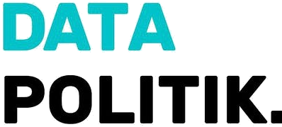
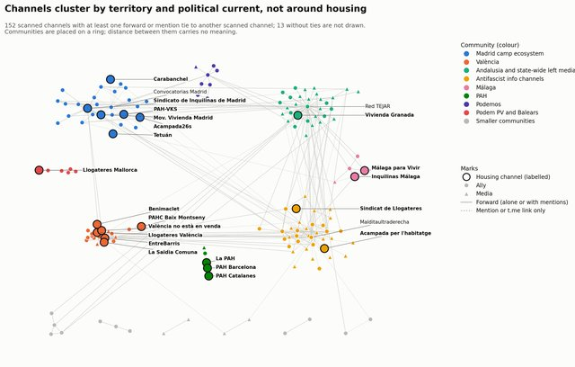
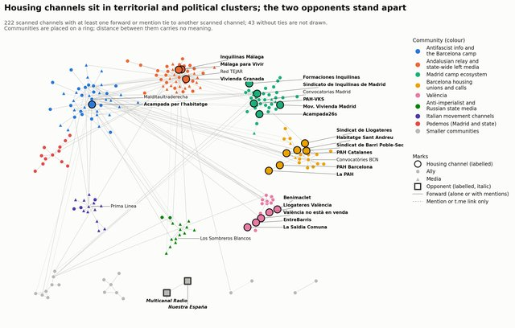
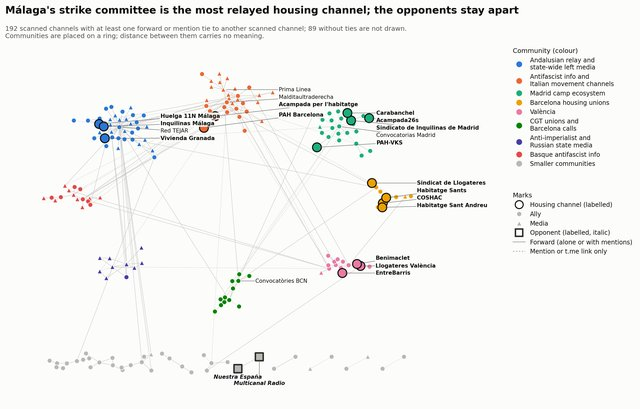
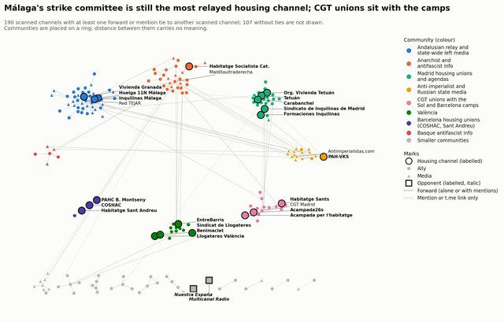
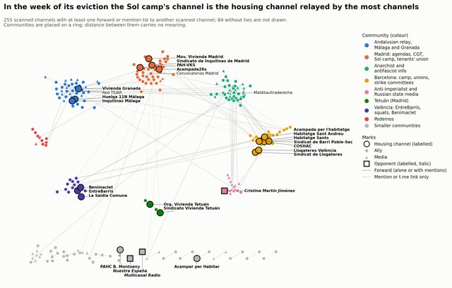

# Housing camps on Telegram, Spain, autumn 2026

An open, documented repository of ongoing research.

<strong>English</strong> · <a href="es/index.html">Español</a> · <a href="ca/index.html">Català</a>

A [DataPolitik](https://www.heuristica.barcelona/datapolitik/) study by [Heurística](https://www.heuristica.barcelona/), Barcelona.

A study of the public Telegram channels of the Spanish housing movement and their
allies during the housing camps that followed the eviction of Maricarmen Abascal in
Madrid, and in the run-up to the general strike for housing called for 11 November:
how the channels were
sampled and classified, and what their forwarding and mention networks show.

## Periods

| Period | Days (2026) | Channels at the end | Report |
|---|---|---|---|
| First study | 14 September – 5 October | 167 | [Technical report](acampadas_vivienda_technical_report.md) · [Community analysis](community_analysis.md) · [External review](external_review.md) · [Evidence (CSV)](external_review_log.csv) |
| Block 1 | 6–19 October | 265 | [Block 1](followup_block1.md) |
| Block 2 | 20–26 October | 281 | [Block 2](followup_block2.md) |
| Block 3 | 27 October – 2 November | 297 | [Block 3](followup_block3.md) |
| Block 4 | 3–9 November | 339 | [Block 4](followup_block4.md) |
| Block 5 | 10–16 November, with the 11 November strike | | in progress |

Blocks 1 onwards extend the first study in weekly blocks, scanning the same channels
in every block and adding those that enter the conversation. How they work, and how
they compare, is on the [follow-up overview](followup.md); their review decisions are
in the [follow-up review log (CSV)](followup_review_log.csv).

Each observation period introduces new data and analyses. Previous reports remain
available to document the evolution of the research, including revisions and
changes in interpretation.

## Across the periods

1. **The Madrid union stops being the hub.** The Sindicato de Inquilinas de Madrid is
   forwarded by 14 channels in the first study and 10 in block 1, after Maricarmen's
   death, then by 1, 2 and 5 in blocks 2 to 4.
2. **Málaga's strike committee channel carries the forwarding of housing content** from
   block 2, but through the same three or four channels: volume without breadth.
3. **The mobilisation turns from the camps to the 11 November strike,** and its
   supporters argue about who leads it: channels criticising CCOO and UGT's leaderships
   rise from 5 to 19 in a week and are 11 in block 4, the week before the strike, almost
   all of them backing the strike. Rejection of the strike itself stays marginal.
4. **Territorial clusters are linked below their housing channels.** Housing channels
   barely forward each other across territories: the first tie, in block 3, is a joint
   statement by the camps after the Urda rail crash. But 7–11 % of the ties among
   channels with a known territory cross territories, carried by anarchist,
   anti-repression and Palestine solidarity collectives, Catalan-language media, and
   organisations present in several territories such as CGT, whose Madrid and Catalan
   channels connect through its state-wide channels.
5. **The camps' own channels are barely relayed**, except the Sol camp's on the day of its
   eviction, in block 4.
6. **The opponents stay closed off:** two hostile media channels that no other channel
   forwards or quotes, joined in block 4 by an author's channel (recorded from block 1,
   when the opponent category was introduced).

## The network in each period

Forwarding and mention networks of the scanned channels, one map per period; select a
map to open it in its report. Communities are detected separately in each period, so
colours and positions are not comparable between maps.

<a href="community_analysis.html#combined" style="display:block;text-decoration:none">First study 14 Sep – 5 Oct</a><a href="followup_block1.html#communities" style="display:block;text-decoration:none">Block 1 6–19 Oct</a><a href="followup_block2.html#communities" style="display:block;text-decoration:none">Block 2 20–26 Oct</a><a href="followup_block3.html#communities" style="display:block;text-decoration:none">Block 3 27 Oct – 2 Nov</a><a href="followup_block4.html#communities" style="display:block;text-decoration:none">Block 4 3–9 Nov</a>

## About this site

This repository brings together successive results from ongoing research into
Telegram communication networks surrounding housing mobilisations in Spain. It
publishes reports, visualisations, methodological documentation, classification
decisions and the processed evidence behind the analyses, so that the research
process can be followed, the findings examined critically, and the evolution of the
interpretations documented as new observations become available.

The findings are provisional, subject to revision, and do not aim to provide an
exhaustive representation of the movement.

- Only public Telegram channels and groups were read, without joining them.
- Collection, classification and analysis were carried out by an AI agent following a
  written protocol, with the team setting the protocol, taking the decisions that changed
  the sample or the classification, and reviewing the results.
- Code and raw data are not published.
- In the evidence files, individual user accounts and hidden-name forward origins are
  pseudonymised, and the text of members' messages in group chats is removed. Channels
  are identified by their public username.
- The sample is a snowball from a nine-channel seed, not a census. See the limitations
  sections before drawing conclusions.

## Use and citation of findings

This repository is open to critical examination, discussion, and reuse of its findings,
and we actively encourage different audiences to use them.

- **Collectives, unions and activists.** Take ownership of the analyses: appropriate,
  reinterpret and adapt the results, and use them in assemblies, discussions,
  communication materials and your own analyses. No prior permission is needed for uses
  covered by the licence below, and we welcome dialogue about your interpretations and
  experiences.
- **Journalists and media.** Findings and visualisations may be reproduced with
  attribution. Please identify the source as "DataPolitik, a programme of Heurística",
  preferably with a link to the specific report, state the observation period, and
  distinguish empirical findings from interpretations and hypotheses.
- **Researchers and analysts.** Critical examination, comparison and further research
  are welcome. Please cite the specific report, its observation period, its publication
  date and the repository URL; each report ends with a suggested citation.

These are recommendations and add no conditions to the licence.

**Licence.** The original texts, analyses and figures published here by DataPolitik
(Heurística) are licensed under
[Creative Commons Attribution 4.0 International (CC BY 4.0)](https://creativecommons.org/licenses/by/4.0/). They may be
shared, reproduced, adapted and reused, including commercially, without prior permission,
provided attribution is given: name the source, link to the licence, and indicate any
changes made. The licence covers only material for which the project holds the rights.
It does not extend to third-party content, such as the Telegram messages quoted or
referenced in the reports and evidence files, photographs, screenshots or other
externally sourced material, nor to the DataPolitik and Heurística logos. In the evidence
files it covers the classifications, decisions and notes, not the quoted Telegram content.

**How to cite.**

DataPolitik (Heurística). <em>Housing camps and Telegram communication networks in Spain, autumn 2026</em>. Ongoing research repository. <a href="https://datapolitik.github.io/acampadas-vivienda-report/">https://datapolitik.github.io/acampadas-vivienda-report/</a>

**Please note.**

- The research is ongoing and findings may be revised as new observations become
  available. The repository does not claim exhaustive coverage of the movement or its
  communication networks.
- Reuse does not imply endorsement: interpretations or adaptations by others should not
  be presented as conclusions endorsed by DataPolitik or Heurística.
- The CC BY 4.0 licence applies only to original materials for which the project holds
  the necessary rights.
- Any reuse of information about identifiable individuals remains subject to applicable
  privacy and data-protection obligations.

If you have questions, would like to discuss interpretations, point out errors, or share
other uses and perspectives, we would be happy to hear from you: open an
[issue in the repository](https://github.com/DataPolitik/acampadas-vivienda-report/issues) or write through
[Heurística's contact page](https://www.heuristica.barcelona/contactheu/).

---

A [DataPolitik](https://www.heuristica.barcelona/datapolitik/) study by [Heurística](https://www.heuristica.barcelona/). · [Home](index.md) · [Follow-up overview](followup.md)
