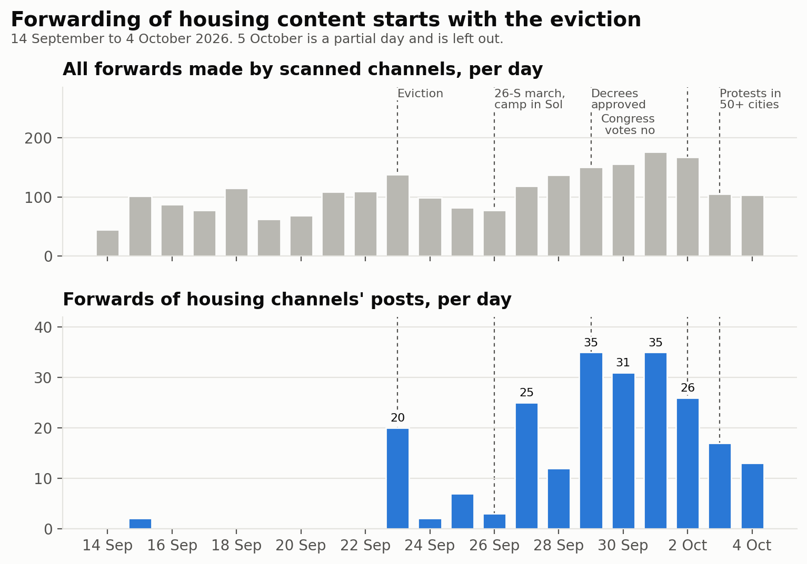

# Housing camps on Telegram, Spain, September–October 2026

A study of the public Telegram channels of the Spanish housing movement and their
allies during the housing camps that followed the Maricarmen eviction in Madrid:
how the channels were sampled and classified, and what their forwarding and mention
networks show.

- **Observation window:** 14 September to 5 October 2026
- **Sample:** 167 public channels — 24 housing organisations, 91 allies, 50 media
- **Data:** 22,111 messages scanned, 2,403 forwards, 2,049 mentions and links to other accounts
- **Report date:** 5 October 2026

## Reports

| Document | What it covers |
|---|---|
| [Technical report](acampadas_vivienda_technical_report.md) | Summary of findings, results, full methodology, limitations |
| [Community analysis](community_analysis.md) | Community detection on the forward and mention networks, stability, description of each community |
| [External channel review](external_review.md) | The rule used to decide which channels entered the sample and how they were tagged |
| [Evidence per channel (CSV)](external_review_log.csv) | One row per reviewed channel: counts, the decision, and the post kept as evidence |

## Main findings

1. **Housing channels are sources, not relays.** Allies forwarded housing content 156
   times; housing channels forwarded ally content 12 times.
2. **One hub.** The Sindicato de Inquilinas de Madrid is forwarded by 14 channels across
   Madrid, València and Andalusia; no other housing channel is relayed by more than 7.
3. **Forwarding starts with the eviction.** Forwards of housing channels' posts go from
   0–2 a day before 23 September to 20 that day, and peak at 35 a day.
4. **No single housing community.** The network clusters by territory and political
   current. Territorial housing clusters (Madrid, València, Málaga, the PAH) do not
   forward each other.
5. **The camp channels are not forwarded by anyone;** they appear only through mentions.

## About this site

- Only public Telegram channels and groups were read, without joining them.
- The reports are published as written for the project. They refer to scripts, data
  files and a Gephi graph that are **not** published here; only the documents listed
  above and the figures are.
- In the evidence file, individual user accounts and hidden-name forward origins are
  pseudonymised. Channels are identified by their public username.
- The sample is a snowball from a nine-channel seed, not a census. See the limitations
  section of the technical report before drawing conclusions.
